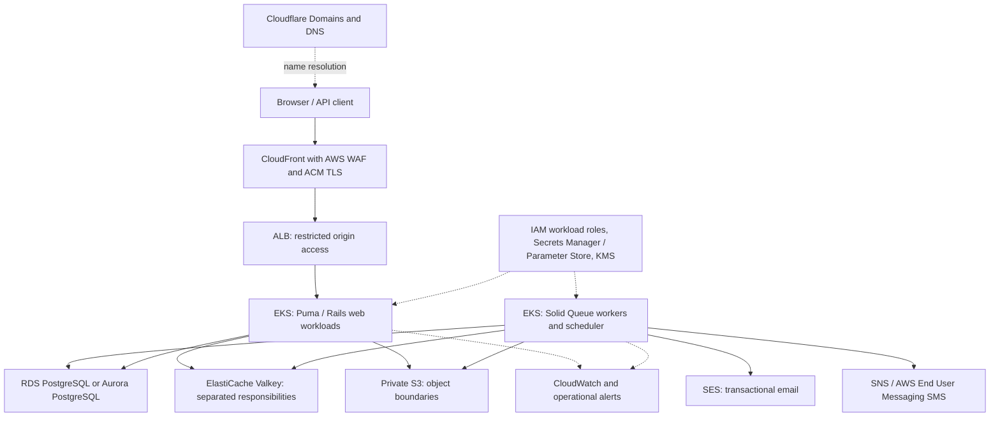

# AWS production service inventory

Status: Planning inventory, recorded on 2026-10-22. This document supports service selection and
budgeting; it does not claim that production resources exist or authorize provisioning, purchases,
configuration changes, or migration. Service sizes, AWS Region, availability targets and monthly
budget remain undecided.

## Owner requirements and current gaps

The owner has specified Cloudflare for domain registration and authoritative DNS, Amazon EKS for
deployment, and CloudFront with AWS WAF for every public request that reaches Rails. Other
application infrastructure should use AWS. The AWS mechanism and policy for rate limiting remain
undecided. Cloudflare Tunnel and development access are outside this production inventory.

This is a target, not the current deployment configuration:

- The accepted [edge-control ADR](../../adr/dos-and-firewall-controls-at-cdn-aws-edge-not-in-rails.md)
  still names ECS tasks. Its edge/origin isolation principles remain relevant, but its compute
  topology conflicts with the owner's EKS direction. Reconcile that ADR before implementation;
  this inventory does not silently rewrite its accepted requirements.
- [Production database configuration](../../config/database.yml) still reads `NEON_*` variables.
  Selecting RDS or Aurora does not automatically make those settings, roles, migrations, connection
  pools or replica endpoints AWS-ready.
- Existing [Terraform environments](../../terraform/environments/development/main.tf) model local
  object storage and streaming resources. They are not a delivered production EKS/CloudFront/WAF
  stack or evidence that MSK is needed by Rails.
- Google, Apple, Microsoft Entra ID and Cloudflare Turnstile remain external integrations where
  enabled. AWS hosting does not replace those providers. If "AWS except DNS/domains" also excludes
  Turnstile, its replacement is a separate application/security decision, not an infrastructure
  switch. Keep existing controls until an accepted replacement is implemented.

## Request path and supporting services

Cloudflare answers DNS queries; it is not an HTTP hop in the proposed DNS-only configuration.
AWS WAF is associated with CloudFront and evaluates requests there, rather than running as a
separate reverse proxy between CloudFront and Rails.

The ALB origin model is still a selection: CloudFront VPC origins can reach an internal ALB; a
public ALB requires explicit CloudFront-only admission. The existing ADR specifies the public-ALB
pattern with source restrictions and a secret origin header. Evaluate the private alternative and
record the selected pattern before deploying. AWS documents both
[VPC origins](https://docs.aws.amazon.com/AmazonCloudFront/latest/DeveloperGuide/private-content-vpc-origins.html)
and [ALB access restrictions](https://docs.aws.amazon.com/AmazonCloudFront/latest/DeveloperGuide/restrict-access-to-load-balancer.html).

## Services to include in the initial estimate

"Required capability" means the deployment needs that function. A candidate AWS product is not a
final selection. Many rows are usage-billed resources under the AWS account, rather than separate
vendor subscriptions. Check selected pricing plans for included features before adding line items.

| Capability | Service or candidate | Selection status | Main budget and setup inputs |
| --- | --- | --- | --- |
| Domain ownership and DNS | Cloudflare Domains / DNS | Owner-selected | Domains, renewals, DNS plan, DNS-only records pointing to CloudFront, validation records |
| Public HTTPS entry | Amazon CloudFront | Owner-selected | Request count, geography, delivered bytes, distributions, selected pricing plan |
| Edge filtering | AWS WAF on CloudFront | Owner-selected; rules undecided | Web ACLs, rule groups, inspected requests, logging, optional bot/CAPTCHA features |
| Certificates | AWS Certificate Manager (ACM) | Required TLS capability; AWS candidate | Public hostnames, validation, renewal ownership, edge and origin certificate placement |
| Kubernetes control plane | Amazon EKS | Owner-selected | Cluster count, Kubernetes support lifecycle, operating model and upgrades |
| Runtime compute | EC2 managed node groups or EKS Auto Mode; Fargate only after compatibility review | Choice required | Web and worker CPU/RAM, minimum capacity, AZs, scaling, node disks and add-on costs |
| HTTP origin load balancing | Application Load Balancer (ALB) | Proposed target | Origin isolation model, ALB count, capacity units, TLS, target registration and health checks |
| Container artifacts | Amazon ECR | Proposed target | Image storage, retention, pulls, image scanning and release provenance |
| Private network | Amazon VPC, subnets, security groups and routing | Required capability | AZs, pod IP capacity, inbound isolation, outbound paths, public IPv4 where allocated |
| Outbound access | NAT Gateway and/or VPC endpoints, based on destinations | Choice required | Gateway/endpoint hours, processed bytes, AZ placement, external IdP/JWKS and SMTP access |
| PostgreSQL persistence | RDS for PostgreSQL or Aurora PostgreSQL | AWS service choice required | Engine/version, writer/readers, Multi-AZ design, storage, I/O, backups and connections |
| Shared Valkey state | Amazon ElastiCache for Valkey | AWS candidate; compatibility gate | Cache, rate-limit and auth-state isolation, engine/mode, capacity, failover and eviction |
| Application objects | Amazon S3 | Existing production adapter targets AWS S3 | Avatar/publishing buckets, storage, requests, versions, lifecycle and delivery traffic |
| Background processing | EKS worker/scheduler capacity plus the PostgreSQL queue database | Existing Solid Queue implementation | Worker concurrency, scheduled jobs, queue depth and DB load; no separate queue service assumed |
| Transactional email | Amazon SES | Existing SMTP configuration targets SES | Sending Region, domain verification, production access, volume and bounce/complaint handling |
| SMS, if enabled at launch | Amazon SNS with AWS End User Messaging SMS provisioning requirements | Existing provider uses SNS Publish | Destination countries, sender registrations, production access, throughput and spend controls |
| Workload access and secrets | IAM roles plus EKS Pod Identity or IRSA; Secrets Manager or SSM Parameter Store; KMS | Required capability; mechanism choice required | Per-workload permissions, secret count, retrieval/rotation, key ownership and recovery |
| Monitoring and alert delivery | CloudWatch Logs, Metrics and Alarms; SNS for alert fan-out where selected | Required capability; proposed AWS target | Log volume/retention, metrics, alarms, dashboards, recipients and operator coverage |
| Infrastructure audit | CloudTrail with an explicit retention/delivery design | Required capability; proposed AWS target | Account/Region coverage, management/data event selection and storage |
| Recovery | RDS backup/PITR and S3 recovery policy; AWS Backup if centrally required | Required capability; implementation choice required | Recovery point/time targets, retention, restore drills and regional disaster strategy |
| Delivery and administration | Existing CI or AWS CodeBuild/CodePipeline; controlled EKS administration | Choice required | Build minutes/artifacts, deployment identity, private API access, release and rollback ownership |
| Financial operations | AWS Budgets, Cost Explorer, billing alerts and a support plan decision | Required planning/operations capability | Environment tags, owners, budget thresholds, support coverage and escalation |

EKS control-plane charges do not include all workload compute charges. Keep cluster, compute and
storage entries separate when estimating; the operating mode can introduce additional charges.
Use the current [EKS pricing](https://aws.amazon.com/eks/pricing/) and
[AWS Pricing Calculator](https://calculator.aws/) after selecting the Region and sizes.

## Configuration decisions that affect purchases

### CloudFront, DNS, certificates and origin access

- Use Cloudflare DNS-only records for application hosts so CloudFront is the public HTTP entry.
  Zone-apex records can use Cloudflare's
  [CNAME flattening](https://developers.cloudflare.com/dns/cname-flattening/set-up-cname-flattening/).
  Preserve certificate/provider verification CNAMEs; flattening all CNAME records can interfere
  with verification. Route 53 public hosted zones or domain registration are not required by this
  owner-selected DNS design. Any private DNS requirement is a separate VPC decision.
- Inventory the actual app/com/org/net/dev hosts from the
  [routing inventory](../../README.md#routing) and production URL configuration. Choose distribution
  and certificate grouping without merging surface controllers, cookies, sessions or state.
- CloudFront certificates must be provisioned/imported in `us-east-1`. Plan a separate certificate
  in the workload Region if using HTTPS on the ALB. See
  [CloudFront alternate-domain HTTPS](https://docs.aws.amazon.com/AmazonCloudFront/latest/DeveloperGuide/cnames-and-https-procedures.html).
  A wildcard for one domain does not cover other TLDs or arbitrary hostname depths.
- A CloudFront-scoped WAF web ACL uses the global scope managed through `us-east-1`; this does not
  require moving EKS or PostgreSQL into that Region. See
  [AWS WAF resource scope](https://docs.aws.amazon.com/waf/latest/APIReference/API_CreateWebACL.html).
- Preserve the original surface host and the required cookies, authorization, query parameters,
  methods and protocol information through the origin policy. Start authenticated and ceremony
  paths with caching disabled. A positive minimum TTL can cache responses despite `no-store` or
  `private`; verify policies rather than relying solely on Rails headers. See
  [cache policy TTL behavior](https://docs.aws.amazon.com/AmazonCloudFront/latest/DeveloperGuide/cache-key-understand-cache-policy.html).
- Restrict ALB admission and pod reachability, establish trusted proxy handling for viewer IPs,
  and test direct-origin refusal. A DNS name pointing to CloudFront alone does not enforce the path.
  Verify protocol, Region, subnet and security-group compatibility before selecting VPC origins.

### EKS networking and process roles

Run web processes and Solid Queue processing as separately scaled workloads. Include worker,
dispatcher and recurring-scheduler responsibilities from [queue configuration](../../config/queue.yml)
and [recurring jobs](../../config/recurring.yml). Plan controlled migration Jobs and internal health
checks. Vite development servers and development emulators are not production dependencies.

Select managed node groups versus Auto Mode before adding controllers and storage/network add-ons.
ALB integration needs the matching controller mechanism; Auto Mode supplies managed integration,
while the conventional model uses AWS Load Balancer Controller. See
[EKS load balancing](https://docs.aws.amazon.com/eks/latest/best-practices/load-balancing.html).

Private workloads need outbound connectivity for AWS APIs and enabled external integrations.
VPC endpoints cover selected AWS services, not Google/Apple/Entra or arbitrary public JWKS URLs.
Budget the chosen egress path and per-AZ endpoints, including ECR/S3 image pulls, secrets and logs.
See [private-cluster dependencies](https://docs.aws.amazon.com/eks/latest/userguide/private-clusters.html).

### PostgreSQL and Valkey

Use [database configuration](../../config/database.yml) and the
[model/database inventory](../architecture/model-database-inventory.md) to enumerate required
logical databases and roles. Logical database count is not automatically RDS instance count.
Physical consolidation requires an explicit design preserving the existing ownership boundaries.
Verify supported engine versions, `citext`, `pgcrypto`, `btree_gist`, permissions, migration behavior
and total connection pools before choosing capacity. Managed PostgreSQL restricts some privileged
operations; see [RDS PostgreSQL](https://docs.aws.amazon.com/AmazonRDS/latest/UserGuide/CHAP_PostgreSQL.html).

Choose RDS PostgreSQL versus Aurora, availability and read topology together. A conventional RDS
Multi-AZ DB instance standby is not a read endpoint; a Multi-AZ DB cluster has a different topology.
Do not count a standby as the application's replica configuration. See
[RDS Multi-AZ models](https://docs.aws.amazon.com/AmazonRDS/latest/UserGuide/Concepts.MultiAZ.html).
RDS Proxy is conditional on measured connection needs and compatibility, not a default purchase.

Valkey has three production responsibilities in [its configuration](../../config/valkey.yml): cache,
rate limits and authentication state. Choose isolation, capacity, eviction and failure behavior for
each; a general cache policy must not silently determine authentication continuity behavior.
The auth-state adapter uses a Redis client and Lua-backed operations. Test TLS/authentication,
command support, scripts, cluster routing and logical database selection against the exact
ElastiCache engine/mode. Serverless and node-based modes are not automatically interchangeable;
AWS behavior also varies by engine version. See
[ElastiCache configuration](https://docs.aws.amazon.com/AmazonElastiCache/latest/dg/RedisConfiguration.html).

### Object delivery, email and SMS

Production [Shrine configuration](../../lib/object_storage_shrine_configuration.rb) uses S3 with
the AWS credential provider chain and private storage. The existing
[bucket module](../../terraform/modules/object_storage/main.tf) blocks public access. Keep avatar
and publishing ownership explicit. If objects are delivered directly through CloudFront, configure
OAC for the private S3 origin and separately decide viewer authorization for private objects; OAC
alone authenticates CloudFront to S3. Upload delivery and signed S3 URLs need an explicit decision
if the CloudFront-only requirement is extended to all object traffic. See
[S3 origin access control](https://docs.aws.amazon.com/AmazonCloudFront/latest/DeveloperGuide/private-content-restricting-access-to-s3.html).

SES requires verified sender identities and production-access planning per sending Region. Put
DKIM and other required email DNS records in Cloudflare, and assign bounce/complaint suppression
ownership. SES SMTP credentials in [production configuration](../../config/environments/production.rb)
are distinct from SDK workload identity. See
[SES production access](https://docs.aws.amazon.com/ses/latest/dg/request-production-access.html).

The [SMS adapter](../../app/services/outbound_sms_providers_aws_sns.rb) publishes through SNS.
Provisioning may require production access, registered sender identities/numbers and country-specific
approval. Set account spend controls and alerts, while retaining application destination budgets.
See [SNS SMS sandbox](https://docs.aws.amazon.com/sns/latest/dg/sns-sms-sandbox.html) and
[AWS End User Messaging production access](https://docs.aws.amazon.com/end-user-messaging/latest/userguide/nx-sms-scale-sandbox.html).
If SMS is not a launch requirement, defer activation explicitly rather than budget it as mandatory.

### Access, secrets, operations and recovery

Use per-workload IAM permissions. S3 already supports platform credentials; the SNS adapter currently
constructs credentials explicitly, so EKS Pod Identity cannot be assumed to work without application
changes. Select Pod Identity or IRSA with supported SDKs, and select secret delivery compatible with
the EKS compute mode. Preserve the Rails encrypted-credentials contract while deciding how its
decryption key and other required secrets reach workloads. See
[EKS Pod Identity](https://docs.aws.amazon.com/eks/latest/userguide/pod-identities.html),
[EKS secret mounts and limitations](https://docs.aws.amazon.com/eks/latest/userguide/manage-secrets.html)
and [Secrets Manager encryption](https://docs.aws.amazon.com/secretsmanager/latest/userguide/security-encryption.html).

CloudWatch is the proposed operational signals destination; CloudTrail addresses AWS control-plane
activity. Neither replaces authoritative application audit records in PostgreSQL. Estimate log
retention and volume, including WAF/ALB/EKS signals, without exporting credentials or sensitive
request payloads. Assign alert recipients and recovery access. See
[CloudWatch and CloudTrail responsibilities](https://docs.aws.amazon.com/decision-guides/latest/decision-guides/cloudtrail-or-cloudwatch.html).

Define backup retention and restore tests for databases, objects and required key material.
Database failover is not a substitute for recovery from deletion or a regional outage. Consistency
across the application's separate databases and queue replay needs an explicit recovery procedure.
AWS Backup, cross-Region copies, additional security services and paid support should be selected
against recovery and response requirements rather than assumed to be included in EKS.

## Rate limiting remains a separate decision

WAF is selected; the rate-limit mechanism and rules are not. WAF rate-based rules are a candidate
for coarse edge traffic control, but AWS explicitly describes approximate enforcement, not an exact
request counter. They do not replace atomic per-destination OTP budgets or durable email/SMS cost
accounting. See [AWS WAF caveats](https://docs.aws.amazon.com/waf/latest/developerguide/waf-rule-statement-type-rate-based-caveats.html).
AWS Budgets notifications can also lag incurred charges; they are financial alerts, not a synchronous
send gate. See [Budgets behavior](https://docs.aws.amazon.com/cost-management/latest/userguide/budgets-managing-costs.html).

Keep the eight deferred application work items separate:

- [Login](../backlog/2026-10-22-login-rate-limit-guarantees.md)
- [Email sign-up](../backlog/2026-10-22-email-sign-up-delivery-limits.md)
- [Telephone sign-up](../backlog/2026-10-22-telephone-sign-up-delivery-limits.md)
- [Sign-in OTP resend](../backlog/2026-10-22-sign-in-otp-resend-limits.md)
- [Sign-up confirmation resend](../backlog/2026-10-22-sign-up-confirmation-resend-limits.md)
- [Step-up email OTP](../backlog/2026-10-22-step-up-email-otp-delivery-limits.md)
- [Password reset](../backlog/2026-10-22-password-reset-abuse-policy.md)
- [Invitation email](../backlog/2026-10-22-invitation-email-abuse-policy.md)

## Services not established as launch requirements

| Service | Reason to defer selection |
| --- | --- |
| SQS | Current Active Job backend is Solid Queue on PostgreSQL. Replacing it needs application design and migration. |
| MSK / Kafka | Local Terraform contains streaming resources, but inspected application dependencies/configuration do not establish an active Kafka client or consumer requirement. |
| Cognito | Existing authentication ownership remains in this application and enabled external IdPs. Moving it is a separate architecture change. |
| API Gateway | CloudFront/WAF/ALB already form the proposed Rails entry; add it only for a concrete additional API requirement. |
| Route 53 public DNS / registrar | Cloudflare owns these functions in the requested topology. |
| EFS | S3 handles current production uploads; require a demonstrated shared filesystem use case. |
| OpenSearch / managed search | A database connection named `search` does not establish a search-cluster dependency. |
| Shield Advanced, paid WAF bot features, GuardDuty, Security Hub, Inspector, Config | Evaluate security/response requirements, included capabilities and extra charges individually; do not assume all are necessary or already enabled. |
| EventBridge Scheduler | Solid Queue already has recurring jobs; add a managed scheduler only for a separate operational requirement. |

## Decisions needed for a costed proposal

| Decision | Information needed |
| --- | --- |
| Launch scope | Public surfaces/hosts, enabled sign-in providers, email/SMS countries and whether SMS launches |
| Region and environments | Primary Region, production/staging isolation, AWS accounts and cluster count |
| Availability and recovery | Allowed downtime/data loss, AZ design, restore targets and operator coverage |
| Traffic | Peak requests/second, monthly requests, CDN egress geography/bytes, upload sizes and retained objects |
| Runtime | Web/worker resource measurements, concurrency, workload count, compute operating mode |
| Persistence | Database sizes/growth, read topology, role isolation, connections, Valkey capacity and behavior |
| Communications | Monthly/peak email and SMS volume, sender identities, registration lead times and abuse budgets |
| Operations | Logs/day and retention, alarms, deployment frequency, build minutes, support plan and spend ceiling |

First estimate the owner-selected edge/EKS stack plus PostgreSQL, Valkey, S3, SES, runtime compute,
networking, access/secrets and operational recovery. Add SMS only for the accepted launch scope.
Resolve compatibility gates before commitments or capacity reservations. Record an explicit
approved configuration and quote later; this inventory contains no price promise or purchase.

## Inspection limits

Repository inspection used commit `febec3225cc9a0cfa53b9cbe817d20d366aba5a2` and the existing dirty
worktree on 2026-10-22. Official vendor sources linked above were consulted on that date. Service
availability, pricing and account quotas must be rechecked when selecting a Region and ordering.
No AWS/Cloudflare account configuration was inspected, no Terraform plan/apply was run, and no
production boot, failover, load test or delivery test was performed. This documentation change
does not establish production readiness.
