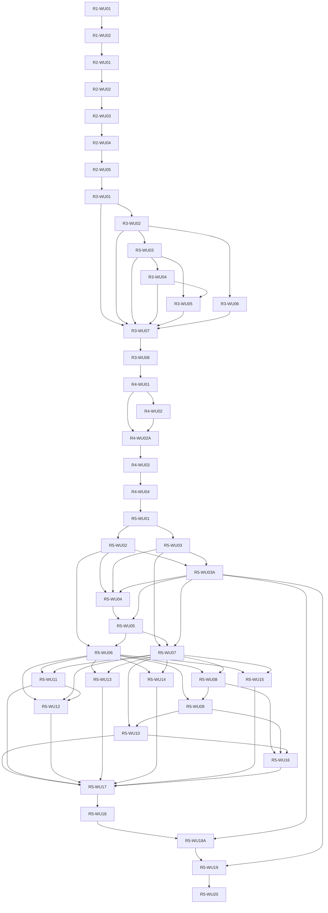

# OP/RP Separation — Implementation Specification

> Archived snapshot, generation 0001 (originally `one.md`). Non-normative and not evidence; see
> [README](./README.md).

[Implementation Specification Supplements](./addenda.md#one-addenda)

Status: **R1-WU01 was started under explicit user I approval on 2026-10-16 and paused by the user
the same day for specification corrections (reviewer corrections of 2026-10-16, see `five.md`
MISC-20261016-0005); its uncommitted worktree changes are preserved and are not accepted results.
The user then approved the section 1.2A approval model, under which R1-WU01 resumes. Final Sol
static design review complete. Release-specific S/D/E and runtime acceptance remain separate; no
Gate is closed by approval alone**.

Baseline: local `feature`, HEAD `17903f7d121aa33efe29f2db9235c9aa5db4b001`, checked 2026-10-16;
tracked worktree and untracked-file status were clean at this revision's start. Earlier
dirty-worktree/Checkpoint observations are history, not current Git status. Source facts, target
requirements and proposed implementations are distinguished below; no application/DB/network
acceptance ran for this specification; scoped R1 test runs after implementation began are recorded
only in `evidence/2026-10-16-r1-context-implementation-R1C1.md` and do not close any Gate.
[nine.md](./planning-discussion.md) is historical discussion, not executable instructions.
Coordination owner: Codex Sol. Future implementation owner: Codex Luna Max after applicable
approval.

## 1. Purpose, Scope and Document Control

Separate authentication persistence and authority so that compromising one RP database cannot mint
OP credentials, revive a revoked grant, authenticate with only a local session, or read another
surface's private state. Preserve existing domain authorization while making future
process/repository separation possible without redesigning OAuth.

Success means:

- Every authenticated RP request requires a valid unexpired exact-client Access JWT and a live
  session in that cell's own store.
- RP execution has no OP signing key or OP/Zenith/other-cell database credentials, and uses declared
  HTTPS contracts for authentication and canonical domain operations.
- Each of the twelve logical RP implementations in this repository is migrated, including
  Core/Warp/Palm. Current programme runtime completion covers Worldwide5 plus JP7 in the JP
  development environment. JP and US have distinct fixed catalog identities and reject cross-region
  credentials; US operational key/URI/Session DB bindings and runtime activation remain deferred
  until an independently approved US environment exists. US runtime stays NOT_RUN and does not block
  JP completion or inherit JP evidence.
- Waiting has no root session, OP grant or RP authentication; old status 103 authenticates on no
  path. The full-access and one-waiting limits are enforced under concurrency.
- Code/Refresh/reissue preserve Org alternative authentication context; Step-Up remains unavailable
  to that context.
- Refresh rotation, replay detection and the five-second delivery receipt remain safe under HTTP
  response loss.
- Logout is established at committed OP revocation/outbox; local delivery and cookie purge are
  separate outcomes.
- Migration history, schema ownership and security invariants hold across independently verified
  release transitions; development/test database contents are rebuilt rather than preserved (section
  1.2A).

### 1.1 Authorized scope and release policy

The design-document cycle is complete. On 2026-10-16 the user separately granted I for R1-WU01. Sol
coordinates its scoped implementation by Luna Max; other units remain subject to their approvals.
The user also granted D for R1 tests on the twenty existing isolated databases identified by
`tmp/acceptance-isolated-20261016w6n2.json`, using one worker and allowing fixture writes only. That
D excludes database creation, deletion, reconstruction, migrations, and changes to ordinary
development/test databases. The user's final design instructions establish H-1 through H-4, M-1
through M-4 and L-1; neither those instructions nor this scoped I/D grant blanket authorization for
other releases, credential cutoff, deployment or external writes. A test runner that would prepare a
database remains outside the approved scope. Section 1.2A (later on 2026-10-16) supersedes these
scope limits: I covers all Work Units and the standing development/test D replaces the
isolated-fleet D.

Future implementation proceeds as five independently bootable releases: R1 Context; R2 Session Limit
and retired-103 cleanup; R3 mechanical DB/Record/Grant naming; R4 target Client IDs; R5 OP/RP
protocol and persistence separation. Each release closes its own acceptance before the next
activation. R3 is not held until R5. R4 uses the existing shared-authority implementation with
corrected target bindings until R5 replaces that implementation.

Development and test databases are disposable and are rebuilt rather than preserved (section 1.2A).
The user confirms no current production fleet and no deployment of this Rails repository. Retain and
consistently rename future production configuration where applicable, but perform no production
migration or fictional fleet verification. Jump and Edge are read-only external contract
dependencies. Regional and Publishing development stays in this repository. Palm is a Browser RP;
native/mobile authentication is a future cycle.

### 1.2 Canonical documents and approvals

| Document                                        | Authority                                                                                                       |
| ----------------------------------------------- | --------------------------------------------------------------------------------------------------------------- |
| `one.md` plus approved One Addenda in `four.md` | Implementation definition; one current definition per concept                                                   |
| `two.md` plus approved Two Addenda in `four.md` | Acceptance definitions and later detailed verification procedures                                               |
| `three.md`                                      | Append-only actual implementation reports and subsequent decision history; not a silent specification amendment |
| `four.md`                                       | Uniquely identified, explicitly approved supplements; conflicting proposals require a user decision             |
| `five.md`                                       | Non-normative notes and references                                                                              |
| `nine.md`                                       | Historical discussion; old U/CID/IW instructions are not executable                                             |

The user-requested five-file layout is the change's document location. Do not create a competing
copy under `specs/`. Later durable explanations, diagrams, checklists and accepted ADR amendments
are promoted by their owning Work Unit; they do not duplicate this change specification.

Approval codes used in Work Units:

- **I:** a separate user implementation instruction after this design review. Granted for all Work
  Units by section 1.2A.
- **S:** approval of the specific persistence/wire Before/After shape before implementation, as
  required by `generic/data-shape-design.mdc`. Section 6 supplies the shape proposal, with any later
  field changes reviewed before code. Approval of the design is not inferred from writing this file.
  Section 1.2A approves section 6 as written; changes beyond it still need review.
- **D:** separate explicit risk/recovery and exact-target approval for real data operations,
  including populated development/test changes, physical rename, credential cutoff and new local
  store construction. Authorization for source/migration preparation is not D. For local
  development/test databases D is a standing grant (section 1.2A).
- **E:** separate external-owner authorization for any external activity that writes
  authentication/session state. No Jump/Edge source/configuration writes are in scope.

Each code packet protects dirty work, loads its applicable AGENTS rules, preserves required
admission/CSRF/control order and updates the affected current diagram/inventory/checklist in the
same change. Configuration/environment construction is verified by authorized actual execution and
evidence, not new setup-subject Minitest/Vitest. Proposed symbol names below obey repository
object-root/suffix rules; historical names are not renamed merely for style.

### 1.2A Approval model and disposable development/test data (user decision, 2026-10-16)

The user approved this model in conversation on 2026-10-16 (recorded in `six.md` section 5.3). It
replaces the per-unit grant practice described elsewhere in this file. Where another clause asks for
a separate I, S or D that this section grants, this section governs.

- **I (granted):** every Work Unit from R1-WU01 through R5-WU20, executed in DAG order and closed
  through its Gates. R1-WU01 resumes under this grant.
- **S (granted):** the shapes in section 6 as written. A field, constraint, endpoint or wire change
  beyond section 6 stops the affected unit and is reported to the user before code.
- **D (standing grant):** development and test databases are disposable. The user routinely drops
  and rebuilds them and preserves none of their contents. For the local development and test
  databases named by the repository's development/test configuration and validated isolated
  manifests, creating, dropping, recreating, migrating, seeding, fixture writes, credential or
  session invalidation and renaming by rebuild are approved without further questions.
  DatabaseSafety stays in force so that each command reaches only its intended environment.
  Production, remote or managed databases (for example Neon) and any target not named by that
  configuration are outside this grant.
- **Still individually approved by the user:** (a) any amendment to the successor sign-out ADR,
  which the user Accepted on 2026-10-16 (section 10); (b) R5-WU03A redistribution or re-encryption
  of credential and master-key material; (c) anything outside the local development/test databases,
  including production execution, external services, CI changes and deployment.
- **E:** Jump and Edge writes remain excluded; read-only contract checks are permitted.
- Escalation in section 1.3 is unchanged: Critical/High findings and contract conflicts stop the
  affected scope and are reported.

Consequences: backup, restore rehearsal, snapshot preservation and populated-data reconciliation
apply to no current environment. Each release reaches its target state on development/test by
rebuilding from the migration history (clean construction). Migration history stays byte-preserved
and forward-only, and future production configuration rules still apply. Security rules about never
reviving revoked credentials remain design rules; a restore or preserved-upgrade rehearsal is
NOT_APPLICABLE with reason `NO_PRESERVED_ENVIRONMENT` until a data-bearing environment exists, which
would need a new user decision.

### 1.3 Escalation

When two accepted decisions, or a decision and a mandatory current contract, cannot both hold, stop
the affected scope and report: exact conflict and source, affected release/unit/cell, options, cost,
security consequences and recommendation. Critical/High or implementation-stopping discoveries are
reported to the user as well as recorded in `three.md` during implementation. Ordinary technical
choices do not require renewed decisions. A scoped NO-GO is always reported, never silently filed.
Existing decisions are not automatically invalidated by an agent.

## 2. Terms and Decisions

| Term                                            | Definition                                                                                                                                                 |
| ----------------------------------------------- | ---------------------------------------------------------------------------------------------------------------------------------------------------------- |
| Realm                                           | app/Client, com/Visitor, org/Operator; independent issuer and authentication state                                                                         |
| Logical RP                                      | One family and realm, such as Core app; twelve kinds                                                                                                       |
| Concrete client / cell                          | One logical RP and deployment scope, such as `core-app-jp` or `base-org-ww`; independent client credentials, registered URIs, local store and activation   |
| WW                                              | Worldwide scope for Base Self-RP, Edit and Tech; not a region code                                                                                         |
| Region                                          | Approved trusted deployment scope, initially `jp` or `us`; never selected by request `ri`, Host or claims                                                  |
| Root / browser login unit                       | One OP full-access browser session; one unit in realm session limits, irrespective of downstream RP grants or Refresh generations                          |
| OP grant                                        | OP-owned RP authorization/Refresh authority, currently `*RpSession`; distinct from RP Local Session                                                        |
| OP `sid`                                        | Client-scoped OP grant session identifier. Current exchange uses usage/grant `public_id`; it is not the RP local ID or necessarily the root ID             |
| Waiting                                         | Authenticated pending sign-in, not Full Access: purge-one/cancel and explicit completion of its own flow when capacity opens; no general principal/session |
| Restricted 103                                  | Historical token-status row retained for history; not an active authorization feature                                                                      |
| Authentication context                          | Session-origin context, Normal versus Org Standby (currently encoded `emergency`); independent of status 103 and Step-Up freshness                         |
| Authentication / Authorization / Data Authority | Issuer/session owner / current domain-permission decision owner / canonical domain writer; independent roles even in one process                           |

| Decision                                                                  | Effective contract                                                                                                                                                                                                           |
| ------------------------------------------------------------------------- | ---------------------------------------------------------------------------------------------------------------------------------------------------------------------------------------------------------------------------- |
| D-01                                                                      | `tech.access` uses same-realm Base's specific org Zenith-backed capability authority, current writer state, fail closed and no positive permission cache.                                                                    |
| D-02                                                                      | Current identity for Base high-risk decisions and all new issuance/Refresh; bounded old-Access use on ordinary RPs; explicit Zenith -> OP -> RP durable propagation, no distributed-transaction fiction.                     |
| D-03 / D-06, resolved by P-8                                              | Waiting is a Base sign-in flow, not a Restricted token. No status-103 writer, Restricted current-state endpoint, restriction notification/outbox or restriction fence. Historical 103 is rejected everywhere.                |
| D-04 / D-10                                                               | Preserve implemented important ActionPolicy guarantees; defer unfinished business permissions. Domain owners keep canonical policy and writes.                                                                               |
| D-05                                                                      | Preserve migration history, DatabaseSafety and the audit/security semantics of the code. Development/test database contents are disposable (section 1.2A, superseding the earlier preservation of development/test records). |
| D-07                                                                      | Breaking target-only 11-character Client IDs. No old-profile verifier, old-family bridge, Dual Registry, key fallback or long drain. Preserve old rows/history while disabling authentication.                               |
| D-08                                                                      | Logout succeeds at OP revocation/outbox commit; ACK/purge are follow-up, never a success prerequisite.                                                                                                                       |
| D-09 plus current scope correction                                        | No Regional infrastructure redesign or repository split. In-repository Regional surfaces are implementation targets. Logical cell-specific stores are bound by trusted deployment; no OP process manages a JP/US fleet.      |
| D-11                                                                      | Offline physical and logical rename with no permanent old aliases; source preparation and actual data operations are separate.                                                                                               |
| P-1/P-8                                                                   | One Waiting slot; additional authenticated attempts refused; no MFA-reset access from Waiting or 103.                                                                                                                        |
| P-2/P-3                                                                   | R1-R5 independent; current production fleet absent; Core/Warp/Palm and Publishing remain inside this repository.                                                                                                             |
| P-4/P-5/P-6/P-7                                                           | Explicit conflict escalation, mechanically derived route/callback coverage, a single implementation definition, and per-cell acceptance.                                                                                     |
| P-9 / H-1, user confirmation in the current final integration instruction | Waiting reserves no capacity. Eligible explicit continuation and new sign-in serialize on the same actor; first valid final commit takes capacity.                                                                           |

P-9's normative source is the user's current H-1 confirmation. `MISC-20261016-0002` preserves prior
discussion; no missing answer is attributed to `nine.md`. H-2 places WW5 plus JP7 in JP development;
H-3 assigns R4 environment binding; H-4 assigns R5 effective secret/process isolation. M-2 requires
explicit Continue on free capacity. These decisions require no repeated question.

## 3. Observed Current State and Source Baseline

| Source inspected                                                                                               | Current fact / consequence                                                                                                                                                                                                                                                                                                                                                                                                                           |
| -------------------------------------------------------------------------------------------------------------- | ---------------------------------------------------------------------------------------------------------------------------------------------------------------------------------------------------------------------------------------------------------------------------------------------------------------------------------------------------------------------------------------------------------------------------------------------------- |
| `app/services/oidc_token_exchange_coordinator.rb`, `authentication_jwt_tokens.rb`                              | OIDC refreshed/exchanged access encodes omit `authentication_context`; local JWT issuance passes it. R1 repairs all observed omission paths first.                                                                                                                                                                                                                                                                                                   |
| `app/services/core_browser_credential_contract.rb`                                                             | A third `AuthenticationTokenService.encode` caller, `CoreBrowserCredentialContract.encode_access_token` (audience `core-browser`), also omits `authentication_context`. A static search at the baseline found callers only in tests (`test/integration/core_browser_api_boundary_test.rb`), not in application code; this is a source observation, not a complete runtime inventory. R1-WU01 classifies it explicitly.                               |
| `app/values/authentication_context_value.rb`                                                                   | Known `normal`/`emergency`; missing claim currently becomes Normal, unknown nonblank becomes UNKNOWN. `permits_rule?` permits ordinary policies for the alternative context; Step-Up is denied. R1 must not rely on missing-token-claim fallback. Current continuity tests and org schema explicitly allow NULL root context as canonical Normal storage; that is distinct from a missing JWT claim.                                                 |
| `authentication_current_resource_resolver.rb`, `browser_rp_authentication.rb`                                  | Root resolver uses ACTIVE; Browser RP chain calls root `currently_usable?` without explicit status check. Old 103 can reach the broad guard on that path. R2 closes the authentication boundary before removing guard branches.                                                                                                                                                                                                                      |
| `SessionLimitResolutionTransactionable`, `LocalAuthenticationSessionCommitter`, `AuthenticationBase`           | 15-minute resolution; open states 10/20; issue lookup is per sign-in flow, not unique per actor. Actor locking exists for root issuance. R2 completes actor-slot enforcement across all paths.                                                                                                                                                                                                                                                       |
| `base/{app,com,org}/sign/in/limitations_controller.rb`, `base_sign_in_limitations.rb`, `config/routes/base.rb` | All three Controllers exist; com/org share the Concern. Three `resource :limitation` declarations expose show/update/destroy (GET, PATCH/PUT, DELETE by the resource declaration; no explicit POST). R2 adds POST at that same path for the existing update Action. Routing is source evidence; runtime recognition/behavior is NOT_RUN. The current common path resolves before later issuance; R2 must preserve the slot through actual promotion. |
| `docs/security/session-limit.md`, committed `adr/root-login-establishment-boundary.md` and Mermaid inventory   | Waiting is documented ahead of implementation with pending/UNCONFIRMED markers. These files are committed at the baseline HEAD; documentation is not proof of delivered behavior.                                                                                                                                                                                                                                                                    |
| `*TicketRecord`, `config/database.yml`                                                                         | Three OP stores use old logical/physical Ticket names; new names do not exist by assumption. Writer/reader and isolated test manifests need coordinated rename.                                                                                                                                                                                                                                                                                      |
| `AppRpRecord/ComRpRecord/OrgRpRecord`                                                                          | Abstract descendants of Zenith Records; remain canonical Global state despite RP in their names.                                                                                                                                                                                                                                                                                                                                                     |
| `AuthBoundaryAuthorityMap`, `RegionalRpClientMatrix`                                                           | Runtime IDs include unsuffixed Core/Warp/Edit/Palm/Tech; predeployment matrix contains Core/Warp regional entries and old Edit; target is not fully activated.                                                                                                                                                                                                                                                                                       |
| `OidcRefreshDeliveryReceipt`, `OidcRpTokenClient`                                                              | Receipt TTL is five seconds; token client open/read timeouts are 2/5 seconds. No valid end-to-end recovery budget follows from those values alone.                                                                                                                                                                                                                                                                                                   |
| `app/models/security_consumed_jti.rb`                                                                          | Current consumed-JTI model uses `AppTicketRecord`. Its authentication consumers must be split by receiving realm/owner rather than reused as a hidden app-DB dependency from every verifier.                                                                                                                                                                                                                                                         |
| `PublishingEntryPolicy`, Management concerns and Publishing Operations                                         | Canonical active Operator policy at controller boundary; Publishing-specific Operations mutate Publishing data. Entry locks/constraints are not an atomic Zenith permission lock.                                                                                                                                                                                                                                                                    |
| `README.md`, `adr/global-regional-database-ownership.md`                                                       | No current production/CD deployment; Regional repository is future. In-repository controllers are real consumers, not an external owner to wait for.                                                                                                                                                                                                                                                                                                 |

Planning did not load Rails, enumerate live routes, query DB catalogs, contact external systems or
run application tests. Static file matches are not complete consumer inventories. Each unit confirms
its narrow baseline at execution time; full ownership generation in R5 does not delay R1.

## 4. Final Architecture and Trust Boundaries

### 4.1 Owners and execution roles

| Role                            | Owns                                                                                                                                 | Calls / restrictions                                                                                                       |
| ------------------------------- | ------------------------------------------------------------------------------------------------------------------------------------ | -------------------------------------------------------------------------------------------------------------------------- |
| OP app/com/org                  | Root, Code, Grant, Refresh Family/Generation/replay/receipt, Step-Up, logout flow/outboxes, authentication revocation                | Canonical identity through the explicit internal identity authority at its writer. Never opens RP databases.               |
| Zenith realm authority          | Global identity/credentials, existing account/organization graph and policies, identity epoch and identity-change outbox             | Its own writer; sends durable invalidation intent to OP. Not an RP store.                                                  |
| RP cell                         | Local Principal/IdentityBinding/Session, callback state, replay receipt, refresh-attempt coordination and absorbing logout tombstone | Public same-realm OP HTTPS/JWKS and concrete domain HTTPS. No Global authority model/credential, other RP DB or OP signer. |
| Domain authority                | Current canonical policy and business Operations/DBs: Publishing, Avatar, Organization, IAM, Support, Enforcement                    | Validates subject/client/realm/resource/action itself; OP only supplies authentication facts.                              |
| Auth                            | Credential ceremonies, evidence, admission and browser-bound pending authentication flows                                            | No general root/Access/Refresh authority and no OAuth RP participation.                                                    |
| Xper                            | Existing nonparticipant behavior                                                                                                     | No registration/session store introduced.                                                                                  |
| Global/Regional/Publishing code | Same current repository, different runtime roles and canonical responsibilities                                                      | Fixed deployment selects cell and credentials. A shared repository does not merge JP and US clients or stores.             |

Common Rails algorithms, Concerns, immutable Values and protocol adapters are shared. DB connection
classes and process credentials are role-specific. Configure actual RP processes/isolated role boots
with only that cell's database and assertion private key; OP-only records must not establish eager
connections in those boots. Static scans and actual credential-denied role execution verify this.
Co-location with all credentials in one process does not prove secret isolation; activation requires
the role-isolated boot/probe, while the repository/application remain one codebase.

Role boot uses one required trusted execution-role configuration and, for an RP role, its immutable
deployment binding. Effective database configuration and secret provisioning include only that
role's owners; rendering another role's configuration must not fetch unavailable credentials or open
its connections. An RP must not receive a universal Rails credential decryption key/file that also
exposes OP signing material, or an OP secret mount hidden behind unused code. Use the existing
credential provisioning mechanism with role-specific bundles/visibility; do not invent a second
secret-management framework. An actual shared-master-key deployment fails the isolation Gate even if
its code never calls the signer.

TLD authentication sessions are never shared. Existing stateless com-to-org application exception
remains scoped. Support's existing org-operator app/com administration is a fixed domain-command
contract, not cross-realm OAuth login or acceptance of an org token as an app token. A signed org
caller is verified against org issuer/client by the org Support authority, then its existing
target-specific capability selects the downstream internal owner. No app/com RP accepts that
credential as its own user session.

### 4.2 Canonical domain operations

RP Local Principal is explicit local authentication state, not a `Client`/`Visitor`/`Operator`
subclass. Canonical ActionPolicy executes with a current real actor and canonical scoped record at
the domain authority. Preserve actor lifecycle, tenant/collective/resource boundaries, audit
identity, optimistic versions and existing constraints. A local allow result or Operator ID from the
RP is never authority.

Tech uses a specific capability HTTPS contract on same-realm Base, backed by current org Zenith
`OperatorCapabilityGrant`. A check beginning after revoke commit denies; current writer read and
real actor validation are mandatory. No cross-request positive cache. A check that completed before
revoke may already be in flight; retain any existing final-write recheck/stronger ordering. Whole-RP
every-request introspection is absent.

Publishing keeps
`Publishing::{CreateEntry,ReviseEntry,PublishEntry,EndPublication,ArchiveEntry,UnarchiveEntry}Operation`,
`PublishingEntryPolicy` and its `publishing` store. Proposed `PublishingAuthorityClient` and
Publishing-owned controllers carry only current entry/publication/archive requests. Owner verifies
signed identity/client/realm, fixed content cell, scoped public resource ID and fixed route action,
reloads policy facts and invokes the existing Operation. It does not become an OP command. Domain
idempotency belongs with a retryable mutation's own writer; no blind replay after response loss.

IAM keeps grant/delegation/bootstrap/self-action constraints; Support keeps realm-specific
capability scopes; Enforcement keeps approval separation, self-action checks and DB constraints.
Avatar retains current ownership-period/permission resolver and `avatar` writes. Organization
retains current canonical identity joins and denied org membership mutation rules. D-10 adds no
unfinished role/ownership design. Owner-specific queries/adapters can later change fact acquisition
without changing RP authentication.

Record current authorization-decision versus mutation-commit guarantees. Different DB transactions
cannot be atomic by assertion. Preserve actual stronger existing lock order if present; otherwise do
not advertise instantaneous cancellation of an already authorized in-flight domain write.
Incompatible mandatory guarantees are reported with a stopped operation.

## 5. Naming, Client and Data Ownership

### 5.1 Fixed catalog and cell stores

All concrete Client IDs are exactly eleven ASCII characters. Instantiate approved `jp`/`us` values;
`{region}` is explanatory only. OP holds a fixed catalog of `5 + 7N` clients; JP+US gives 19. A
runtime's region is selected by trusted immutable deployment configuration and fixed lookup, never
`ri`, Host or token input. No silent JP default. R4 may retain the current multi-host Rails process:
its fixed host routes select family/realm only, all Regional families bind the one configured JP
scope, and WW remains WW. R5 uses per-cell roles/stores. This distinction is owned by R4-WU02A and
R5-WU03A.

| Realm | Logical RP connection | Exact client / template | Target Abstract Record | Physical development DB pattern       |
| ----- | --------------------- | ----------------------- | ---------------------- | ------------------------------------- |
| app   | `rp_base_app`         | `base-app-ww`           | `RpBaseAppRecord`      | `development_rp_base_app_db`          |
| app   | `rp_core_app`         | `core-app-{region}`     | `RpCoreAppRecord`      | `development_rp_core_app_{region}_db` |
| app   | `rp_warp_app`         | `warp-app-{region}`     | `RpWarpAppRecord`      | `development_rp_warp_app_{region}_db` |
| app   | `rp_palm_app`         | `palm-app-{region}`     | `RpPalmAppRecord`      | `development_rp_palm_app_{region}_db` |
| com   | `rp_base_com`         | `base-com-ww`           | `RpBaseComRecord`      | `development_rp_base_com_db`          |
| com   | `rp_core_com`         | `core-com-{region}`     | `RpCoreComRecord`      | `development_rp_core_com_{region}_db` |
| com   | `rp_warp_com`         | `warp-com-{region}`     | `RpWarpComRecord`      | `development_rp_warp_com_{region}_db` |
| org   | `rp_base_org`         | `base-org-ww`           | `RpBaseOrgRecord`      | `development_rp_base_org_db`          |
| org   | `rp_core_org`         | `core-org-{region}`     | `RpCoreOrgRecord`      | `development_rp_core_org_{region}_db` |
| org   | `rp_warp_org`         | `warp-org-{region}`     | `RpWarpOrgRecord`      | `development_rp_warp_org_{region}_db` |
| org   | `rp_edit_org`         | `edit-org-ww`           | `RpEditOrgRecord`      | `development_rp_edit_org_db`          |
| org   | `rp_tech_org`         | `tech-org-ww`           | `RpTechOrgRecord`      | `development_rp_tech_org_db`          |

Each logical RP migration path is `db/<logical_connection>_migrate`, dump
`<logical_connection>_structure.sql`; its schema is common across its regions. Normal test patterns
replace `development_` with `test_`; independent test replicas add `_replica` before `_db`. Isolated
targets use the existing validated run-ID/worker manifest and include the concrete cell scope so
JP/US cannot collide. The current isolated name derivation must be explicitly extended and approved
in R5; it is not already implemented. Streaming writer/reader use the same physical name on verified
distinct hosts; independent test replicas are separately identified data-bearing targets. No store
is constructed or overwritten without D.

**Current development allocation (H-2): JP hosts exactly twelve target RP cells: WW `base-app-ww`,
`base-com-ww`, `base-org-ww`, `edit-org-ww`, `tech-org-ww`; JP `core-app-jp`, `core-com-jp`,
`core-org-jp`, `warp-app-jp`, `warp-com-jp`, `warp-org-jp`, `palm-app-jp`.** In R5 each gets an
independent local store using the table's JP substitutions. OP3, Zenith, Publishing and other
canonical stores are additional authorities, not part of this twelve-RP count. R4 has no new local
RP DBs yet.

The nineteen-client JP/US catalog is metadata, not a requirement to provision nineteen local stores
per environment. US has no assumed DB/process/host/private-key environment. Keep its fixed client
metadata and static configuration validation; wrong-region/client/audience tests use nonmatching
signed inputs or isolated protocol fixtures. US runtime results are NOT_RUN with
`US_ENVIRONMENT_NOT_PROVISIONED`; JP evidence is never copied to US. Add a separately approved
independent US environment only when needed. Test/replica/worker targets exist only for explicitly
approved scopes/manifests; the plan does not automatically multiply twelve or nineteen by every
role. WW placement in JP is development placement, not a JP OAuth attribute or a future production
decision. Regional business DB redesign and an imagined AWS fleet remain excluded.

The single target Registry separates declared metadata from provisioned/active registration: US
target IDs are declared but inactive/unprovisioned until exact real public key/URI configuration is
supplied. JP boot must not fetch nonexistent US private keys, hosts or DB credentials, nor invent
values to validate the catalog. Unknown/inactive US requests refuse before credential issuance. This
is one target metadata/activation view, not a legacy/new Dual Registry. Static US validation checks
shape/partition and reports missing operational bindings; it is not an actual US registration or
deployment PASS.

Client Assertion namespaces are independent, for example `BASE_RP_APP_WW`, `EDIT_ORG_WW`,
`TECH_ORG_WW`, `CORE_APP_JP`, `CORE_APP_US`, and the corresponding fixed family/realm/scope entries.
Freeze exact credential registry paths with the catalog in R4; no alias to old key material. OP
signing secrets are separate. Global registration needs client public assertion keys, not private
keys from all cells.

Issuer is the fixed same-realm Base issuer. Access `aud` and `client_id`, ID Token `aud`, assertion
`iss`/`sub`, session binding and recipient identity all name the exact registered client. Assertion
`aud` is the exact receiving endpoint; token endpoint assertions cannot be replayed at a
domain/receipt endpoint. Redirect and logout URLs are literal registered allowlists, with fixed
`https` origins/paths and bounded approved query forms. Token claims or callback input never supply
a JWKS URL or arbitrary redirect.

### 5.2 OP rename matrix (R3)

| Current logical / Record         | Target logical / Record           | Migration path                                       | Physical source -> target (realm r)                         |
| -------------------------------- | --------------------------------- | ---------------------------------------------------- | ----------------------------------------------------------- |
| `app_ticket` / `AppTicketRecord` | `op_base_app` / `OpBaseAppRecord` | `db/app_tickets_migrate` -> `db/op_base_app_migrate` | `development_app_ticket_db` -> `development_op_base_app_db` |
| `com_ticket` / `ComTicketRecord` | `op_base_com` / `OpBaseComRecord` | `db/com_tickets_migrate` -> `db/op_base_com_migrate` | `development_com_ticket_db` -> `development_op_base_com_db` |
| `org_ticket` / `OrgTicketRecord` | `op_base_org` / `OpBaseOrgRecord` | `db/org_tickets_migrate` -> `db/op_base_org_migrate` | `development_org_ticket_db` -> `development_op_base_org_db` |

Replica logical keys become `<target>_replica`. Normal test `test_<r>_ticket_db` becomes
`test_op_base_<r>_db`; independent `test_<r>_ticket_replica_db` becomes
`test_op_base_<r>_replica_db`. Isolated names preserve the existing validated run/worker identity
with the target logical key; creation/catalog receipts and manifests change together. Dumps
`<r>_ticket_structure.sql` move to `op_base_<r>_structure.sql`. Future `production_<r>_ticket_db`
configuration becomes `production_op_base_<r>_db` without a production execution claim.

Environment host-variable names that describe Ticket are renamed with all actual consumers to the OP
form; the approved mapping records exact existing variables, writer/reader role, host, port,
database, owner/OID and manifest before execution. Required variables use one-argument `ENV.fetch`;
missing configuration fails rather than falling back to an old DB. Read no secret values into
planning logs. Actual physical identity is unverified until an authorized data-operation preflight.

### 5.3 Before/after model and table ownership

| Model/table family                                                                                                   | Current owner                                        | R3 owner/name                                                         | R5 owner / change                                                                                                                                          |
| -------------------------------------------------------------------------------------------------------------------- | ---------------------------------------------------- | --------------------------------------------------------------------- | ---------------------------------------------------------------------------------------------------------------------------------------------------------- |
| `ClientToken`, Client root/device/Step-Up/Code/SignInFlow/ceremony/resolution and associated status/reference tables | `app_ticket` through `AppTicketRecord`               | `op_base_app` through `OpBaseAppRecord`; meaningful domain names stay | OP app; no move into RP DB                                                                                                                                 |
| Visitor equivalents                                                                                                  | `com_ticket`                                         | `op_base_com` / `OpBaseComRecord`                                     | OP com                                                                                                                                                     |
| Operator equivalents and durable authentication context                                                              | `org_ticket`                                         | `op_base_org` / `OpBaseOrgRecord`                                     | OP org                                                                                                                                                     |
| `ClientRpSession` / `client_rp_sessions`                                                                             | app Ticket; RP grant and Refresh authority           | `OpAppGrant` / `op_app_grants`                                        | OP app; `sid` remains grant public ID                                                                                                                      |
| `VisitorRpSession` / `visitor_rp_sessions`                                                                           | com Ticket                                           | `OpComGrant` / `op_com_grants`                                        | OP com                                                                                                                                                     |
| `OperatorRpSession` / `operator_rp_sessions`                                                                         | org Ticket                                           | `OpOrgGrant` / `op_org_grants`                                        | OP org                                                                                                                                                     |
| Refresh digest/Family/Generation/replay/delivery ciphertext and receipt metadata                                     | Existing grant/token OP rows                         | Same realm OP, preserved                                              | Remain OP; only minimal attempt coordination is RP-local                                                                                                   |
| Waiting Slot lease and resolution                                                                                    | New R2 fields on existing realm resolution           | Follows same OP rename                                                | Remains OP; no downstream grant or event for Waiting                                                                                                       |
| `*RpRecord`, `*PrincipalRecord`, Global Client/Visitor/Operator and identity/membership graph                        | Respective `*_zenith` through Zenith Records         | Unchanged                                                             | Global authority; RP gains opaque verified binding, not canonical rows                                                                                     |
| `OperatorCapabilityGrant`                                                                                            | org Zenith                                           | Unchanged                                                             | Same canonical capability authority                                                                                                                        |
| Publishing content/revisions/versions/publications/archive/taxonomy                                                  | `publishing` / `PublishingRecord`                    | Unchanged                                                             | Publishing-owned Operations and policy; domain-specific API                                                                                                |
| Avatar ownership/lifecycle/permission records                                                                        | `avatar` and actual existing canonical collaborators | Unchanged                                                             | Same domain owners; no copy into RP session schemas                                                                                                        |
| Existing settings/preferences, signal, storage, search, Chronicle, queue and other non-OP stores                     | Current declared Record connections                  | Unchanged unless a direct OP-name consumer must be updated            | Their actual owners; authentication separation grants no relocation authority                                                                              |
| Legacy logout transaction rows (including current app-owned coordinator data)                                        | Actual existing store                                | Preserved, with renamed connections only                              | Historical rows retained; new active realm flow lives in corresponding OP DB. No reinterpretation of old rows as current authority                         |
| New Local Principal/Binding/Session/Callback/Attempt/Receipt/tombstone                                               | None                                                 | Not added by R3                                                       | Exact RP cell store; no domain data                                                                                                                        |
| New identity invalidation intent                                                                                     | None                                                 | Not added by R3                                                       | Same Zenith DB as identity epoch/state change                                                                                                              |
| New OP logout flow/participant/receipt/outbox                                                                        | None                                                 | Not added by R3                                                       | Same OP DB as revoked root/grants                                                                                                                          |
| Existing `SecurityConsumedJti` and authentication assertion/replay consumers                                         | App Ticket for the inspected model                   | App OP connection rename; behavior unchanged                          | Realm-authentication consumers use realm-local `Op*ConsumedJti`; historical and unrelated purposes retain their documented existing owner until classified |

Every concrete model/table is classified from its actual inheritance/`connects_to`/`table_name` and
migration creator, including join/reference/trigger-only tables. R3 inventories its old OP-name
consumers; R5-WU01 generates the exhaustive model/table/owner manifest and reconciles it with
existing model inventory docs. This family table is not a claim that all 911 source model files were
individually verified. An unclassified table blocks its migration/removal, not an unrelated R1 fix.
Historical migrations remain byte-identical; all structural changes are forward migrations.

## 6. Persistence and Wire Shape Proposals

This section is the single owner of target shapes for S review. Fields are required unless
explicitly optional. Use local bigint primary/FKs, existing timestamp conventions and
migration-owned state references; self-controlled public IDs use existing `PublicId.generate` (21
characters). Secret challenges and protocol JTI values keep their appropriate cryptographic
generators, not the public-ID helper. Realm/client/subject identifiers are bounded by the existing
owning contracts; validate those bounds before selecting SQL lengths. Avoid arbitrary polymorphic
type strings or JSON as an unexplained alternative to typed columns.

### 6.1 R2 Waiting lease and transition changes

Before: each realm resolution has flow/actor/challenge/browser/state/expiry and is looked up per
sign-in flow. After: add nullable `waiting_slot smallint` whose only non-null value is `1`, with a
unique index on `actor_ref WHERE waiting_slot = 1`, and constraints requiring open states (10/20) to
hold slot 1 and terminal states to have NULL. The index has no time predicate. R2's rollout
transitions expired/superseded existing rows through the named writer before validating the
constraint; it never deletes history.

Only the named transition boundary changes lease/state/terminal facts. Under the canonical actor
lock, lazily expire elapsed resolutions using fresh owning-writer time, validate
parent/actor/browser, then claim/release in the same OP transaction. Terminal states release the
lease. A time-based expiry alone does not remove an index entry; lazy reconciliation and a bounded
expiry job use the same writer. No active-clock partial-index trick.

Existing `RESOLVED` must mean actual completed promotion/finalization, not merely having purged a
token. `SESSION_SELECTED` can retain selected-session/purge facts while waiting until final
issuance; use existing fields where sufficient, adding an explicit nullable `purged_at` only if the
execution inventory proves no suitable fact. A required new field changes this S proposal before
implementation. Existing historical resolved facts retain their historical meaning and do not
acquire an open lease retroactively.

If multiple unexpired open resolutions already exist for one actor at upgrade, the migration cannot
silently pick a winner. D approval includes a stable policy proposal: retain the earliest
`started_at, id` eligible row as lease owner, cancel other pending resolutions through the legal
transition and audit them; never revoke any Full Access root. Reconciliation is a credential-flow
change, not data deletion. User approval of this exact reconciliation is required before populated
application. No current environment needs it: development/test databases are rebuilt (section 1.2A).

### 6.2 R5 minimal local schema

All required local tables share a schema algorithm but remain in each cell's own database. Concrete
model prefix is its Record prefix without `Record`, e.g. `RpCoreAppSession`; region comes from the
bound store, not request-dependent class construction. WW and regional deployments never share a
physical store even if their schema is identical.

| Local table / suffix                          | Authoritative fields and constraints                                                                                                                                                                                                                                                                                    |
| --------------------------------------------- | ----------------------------------------------------------------------------------------------------------------------------------------------------------------------------------------------------------------------------------------------------------------------------------------------------------------------- |
| `rp_principals` / `Principal`                 | Local ID/public ID, created/disabled timestamps. Represents this cell's subject, not Global profile/roles.                                                                                                                                                                                                              |
| `rp_identity_bindings` / `IdentityBinding`    | principal FK, issuer, realm, exact client ID, subject; unique `(issuer, realm, client_id, subject)`; immutable binding. No email linking or Global integer FK.                                                                                                                                                          |
| `rp_op_session_bindings` / `OpSessionBinding` | identity-binding FK nullable until first verified enrollment, issuer/realm/client/sid, revoked_at nullable; unique `(issuer, realm, client_id, sid)`. Permanent serialization anchor for callback/refresh/logout, including unknown sid. Revocation is absorbing; an unknown-sid tombstone needs no identity/principal. |
| `rp_sessions` / `Session`                     | local public ID, op-binding FK, created/absolute-expiry/revoked times, installed generation and current JWT binding metadata. One live enrollment for an OP binding; row lock/CAS prevents late overwrite. No Refresh token vault.                                                                                      |
| `rp_callback_states` / `CallbackState`        | one-time state/challenge digest, browser binding digest, nonce/PKCE protected material, exact cell, expiry/consumed_at. Encrypt only necessary secret material; never log it.                                                                                                                                           |
| `rp_refresh_attempts` / `RefreshAttempt`      | session FK, unique attempt public ID, input HMAC, expected installed generation, dispatched/uncertain/installed timestamps and expiry. Only bounded dispatch coordination; not token authority or ciphertext response store.                                                                                            |
| `rp_event_receipts` / `EventReceipt`          | issuer/client/realm, event type/JTI, expiry/committed_at, target op-binding; unique sender-purpose/JTI key. Same transaction as tombstone/invalidation. No Restricted events.                                                                                                                                           |

`rp_op_session_bindings.revoked_at` is the logout tombstone, so no additional unused fence table is
introduced. Bindings never recycle `sid`; historical revoked rows remain and cannot be cleared.
Future retention must prove every possible callback/code/token/receipt horizon is closed and receive
data approval; this programme does not garbage-collect tombstones. Local session expiry is the
minimum of enrolled OP absolute continuation limit and configured current browser/session lifetime,
not an extension from each Refresh receipt. JWT exp independently bounds every request.

A callback may fill a NULL identity-binding FK on an unrevoked anchor only after its verified
subject is resolved, under that anchor's lock. A non-NULL identity binding is immutable and must
match the callback; a revoked anchor is never filled/reopened. Session creation and request
acceptance require this resolved identity binding. Thus an authenticated logout for a never-seen sid
can commit a tombstone without creating an artificial principal. No callback, delayed Refresh or raw
local-session row with a missing/mismatched binding can authenticate.

### 6.3 Identity epoch and durable flow shapes

Before: actor lifecycle in Zenith and OP session invalidation have no shared transaction. After:
actor has monotonic `authentication_epoch`; its stop transition writes
`identity_authentication_events` in the same Zenith DB transaction with unique event ID, actor ref,
realm, cutoff epoch, reason/scope and committed time. Keep separate normal withdrawal-request,
access-blocking stop and compromise semantics from current code.

OP root/grant record the issued epoch. OP consumes identity events into its own dedup receipt plus
root/grant/code/receipt invalidation and OP logout outbox, atomically in one OP DB. Invalidate
authority older than the cutoff epoch; a delayed event cannot kill newly established post-recovery
roots. Monotonic actor epochs never roll back during restoration.

**R5 contract-epoch shape (S proposal):** before R5, Access has no required release-profile marker.
After R5, Access requires a positive integer `umx_contract_epoch` equal to the realm OP's persisted
current contract epoch and the RP role's trusted expected epoch. Example target fields:
`{"authn_ctx":"standby","umx_contract_epoch":1}`; numbers are illustrative initial epoch values, not
a current deployment claim. Store `contract_epoch` on new OP root/Grant/authorization and encrypted
delivery binding as needed to enforce the same value; historical NULL/older values remain readable
but cannot issue/deliver new-profile authority. Contract epoch (release/profile cutoff) is separate
from actor `authentication_epoch` (identity stop). Neither is inferred from RP rows or a
token-supplied configuration. R5-WU02 prepares this shape, WU04 verifies it and WU06 mints/rechecks
it. All pre-R5 credentials missing the signed marker are refused by R5 even if an attacker inserts
apparently valid local session rows. This avoids both an old-credential bridge and a per-request OP
status lookup. A current legitimate JWT cannot be minted from status 103; no new writer may
transition a root into that retired state.

New realm-local models `OpAppLogoutFlow`, `OpComLogoutFlow`, `OpOrgLogoutFlow`, corresponding
`Participant`, `Receipt`, `OutboxEvent` and `InboundEventReceipt` subclasses use their own OP
Record. Tables: `logout_flows`, `logout_flow_participants`, `logout_receipts`, `op_outbox_events`,
`op_inbound_event_receipts`. Types/uniqueness are migration-owned. Flow stores immutable target/root
public reference, idempotency/browser binding, `op_revoked_at`, creation/absolute expiry and audit
correlation. Participant stores exact issuer/realm/client/sid, fixed registered endpoint identity
and independent delivery/ACK/purge-response facts. Receipt stores one-time browser-bound nonce
digest/consumed_at. Outbox stores typed target payload, delivery attempts/next-attempt/lease and
completion facts. Delivery state is independent of OP commit and browser notice consumption; no
combined success enum.

OP protocol assertion replay uses `OpAppConsumedJti`, `OpComConsumedJti`, `OpOrgConsumedJti` over
`op_consumed_jtis` in each realm, with fixed purpose, issuer/client/realm, JTI, absolute expiry and
consumed time, and a unique scoped purpose/JTI key. Map the actual existing consumed-JTI
purposes/consumers before migration; use endpoint-specific purposes and no broad allowlist. A
receiver's signature verifier cannot silently write app OP replay state for org/com. RP Logout
replay stays in local EventReceipt; domain endpoint replay stays with its domain receiver. R5's
authentication cutoff closes outstanding old authentication assertions, so no old-purpose dual-read
compatibility is needed; retain old history and unrelated security consumers with their proper
owner.

Outbox payloads contain stable identifiers and required protocol facts, not raw tokens/cookies or
signing secrets. Queues carry event IDs. Senders generate signed short-lived Logout Tokens for the
exact target according to the protocol, preserving event identity and bounded replay accounting; if
re-signing with a new JTI on retry, the stable event ID remains deduplicated as well. Repeated
delivery cannot clear tombstones. No external URL is taken from a grant/user request outside the
fixed registry.

### 6.4 HTTPS contracts

Existing OP authorization/token/UserInfo/JWKS endpoint locations are frozen from actual realm routes
in R4; retain standards-compatible requests/responses. New endpoint names below are target
definitions requiring route registration and S approval, not existing implementation.

| Boundary                                                  | Request and validation                                                                                                                    | Outcome                                                                                                                                                                   |
| --------------------------------------------------------- | ----------------------------------------------------------------------------------------------------------------------------------------- | ------------------------------------------------------------------------------------------------------------------------------------------------------------------------- |
| Authorization Code                                        | standard code + PKCE verifier, exact redirect/client; fresh endpoint-bound `private_key_jwt`                                              | one-time Code exchange; no automatic uncertain Code retry                                                                                                                 |
| Refresh token endpoint                                    | original refresh credential, exact client and a bounded attempt reference; fresh assertion                                                | rotate once; commit Family/Generation and encrypted complete receipt together                                                                                             |
| Proposed `POST /oauth/refresh-deliveries/query`           | `{"attempt_ref":"<id>","refresh_token":"<original>"}` and a new endpoint-bound assertion; exact predecessor/client/realm/attempt proof    | existing response only inside original five seconds, with current actor/epoch/grant/state validation; no rotation/retry window extension                                  |
| RP proposed `POST /oidc/backchannel-logout`               | standard `logout_token`; strict OP public-key signature, issuer, exact audience/type/events/iat/exp/JTI/sid; no nonce; fixed realm/client | 200 only after local replay receipt + absorbing binding tombstone + session invalidation commit. Duplicate valid committed result is 200; DB failure is retryable non-200 |
| OP identity invalidation delivery                         | authenticated internal owner contract with event ID/realm/actor/cutoff epoch/scope; no browser authority                                  | OP dedup + invalidation + outbox commit, then acknowledgement                                                                                                             |
| Proposed same-org `POST /api/v0/tech-capability-checks`   | fixed Tech assertion and verified Access subject/client/sid; fixed `tech.access` operation, resource/audience/realm checks                | latest real Operator/capability decision only; transport failure denies                                                                                                   |
| Publishing / Avatar / Membership / IAM / Support commands | domain-specific fixed routes and schemas in their owning unit; verified caller/subject/resource/operation, canonical policy               | bounded domain result; owning DB idempotency where retry is supported; no generic Base dispatch                                                                           |

The attempt reference is added to the OP delivery snapshot/binding in R5; the existing receipt
fields and encryption purpose remain explicitly versioned for the new contract. Tokens returned by
receipt lookup keep their original bytes and exp. Response also supplies authoritative original
absolute Refresh expiry over the authenticated OP channel; RP cookie installation uses absolute
deadlines, never delivery time plus the original relative lifetime. Proposed result example:
`{"access_token":"<original>","refresh_token":"<original successor>","id_token":"<original if requested>","token_type":"Bearer","expires_in":123,"refresh_expires_at":"<original UTC instant>"}`
with the ordinary required response fields retained. `expires_in` must be recomputed as remaining
lifetime if reserialized; it never changes JWT exp. Sensitive examples here are placeholders.

Domain schemas are fixed per current Operation, with existing form/resource/public ID/version/body
inputs and canonical audit identity supplied by the owner. Before their code packet, the unit
presents concrete Before/After samples from those existing forms/operations, verifies policy
freshness/target-realm handling, and closes S. A generic business JSON schema is deliberately not
invented for unimplemented features.

The current Publishing operations are sufficiently concrete to fix their target route/action mapping
now. The base is a trusted Publishing Authority HTTPS origin, registered for `edit-org-ww`; it is
not an origin supplied by the browser or a new service deployment. `:surface/:audience` must match
an existing fixed Publishing cell in the caller and receiver registries, not an arbitrary model
constant. These are domain-data scopes; the caller remains authenticated under org issuer/client.

| Proposed Publishing route (under `/api/v0/publishing/:surface/:audience`) | Input / existing owner                                                                                                                                         |
| ------------------------------------------------------------------------- | -------------------------------------------------------------------------------------------------------------------------------------------------------------- |
| `GET /entries`                                                            | Bounded existing page query; `index?` and current ManagementEntriesQuery result                                                                                |
| `GET /entries/:entry_ref`                                                 | Scoped public reference, `show?`, allowlisted current page data                                                                                                |
| `POST /entries`                                                           | `{"entry":{"locale":"en","slug":"example","title":"Example","summary":"","body":{}}}`; exact existing content-body validation, `create?`, CreateEntryOperation |
| `PATCH /entries/:entry_ref`                                               | `entry` contains title/summary/body and integer `lock_version`; `update?`, ReviseEntryOperation                                                                |
| `POST /entries/:entry_ref/publications`                                   | Optional `publication.effective_from` ISO text; `update?`, PublishEntryOperation                                                                               |
| `DELETE /entries/:entry_ref/publications/:publication_ref`                | Required `publication.reason`, scoped child lookup; `update?`, EndPublicationOperation                                                                         |
| `POST /entries/:entry_ref/archive`                                        | Required `archive.reason`; `update?`, ArchiveEntryOperation                                                                                                    |
| `DELETE /entries/:entry_ref/archive`                                      | No arbitrary actor/state input; `update?`, UnarchiveEntryOperation                                                                                             |

The Create example illustrates keys, not a promise that an empty content body passes the current
form. Receiver parses the existing content format through the existing forms; changing its format is
outside this transport change. New/edit page authorization is covered by the same current
create/update policy at the domain query boundary; templates and UI presentation remain RP-owned.
Responses use typed allowlisted data or existing form/domain errors, never AR objects or a remote
redirect to follow blindly. A successful write returns resource public reference/version/outcome for
RP-controlled navigation;
authentication/authorization/missing-resource/validation/conflict/dependency outcomes stay distinct.
A mutation request ID is bound to caller, action, resource and payload digest, with its result
committed in the Publishing DB when retriable delivery is supported. Existing body/DTO field limits
and response schemas are frozen from the actual forms/queries during S review; no speculative new
business field or permission is added.

Protocol Result categories: success; definitive OAuth credential refusal; transport/dependency
failure; invalid remote protocol/configuration; indeterminate commit.
TLS/DNS/timeouts/5xx/429/corrupt success do not become `invalid_grant`. Reject unexpected redirects
and untrusted JWKS/endpoint input. Browser unsafe endpoints retain CSRF, Origin, Fetch Metadata and
admission/rate-limit order; server-to-server endpoints use their explicit assertion/signature/replay
controls rather than disabling security globally.

## 7. Lifecycle Algorithms

### 7.1 R1 context continuity and later terminology

Pass the locked root's `authentication_context_value` at exchanged and refreshed Access encode
calls, plus every other actual reissuer identified by the narrow R1 inventory. Assert the minted
context equals that authority, preserving `acr`/`amr` and absolute lifetime. Never use omitted input
as Normal for an alternative-context root. Invalid stored context prevents issuance. Require
explicit known `authn_ctx` on the repaired OIDC access contract; existing absent-claim tokens must
not gain Step-Up and are reauthenticated where their provenance cannot be recovered from the current
root.

For an Operator root, the existing schema/test contract defines SQL NULL as Normal and explicitly
permits `normal` and `emergency`. Resolve NULL to Normal only from that verified, locked canonical
root; resolve explicit values through the strict enum and reject empty/unknown values. This is not a
missing-JWT-claim fallback. app/com without the column use their existing Normal-only authority. Do
not invalidate legitimate NULL-context Normal roots or backfill them in R1. Verification of an OIDC
Access token with missing/unknown context refuses authentication at that boundary rather than
calling a fallback that grants Normal. Legitimate affected clients start a fresh Code Flow against
the existing valid root as allowed by current policy; no silent elevation or database-wide session
deletion is required for this fix.

R1 retains the current `emergency` literal and class names to keep the security fix small and
independently bootable. It is the semantic Org Standby context: ordinary ActionPolicy still governs,
Step-Up always denied. R5's coherent terminology packet changes only Org alternative-auth
classes/values/consumers to Standby, migrates approved current root-value constraints, and performs
its credential-format cutover. It preserves unrelated Emergency mechanisms. Old historical/audit
values remain readable without accepting legacy credentials in active authentication.

**R1 Release Impact (M-3).** `AuthorizationTokenClaims.build` currently defaults an omitted encode
argument to Normal. The inspected defect can therefore produce an explicit but wrong
`authn_ctx: normal`, not just a missing JWT claim. In the current shared-authority chain, compare
the verified OIDC claim with its already-resolved canonical root context before accepting
business/Step-Up authorization; mismatch refuses. Do not add an OP HTTP lookup to R1. R5 replaces
that shared-chain comparison with explicit trusted issuance and its local protocol binding.

| Existing or new state                                                        | R1 result / recovery                                                                                                                                                                                              |
| ---------------------------------------------------------------------------- | ----------------------------------------------------------------------------------------------------------------------------------------------------------------------------------------------------------------- |
| New token after repair                                                       | Explicit context from the locked root; all Code/Refresh/reissue paths agree.                                                                                                                                      |
| Previously issued known-context token matching the current root              | Continues under existing expiry, binding, policy and lifecycle rules; no blanket re-login.                                                                                                                        |
| Previously issued Normal claim bound to a Standby root                       | Context mismatch refuses; retain root truth, never treat the root as Normal because the token says so.                                                                                                            |
| Missing/empty/unknown/wrong-type Access claim                                | Refuse this Access authentication without guessing Normal. It is not authority to find another user's root or to reset credentials.                                                                               |
| Independently verified live root plus valid existing bound Refresh authority | An already authorized Refresh/reissue path may produce a corrected token from that root; all normal replay/client/browser checks remain. No new root is minted and no root Refresh is reconstructed from storage. |
| Live OP root but no usable independently authorized RP continuation          | New standard Code Flow, which may use that existing OP session without a fresh credential ceremony when current policy permits. A root cookie alone is not an RP Access token.                                    |
| No valid root/continuation, expired or revoked authority                     | Fresh sign-in under existing policy, not a context-repair bypass.                                                                                                                                                 |

The actual affected population is unmeasured. R1 changes no database context representation, Client
ID or blanket credential-cutoff state. `two.md` distinguishes these cohorts and the current
Normal-root NULL representation in its R1 cases. The existing general legacy helper tests are not
globally weakened; strict OIDC boundary validation and canonical-root consistency supply this
release's contract.

### 7.2 R2 admission and Waiting transition

N is 2 for app, 1 for com/org. Count Full Access by the existing usable ACTIVE root login unit, not
RP grants or successive Refresh rows. Existing total token-row ceilings N+1 remain defence in depth,
never permission to create a Waiting token. If stale historical rows make that model ceiling reject
a legitimate issue, refuse/reconcile through the named writer rather than bypassing it or deleting
history.

Final root establishment remains
`AuthenticationBase#log_in(... establishment: :root_login, sign_in_flow: ...)`; RP enrollment never
creates a root. Refactor its owned committer where needed; introduce no bypass establishment value
or publicly callable unchecked issuer. Lock order for admission/promotion is canonical Zenith actor
-> OP parent/sign-in-flow -> Waiting resolution/slot -> selected stable root/device/current token.
All paths follow one order with stable same-type IDs. Waiting expiry jobs acquire actor first. No
held OP lock later acquires actor, and no lock spans HTTP or a Valkey wait.

After acquiring locks reload actor/parent and obtain fresh writer time. A transaction-start
`CURRENT_TIMESTAMP` captured before a lock wait is not sufficient for a deadline decision; use a
fresh owning-writer clock after lock acquisition. Recheck authentication evidence,
lifecycle/cooldown anchor, browser/realm/OIDC binding and parent expiry. An authenticated browser
already holding a Full Access unit retains its existing sign-in refusal behavior.

Admission:

1. Expire stale slot owner through its legal transition; count F current Full Access units.
2. If F < N, a fresh eligible sign-in flow may issue one Full Access root atomically with its final
   flow completion. An existing Waiting row does not reserve that capacity. A flow already
   classified as Waiting must instead enter the verified explicit continuation/finalizer below;
   discovering free capacity during an OAuth/social auto-resume is not consent to promote it.
3. If F = N and no live Waiting owner, bind one pending resolution/slot to the authenticated parent
   flow and browser, deadline `min(now + 15 minutes, parent expiry)`. Issue only opaque ceremony
   locator/challenge cookies; never Access/Refresh/root/Grant/RP session or LOGGED_IN audit.
4. If F = N and the slot belongs to another live flow, refuse this additional attempt with a generic
   403 and no purge choice or new authority. Retry of the same bound flow returns its existing
   Waiting outcome idempotently; it is not a second slot. F > N is an invariant failure and cannot
   issue another root.
5. The refused attempt does not change existing Full Access units, the existing Waiting lease,
   cooldown or success audit. It closes only its own failed/resumable state according to the
   reviewed legal transition, without exposing another actor's waiting details.

Waiting's interface is the existing Base limitation show/update/destroy and browser-bound parent
continuation. Read-only show displays only its own flow and available purge candidates; it changes
no authority. Waiting permits purge one owned Full Access unit, cancel its own flow, and the
explicitly user-confirmed completion of that same pending flow when capacity is free. The last is
the M-2 continuation, not an ordinary-session capability. All ordinary authenticated, RP
enrollment/refresh, Step-Up and every MFA-reset entry is denied. Only a Full Access credential under
its own policy reaches existing MFA-reset pages; remove all special Waiting/103 reset exceptions and
links. An Org Standby (current literal `emergency`) root is Full Access for capacity counting, but
it never obtains Step-Up; any MFA-reset action that changes a credential or factor therefore
requires Step-Up and is unreachable from Standby. Today the reset pages render only "reset
unavailable"; a future reset implementation inherits this Step-Up requirement rather than adding a
Standby exception.

Promotion after selected purge uses a single actor-serialized final establishment path. Validate
selected target ownership and current parent/browser; before mutating check all final issuance
prerequisites, then revoke selected root and invalidate its grants, recount capacity, issue new
root, mark parent completed and resolution resolved/release lease in the same OP transaction. A
failure before commit leaves existing sessions and slot intact (or legally expired), not a falsely
completed resolution. Refactor the current early `resolve!`/later `log_in` gap. Targeted root
revocation participates in R5 outbox after separation; R2 uses the current authoritative revocation
primitive.

Natural sign-out/expiry/revocation can make F < N while Waiting remains open. No root is minted by a
background expiry/notification job. The same authenticated, browser-bound parent finalization is
resumed at the existing limitation path/update Action, with an explicit POST verb mapping added in
R2; when capacity is already free it skips purge and completes normal root establishment. It is a
lifecycle completion, not a new Waiting permission or MFA route. Read-only show presents an explicit
user-operated Continue control when capacity appears free. It submits to that safe POST mapping,
protected by CSRF, Origin and browser binding. Current PATCH/PUT callers are preserved with
identical authorization and transition rules; no method can bypass the lease/finalization gate.
There is no auto-submit, polling-triggered issuance or GET mutation. The POST revalidates
capacity/actor/evidence/flow and may safely redisplay the still-owned Waiting slot if another commit
filled capacity. Continue is finalization of the same pending sign-in, not general authentication
authority or a new privileged endpoint.

**Competition:** per the user's P-9 answer, new sign-in and Waiting completion serialize on the
actor; the first eligible OP commit takes capacity. If new sign-in fills N first, the old resolution
remains the sole Waiting owner with its original deadline. If promotion wins, it releases the slot
atomically; the next attempt at N may acquire a new Waiting slot. No fairness reservation or TTL
extension. Existing Full Access sessions continue until an actual selected purge or their own end.
No poll/GET creates a root.

Cancel/expiry closes only that resolution and parent as legally required, clears the lease and
locator, and never revokes pre-existing Full Access sessions. A duplicate bound terminal request
returns the recorded outcome and cannot target a later login. A crash after OP commit but before
browser delivery cannot issue a second root: recover the bound parent completion/idempotency fact or
start a new permitted flow, rather than rerunning creation.

All generic root issuers, OAuth resumes and social completion paths must recognize when the flow
being resumed is itself the actor's Waiting owner (its parent sign-in flow holds the lease) and
return the safe Waiting/read-only entry instead of issuing on GET or automatic continuation, even
when F < N. This check is scoped to that flow. A different, fresh eligible sign-in flow of the same
actor (for example from another browser, including through OAuth or social completion) is not
blocked by the existence of the Waiting lease: it follows admission step 2 and may take free
capacity per P-9, leaving the Waiting owner in place. Only the existing update Action's verified
explicit POST (or equally protected preserved PATCH/PUT caller) enters the named atomic Waiting
completion writer with the actor/parent/resolution/challenge/browser checks. Final `log_in`
revalidates that owned transition; no caller-supplied boolean, third establishment mode, background
job or ordinary capacity check bypasses it. This closes an alternate-path auto-promotion, not just
the removed auto-submit UI.

### 7.3 R3 and R4 transition compatibility

R3 preserves every existing credential identifier/context/status/refresh
Family/Generation/receipt/revocation fact; only names/Grant table structure change. Use an outage
for source/config/schema/physical cutover with the R1/R2 behavior already complete. Do not change
Client IDs, introduce local RP tables or switch protocol semantics in this release. Existing
five-second receipts may expire during the outage; do not extend or reset them. Preserve
keys/encryption purposes needed by valid current data.

R4 changes registry/callers/keys/URI/audience bindings while OP/RP still use the current
shared-authority chain. Configure target-only cells for all in-repository surfaces first; offline
activation invalidates all pre-cutover root/Grant/Code/refresh/receipt continuations under an
audited cutoff, including unchanged Base IDs, so old tokens cannot authenticate to the new profile.
Keep business/audit/history rows and status/replay facts. New sign-ins use standard Code Flow under
target IDs; do not rewrite old signed tokens or convert old families/bindings. Excluded Jump/Edge
incompatibility is found before activation and reported; affected cells remain closed rather than
accepting old profiles.

### 7.4 R5 RP authentication, callback and Refresh

RP verification uses public same-realm JWKS, an explicit Access-token verifier distinct from
ID/Logout verifiers, fixed allowed algorithms and strict issuer/audience/client/realm/type/claim
requirements. Preserve the current 300-second Access TTL and 30-second clock leeway
(`SecurityTokenLifetimes` / `SecurityJwtRfc9068AccessTokenProfile`); leeway is fixed clock
tolerance, not a sliding extension granted by the local session. Cache only trusted public keys with
a bounded approved rotation policy; unknown kid triggers one bounded fetch and fails closed if
unavailable. Keys/URLs are never selected from arbitrary token input. OP signer code/keys are absent
from RP boot dependencies.

Callback validates one-time browser-bound State, PKCE/Nonce, exact issuer/client/subject across
Access/ID/UserInfo and the exact grant `sid`. After successful Code exchange, in one RP writer
transaction: consume callback state; upsert then lock `rp_op_session_bindings` by exact
issuer/realm/client/sid; refuse revoked binding; create/resolve immutable identity binding and local
principal; create one local session with capped expiry. Unique upsert/row locking handles absence
races: logout creating the row first makes callback refuse, callback creating it first is
subsequently revoked. No Global actor lookup or email linking. A callback failing local commit
creates no cookie and cannot reuse Code; restart Code Flow.

R5 fresh Code enrollment allocates a fresh OP grant public ID/sid; it never reactivates a
revoked/expired grant or overwrites its historical Family/Generation. Where the existing
one-active-grant-per-device/client constraint applies, retire the predecessor grant/family and
append its logout intent in the same OP enrollment transaction before creating the successor.
Serialize on the stable device/client owner even when no current grant exists. This preserves that
existing singular-grant invariant while letting a genuinely new Code Flow recover from a terminal
local session without recreating a tombstoned sid. Ordinary Refresh continues the same grant/sid and
cannot perform this replacement. Required OP grant uniqueness/retirement behavior is part of R5-WU06
and its shape review.

Every request verifies Access JWT AND local session, exact binding/expiry and unrevoked OP binding.
It never follows the old root/device/Global actor chain. Local revocation is writer-consistent; a
stale replica cannot authorize. Local session ID is an opaque distinct browser credential bound to
Access subject/client/sid. Cookies are HttpOnly, secure/host-scoped per existing naming, with
current SameSite/CSRF rules. Local authentication does not establish domain permissions or bypass
withdrawal recovery restrictions at their current Authority.

RP Refresh calls HTTPS. Acquire required Valkey coordination before DB locks, reserve one short
local attempt under session lock/CAS, close the transaction, then dispatch. OP serializes
actor/root/grant state, rotates once and commits encrypted delivery snapshot in its DB. After
response, verify token/context/binding and re-lock local session/binding; reject if
tombstoned/expired or if another generation won, then install one valid generation. No transaction
holds a lock across HTTPS.

On uncertain delivery query the exact original attempt/predecessor through the read-only receipt
endpoint with a fresh assertion. Authorize against current actor/epoch/grant/revocation and original
five-second expiry. Do not resend an uncertain old credential automatically to the rotation
endpoint, particularly outside that window. Replay after the window retains existing
family-revocation detection; receipt query failure does not create a new grace period. Retain
cookies on transport/dependency failure; a stale Access still expires normally. Definitive
credential rejection follows the existing invalid-credential policy.

Starting recovery budget targets are 2 seconds total initial token call, 1 second receipt call, 4
seconds total from dispatch; these are engineering targets, not measurements. Prove them under
actual admission/DB waits and clocks within the unchanged receipt window. If impossible, stop and
report rather than widening TTL or weakening replay. Reserved OP receiving
processes/listeners/admission and bounded pools prevent same-Rails self-call starvation; longer
timeout alone is not a remedy. Base Self-RP uses this HTTPS contract too. Core GET/HEAD does not
rotate; existing protected POST behavior is retained.

### 7.5 Identity stop ordering

For every issuance/Code/Refresh/reissue/receipt redelivery, acquire current canonical actor lock on
Zenith writer before OP locks, recheck current lifecycle/epoch, and hold it through OP issuance
commit. This is an ordering discipline, not an atomic transaction across both stores. Stop changes
actor state/epoch plus Zenith outbox in its own commit. If stop commits first, subsequent
issuance/refreshed authority is refused. An issuance that committed before stop remains real even if
the outer process crashes. Its fixed exp bounds old Access use once all issuing paths obey this
discipline.

Define `Tidentity` as state/epoch/outbox Zenith commit, `Top` as OP revocation/outbox commit, and
`Trp` as each RP tombstone commit. OP event processing uses cutoff epoch and persistent dedup;
delivery retry reconciles partial progress. High-risk Base/domain decisions reload current identity
at their authority; security stop/ordinary withdrawal/requested deletion retain their current
meanings and recovery gates. No new ordinary Refresh authority for a stopped actor. Existing
recovery identification pages must use their explicit limited owner contract rather than minting
ordinary RP access to bypass stop.

An Access residual bound measured from Tidentity requires proof that no later issuance extends exp.
Preserve TTL/leeway plus verified clock-error allowance; do not infer stop-plus-330-seconds solely
from a five-minute JWT. Zenith->OP queue lag is separately monitored and retryable, not hidden in
that number. RP local expiry never extends JWT validity. No network/lease wait under Zenith/OP locks
and no OP-first path calling a Zenith-locking helper. A stale stop event after restoration cannot
revoke a newer epoch.

### 7.6 Logout and durable delivery

Validate initiating client, browser/parent/target and idempotency binding. In the same realm OP DB
transaction lock stable parent, revoke root continuation and associated Grant/Refresh authority,
invalidate pending Codes and delivery receipts, record Flow/Participant/one-time Receipt and Outbox.
Confirmed commit is successful logout and Point of No Return. A lost/indeterminate response is
resolved by the OP writer's recorded outcome, not by assuming failure or reviving the root.

Prioritize Base Self-RP and exact initiating cell for delivery and browser follow-up; neither ACK is
required for OP success. All applicable registered participants receive durable notifications.
Workers use bounded leases/attempt schedules and a recoverable DB sweep so Queue outage loses no
intent. No outbound call under a DB transaction. Endpoint addresses come from frozen registration.
Local receiver validates protocol then atomically records receipt, upserts/locks the same OP binding
used by callback and sets absorbing revocation plus local session invalidation. It returns 200 after
commit; failed persistence is not success. Unknown sid still gets a tombstone. Duplicate ACK loss is
safe.

Base `GET /sign/bye` reads the bound OP outcome; `POST /sign/bye` consumes a browser-bound one-time
LogoutReceipt under CSRF and presents completion. Completion can state OP logout established while
other cleanup remains pending. Each RP's separate registered cookie-purge/return endpoint binds
flow/client/browser and the matching old local session; it cannot purge a newer login.
Purge-response-sent is not proof of browser storage deletion. Existing sign-out route removal
remains Pending; surviving entry routes delegate to the one new commit owner rather than competing
coordinators.

## 8. Release Plan and Work Units

### 8.1 Packet contract

IDs `Rr-WUnn` are the only executable Work Units. Each has a corresponding stable Gate `AT-Rr-nn` in
`two.md`. Unit completion requires that Gate's detailed test specification and actual PASS evidence;
all Gates currently have NOT_RUN status and detailed procedures are deliberately deferred until this
design review. A source packet may be reviewed before its coherent release boots, but a release is
never deployed in an intermediate broken state.

Each packet below supplies purpose/evidence, files/classes, DB/migration/ownership, ordered
implementation, preserved/security invariants, dependency, completion/Gate, recovery, stop and
approvals. Common baseline source references are in section 3; canonical mechanisms and shapes are
defined once in sections 4-7 and referenced, rather than duplicated as independent requirements.
File globs include all actual consumers discovered in the unit, not permission for unrelated
refactoring.

Release acceptance Gates `AT-R1-REL` through `AT-R5-REL` require every unit Gate and the release's
bootable transition/rollback boundary; no release can proceed on placeholders. Current external gaps
or data approval are recorded distinctly from failed tests.

### R1 — Authentication Context Repair

#### R1-WU01 — Explicit Context at Every OIDC Access Issuer

- **Evidence/targets/classes:** section 3 encode omissions in
  `app/services/oidc_token_exchange_coordinator.rb`, existing `authentication_jwt_tokens.rb`,
  `AuthenticationContextValue`, token codec and actual encode/reissue callers. Modify existing
  classes; no new persistence, renamed class or Client ID.
- **DB/migration:** current OP root context is the authority; no migration or data rewrite. Read the
  locked current root at the established issuance boundary.
- **Order:** inventory only Code/Refresh/reissue context producers/consumers; pass explicit context
  at both observed OIDC omissions; classify the third omitted encoder
  `CoreBrowserCredentialContract.encode_access_token` (section 3): if any application caller exists
  it passes the root's explicit context like the other issuers, and if it is reachable only from
  tests it is recorded as such and must not serve as a context-free issuer for new application code;
  reject invalid stored context; enforce section 7.1 continuity and no Step-Up from
  absent/alternative context; keep lifetime, `acr/amr`, ordinary ActionPolicy and other Emergency
  mechanisms.
- **Depends:** none; broad R5 inventory is not a prerequisite. **Done / Gate:** all actual issuance
  paths are explicit and preserve root context; `AT-R1-01` PASS. No Org naming migration here.
- **Recovery:** coherent source correction before activation; after any auth/security write retain
  rotation/revocation and repair forward. **Stop:** an issuer cannot derive trusted context, or
  missing-claim handling would silently promote. **Approvals:** I; S only if a wire change beyond
  explicit existing claim is required and reviewed.

#### R1-WU02 — Independent Release Closure

- **Evidence/targets/classes:** current Context policy/value tests,
  `org_emergency_session_continuity_test`, exchange/Refresh tests, applicable current
  checklists/docs; no new Runtime class. Two.md owns detailed procedures.
- **DB/migration:** existing OP/Zenith test targets only after their safety/permission checks; none
  added. **Order:** close AT-R1-01, perform R1-only boot/round-trip under current names/clients,
  update actual current contract explanations without claiming Standby renaming delivered, record
  evidence.
- **Depends:** R1-WU01. **Done / Gate:** `AT-R1-02` and `AT-R1-REL` PASS with no R2-R5 requirement
  to boot. **Recovery:** forward context repair, preserve family state. **Stop:** release only works
  after another release, or any Normal promotion/Step-Up regression. **Approvals:** I; D for any
  data-bearing execution beyond the explicitly authorized safe test scope.

### R2 — Session Limit and Retired Restricted Cleanup

#### R2-WU01 — Waiting Lease and Legal Transition Preparation

- **Evidence/targets/classes:** `SessionLimitResolutionTransactionable`, three resolution models and
  current migration paths; current per-flow lookup and open state IDs. Extend existing
  models/transition writers; no Waiting token model.
- **DB/migration:** section 6.1 forward fields/index/constraints in the existing Ticket paths (R3
  later moves them unchanged); owner remains realm OP. Prepare populated conflict reconciliation
  manifest, preserving all records.
- **Order:** close S for exact field/constraint/reconciliation shape, map current state edges/locks,
  prepare guarded migration and named claim/release/expire transitions, adapt actual diagram
  inventory and pending markers only when implemented. No table or row deletion.
- **Depends:** R1-WU02. **Done / Gate:** `AT-R2-01`; DB lease enforces one owner independently of
  model validation, expiry is reconciled through writer. **Recovery:** pre-write source repair;
  populated changes forward-reconciled. **Stop:** unresolved duplicate active resolutions or inverse
  locks. **Approvals:** I/S; D before populated migration/reconciliation.

#### R2-WU02 — Final Root Admission and Refusal

- **Evidence/targets/classes:** `AuthenticationBase`, `LocalAuthenticationSessionCommitter`, all
  root establishment/OIDC/social/MFA finalizers and `SessionLimitGate`; proposed narrowly scoped
  `SessionLimitAdmissionCommitter` only if the existing committer cannot coherently own the rule.
- **DB/migration:** actor row in Zenith plus existing OP flow/lease/token records; no new store.
  **Order:** actor-first section 7.2 admission, fresh writer clock after lock, identical three-realm
  limits, occupied-slot generic refusal and same-flow idempotency; keep cooldown/final flow check
  and current total-row defence. Set success cookies/audit only after OP commit.
- **Depends:** R2-WU01. **Done / Gate:** `AT-R2-02`; exactly N Full Access and at most one Waiting;
  no root/Grant on Waiting/refusal. **Recovery:** forward writer correction; preserve existing Full
  Access roots. **Stop:** a direct issuer bypass, wrong count of Refresh generations or
  occupied-slot refusal changes an existing login. **Approvals:** I/S for newly exposed
  result/status shape, D for required populated changes.

#### R2-WU03 — Purge, Natural Promotion, Cancel and Expiry

- **Evidence/targets/classes:** all three Base Limitations Controllers, `BaseSignInLimitations`,
  `SessionLimitResolutionTransactionable`, `config/routes/base.rb`, parent/OIDC/social continuation
  and affected Inertia components; current early resolve/later issuance gap. Extend existing
  Concern; callbacks declared explicitly in controllers.
- **DB/migration:** same OP parent/lease/root; canonical actor serialization; only approved section
  6.1 additions. **Order:** implement section 7.2 atomic selected purge plus final root commit,
  free-capacity no-purge continuation and P-9 first-commit competition, slot
  release/idempotency/expiry. Add the explicit POST mapping to existing update/path for all three
  realms; preserve PATCH/PUT protections. Existing show remains read-only; no extra MFA/normal
  business capability.
- **Depends:** R2-WU02. **Done / Gate:** `AT-R2-03`; safe one promotion, no double purge or
  stranded/early released slot, no background root creation. Current com/org routes/UI are
  exercised, not recreated as missing. **Recovery:** reconcile recorded commit and bound browser
  continuation; never undo a purge by restoring stale credentials. **Stop:** any cross-DB atomicity
  assumption or new action beyond Waiting's contract. **Approvals:** I/S for changed continuation
  response/fields; D for populated changes.

#### R2-WU04 — ACTIVE-Only Authentication and MFA Boundary Cleanup

- **Evidence/targets/classes:** `browser_rp_authentication.rb#valid_browser_rp_chain?`, root
  resolver, Refresh/Code/UserInfo/reissue/Step-Up consumers, `TokenStatusManagement`,
  `RestrictedSessionGuard` and all registered callback/allowlist consumers, three MFA resets
  Controllers.
- **DB/migration:** preserve status row 103 and all old token/audit rows; no mass status conversion.
  **Order:** enforce explicit ACTIVE at every credential-authentication/issuance path and root/grant
  chain; make 103/expired/revoked/unknown deny before principal creation; then remove dead
  Restricted callbacks/Concern/writers/exception branches after all consumers migrate. Close every
  reset path from Waiting/103/non-Full; Full Access keeps its own existing policy, and Org Standby
  cannot reach a reset mutation because it requires Step-Up (section 7.2). No restriction
  query/event schema is built.
- **Depends:** R2-WU03. **Done / Gate:** `AT-R2-04`; 103 authenticates nowhere including Browser RP,
  MFA-reset verbs; unrelated account suspension and Org context remain independent. **Recovery:**
  fail-closed source fix; no re-enabling 103. **Stop:** removing guard before all authentication
  gaps are closed or collateral removal of account/security controls. **Approvals:** I; D only if a
  separately justified actual data operation arises.

#### R2-WU05 — Release Closure and Contract Reconciliation

- **Evidence/targets/classes:** current session-limit docs, committed root-login ADR and affected
  Mermaid/transition inventory/checklists; model ceilings and public session/cooldown tests. No new
  Runtime class.
- **DB/migration:** DatabaseSafety target identity checks remain; development/test contents are
  disposable (section 1.2A); source-to-schema reconciliation of R2 only. **Order:** derive
  route/callback inventory in a verified isolated authorized boot, complete P-8/P-9 behavior and
  103/MFA acceptance, reconcile current docs/ADR amendment with actual delivered behavior, record
  evidence. A planned UNCONFIRMED row becomes CONFIRMED only on actual proof.
- **Depends:** R2-WU04. **Done / Gate:** `AT-R2-05`, `AT-R2-REL`; R2 boots on old DB/client names.
  **Recovery:** forward state/constraint repair with audited transition history. **Stop:** docs
  report behavior absent in runtime, race/fairness differs from P-9, or R3 is needed for R2 to work.
  **Approvals:** I; ADR edits only under this later implementation scope, D for populated execution.

### R3 — Mechanical Rename (Eight Reviewable Units)

#### R3-WU01 — Migration History and Dump Moves

- **Evidence/targets/classes:** three `db/*_tickets_migrate` directories, associated dumps/path
  consumers; no new class. **DB/migration:** ownership unchanged; section 5.2 move only, each
  migration version/basename/class/body byte-preserved, including R2 additions.
- **Order:** hash/sort version/class manifests; move directories and dumps; assign path references
  to WU02/WU06; classify legitimate historical names. **Depends:** R2-WU05. **Done / Gate:**
  `AT-R3-01`; no missing/duplicate/reexecuted version. Packet need not independently boot.
- **Recovery:** coherent source move reversal before data writes. **Stop:** modified historical
  body/version or unassigned path. **Approvals:** I, no physical operation.

#### R3-WU02 — Connection and Physical-Name Mapping

- **Evidence/targets/classes:** `config/database.yml`, actual host environment
  declarations/examples, operational manifests/selectors; no new Runtime class. **DB/migration:**
  section 5.2 target logical/reader/path/dump names; future production configuration retained and
  renamed, no production execution.
- **Order:** exact non-secret source/target mapping; update all configuration selectors and
  required-env consumers, preserve environment/reader separation and safe isolated naming. No
  permanent old-name fallback. **Depends:** R3-WU01. **Done / Gate:** `AT-R3-02`; every active
  connection consumer mapped. Actual physical rename waits WU08.
- **Recovery:** coherent pre-cutover source fix. **Stop:** unknown actual identity, dev/test overlap
  or reader mismatch. **Approvals:** I; S for any manifest shape change, D only at actual execution.

#### R3-WU03 — Abstract Records and Descendants

- **Evidence/targets/classes:** `AppTicketRecord/ComTicketRecord/OrgTicketRecord` files, all
  subclasses and Zeitwerk references. Rename to `OpBaseAppRecord/OpBaseComRecord/OpBaseOrgRecord`
  and matching files; map each descendant by real ownership. Zenith `*RpRecord` stays.
- **DB/migration:** no data/schema mutation; target connections from WU02. **Order:** app/com/org
  review packets, inheritance census, explicit autoload mapping; old alias absent in final.
  **Depends:** R3-WU02. **Done / Gate:** `AT-R3-03`; all descendants assigned; related Runtime
  references complete in WU05 before coherent boot.
- **Recovery:** source repair as a set. **Stop:** unknown descendant/persisted class discriminator
  or wrong realm. **Approvals:** I. Intermediate packets are review units, not deployments.

#### R3-WU04 — OP Grant Models and Forward Table Renames

- **Evidence/targets/classes:** current `ClientRpSession/VisitorRpSession/OperatorRpSession` and
  dependent FK/index/association/refresh/receipt references. Rename to
  `OpAppGrant/OpComGrant/OpOrgGrant`; tables in section 5.3.
- **DB/migration:** prepare forward renames under final paths; preserve PK/public IDs, every
  Family/Generation/digest/replay/receipt/status/audit relation. No RP Local Session yet. **Order:**
  exact object-name/FK/default/Sequence map, migration preparation, model/association changes; do
  not assume automatic rename covers custom names.
- **Depends:** R3-WU03. **Done / Gate:** `AT-R3-04`; clean historical creation then forward rename
  and preserved-data upgrade both defined. Apply populated data only WU08. **Recovery:** forward
  schema/Sequence repair after writes. **Stop:** lost Grant history, dangling FK or changed token
  bytes/purpose/client profile. **Approvals:** I/S; D before application.

#### R3-WU05 — Runtime and Serialized Consumers

- **Evidence/targets/classes:** all old Record/connection/Grant references in Operations, Services,
  controllers/Concerns, jobs, serializers/queries/callbacks and test helpers. Consumer rename
  manifest assigns every hit.
- **DB/migration:** same OP ownership; prepare any required class-discriminator/queued-payload
  reconciliation separately; historical evidence stays. **Order:** realm/path packets, actual
  ownership review, update all runtime dispatch and job consumers, keep serialization history
  readable without a permanent authentication alias.
- **Depends:** R3-WU03, R3-WU04. **Done / Gate:** `AT-R3-05`; no unclassified active old name, job
  or discriminator. Later protocol adapters remain current implementations under corrected names,
  not prematurely deleted for R5. **Recovery:** coherent source repair; any populated transform uses
  WU08 D manifest. **Stop:** abandoned consumer or queue deletion proposed as cleanup.
  **Approvals:** I; S/D if payload changes.

#### R3-WU06 — DatabaseSafety, CI and Test Tooling

- **Evidence/targets/classes:** `lib/umaxica/test_environment/database_safety.rb`, test preparation
  tasks, `test/support/parallel_test_database_cloner.rb`, manifest scripts, actual CI workflows/dev
  safeguards. Extend existing owners, no duplicate framework.
- **DB/migration:** source/configuration preparation only; preserve test data, environment/OID/role
  checks, isolated creation receipts/worker suffixes. **Order:** consume WU02 mapping and WU01
  paths; refuse unsafe targets before preparation; update actual tooling rather than add
  environment-construction test suites.
- **Depends:** R3-WU02. **Done / Gate:** `AT-R3-06`; later actual safe boot/tooling execution
  documented as evidence, existing meaningful safety behavior retained. **Recovery:** source
  correction and keep targets closed. **Stop:** automatic reset/recreation, dev fallback, unsafe
  worker or replica. **Approvals:** I/S for manifests, D for any data-bearing tooling execution.

#### R3-WU07 — Isolated Integrated Acceptance

- **Evidence/targets/classes:** WU01-WU06 source/ledger/consumer manifests and selected existing
  public behavior tests; no new Runtime class. **DB/migration:** rebuilt isolated test targets under
  the standing D (section 1.2A). No real physical rename required for this Gate.
- **Order:** verify historical hashes, clean construction from the full migration history
  (preserved-snapshot upgrade is NOT_APPLICABLE, section 1.2A), dump/Sequence/FK/constraint
  equality, boot/association/public behavior, no old aliases or abandoned jobs. Scope is R3, with
  R1/R2 behavior intact; R4/R5 absent.
- **Depends:** all R3-WU01 through WU06. **Done / Gate:** `AT-R3-07`; isolated clean construction,
  schema and boot passed. **Recovery:** correct source/forward migration; repeat affected boundary
  on verified isolated target. **Stop:** missing isolation approval or byte/ledger/data mismatch.
  **Approvals:** standing I/D (section 1.2A).

#### R3-WU08 — Approved Development/Test Physical Cutover

- **Evidence/targets/classes:** exact WU02 manifest and WU07 observed rehearsal; runbook uses
  existing tooling, no new Runtime layer. **DB/migration:** drop and rebuild the development/test OP
  databases under the target names with the full migration history including WU04; section 9 short
  procedure.
- **Order:** stop all processes using the targets; drop the old-name databases; create the
  target-name databases; migrate and seed; verify schema/ledger, no old-name connection or alias,
  and boot coherent R3. Keep current Client IDs/protocol. Existing sessions end with the rebuild.
- **Depends:** R3-WU07. **Done / Gate:** `AT-R3-08`, `AT-R3-REL`; physical/logical names agree, R3
  independently works. **Recovery:** rebuild again after source repair. **Stop:** target outside the
  local development/test configuration, stale reader/alias or schema/ledger mismatch. **Approvals:**
  standing I/D (section 1.2A); no production operation.

### R4 — Client ID Cutover

#### R4-WU01 — Registry, Keys and Trusted Deployment Binding

- **Evidence/targets/classes:** `AuthBoundaryAuthorityMap`, `RegionalRpClientMatrix`, static
  store/`OidcClientRegistry`, `OidcClientAssertionJwt`, key registry consumers. Add
  `RpDeploymentBindingValue` in `app/values`; protocol key consumers in adapters/lib as appropriate.
- **DB/migration:** no new RP store or R5 schema. Fixed section 5.1 catalog, exact namespaces and
  endpoint/URI registration metadata; historical rows unchanged. **Order:** unify catalog source,
  include Palm regional and WW Edit/Tech, trusted scope lookup, per-client public/private-key owner
  mapping and strict endpoint assertion contracts. No dual profile.
- **Depends:** R3-WU08. **Done / Gate:** `AT-R4-01`; JP/US negative binding and 19-client target
  catalog when both enabled. **Recovery:** pre-activation source correction; never reopen old
  profile after cutoff. **Stop:** missing trusted scope/key/host, old-key alias or input-derived
  region. **Approvals:** I/S; no external registration write.

#### R4-WU02 — All In-Repository Callers and Preflight

- **Evidence/targets/classes:** Base Self-RP, Core/Warp app/com/org, Palm app, Edit/Tech org
  application/OIDC/callback/refresh/sign-out consumers, routes and local credential config; same
  source repository. New binding Value shared; no native Palm extension.
- **DB/migration:** current shared OP Grant chain with exact target Client ID; Local Session DB
  moves deferred to R5. **Order:** migrate all caller
  IDs/audiences/assertions/redirect/BCL-registration/cleanup bindings; check existing Jump/Edge
  contract read-only before cutover, including Base same-origin bypass and cross-origin handoff.
  Validate genuine regional binding without imaginary external owner.
- **Depends:** R4-WU01. **Done / Gate:** `AT-R4-02`; every in-repository logical RP has a working
  target-profile code path; excluded-owner mismatch is reported before activation. **Recovery:**
  pre-cutoff source fix; keep affected cell closed. **Stop:** required route/key/handoff missing,
  cell silently excluded, or arbitrary region selection. **Approvals:** I/S; E for external stateful
  probes, never source writes.

#### R4-WU02A — JP Development Topology and Trusted Binding

- **Purpose/evidence:** H-3; current `config/puma.rb` is a single multi-host listener,
  `.env.example` declares Base/Core/Warp/Palm/Edit/Tech hosts, and host-constrained routes select
  surfaces. These source settings are not proof that every tunnel/host is reachable.
- **Targets/classes/owner:** `config/database.yml` only for current R4 connections, actual
  environment examples/launch/host allowlist configuration, route binding consumers and
  `RpDeploymentBindingValue`. Extend the existing launch mechanism; no new framework, RP local
  schema, or mandatory R5 secret container split.
- **Implementation packets:** (a) freeze the actual JP public host -> logical family/realm allowlist
  from required `PUBLIC_*` configuration; (b) require a trusted startup
  `UMAXICA_DEPLOYMENT_REGION=jp` and registry lookup; (c) bind Regional families to JP and
  Base/Edit/Tech to WW; (d) actual approved JP boot/Code-flow readiness and updated current
  configuration docs/evidence. A Host chooses only its fixed logical surface, never a region, client
  namespace or database from request text. A forged `ri=us` cannot select a US OAuth client. Reject
  an unregistered US Host rather than deriving a client ID from its subdomain.
- **Process and DB state:** R4 may use the current shared Rails process and existing shared
  authority credentials. That is an explicitly intermediate R4 state, not effective R5 isolation. No
  US DB/secret/host is provisioned. If one trusted JP binding cannot be made unambiguous in the
  current launcher, split only the necessary development listener/process scopes here with the same
  fixed registry; do not defer that correction until cutoff.
- **US acceptance:** static catalog/config validation for a hypothetical explicit US scope,
  missing-secret/host refusal and JP/US negative protocol tests. Actual US boot/round-trips are
  NOT_RUN (`US_ENVIRONMENT_NOT_PROVISIONED`). WW remains WW regardless of development placement.
  Production placement remains undecided.
- **Dependencies:** R4-WU01 and R4-WU02. **Done / Gate:** `AT-R4-02A` has an executable JP
  environment and proof of fixed host/client binding before R4-WU03. **Recovery:** pre-cutoff
  source/config repair, no old client fallback after cutoff. **Stop:** region chosen from request,
  an assumed US runtime, missing required JP route, or required unperformed Jump/Edge change.
  **Approvals:** I, S for changed manifests/protocol shape if required, D for any actual data
  change, E for external-owner stateful probes. No execution is authorized now.

#### R4-WU03 — Approved Authentication Profile Cutoff

- **Evidence/targets/classes:** current root/Grant/Code/Refresh/receipt/token verifiers and exact
  preflight/activation manifest. Use one reviewed existing invalidation operation per realm; no
  session migration adapter.
- **DB/migration:** audited old credential disablement in renamed OP DBs, rows/history retained.
  Prepare only required cutoff marker/constraint forward migration under S; no new protocol
  separation schema. **Order:** offline stop, backup and approved invalidation including unchanged
  Base profiles; activate target-only registry/keys; start fresh standard Code Flow. Never convert
  old Refresh families or signed-token audience.
- **Depends:** R4-WU02A. **Done / Gate:** `AT-R4-03`; old root/Access/code/Refresh/receipt
  credentials, including unchanged `base-*-ww` IDs, cannot authenticate or recover on the new
  profile; unrelated business/history unchanged. **Recovery:** forward credential/config repair; no
  stale snapshot or old-key reopen. **Stop:** failure to invalidate any old path, unapproved
  external registration, missing cutoff audit. **Approvals:** I/S as needed and separate D for
  revocation/cutoff.

#### R4-WU04 — Independent Target-Client Release Closure

- **Evidence/targets/classes:** target catalog/client/callback/realm/Tech policies and current RP
  flow tests; no new framework. **DB/migration:** current shared authority still active; no local RP
  schema required.
- **Order:** verify WW5 plus JP7 under target IDs, retain explicit US static/NOT_RUN results and
  verify every configured runnable concrete cell, wrong-region/client negatives,
  Refresh/DBSC/current logout and R1/R2 regressions; record Jump/Edge contract status and inactive
  cells honestly. **Depends:** R4-WU03. **Done / Gate:** `AT-R4-04`, `AT-R4-REL`; all required
  in-repository cells ready on current implementation; blocked required cell means release closure
  blocked, not replaced by old IDs. **Recovery:** repair forward/deactivate failing cell, retain
  cutoff. **Stop:** need for R5 to make an R4 flow work or mock-only external success.
  **Approvals:** I; D/E for stateful execution where required.

### R5 — OP/RP Persistence and Protocol Separation

#### R5-WU01 — Exhaustive Ownership and Operation Contract Manifest

- **Evidence/targets/classes:** actual model inheritance/table names/migration ownership, `README`,
  Accepted ADR chains, current policies/operations, routes and effective callbacks; existing
  inventory docs. Proposed read-only `RpBoundaryInventory` query/tool only if needed, not a
  framework.
- **DB/migration:** read-only design/source inventory; no data change. **Order:** in authorized
  isolated boot derive route/controller/action/verb/auth-mode/callback/skip inventory mechanically;
  reconcile every model/table (including trigger/join/reference tables) to current/target owner;
  freeze specific canonical-domain endpoint/shape/lock requirements. Before changing behavior that
  conflicts with the current shared-store sign-out ADR, confirm that the section 10 successor ADR
  (Accepted 2026-10-16) still matches the then-current design; a material difference returns to the
  user as an ADR amendment. Pin actual security-boundary coverage with appropriate invariant tests
  rather than a handwritten truth table.
- **Depends:** R4-WU04. **Done / Gate:** `AT-R5-01`; all required cells/important current operations
  have evidence-backed ownership/contract; UNKNOWN is blocked and reported. The successor logout ADR
  (Accepted 2026-10-16) matches the R5 design, or an approved amendment does, before downstream
  conflicting R5 implementation proceeds. Status-103 cleanup is confirmed, not replaced by
  Restricted API. **Recovery:** document/source corrections only. **Stop:** unclassified canonical
  RP read, missing mandatory policy, unaccepted required ADR Supersession or another current
  contract conflict. **Approvals:** I including specifically authorized ADR preparation/acceptance
  workflow; no present ADR edit or broad data probe is implied.

#### R5-WU02 — Identity Epoch, OP Flow and Outbox Foundation

- **Evidence/targets/classes:** canonical lifecycle/stop writers, renamed OP root/Grant, current
  logout model/coordinator history. Prepare section 6.3 Zenith/OP schemas and realm model classes,
  query/result Values and migration-owned states.
- **DB/migration:** additive Zenith epoch/invalidation intents; OP root epoch, typed
  Flow/Participant/Receipt/outbox/inbound receipt in their realm DBs. No RP local state or
  Restricted notification fields. **Order:** close exact S, prepare constrained migrations/unique
  keys/legal transitions and archive/read-only treatment of legacy logout rows; event sender
  behavior waits WU10.
- **Depends:** R5-WU01. **Done / Gate:** `AT-R5-02`; fresh and upgraded ownership/constraints
  coherent. **Recovery:** forward schema repair, preserve events/epochs. **Stop:** app DB
  centralizes com/org flows, unexplained JSON state or cross-DB FK. **Approvals:** I/S, D before
  populated migration.

#### R5-WU03 — Cell-Local Schema, Records and Safety Manifests

- **Evidence/targets/classes:** twelve logical RPs, current DatabaseSafety/cloner/preparation/config
  owner. Add section 5.1 Records and section 6.2 concrete models, bounded shared Concerns/Values and
  logical migration directories.
- **DB/migration:** cell-owned Principal/Binding/Session/Callback/Attempt/EventReceipt; distinct
  physical cell targets. OP roles do not open them. **Order:** close S for cell-aware
  manifests/schema; create one schema source per logical RP, deploy-bound region targets,
  role-specific lazy connection loading and writer-safe local authorization; extend existing tooling
  once.
- **Depends:** R5-WU01. **Done / Gate:** `AT-R5-03`; all configured cells have disjoint target
  identity and minimal schema, safe isolated/replica/worker mappings. **Recovery:** source/forward
  schema repair; do not drop populated targets. **Stop:** JP/US physical collision, global
  credential leakage, unsafe test construction or business data in local schema. **Approvals:** I/S
  and separate D for DB creation/application.

#### R5-WU03A — Effective Secret, Process and Worker Isolation

- **Purpose/evidence:** H-4, section 4.1 and AR-20. Current development credential provisioning uses
  encrypted environment-wide credentials and local master-key files; source-level absence of a
  signer call cannot isolate that shared key. Inventory names/permissions/consumers without
  printing/decrypting secret contents in planning.
- **Targets/classes:** role boot/configuration before eager loading, existing credential/key
  provider consumers, database configuration selector, Puma and current job/worker launch
  definitions, volume/mount and UID/permission manifests, existing credential provisioning runbook.
  Use one immutable role/binding Value and existing Rails encrypted-credentials supply mechanism;
  adapt actual provider interfaces rather than build a new secret system.
- **Roles and allowed secrets:** OP-app/com/org gets only its realm signer, OP DB and required
  canonical identity-authority access; RP-<exact-client> gets only that cell's assertion private
  key, local DB credential, local cookie/session encryption material and registered public OP
  metadata; existing domain authority gets only its required canonical stores and protocol secrets.
  Public verification keys may be shared. A domain or privileged maintenance role is not assigned to
  an RP worker to make a query work.
- **Implementation order:** S-review the exact role manifest and permitted provider paths; choose
  the role from trusted startup configuration by fixed lookup before loading
  credentials/connections; produce role-specific encrypted credential bundles or the existing
  provider's equivalent; supply only the matching decryption key; create code-only launch
  views/mounts excluding shared `.env`, global key files and host-control sockets; split Puma
  processes and job/scheduler workers by role with distinct OS permission/mount/process visibility
  identities; validate effective database and public endpoint configuration at boot. Same-UID `0600`
  files alone cannot isolate two mutually readable roles. Database logins are distinct
  non-superuser/non-createdb/non-createrole/non-bypass-RLS roles, with only required
  connect/schema/table grants; no inherited global administrator/peer-auth shortcut. Prepare actual
  ACL changes under S/D. No role path is derived by unvalidated string interpolation. Missing
  role/secret is an explicit boot failure.
- **Actual isolation boundary:** RP must neither read nor decrypt an OP signer or another cell's
  private assertion key, and must have no OP/Zenith/sibling DB login. Sharing a repository/image of
  code is permitted; sharing a universal `development.key`, an all-secret environment, a broad
  secret mount, Docker/Podman control access or a readable common master-key file is not. Merely
  passing an environment variable that asks code not to use an accessible secret is NO-GO. Prefer
  existing encrypted credentials plus OS/container permission isolation; do not assume current
  development user/mounts already provide it.
- **Role ingress/cookie boundary:** deny non-owned controller/route entry before credential
  lookup/AR access, using the fixed role/surface allowlist rather than a request-selected role.
  Where Base OP and Self-RP retain a public host, the trusted development ingress routes fixed OP
  versus RP paths to their proper listeners; it must not forward OP root/session/master-authority
  cookies to the RP upstream or allow an RP response to set OP-owned cookies. Freeze distinct OP/RP
  cookie/session encryption namespaces and exact existing cookie consumer changes in S review,
  preserving HttpOnly/Secure/SameSite/CSRF/DBSC contracts. Gate malformed or wrong-role
  route/Set-Cookie attempts; no general proxy target supplied by a request. The role-isolation
  bundle/process/queue/ingress tasks can be reviewed as bounded 03A-B/03A-P/03A-Q/03A-I packets. If
  existing Jump/Edge ingress cannot meet the required paths without an excluded write, report/block
  that cell; do not silently give the RP root credentials or reuse the shared privileged listener.
  No claim of separate browser origins follows from same-host process separation.
- **Connections and workers:** R5-WU03 supplies schemas/connection definitions; this Unit supplies
  permitted credentials/effective role config. RP callback/refresh/BCL jobs run only as their cell;
  OP outbox/issuance jobs only as the realm OP; canonical domain jobs keep their owner. Queue
  payloads carry IDs, never cross-role secrets. A shared queue/database, if retained, has a
  documented least-privilege dispatch/visibility boundary; a privileged global worker cannot execute
  a deserialized RP job as arbitrary code under OP secrets. If the existing queue cannot meet this,
  isolate worker/queue credentials in this Unit or report NO-GO before activation.
- **Concrete queue isolation target:** reuse Solid Queue and the existing physical queue authority,
  with separate fixed role schemas/connections and PostgreSQL grants (e.g. OP-app queue schema
  versus RP-core-app-JP queue schema). Each producer/worker login can address only its own schema,
  has no public-schema write or sibling schema privilege, and its worker accepts only its owned job
  classes. A queue-name string in one shared writable table is insufficient isolation. Keep legacy
  public-schema job/history rows under maintenance/history ownership; inventory and explicitly
  D-approve pending-job transfer/termination before the common switch. No bulk history deletion.
  Validate the installed queue's schema/connection support in the first packet; if it cannot enforce
  this target, report the exact limitation and a reviewed isolated-connection alternative rather
  than introduce a generic broker/framework or run all jobs with OP credentials.
- **Acceptance:** `AT-R5-03A` boots the real restricted role without future business-flow success
  being assumed. From that role inspect only capability outcomes (not secret values), attempt
  unauthorized file/key resolution and actual denied DB connections, and prove permitted local
  DB/public HTTPS access. Repeat for each JP cell and realm/worker role; US remains static/NOT_RUN.
  Functional JWT/Code tests follow WU04/WU05/WU07 using these completed isolation foundations. No
  circular dependency on those later implementations.
- **Dependencies:** R5-WU02, R5-WU03. **Done:** checked role/secret/DB/worker allowlist and real
  negative isolation evidence before JWT/JWKS, HTTPS, Local Session and activation Gates can pass.
  **Recovery:** close affected role, fix provisioning forward; never fall back to the shared key.
  **Stop:** any readable/decryptable disallowed secret, privileged socket or broad credential
  inherited by RP. **Approvals:** I, S for exact role/credential shape; D for actual credential/data
  changes and safe probe targets; E for external-owner operations. No deployment or secret
  redistribution is authorized by this document edit.

#### R5-WU04 — OP Issuer and Public-JWKS RP Verifiers

- **Purpose:** OP signs its realm's credentials; each RP verifies them with trusted public keys and
  its fixed client/realm/profile binding. Public verification must not call an OP signer or load an
  OP private key. This Unit supplies protocol verification; WU07 supplies the additional mandatory
  live local-session check.
- **Current-cycle scope:** the user deferred R5-WU03A in this conversation; the same scope decision
  is recorded in
  [the runtime secret-isolation ADR](../../../adr/runtime-secret-isolation-deferred.md). WU04 source
  implementation and protocol tests may proceed. Credential redistribution/re-encryption,
  OS/container/mount separation, database-role provisioning and worker isolation remain deferred. A
  verifier using only public keys does not prove that the enclosing shared process cannot read OP
  secrets.
- **Edge and Jump boundary:** make no Edge or Jump source, configuration, ingress, routing,
  registration or deployment changes. Preserve their existing externally observable contracts and
  avoid collateral changes to their shared helpers. Any necessary contract inspection is read-only.
  Local Rails controller tests and controlled HTTPS/JWKS fixtures verify this Unit without asserting
  external reachability. If the required real path cannot work without an Edge/Jump change, report
  the exact endpoint, affected cell and incompatibility, leave that runtime result BLOCKED, and
  continue independent source work. Do not introduce a proxy bypass, token-profile relaxation or
  private-key fallback to make that path pass.
- **Evidence/targets/classes:** inventory
  `app/controllers/concerns/authentication_token_service.rb`,
  `app/values/security_jwt_auth_access_token_codec.rb`,
  `app/values/security_jwt_oidc_id_token_codec.rb`,
  `app/services/oidc_token_exchange_coordinator.rb`, current Refresh/reissue consumers,
  `app/values/oidc_issuer.rb`, `lib/jit_security_jwt_*`, Base realm discovery/JWKS controllers and
  their rendering Concerns. Existing adapters are `OidcOpAccessTokenVerifier`,
  `OidcOpIdTokenVerifier`, `OidcOpLogoutTokenVerifier` and `OidcOpJwksClient`. Reuse their current
  ownership; proposed `OpAccessTokenIssuer`/codec extraction is justified by actual consumers rather
  than creating parallel implementations. Unrelated authentication, preference and other crypto
  consumers retain their current owners and contracts.
- **DB/migration:** no new schema or credential rewrite in this Unit. Issuance uses WU02's
  contract-epoch shape and owning OP state; cryptographic verification uses public keys without
  OP/Zenith queries. WU06 owns current actor/epoch issuance ordering. WU07 owns RP-local session
  persistence and request authentication. WU08 owns Refresh delivery recovery; WU10 owns logout
  delivery/receipt persistence.

Ordered implementation packets remain within `R5-WU04` and its existing Gate:

| Packet                                 | Implementation and handoff                                                                                                                                                                                                                                                                                                                                                                                              | Acceptance counterpart                                  |
| -------------------------------------- | ----------------------------------------------------------------------------------------------------------------------------------------------------------------------------------------------------------------------------------------------------------------------------------------------------------------------------------------------------------------------------------------------------------------------- | ------------------------------------------------------- |
| 04-I — Consumer inventory              | Classify each signing, verification, JWKS, assertion and codec consumer by realm, purpose and owner; identify shared helpers used by Edge/Jump before editing them. Assign each migrated caller to the OP issuer or the explicit public verifier. Classify historical references and preserve unrelated crypto consumers.                                                                                               | AT-R5-04 consumer accounting; INV-007/008/017           |
| 04-P — OP issuance and public metadata | Keep signing in the owning realm OP path; derive context/profile and existing identity/session claims from its authoritative issuance boundary. Preserve Access/ID contracts and existing Base discovery/JWKS route identities. Discovery advertises the fixed `jwks_uri`; JWKS contains public verification material only. Exercise actual issuance and Base rendering, with no external registration or key rotation. | TC-R5-04-001; applicable R1 continuity regression       |
| 04-V — Purpose-specific verification   | Migrate actual RP verification callers to the Access or ID verifier as appropriate. Keep Logout verification distinct and hand it to WU10. Fix trusted issuer/client/realm/expected epoch before reading token claims; enforce the current allowed algorithm, JOSE type, required claim types, audience, context and time rules. A token cannot select its verifier, endpoint, realm or expected epoch.                 | TC-R5-04-001; INV-008; WU07 integration handoff         |
| 04-J — JWKS trust and rotation         | Use only the fixed same-realm HTTPS JWKS source. Specify and test cache lifetime, bounded known-key stale use, unknown-kid fetch limits, request timeouts and document/key limits. Exercise rotation with disposable fixture keys and independent trusted issuers; prove that a successfully refreshed document removing a key does not fall back to the previous document.                                             | TC-R5-04-001 cache/outage/rotation scenarios            |
| 04-C — Caller closure and evidence     | Run focused public protocol/renderer cases, then affected current-profile regression. Record source coverage, commands, exact revision/dirty scope, expected/observed outcomes and outstanding role/external-path proof. Pass the verifier and binding contract to WU05/WU07 without claiming those later flows already passed.                                                                                         | AT-R5-04; TC-REG-001; WU03A-dependent result stays open |

Before implementing 04-J, record the cache/rotation policy from the effective implementation and the
accepted security contract. Current source inspection finds `OidcOpJwksClient` constants of one hour
fresh cache, five minutes additional stale allowance, 2/5-second open/read timeouts, 65,536 response
bytes, four keys and 128-byte kids. These are observed implementation values, not measurements or
approval of their security suitability. Confirm them or present the required policy change before
changing behavior; do not invent a new operational default in this packet. Known cached-key use
during retrieval failure remains bounded by the approved trust window and JWT expiry. Unknown,
removed or untrusted keys never acquire trust from local session rows or an OP private-key fallback.
Token-supplied `jku`/`jwk`/`x5u` inputs cannot change the trusted source; unexpected redirects and
private material in a JWKS document are rejected.

**Verification implementation:** extend existing `test/adapters/oidc_op_protocol_verifiers_test.rb`,
`test/controllers/base/{app,com,org}/jwks_controller_test.rb` and the applicable discovery and
issuance suites. Record the actual file/case/command mapping to `TC-R5-04-001` before execution;
start with `bin/rails test test/adapters/oidc_op_protocol_verifiers_test.rb`, then the relevant Base
renderer/issuer files. Use production encoding for issuer round-trips and disposable test keys for
signed negative/rotation cohorts. Test each one-field issuer/audience/client/realm/type/
epoch/context mismatch with other bindings valid, plus wrong signature, missing/empty/wrong-type
claims, unknown kid and token-supplied key URLs. Cover exact expiry/leeway and cache/trust-window
boundaries immediately below/at/above each limit using the nearest supported clock resolution;
retain the existing 300-second Access TTL and 30-second leeway. No local principal is authenticated
merely because signature verification succeeds: WU07 must still require its live bound session. Do
not expose private test helpers or stub the verification result. Controlled transport tests prove
protocol behavior, not real Edge/Jump reachability, deployed rotation or process isolation.

- **Dependencies:** R5-WU02 and R5-WU03 supply the source shapes; R5-WU03A remains the unmet
  isolation prerequisite for full acceptance. The authoritative DAG and `two.md` remain unchanged.
  The deferral permits source preparation, not Gate completion or activation.
- **Done / Gate:** record protocol case outcomes separately from the full `AT-R5-04` result. Full
  PASS still requires `TC-R5-04-001` and the applicable `TC-R5-03A-001`/INV-007 evidence, including
  actual restricted-role execution and required isolated rotation proof. While WU03A is deferred,
  protocol tests may pass but `AT-R5-04` cannot be closed as PASS. Missing real external-path
  evidence remains explicitly unverified or BLOCKED for its exact cell; no JP result covers US
  runtime. Update current docs against observed delivery without changing `two.md` acceptance or
  claiming the release activated.
- **Recovery:** repair verifier/issuer/configuration forward while preserving committed epochs,
  revocations and credential history. Fail closed on unverifiable authority; never reopen an old
  profile or supply the OP signer to an RP as recovery.
- **Stop / approvals:** report an unclassified consumer, type/audience confusion, a required
  Edge/Jump alteration, or a persistence/wire change beyond approved section 6. Existing I covers
  this local source/documentation scope; applicable S/D boundaries remain. This packet authorizes no
  deployment, external state write, credential redistribution or WU03A implementation.

#### R5-WU05 — Public HTTPS Adapters and Receiving Capacity

- **Evidence/targets/classes:** existing `OidcRpTokenClient`/UserInfo clients, direct exchange
  coordinator callers, Puma/ingress topology. Replace with
  `OidcOpTokenClient`/`OidcOpUserInfoClient` in adapters; shared explicit protocol Result Value.
- **DB/migration:** no RP->OP model call; no new table. **Order:** exact existing OP
  routes/assertions/PKCE/UserInfo over TLS, section 6.4 error taxonomy; reserve separate OP
  receiving processes/listeners/admission from waiting RP workers; prohibit redirect loops and HTTP
  while locks held.
- **Depends:** R5-WU04, R5-WU03A. **Done / Gate:** `AT-R5-05`; actual Self-RP and cross-cell public
  path works with bounded capacity; dependency failures retain cookies. **Recovery:** stop cell and
  repair transport/admission forward. **Stop:** timeout-only starvation fix, excluded Edge change
  required but assumed done, or direct coordinator fallback. **Approvals:** I/S; D/E for runtime
  stateful probes, no deployment currently authorized.

**Current-cycle implementation detail (user direction):** apply WU04's Edge/Jump exclusion and the
accepted WU03A deferral. Source adapters and protocol tests proceed; full Gate/activation
prerequisites stay unchanged. Inventory actual token/UserInfo callers, including Base Self-RP, and
bind each to its exact registered HTTPS endpoint and fresh endpoint-bound assertion. Reuse existing
adapters; account for each remaining in-process coordinator call by its OP-only owner. Preserve
standard Code/PKCE and UserInfo contracts and current credential-refusal policy.

Keep success, definitive credential refusal, dependency failure, invalid remote protocol and
indeterminate commit distinct. A timeout or malformed response cannot prove that a mutation did not
commit; hand uncertain Refresh outcomes to WU08's exact receipt recovery. Retain cookies on
dependency failures without extending Access validity. Reject redirects and endpoint substitution;
do not fall back to a direct Ruby coordinator, cached authorization or insecure transport.

For `TC-R5-05-001`, extend `test/adapters/oidc_op_token_client_test.rb` and actual routed caller
tests with positive controls and TLS/DNS/timeout/429/5xx/invalid-success outcomes. Before real
capacity probes, record listener/worker/pool topology, offered load, concurrency, total deadlines
and bounded OP receiving capacity independently of waiting RP requests. Distinguish construction or
transport fixtures from real same-FQDN Self-RP HTTPS/load evidence. The current unsplit shared
development role does not establish reserved receiving capacity. Any capacity proof requiring
deferred process isolation or an Edge/Jump change stays BLOCKED for that scope; preserve source
progress and report it without extending timeouts as a substitute. Run actual local construction as
a probe with evidence, not a setup-subject test. No external source/configuration change,
deployment, credential redistribution or WU03A work is included.

#### R5-WU06 — Issuance/Stop/Receipt Authorization Serialization

- **Evidence/targets/classes:** `AuthenticationBase`, `LocalAuthenticationSessionCommitter`,
  `OidcTokenExchangeCoordinator`, `OidcRefreshTokenIssuer`,
  lifecycle/withdrawal/access-lock/Enforcement writers and receipt queries. Extend actual owning
  writers, not model-to-Service callbacks.
- **DB/migration:** section 6.3 canonical epochs/Zenith outbox and OP invalidation receipt/state.
  **Order:** implement section 7.5 all-path actor-first serialization and crash/cutoff ordering;
  stamp current epoch, preserve latest identity checks on receipt redelivery, implement internal
  event application plus OP outbox insertion and section 7.4 fresh-Code grant
  retirement/replacement. It need not wait for RP Refresh HTTP orchestration.
- **Depends:** R5-WU02, R5-WU05. **Done / Gate:** `AT-R5-06`; no new ordinary token after committed
  stop, cutoff propagation retryable, delayed old event cannot revoke recovery epoch. **Recovery:**
  replay/reconcile durable events forward, never undo stop to restore availability. **Stop:** missed
  issuer, reverse lock/network under lock, fictional atomicity or unbounded residual claim.
  **Approvals:** I/S/D for data changes.

#### R5-WU07 — Local Callback and Request Authentication

- **Evidence/targets/classes:** `OidcRpIdentityProvisioning`, callback controllers/Concerns,
  `BrowserRpAuthentication` and `BrowserSessionSecurityContext` root reads. Target
  `RpCallbackCommitter`, `RpSessionContextValue`, local principal context; remove old
  resolver/provisioning path when migrated.
- **DB/migration:** section 6.2 cell-local state; no root/Global identity migration/import.
  **Order:** section 7.4 one-time callback and common op-binding lock, immutable identity binding,
  JWT+local-session request resolver, capped cookie lifetime and writer-consistent tombstone checks.
  Keep waiting browser incapable of enrollment.
- **Depends:** R5-WU03, R5-WU03A, R5-WU05. **Done / Gate:** `AT-R5-07`; no root fallback/private
  Global DB lookup, callback cannot resurrect sid. **Recovery:** restart Code Flow on failed
  consumed callback, preserve tombstone. **Stop:** email auto-link, principal masquerade, local-only
  authentication or delayed replica permit. **Approvals:** I/S, D for actual new-store writes.

#### R5-WU08 — HTTP Refresh and Exact Delivery Recovery

- **Evidence/targets/classes:** `OidcRefreshTokenIssuer`, `OidcRefreshDeliveryReceipt`, current
  Refresh concerns/coalescing, proposed `OidcRefreshDeliveryQuery`, dedicated receipt controller and
  `RpRefreshCommitter`/attempt model.
- **DB/migration:** OP versioned encrypted receipt binds exact attempt/predecessor; RP stores
  bounded attempt metadata, no token vault. **Order:** section 7.4
  rotation/response-loss/query/install protocol; retain five seconds and original exp; fresh
  assertion per request; prove budget and Valkey/DB coordination. UserInfo native Bearer mode is not
  added to Palm.
- **Depends:** R5-WU06, R5-WU07. **Done / Gate:** `AT-R5-08`; one installed generation, no replay
  relaxation or cookie deletion on transport failure. **Recovery:** exact read-only receipt within
  window or new Code Flow after safe refusal; never generation rollback. **Stop:** late automatic
  retry, widened TTL or unprovable bounded communication. **Approvals:** I/S/D.

**Current-cycle implementation detail (user direction):** apply WU04/WU05's Edge/Jump exclusion and
WU03A deferral. Refine existing `OidcRefreshDeliveryQuery`, realm delivery-query controllers,
`OidcOpTokenClient` and `RpRefreshCommitter` rather than adding a second rotation owner. Bind each
attempt to the exact client/realm/predecessor and expected installed generation. Acquire required
Valkey coordination before DB locks, reserve locally, commit/release locks, dispatch HTTPS, then
verify and re-lock the session/binding for generation CAS installation. OP rotation and its complete
encrypted receipt commit together under the current actor/root/grant checks. No local or OP row
transaction spans HTTPS.

After an uncertain outcome, query only that original attempt/predecessor at the section 6.4 delivery
endpoint with a fresh assertion for that endpoint. Return the original committed token bytes and
deadlines within the original five seconds; never resend the uncertain predecessor automatically to
the rotation endpoint. An unsuccessful query creates no new grace window. Classify a dependency
failure separately from definitive refusal, retain cookies on dependency failure, and require a new
permitted Code Flow when authority cannot safely be recovered. Late delivery cannot overwrite a
newer generation or an absorbing logout tombstone; cookie installation uses original absolute
deadlines, never receipt time plus the original lifetime.

Implement `TC-R5-08-001` through public issuer/query/committer interfaces. Start with
`bin/rails test test/operations/rp_refresh_committer_test.rb` and
`bin/rails test test/adapters/oidc_op_token_client_test.rb`, then the current receipt/coalescing and
routed query suites. Cover committed-response loss, exact recovery at 4.999/5.000/5.001 seconds,
wrong attempt/client/realm, revoked/stopped authority, two-generation-old replay, Valkey/lease
failure, corrupt receipts and competing tabs. Use independent committed connections and
deterministic barriers for logout/late-install and generation races. Observe rotation count,
Family/Generation, unchanged expiry, installed generation and tombstone state, not HTTP status
alone. Keep credentials out of logs and evidence.

Section 7.4's 2-second initial-call, 1-second query and 4-second total dispatch budget are targets
to prove, not measured results. Reconcile actual adapter timeouts, admission, DB waits and clocks
with that total before claiming recovery works within five seconds; the current 2/5-second open/read
timeout constants alone provide no such proof. Keep real capacity/external-path and isolation
evidence open where WU05/WU03A cannot supply it this cycle. Failure to meet the budget is reported;
receipt TTL and replay detection stay intact. Unit/protocol PASS does not close the unchanged full
Gate or authorize cell activation.

#### R5-WU09 — Realm OP Logout Commit Owner

- **Evidence/targets/classes:** `AcmeLogoutTransactionCoordinator`, logout
  operations/controllers/jobs and legacy row consumers. Target `OpLogoutCoordinator` in services and
  `OpLogoutCommitter` in operations; section 6.3 realm models.
- **DB/migration:** OP same-DB revoke plus Flow/Receipt/Participant/outbox; legacy rows preserved
  history. **Order:** section 7.6 exact binding/idempotency, current root/Grant/Code/receipt
  invalidation, committed-outcome reread; update surviving entry consumers. No sender ACK
  dependency.
- **Depends:** R5-WU06, R5-WU08. **Done / Gate:** `AT-R5-09`; OP commit establishes logout even with
  all RPs down; receipt/Refresh cannot restore it. **Recovery:** reconcile OP writer outcome/forward
  repair, never revive parent. **Stop:** ACK-based success, wrong realm DB or scope/hint-only trust.
  **Approvals:** I/S/D.

#### R5-WU10 — Outbox Senders and RP Logout Receiver

- **Evidence/targets/classes:** existing queue/notification code and actual BCL remnants rechecked;
  target typed sender/dispatcher/sweep, `OidcBackchannelLogoutClient` adapter, RP protocol
  controller/verifier and `RpSessionRevoker`. No assumption that an old BCL defect still exists.
- **DB/migration:** Zenith identity intents -> OP application; OP notification outbox -> RP
  receipt/tombstone. Same DB atomicity at each owner, not end-to-end. **Order:** bounded
  leases/retry/sweep, fixed endpoints, fresh signed tokens, common callback/receiver op-binding row
  and durable 200 semantics. Queue receives IDs only.
- **Depends:** R5-WU07, R5-WU09. **Done / Gate:** `AT-R5-10`; Queue/ACK loss recoverable and no
  callback/Refresh resurrection, unknown sid retained. **Recovery:** resend from durable outbox,
  reconcile local committed receipt; never clear a fence. **Stop:** replay/session non-atomicity,
  untrusted target URI, false 200 or nonce-bearing Logout Token accepted. **Approvals:** I/S/D; E
  for excluded-owner stateful delivery probes.

#### R5-WU11 — Tech Specific Capability Boundary

- **Evidence/targets/classes:** Tech private-action gate, `OperatorCapabilityGrant`, existing
  capability query/Policy. Add a specific `TechCapabilityClient` adapter and fixed Base-org
  capability endpoint/query; no Base generic authorization client.
- **DB/migration:** current real org Zenith Operator/grants; RP local authentication only. Replay
  state belongs to receiving authority's exact endpoint contract. **Order:** section 4.2 and 6.4
  current writer subject/client/realm/audience checks, fail closed, no positive cache, migrate all
  Tech gate consumers.
- **Depends:** R5-WU06, R5-WU07. **Done / Gate:** `AT-R5-11`; post-revoke new decisions deny,
  in-flight guarantee explicit; old IDs/Global actor RP reads absent. **Recovery:** deny and repair
  adapter/authority forward. **Stop:** stale capability permit, local Operator spoof or generic
  per-RP introspection. **Approvals:** I/S; D where replay schema applied.

#### R5-WU12 — Existing IAM, Support and Enforcement Authorities

- **Evidence/targets/classes:** `OperatorCapabilityGrantPolicy`,
  `SupportClientPolicy/SupportVisitorPolicy`, `EnforcementCasePolicy` and actual command/approval
  writers and realm constraints. Specific per-operation authority entry/adapters; preserve those
  current Operations.
- **DB/migration:** actual Zenith/case/audit owners; OP receives only authentication-revocation
  effect. Add domain idempotency/replay fields only if a concrete retryable command needs them, with
  its own S. **Order:** migrate IAM, then Support, then Enforcement as separate review packets;
  verify signed org identity, fixed allowed target realm, current capability and canonical resource;
  retain approval/self-action/tenant constraints and effect convergence.
- **Depends:** R5-WU06, R5-WU07, R5-WU11. **Done / Gate:** `AT-R5-12`; no generic domain dispatch,
  RP canonical AR reads or weakened current policy. **Recovery:** preserve
  discipline/audit/revocation and repair forward. **Stop:** target-realm command contract conflicts
  with TLD rules or actual stronger serialization lost. **Approvals:** I/S, D for domain
  schema/execution; conflict reported rather than implicitly authorizing cross-realm login.

#### R5-WU13 — Publishing Authority Boundary

- **Evidence/targets/classes:** `PublishingEntryPolicy`, `PublishingManagementCell`,
  Entries/Publications/Archives concerns, six section 4.2 Operations and related current
  forms/queries/controllers. Target `PublishingAuthorityClient` plus Publishing-owned
  controllers/queries, existing Operations retained.
- **DB/migration:** Publishing remains `publishing`; canonical real Operator from org identity; RP
  Edit authentication DB has no content. Any necessary mutation receipt is Publishing-owned.
  **Order:** exact per-operation S sample, fixed content-cell/resource scoping, owner-side current
  policy and audit identity, migrate all Edit callers, preserve locking/version/window/archive
  behavior and indeterminate-response handling.
- **Depends:** R5-WU06, R5-WU07. **Done / Gate:** `AT-R5-13`; Edit no canonical SQL and OP is not
  Publishing writer; existing semantics retained. **Recovery:** domain forward repair/outcome query,
  no blind command retry. **Stop:** RP boolean/ID trusted, new unrequested publishing-role model or
  invented cross-DB atomicity. **Approvals:** I/S/D as applicable.

#### R5-WU14 — Existing Avatar Authority Boundary

- **Evidence/targets/classes:** `AvatarPolicy`, `AvatarPermissionResolver`, ownership-period source,
  current app/org Avatar controllers and Operations; the Avatar changes committed at the baseline
  HEAD are preserved. Specific Avatar adapter/controller only for existing required actions.
- **DB/migration:** `avatar` plus actual canonical collaborators remain owners; local RP never owns
  content/ownership. **Order:** freeze current action/resource/collective inputs and policy
  guarantees, S approve wire shape, re-resolve actor/collective at owner, migrate all RP
  readers/writers to concrete domain contract.
- **Depends:** R5-WU06, R5-WU07. **Done / Gate:** `AT-R5-14`; current lifecycle/ownership/tenant
  checks survive and unrelated work is not overwritten. **Recovery:** existing domain forward repair
  with preserved audit. **Stop:** ownership claims accepted without current owner verification or
  future model invented. **Approvals:** I/S/D as applicable.

#### R5-WU15 — Existing Organization Membership Boundary

- **Evidence/targets/classes:** `OrganizationMembershipPolicy`, app/com/org membership
  controllers/operations and canonical identity joins. Specific membership query/command adapters
  for already supported operations.
- **DB/migration:** existing Zenith/account/membership owner mapping from WU01; no local projection
  becomes canonical. **Order:** domain subject/tenant/resource validation, preserve current active
  membership/ownership queries and org mutation denial, migrate current RP consumers only.
- **Depends:** R5-WU06, R5-WU07. **Done / Gate:** `AT-R5-15`; no direct canonical SQL or invented
  permission; D-10 deferred work listed, not implemented. **Recovery:** owner forward repair.
  **Stop:** unimplemented policy made permissive or current important guarantee unpreservable.
  **Approvals:** I/S/D as applicable.

#### R5-WU16 — DBSC, Browser Completion and Cookie Purge

- **Evidence/targets/classes:** existing DBSC enrollment/refresh/fallback, logout browser routes,
  Sign-out controllers/Concerns and cookie helpers. Add Base `/sign/bye` and distinct fixed RP
  purge/return actions with explicit controllers.
- **DB/migration:** existing OP DBSC authority and local session binding; section 6.3 one-time
  LogoutReceipt. **Order:** preserve server-side DBSC binding checks via explicit authentication
  contract, supported-browser proof and fallback; implement read-only GET/final one-shot POST and
  matching-session purge. Current Sign-out route deletion remains Pending.
- **Depends:** R5-WU08, R5-WU09, R5-WU10. **Done / Gate:** `AT-R5-16`; Base completion independent
  of RP response; DBSC fallback no weaker than current; stale purge cannot destroy new login.
  **Recovery:** forward browser/receipt reconciliation, never reset OP revocation. **Stop:**
  ACK/purge claimed as logout success or DBSC authority requires RP internal OP access.
  **Approvals:** I/S/D as applicable; E for external writes.

#### R5-WU17 — Twelve Logical RP Wiring and Cell Readiness

- **Evidence/targets/classes:** in-repository Base, Core, Warp, Palm, Edit, Tech
  controller/callback/sign/refresh/policy integration and trusted catalog. All are owned source
  here, including regional implementations. Each family/realm is a bounded implementation packet
  using the same shared auth engine-free algorithm.
- **DB/migration:** each cell's Record/store; no OP/Zenith/sibling credentials in RP role.
  **Order:** Base app pilot; Base com/org; Core app/com/org; Warp app/com/org; Palm app Browser
  cleanup; Edit org; Tech org. Build/verify behind activation gates using WU11-WU16 domain/browser
  contracts; JP is wired/runnable now; US catalog/static binding is separate and US runtime remains
  NOT_RUN until independently provisioned. Read-only Jump/Edge preflight is repeated for changed
  protocol/URI paths before activation.
- **Depends:** R5-WU10 through R5-WU16. **Done / Gate:** `AT-R5-17`; each configured concrete cell
  has real role-isolated protocol/domain/DB binding evidence and defined activation eligibility.
  Palm-only native paths removed after consumer mapping; shared OIDC mechanisms retained.
  **Recovery:** cell remains closed, source repaired forward. **Stop:** nonexistent external
  Regional owner used as substitute, unverified required Jump/Edge path, duplicate auth
  implementation or unclassified Palm shared dependency. **Approvals:** I, D for runtime local-store
  writes, E for excluded-owner stateful probes.

#### R5-WU18 — Coherent Terminology and Legacy Runtime Removal

- **Evidence/targets/classes:** all old direct-OP RP paths/adapters/facades, legacy logout
  coordinator models/jobs, Org alternative-auth identifiers/values, payload/discriminator consumers.
  Target Org `SignOrgStandbyPasskeyCeremony`/`OrgStandbyAccessPolicy` only where corresponding
  current Org classes are confirmed; existing unrelated Emergency names remain.
- **DB/migration:** prepare approved Org current-context value/constraint migration, retain history
  and trusted audit readability; no old credential fallback. **Order:** finish every consumer before
  removing old class; remove only unused old facade/adapter/path, classify immutable
  migrations/audit references; no constant aliases or broad invariant exemptions. Reconcile all
  affected ADR/docs/checklists and diagrams with delivered design, preserving history/Pending.
- **Depends:** R5-WU17. **Done / Gate:** `AT-R5-18`; all active consumers target-only and required
  historical data readable, no ghost job class or duplicate writer. **Recovery:** coherent
  source/forward migration repair; no old active alias. **Stop:** unknown serialized consumer,
  deleted history, or unrelated security mechanism removed. **Approvals:** I/S, D before populated
  value/job changes.

#### R5-WU18A — Isolated Adversarial Rehearsal Before Activation

- **Purpose:** make the security proof a prerequisite to any R5 activation. Source review and a
  future final acceptance promise cannot substitute.
- **Targets/DB:** completed R5 source/role setup and isolated clean-rebuilt targets under the
  standing development/test D (section 1.2A), current JP cells and actual OP/Zenith/domain roles. No
  preserved-data environment exists, so preserved-data restore rehearsal is NOT_APPLICABLE
  (`NO_PRESERVED_ENVIRONMENT`). External state is never changed without E. No new framework or
  Runtime authority.
- **Procedure owner:** execute two.md's AT-R5-18A checklist with the shared cases: strict
  type/issuer/audience/client and callback State/Nonce/PKCE; callback/logout/Refresh races;
  rotation/replay and five-second receipt before/at/after boundary;
  stop-versus-all-issuer/redelivery; actual file/key/DB negative capabilities; old credentials
  including Base cutoff; Queue/outbox crash/retry; after a clean rebuild and migration,
  revocation/Family/epoch/tombstone state is correct and no rebuilt target accepts a credential
  revoked or cut off before the rebuild. Independent connections, real committed outcomes and
  constrained real role processes are required.
- **Dependencies:** R5-WU18, R5-WU03A. **Done / Gate:** all mandatory isolated scenarios have actual
  PASS evidence for the reviewed revision and JP activation scope; no Critical/High unresolved
  result. US is NOT_RUN, not assumed or force-provisioned. If isolation/host/shape approvals or
  environment are missing, BLOCKED/NOT_RUN keeps activation closed.
- **Recovery/stop/approvals:** preserve fixture/snapshot security facts and follow forward repair;
  no hidden old-profile reset. Any required scenario unperformed or failing is NO-GO for R5-WU19. I
  plus explicit safe-target/test authorization, S/D/E as applicable; test permission alone is not
  data-operation approval.

#### R5-WU19 — Approved Common Cutover and Cell-by-Cell Activation

- **Evidence/targets:** completed protocol/schema/secret-role manifests, R5-WU18A actual isolated
  adversarial evidence, current approved JP target set and exact data/cutoff/recovery manifest. US
  runtime is not a prerequisite or an assumed environment.
- **Common stopped-writer batch (19-COMMON):** under the standing development/test D (section 1.2A;
  on development/test the batch is a rebuild), stop all old-profile writers for the affected shared
  OP/Zenith scope; back up/reconcile actual stores, apply approved common and JP-local schema,
  initialize monotonic epochs and perform audited pre-R5 root/Grant/Code/Refresh/receipt cutoff.
  Install one new OP protocol/claim/issuer contract and new restricted role credentials. Every
  browser cell initially remains disabled. OP physical names are already final from R3. This is one
  coordinated closed-access maintenance batch, **not** a distributed transaction: each database
  commit has a recorded checkpoint; any partial failure keeps the whole affected scope closed while
  forward repair finishes.
- **Activation authority:** S-review a minimal realm-OP `op_client_activations` table with exact
  client ID, current contract epoch, enabled/disabled state, changed timestamp, actor/audit
  reference and source-manifest digest, unique client/current epoch. One named OP writer changes it.
  The target catalog may include US metadata but no US activation exists without its environment. OP
  authorization/new token endpoints check that persisted admission; an RP uses only its trusted
  local deployment admission/expected epoch, never an OP DB read or routine admission introspection.
  Open OP admission only after readiness while RP browser entry remains closed, then enable the
  exact RP manifest/role; close both sides on a failed-cell rollback-to-disabled. These are
  separately recorded distributed control actions, not one atomic commit. OP disable alone prevents
  new authority but is not a claim that every old local JWT stopped instantly. Protocol-only BCL
  receivers may run while browser admission is disabled so durable revocation can land. The signed
  contract epoch and current role manifest prevent old-profile credential reuse; never install old
  code/config to reopen an earlier contract. Keep authentication state at OP and local session state
  at RP; admission is not a second session authority.
- **Per-cell packets (19-<client>):** verify that cell's existing AT-R5-17 readiness, actual role
  isolation, local schema/DB identity, domain contracts and fixed URI/key/Host mapping; enable just
  the exact cell/epoch with audit; perform its public Code/Refresh/logout/negative binding
  acceptance on the new environment. Start `base-app-ww`, then other Base, Core, Warp, Palm, Edit
  and Tech as ready. Domain/ingress gaps keep their cell disabled. JP scope has twelve cells; actual
  US remains NOT_RUN, not a prerequisite to JP completion.
- **Safety and failure:** required shared protocol/cutoff/epoch changes occur once before any cell
  can issue. Cell admission/wiring verification and opening can occur individually after that common
  batch. No old authenticator/Direct-AR fallback continues serving disabled cells; no dual
  authority, Dual Write or old family drain. A failed cell is disabled and reported, its committed
  revocations/generations retained; OP success and siblings already safe do not roll back. Common
  unsafe state closes every dependent cell. If actual inventory discovers a stronger shared-state
  coupling, enlarge and approve that maintenance batch before execution rather than guess cross-DB
  atomicity.
- **Dependencies:** R5-WU18A and R5-WU03A. **Gate:** `AT-R5-19` has separate common and exact-cell
  rows; unready cells cannot borrow a sibling PASS. Source preparation may finish for all cells
  without their runtime activation being complete. Parent completion requires all twelve intended JP
  cells accepted or an explicitly approved reduced release scope; no silent exclusion. R5-WU20 is a
  later independent final environment verification, not the first attack test.
- **Recovery/stop/approvals:** section 9 forward repair after every security write. Missing
  preactivation race, secret-isolation, clean-rebuild or security-state proof means Activation
  NO-GO. I/S and development/test D are the standing grants of section 1.2A; credential or
  master-key redistribution needs the user's individual approval, and E covers any excluded-owner
  state write. Nothing outside local development/test databases is authorized.

#### R5-WU20 — Final Adversarial and Continuity Acceptance

- **Evidence/targets/classes:** shared protocol/race/policy tests, per-cell wiring tests, actual
  outage-and-recovery (service recovery after an OP/Zenith/RP/Queue/Valkey outage, not a database
  restore)/role/load/browser evidence and final ADR/docs. No new Runtime abstraction.
- **DB/migration:** verify actual current role/store ownership; no added shape. **Order:** two.md's
  completed procedures run against actual R5, actual Jump/Edge interface checks distinguished from
  in-repo regional verification; reconcile every acceptance status, legacy consumer and history
  exception; close release only for the declared tested scope.
- **Depends:** R5-WU19. **Done / Gate:** `AT-R5-20`, `AT-R5-REL`; Critical/High findings resolved or
  affected scope explicitly stopped/reported, all required cell Gates PASS. **Recovery:** reopen
  affected unit and repair forward, rerun its affected boundaries. **Stop:** mock-only completion,
  RP secret/canonical SQL leak, false ACK semantics or unverified required cell. **Approvals:**
  I/D/E for actual executions in their respective scopes.

### 8.1A R5 Reviewable Sub-Packets and Data Handoffs

These labels are ordered review/execution packets inside the stable parent Unit/Gate. They are not
independent permission to skip the parent, repeat a migration or silently change dependencies. Every
packet closes all listed consumers and records the corresponding Gate's scoped case/evidence.
Cell-specific acceptance is keyed by exact client, not just a family.

| Parent / ordered packets             | Concrete responsibility and handoff                                                                                                      | Owner / completion boundary                                                                          |
| ------------------------------------ | ---------------------------------------------------------------------------------------------------------------------------------------- | ---------------------------------------------------------------------------------------------------- |
| R5-WU06 / 06-I                       | Map every issuer, receipt redelivery and actor stop/restore writer; record root/Grant/current epoch and actor-first lock graph           | Canonical Zenith identity query and current OP Code/Refresh/committer consumers; no uncovered issuer |
| R5-WU06 / 06-S                       | Commit actor state/epoch + identity outbox; apply deduplicated OP cutoff and outbox; independent-DB crash/old-event recovery             | One Zenith commit then one OP commit, never atomic across them                                       |
| R5-WU06 / 06-E                       | Stamp/reload epoch on every Code/Refresh/reissue/redelivery; serialize fresh grant replacement on stable device/client; preserve context | Exact OP models/issuer paths, bound wait/deadlock result; AT-R5-06                                   |
| R5-WU08 / 08-O                       | OP once-only generation rotation and encrypted five-second original delivery snapshot/attempt binding                                    | OP Grant/receipt transaction; no new deadline on redelivery                                          |
| R5-WU08 / 08-Q                       | Exact read-only attempt/predecessor delivery query, endpoint-bound assertion, latest epoch/parent/revocation checks                      | OidcRefreshDeliveryQuery/protocol controller; no rotation or late grace                              |
| R5-WU08 / 08-R                       | RP local attempt reserve -> close txn -> HTTPS -> re-lock session/binding -> CAS install; dependency/uncertain recovery                  | RpRefreshCommitter and common browser Refresh concerns; AT-R5-08                                     |
| R5-WU09 / 09-C                       | Realm Flow/Participant/Receipt and bound idempotent OP revoke+outbox+Code/receipt invalidation                                           | OpLogoutCommitter; confirmed OP commit is success                                                    |
| R5-WU09 / 09-M                       | Migrate all surviving sign-out callers/jobs; resolve lost commit response by recorded writer outcome                                     | One active coordinator; no ACK success predicate; AT-R5-09                                           |
| R5-WU10 / 10-S                       | Short DB lease/dispatch checkpoint -> release txn -> fixed-registry HTTPS -> attempt outcome; Queue-ID sweep recovery                    | OP Outbox sender and identity delivery, no lock held over network                                    |
| R5-WU10 / 10-R                       | Verify standard Logout Token, upsert/lock common nullable-identity anchor, commit receipt+tombstone+invalidation before 200              | RpSessionRevoker/receiver; unknown sid and callback races; AT-R5-10                                  |
| R5-WU12 / 12-I                       | Existing IAM capability grant/revoke/read, bootstrap/self-delegation rules and audit                                                     | OperatorCapabilityGrantPolicy + current IAM writers, org authority                                   |
| R5-WU12 / 12-S                       | Existing Support app/com target lookup and session revoke, signed org actor and target-specific capability                               | Support owner invokes realm OP invalidation effect, never cross-TLD user login                       |
| R5-WU12 / 12-E                       | Existing case apply/approve/release/appeal with scoped class/capability and separation constraints                                       | Enforcement policy/Operations and DB constraints; AT-R5-12                                           |
| R5-WU13 / 13-Q                       | Read/new/edit authorization and scoped management queries/page DTOs                                                                      | Publishing owner checks current real Operator and fixed content cell                                 |
| R5-WU13 / 13-W                       | Create/Revise fixed routes/forms/version inputs; idempotency outcome only where safely supported                                         | Existing CreateEntryOperation/ReviseEntryOperation and Publishing DB                                 |
| R5-WU13 / 13-P                       | Publish/End/Archive/Unarchive scoped child routes and current validation/locking/audit                                                   | Existing six Operations; entry window constraints retained; AT-R5-13                                 |
| R5-WU14 / 14-Q then 14-W             | Avatar reads/permission+collective resolver, then existing lifecycle/ownership commands with actual current policy                       | Avatar-owned DB/collaborators; no new D-10 permission; AT-R5-14                                      |
| R5-WU15 / 15-Q then 15-W             | Canonical membership/identity joins and current reads, then only existing supported changes                                              | Organization owner; denied org changes remain denied; AT-R5-15                                       |
| R5-WU17 / 17-<client>                | Bind Record, keys, callback, browser/refresh/logout and current domain routes for each JP cell using shared algorithm                    | All twelve source implementations belong here; per-cell readiness outcome, no US runtime claim       |
| R5-WU19 / 19-COMMON then 19-<client> | Closed-writer common protocol/schema/cutoff batch, then exact-cell enable/acceptance under current epoch                                 | Common facts must be coherent before any opening; cell failure never resurrects old mode             |

For each domain packet use the section 4.2/6.4 fixed contract and actual current
policy/form/Operation census from R5-WU01. A query cannot mutate, a Policy cannot call a writer, and
a Model does not gain a Service/Adapter dependency. Unsupported business behavior remains denied;
unknown existing behavior blocks its packet and is reported instead of being guessed. Per-packet
tests attach to the existing parent Gate and two.md scenarios; fuller R2-R5 procedures are completed
before their execution/completion.

### 8.2 Authoritative Direct Dependency Table

This table defines the DAG; WU numbers are labels, not implicit edges. Unit approval/data gates are
additional prerequisites, not reverse implementation edges.

<!-- BEGIN UNIT DEPENDENCIES -->

| Unit     | Direct dependencies                                           | Acceptance Gate |
| -------- | ------------------------------------------------------------- | --------------- |
| R1-WU01  | none                                                          | AT-R1-01        |
| R1-WU02  | R1-WU01                                                       | AT-R1-02        |
| R2-WU01  | R1-WU02                                                       | AT-R2-01        |
| R2-WU02  | R2-WU01                                                       | AT-R2-02        |
| R2-WU03  | R2-WU02                                                       | AT-R2-03        |
| R2-WU04  | R2-WU03                                                       | AT-R2-04        |
| R2-WU05  | R2-WU04                                                       | AT-R2-05        |
| R3-WU01  | R2-WU05                                                       | AT-R3-01        |
| R3-WU02  | R3-WU01                                                       | AT-R3-02        |
| R3-WU03  | R3-WU02                                                       | AT-R3-03        |
| R3-WU04  | R3-WU03                                                       | AT-R3-04        |
| R3-WU05  | R3-WU03, R3-WU04                                              | AT-R3-05        |
| R3-WU06  | R3-WU02                                                       | AT-R3-06        |
| R3-WU07  | R3-WU01, R3-WU02, R3-WU03, R3-WU04, R3-WU05, R3-WU06          | AT-R3-07        |
| R3-WU08  | R3-WU07                                                       | AT-R3-08        |
| R4-WU01  | R3-WU08                                                       | AT-R4-01        |
| R4-WU02  | R4-WU01                                                       | AT-R4-02        |
| R4-WU02A | R4-WU01, R4-WU02                                              | AT-R4-02A       |
| R4-WU03  | R4-WU02A                                                      | AT-R4-03        |
| R4-WU04  | R4-WU03                                                       | AT-R4-04        |
| R5-WU01  | R4-WU04                                                       | AT-R5-01        |
| R5-WU02  | R5-WU01                                                       | AT-R5-02        |
| R5-WU03  | R5-WU01                                                       | AT-R5-03        |
| R5-WU03A | R5-WU02, R5-WU03                                              | AT-R5-03A       |
| R5-WU04  | R5-WU02, R5-WU03, R5-WU03A                                    | AT-R5-04        |
| R5-WU05  | R5-WU04, R5-WU03A                                             | AT-R5-05        |
| R5-WU06  | R5-WU02, R5-WU05                                              | AT-R5-06        |
| R5-WU07  | R5-WU03, R5-WU05, R5-WU03A                                    | AT-R5-07        |
| R5-WU08  | R5-WU06, R5-WU07                                              | AT-R5-08        |
| R5-WU09  | R5-WU06, R5-WU08                                              | AT-R5-09        |
| R5-WU10  | R5-WU07, R5-WU09                                              | AT-R5-10        |
| R5-WU11  | R5-WU06, R5-WU07                                              | AT-R5-11        |
| R5-WU12  | R5-WU06, R5-WU07, R5-WU11                                     | AT-R5-12        |
| R5-WU13  | R5-WU06, R5-WU07                                              | AT-R5-13        |
| R5-WU14  | R5-WU06, R5-WU07                                              | AT-R5-14        |
| R5-WU15  | R5-WU06, R5-WU07                                              | AT-R5-15        |
| R5-WU16  | R5-WU08, R5-WU09, R5-WU10                                     | AT-R5-16        |
| R5-WU17  | R5-WU10, R5-WU11, R5-WU12, R5-WU13, R5-WU14, R5-WU15, R5-WU16 | AT-R5-17        |
| R5-WU18  | R5-WU17                                                       | AT-R5-18        |
| R5-WU18A | R5-WU18, R5-WU03A                                             | AT-R5-18A       |
| R5-WU19  | R5-WU18A, R5-WU03A                                            | AT-R5-19        |
| R5-WU20  | R5-WU19                                                       | AT-R5-20        |

<!-- END UNIT DEPENDENCIES -->

The R1-WU02/R2-WU05/R3-WU08/R4-WU04 boundaries additionally require their release Gate before the
next release implementation/activation sequence proceeds. Acceptance-spec drafting may proceed after
the user reviews this specification without running implementation. R5 preparation is reviewed
before R5-WU19 activates it; no future unit is needed for an earlier release to boot.

### 8.3 Historical IW Traceability

Historical work is neither scheduled twice nor restored when explicitly removed. Original U/CID IDs
resolve through their last IW mappings in history to the owners below; obsolete
restricted/drain/external-Regional work has no executable replacement.

| Historical unit | Current owner / disposition                                                                                                                    |
| --------------- | ---------------------------------------------------------------------------------------------------------------------------------------------- |
| IW00            | R1-WU01 narrow issuer inventory; R2-WU01/R2-WU05 limit contracts; R3-WU01/WU05 rename inventory; R5-WU01 exhaustive ownership/domain inventory |
| IW01            | R1-WU01/WU02 context repair; R5-WU18 Org terminology only                                                                                      |
| IW02            | R4-WU01/WU02/WU02A; shared-process JP topology is explicit                                                                                     |
| IW03-A          | R3-WU01                                                                                                                                        |
| IW03-B          | R3-WU02                                                                                                                                        |
| IW03-C          | R3-WU03                                                                                                                                        |
| IW03-D          | R3-WU04                                                                                                                                        |
| IW03-E          | R3-WU05                                                                                                                                        |
| IW03-F          | R3-WU06                                                                                                                                        |
| IW03-G          | R3-WU07; actual data acceptance R3-WU08                                                                                                        |
| IW03 parent     | Nonexecutable; children above                                                                                                                  |
| IW04            | R5-WU02/WU03/WU03A (schema versus effective role isolation); R2 lease separately R2-WU01                                                       |
| IW05            | R5-WU04                                                                                                                                        |
| IW06            | R5-WU05                                                                                                                                        |
| IW07            | R5-WU07, R5-WU17                                                                                                                               |
| IW08            | R5-WU08                                                                                                                                        |
| IW09            | R5-WU06                                                                                                                                        |
| IW10            | Restricted query/transition/notifications removed; only Waiting and 103 cleanup in R2-WU01 through WU04                                        |
| IW11            | R5-WU09                                                                                                                                        |
| IW12            | R5-WU10 for logout/identity only; no Restricted event                                                                                          |
| IW13            | R5-WU11 through WU15, specific domain owners                                                                                                   |
| IW14            | R5-WU16                                                                                                                                        |
| IW15            | R3-WU07/R3-WU08 rehearsal/runbook; R4-WU03 and R5-WU19 own distinct cutoff plans                                                               |
| IW16            | R3-WU08 physical rename; R4-WU03 Client cutoff; R5-WU19 separation activation; never one combined execution                                    |
| IW17-PRE        | R4-WU02/WU02A and R5-WU17 Jump/Edge read-only contract preflight; in-repository Regional implementation belongs to same units                  |
| IW17-POST       | R4-WU04/R5-WU20 actual acceptance; no nonexistent external Regional owner                                                                      |
| IW17 parent     | Nonexecutable stage label only                                                                                                                 |
| IW18            | Owning release current-doc updates; R3-WU05 name cleanup; R5-WU18 final cleanup/ADR alignment                                                  |
| IW19            | Each release regression Gate; R5-WU18A before activation, R5-WU20 after activation                                                             |

## 9. Offline Data Procedure and Recovery

For local development/test databases the standing D in section 1.2A applies, and R3-WU08, R4-WU03
and R5-WU19 reduce to: stop processes, drop, rebuild from migrations, seed, verify, reopen. The
steps below apply in full only to a future data-bearing environment, which needs a new user
decision. Shared safety principles below do not merge their changes.

1. Identify actual development/test databases from effective safe config plus separately authorized
   catalog collection: server identity, host/port, environment, database OID/name/owner,
   writer/reader mode, independent replica versus streaming reader, isolated run/worker receipt,
   table and migration history. Any UNKNOWN target stops execution. Do not probe secrets into logs.
2. Record schema/ledger hashes, row counts/key ranges,
   FKs/indexes/constraints/triggers/extensions/ACLs, every Sequence owned/default/max/next value and
   security-state reconciliation fingerprints. Snapshot all stores that this release actually
   changes; preserve existing cross-store reference consistency. R3 need not back up an imaginary
   production fleet.
3. Obtain D for exact commands, source/target, backup restore proof, planned flow
   reconciliation/credential invalidation (if any), downtime and forward repair. Keep pretransition
   snapshots separate from the working targets.
4. Stop web, jobs/schedulers and all root/Code/Refresh/receipt/revocation/lifecycle/domain writers
   relevant to the release. Prove no remaining writer or pooler connection can race; drain and
   explicitly identify connections. Prevent reconnect before name switch. Do not use wildcard
   termination or assume Jobs stopped because web is down.
5. Back up the quiescent targets and verify restoration into separately approved safe targets with
   complete security-state comparison. A backup file's existence is not restore proof. In a future
   data-bearing environment its test databases would be protected; the current development/test
   databases are disposable (section 1.2A).
6. For R3 prefer PostgreSQL Rename on the same verified server: preserves OID/data/migration
   ledger/constraints/Sequences and is simpler than copying. Run administrative rename from a
   different DB after approved connection shutdown. Copy/restore is used only if actual local
   topology/permissions require it, with all ownership/ACL/extension/Sequence/security and ledger
   checks. No `drop/reset/clean` convenience flags. Separate test replicas are distinct targets;
   streaming readers need topology-specific confirmation, not a second invented writer.
7. Install coherent source/config, apply only that release's reviewed forward migrations and
   approved populated reconciliation, and regenerate only the expected schema changes. R3 applies
   name/Grant migrations only; R4 cutoff invalidates old profiles only; R5 applies new
   stores/epochs/outboxes and new-session-format cutoff. Historical migration bodies/versions remain
   unchanged.
8. Verify posttransition source/target manifests, migrated row/security facts,
   constraints/defaults/Sequence ownership, actual writer/reader connection role, no old
   aliases/connection targets and targeted auth/limit/refresh/logout invariants. Boot alone is
   insufficient. Preserve old snapshots and histories; do not delete old data as cleanup.
9. Reopen only the passed release scope/cells. Stateful smoke tests themselves are new security
   writes and must be recorded as such. A failed cell is closed/reported, never silently made
   compatible with old credentials.

Before any new authentication/security write, a verified inverse Rename/source return may be
possible only if the exact schema and data transformations are reversible and approved. After a
rotation, revocation, epoch update, profile cutoff or other security write, unconditional
old-snapshot rollback is forbidden. Prefer forward repair. A restored recovery must incorporate
every later committed epoch, Family/Generation/replay/revocation/receipt/tombstone and canonical
state; if that cannot be proved, keep service closed and use an explicitly approved forward
credential-invalidation recovery, preserving audit/history. Never resurrect an old Refresh family or
clear a tombstone to reopen.

R3 preserves valid existing authentication state rather than intentionally invalidating it. R4/R5
separately documented authentication cutoffs are deliberate profile/format transitions with D; they
do not authorize business/history deletion. Current production config may be parsed under future
required-variable rules, but no production operational step is claimed or executed.

## 10. Legacy Removal and ADR Alignment

| Runtime item                                           | Replacement / exit condition                                                                             | Historical preservation                                                |
| ------------------------------------------------------ | -------------------------------------------------------------------------------------------------------- | ---------------------------------------------------------------------- |
| Status-103 issuance/guard/reset exceptions             | ACTIVE-only boundary, Waiting lease; R2-WU04 all consumers migrated                                      | Keep status reference and old rows; old migrations/audits readable     |
| Restricted query/Outbox/Fence proposals                | No implementation; no per-request restriction traffic                                                    | Only in `nine.md` history                                              |
| Ticket Record/connection/dir/dump names                | R3-WU01 through WU08 coherent target names; zero Runtime alias                                           | Old migration file bodies and historical text retain original strings  |
| `*RpSession` as ambiguous grant names                  | `Op*Grant` and forward tables; all associations/jobs migrate                                             | PK/public ID and security/history preserved                            |
| Old Client IDs/key aliases/families as active profiles | R4 target-only Registry and approved credential cutoff                                                   | Rows retain old client as historical fact; never relabeled or accepted |
| RP direct OP/Zenith access and signing facade          | R5 public verifier/local session/HTTPS and domain boundaries; remove old consumers before class deletion | Unrelated shared crypto consumers stay with explicit owner             |
| Old centralized active logout coordinator/model path   | Realm-local OP commit/outbox; all surviving routes use one owner                                         | Old rows/read-only historical interpretation retained                  |
| Palm native-specific unused paths                      | Remove only after actual consumer mapping; keep shared OIDC primitives                                   | Mobile design deferred, no new bearer/Refresh compatibility layer      |
| Org alternative-auth Emergency names                   | R5-WU18 Standby names/value/consumer transition                                                          | Other Emergency mechanisms and historical audit meaning preserved      |

Planned ADR work is performed in future owning units, never in this document cycle:

| ADR family                                                                                                       | Required treatment                                                                                                                                                                                                                                                                                                                                                                                                                                                                                                                                                                                                                                                                                                                                                                                                                                                                                                                                                                        |
| ---------------------------------------------------------------------------------------------------------------- | ----------------------------------------------------------------------------------------------------------------------------------------------------------------------------------------------------------------------------------------------------------------------------------------------------------------------------------------------------------------------------------------------------------------------------------------------------------------------------------------------------------------------------------------------------------------------------------------------------------------------------------------------------------------------------------------------------------------------------------------------------------------------------------------------------------------------------------------------------------------------------------------------------------------------------------------------------------------------------------------- |
| `root-login-establishment-boundary.md`                                                                           | Reconcile user-authorized Waiting/P-9 with actual R2, preserve root-only establishment/cooldown/final flow check. The committed Waiting amendment is baseline; confirm provenance concerns in history rather than inventing acceptance.                                                                                                                                                                                                                                                                                                                                                                                                                                                                                                                                                                                                                                                                                                                                                   |
| `first-party-sign-out-shared-database-without-backchannel-logout.md` and current logout ceremony/primitive chain | The successor `adr/first-party-sign-out-op-commit-and-backchannel-logout-for-separated-rp-stores.md` was Accepted by the user on 2026-10-16 and supersedes the old ADR only for separated R5 cells. R5-WU01 reconciles it with the then-current design; any material change returns to the user as an amendment. Supersede the shared-store parent/RP atomic-transaction and universal direct-parent-read premises, the no-BCL/no-delivery-ledger prohibitions and corresponding metadata requirements for separated RP stores. Preserve parent revocation authority, irreversible OP commit, non-mutating GET/protected POST, exact return binding and D-08 success independent of ACK/purge. OP root/Grant revocation plus OP outbox commit remains atomic; RP-local revocation is a separate commit. R1-R4 keep the current shared-store contract. R5-WU18 closes documentation against actual delivery; it is not the first Supersession gate. Pending route removal remains Pending. |
| `global-regional-database-ownership.md`, `split-into-regional-and-global-repos.md`                               | Keep Global canonical Zenith and future separation direction; amend current programme scope to in-repository regional implementation. No invented external readiness gate.                                                                                                                                                                                                                                                                                                                                                                                                                                                                                                                                                                                                                                                                                                                                                                                                                |
| `operator-capability-authorization.md`                                                                           | Preserve grants/catalog/current policies/denials/approval scopes; add specific independent-RP transport only.                                                                                                                                                                                                                                                                                                                                                                                                                                                                                                                                                                                                                                                                                                                                                                                                                                                                             |
| Publishing/Avatar/identity authority ADRs                                                                        | Keep actual data/policy owners and current successor chain; amend required transport/role separation only.                                                                                                                                                                                                                                                                                                                                                                                                                                                                                                                                                                                                                                                                                                                                                                                                                                                                                |
| Org Entra/alternative-auth contracts                                                                             | R1 context guarantee; R5 scoped Standby terminology with preserved ordinary-policy/Step-Up/lifetime meaning.                                                                                                                                                                                                                                                                                                                                                                                                                                                                                                                                                                                                                                                                                                                                                                                                                                                                              |
| JWT/DBSC/Zero-Cookie/security baseline                                                                           | Preserve signing/type/TTL/leeway, DBSC/fallback, HttpOnly cookie and TanStack zero-cookie boundary; document replacement mechanism where shared DB assumptions change.                                                                                                                                                                                                                                                                                                                                                                                                                                                                                                                                                                                                                                                                                                                                                                                                                    |

Current docs/diagrams/checklists are updated by actual behavior packets and identify NOT_RUN scope.
Historical ADRs are not silently rewritten as if the new design always existed; Supersession states
exactly which premise changes. Pending entries are not promoted without user decision.

## 11. Continuity and Maintainability

| Failure after R5    | Existing access                                                                                                 | Sign-in / Refresh                                                                                                          | Important current-authority operations                                                             | Logout                                                                                                                |
| ------------------- | --------------------------------------------------------------------------------------------------------------- | -------------------------------------------------------------------------------------------------------------------------- | -------------------------------------------------------------------------------------------------- | --------------------------------------------------------------------------------------------------------------------- |
| OP endpoint/DB down | Valid JWT + writer-live local session may continue until exp if its own current domain checks do not require OP | Unavailable; transport errors retain cookies but grant no access past exp                                                  | Tech authentication/capability prerequisites and Base high-risk checks fail closed where dependent | New OP logout cannot be asserted; already committed logout remains established and cleanup pending                    |
| Zenith down         | Ordinary local cryptographic/session paths continue only under their other current controls                     | Current-identity issuance/redelivery refuses                                                                               | Identity/capability/canonical policy-dependent decisions refuse                                    | OP-only current-root revoke may commit if prerequisites are OP-local; no reverse Zenith-lock dependency is introduced |
| One RP/DB down      | Only that cell is unavailable; sibling state independent                                                        | That cell cannot enroll/install                                                                                            | That cell refuses                                                                                  | OP commit independent; durable recipient delivery retries                                                             |
| Queue down          | Short JWT/local state rules unchanged; no Waiting/Restricted notification dependency                            | Synchronous current issuance still checks writer                                                                           | Current owner checks remain fail closed                                                            | OP/Zenith outboxes retain intent; sweep recovers delivery; success never waits for ACK                                |
| Valkey down         | Existing limiter/DBSC failure contracts still apply                                                             | Required coordination failure prevents starting rotation; exact already-committed DB receipt recovery follows its contract | No cache-based authorization bypass                                                                | Commit allowed only if its ingress prerequisites hold; later cache loss cannot reverse logout                         |
| HTTP loss/latency   | Affected domain decision unavailable; no generic per-page OP restriction call                                   | Bounded uncertain receipt recovery, then explicit reauthentication rather than old-token replay                            | Narrow current-authority checks fail closed                                                        | Indeterminate OP outcome reconciled; ACK loss is retryable                                                            |
| JWKS retrieval down | Approved still-trusted known cached key may verify; unknown/untrusted/expired key refuses                       | No unverifiable token installation                                                                                         | Same key trust requirements                                                                        | No token-supplied URL/private-key fallback                                                                            |
| Domain owner down   | Independent authentication/presentation may work; dependent data requests fail                                  | OP authentication can remain available if independent                                                                      | Affected domain operations refuse; OP cannot take over the writer                                  | OP logout independent                                                                                                 |
| Cookie purge fails  | Old cookie grants nothing after tombstone/expiry; old JWT still bounded until expiry if notification delayed    | No fresh tokens after OP revoke                                                                                            | No cookie-only permission                                                                          | OP success retained; purge-response status distinct                                                                   |

R1-R4 still use shared authority and have its actual failure dependencies; this target matrix is not
a claim that their intermediate request paths are already independent. No current production uptime
or throughput value is assumed. Standby substitutes for Entra sign-in, not for OP Authority failure.

Common authentication logic resides in bounded shared Concerns/Operations/Values/adapters; per-cell
distinctions are fixed binding and connection class. No engine or new generic authorization
framework. Cells share schema algorithms, never data authority. No unused RP domain tables or token
vaults. New RP cost is a catalog entry, exact registered key/URIs, explicit Record/config target,
bounded controller wiring and acceptance matrix, not another copied authentication implementation.

Budget connections by actual role/instance/pool, including existing domain/Zenith pools and reserved
OP receivers. Never multiply client count into a fictional Global-managed fleet. Before activation
measure actual TLS/HTTP/lock/admission, DB connections and thread occupancy under
token/Refresh/logout/domain load, with region-specific latency where tested. The five-second receipt
window and fail-closed policy bound any tuning. Test deep common protocol/races once plus exhaustive
per-cell wiring/negative scope; do not duplicate every attack nineteen times. Logs correlate
release/unit/client/realm/owner/attempt/event/outcome without token/cookie/body secrets.

## 12. Static Adversarial Review and Residual Risks

These are design-review results, not runtime PASS claims. Corrective definitions are integrated
above. The following provenance/status register distinguishes source defects from target risks. All
twenty countermeasures are DESIGN_DEFINED; programme implementation is NOT_IMPLEMENTED and
verification is NOT_RUN at this baseline. These labels do not claim current legacy controls are
absent; they describe delivery of the proposed programme countermeasure. two.md maps every AR to
Invariants, Gates, cases and evidence.

| AR IDs              | Basis / observation class                                                                                                                                                                                                        |
| ------------------- | -------------------------------------------------------------------------------------------------------------------------------------------------------------------------------------------------------------------------------- |
| AR-01               | CURRENT_SOURCE_DEFECT: omitted encoder context plus claim-builder Normal default; additionally preserve legitimate NULL-context Normal roots. No runtime exploit test has run.                                                   |
| AR-02, AR-03, AR-04 | CURRENT_SOURCE_GAP: per-flow slot rather than actor uniqueness; Browser RP status gap before guard; early resolution then separate final login. Public exploit/race verification NOT_RUN.                                        |
| AR-05 through AR-20 | TARGET_RISK: the failure to prevent during the specified releases, including shared credential exposure and unknown-sid schema design. Some current components are its source evidence, not proof the new countermeasure exists. |

| ID / severity  | Failure scenario                                                                                                     | Integrated resolution / falsifier                                                                                                                    | Residual stop condition                                                                 |
| -------------- | -------------------------------------------------------------------------------------------------------------------- | ---------------------------------------------------------------------------------------------------------------------------------------------------- | --------------------------------------------------------------------------------------- |
| AR-01 Critical | Alternative context lost in Code/Refresh defaults to Normal and gains Step-Up                                        | R1 explicit root context, missing/unknown negative handling and independent release                                                                  | Any issuer/provenance gap blocks AT-R1-01                                               |
| AR-02 High     | Full + Waiting concurrency grants multiple purge choices or overissues roots                                         | Actor lock + DB unique lease + common finalization/expiry writer, P-9 first-commit competition                                                       | Independent-connection lease/promotion evidence absent; R2 blocked                      |
| AR-03 Critical | Waiting reaches MFA-reset/normal RP or old 103 authenticates through browser chain                                   | ACTIVE-only before principal/issuance, then guard cleanup; all MFA paths closed to non-Full                                                          | Any route/verb or credential path not covered blocks R2                                 |
| AR-04 High     | Resolution becomes terminal/releases lease before promotion, allowing another waiter; purge survives failed issue    | One OP final establishment commit for purge/root/parent/lease; preserve slot on refusal                                                              | A path leaves the current early resolve/later-issue gap                                 |
| AR-05 High     | Natural capacity creates ambiguous priority or background root issuance                                              | User approved first eligible actor-serialized commit, no reservation; browser-bound existing finalization only                                       | New code implements FIFO/automatic root issuance or unapproved extra Waiting capability |
| AR-06 High     | Mechanical rename requires Client/Protocol changes to boot                                                           | Independent R3 current-profile boot, byte-preserved history/forward Grant rename, actual separate cutover                                            | Any hidden R4/R5 boot dependency or schema/Sequence mismatch                            |
| AR-07 Critical | Restore revives revoked/rotated credential                                                                           | Security-write boundary and forward repair; preserve epochs/Family/replay/tombstones                                                                 | Restore cannot reproduce latest security truth; keep target closed                      |
| AR-08 High     | R4 disables old IDs but current Core/Warp/Palm still call them                                                       | All in-repository callers migrate before cutoff; static and actual cell matrix                                                                       | Required in-repo cell broken or external-owner assumption revived                       |
| AR-09 Critical | JP/US audience union/key or local DB collision authenticates another region                                          | Immutable deployment binding, exact client throughout, distinct physical stores and key namespaces                                                   | Any Host/ri routing, old-key fallback or wrong-cell credential accepted                 |
| AR-10 Critical | Local session or delayed callback revives logged-out user                                                            | Valid JWT AND local session; common upsert/lock tombstone row; typed durable receipt before ACK                                                      | Race or expired-JWT local-only acceptance blocks R5                                     |
| AR-11 Critical | Stop committed in Zenith but late issuance/receipt extends access                                                    | Actor-first all-issuer ordering, epoch cutoff/outboxes, fixed exp and current redelivery                                                             | Missing issuer, inverse locks or unproven residual bound                                |
| AR-12 High     | HTTP loss triggers replay family revocation or timeout tuning hides starvation                                       | Exact read-only delivery query, unchanged five seconds, bounded attempt/install and reserved receiver capacity                                       | Legitimate recovery/replay guarantees cannot both pass                                  |
| AR-13 Critical | RP private DB compromise yields OP signer/Global actor and business writer                                           | Role-limited credentials, public JWKS, canonical domain policy/resource verification                                                                 | Actual role boot still sees OP key/authority credentials or direct canonical SQL        |
| AR-14 High     | Publishing/Avatar moved into OP, policy is replaced by RP allow, or cross-DB atomicity invented                      | Existing domain owners/Operations retained; exact owner contracts and current guarantee inventory                                                    | Required current policy/write ordering cannot be preserved                              |
| AR-15 High     | OP logout held hostage by ACK/purge, or receiver returns 200 before state commit                                     | OP commit success; separate participant facts and RP atomic receipt/tombstone/session commit                                                         | False success/failure or callback/receipt resurrection                                  |
| AR-16 High     | Jump/Edge handoff/BCL contract changes assumed ready                                                                 | Read-only preflight before each affected cutoff; actual owner-authorized acceptance distinct                                                         | Required excluded contract gap blocks cell and is reported                              |
| AR-17 Medium   | Manual owner/action inventory or intermediate rename packet rots                                                     | Mechanically derived routes/callbacks/models plus invariant guards, all-consumer manifests, coherent release gate                                    | Unclassified new action/table/job prevents relevant completion                          |
| AR-18 Medium   | Future addendum silently overrides spec or unfinished test marked PASS                                               | Explicit approved addendum IDs, conflict report, stable Gate mapping and NOT_RUN skeleton                                                            | Ambiguous approval or missing detailed case/evidence blocks completion                  |
| AR-19 Critical | Unknown-sid logout cannot create a tombstone because a required identity FK is not yet known; callback later enrolls | Nullable identity on the shared permanent anchor, no synthetic principal, callback lock and immutable resolved binding; fresh Code gets a new OP sid | Any receiver requires prior enrollment or callback reopens a terminal anchor            |
| AR-20 High     | Shared Rails credential master key exposes OP signer despite a database-free RP verifier                             | Role-specific effective config and secret bundles, no universal OP-decryption key/mount in RP; actual negative credential probe                      | Code-only signer isolation claimed while RP can read/decrypt OP credentials             |

No application/race/DB/HTTP/browser/restore/load acceptance was executed during planning. Main
remaining engineering validations are exact source/catalog identities, complete current
consumer/domain shapes, approved data reconciliation and role/capacity/receipt behavior. These are
explicit future unit conditions rather than hidden claims. No new unresolved Waiting priority
decision remains after P-9; populated duplicate-flow reconciliation and exact data operations still
require D approval. A newly demonstrated accepted-contract conflict invokes section 1.3.

## 13. Handoff and Verdict

**Design GO for this baseline candidate; R1-WU01 was started under the user's explicit I, paused by
the user for corrections, and resumes under the section 1.2A approval model.** The separately
approved one-worker isolated-fixture test scope is recorded in section 1.1. R1 detailed cases are
defined in two.md and do not wait for the broad migration inventory. Sol has handed R1-WU01 to Luna
Max; R1-WU02 and AT-R1-REL follow only under their applicable approval and acceptance conditions
before R2. The handoff includes the current source hash, the omitted encode callers listed in
section 3 (two OIDC paths plus the classified `CoreBrowserCredentialContract` encoder), canonical
NULL-Normal distinction, strict OIDC claim/root consistency, public test paths/cases, permitted
files and approval scope. It authorizes no database cutoff or new environment.

Before any unit is completed, `two.md` must contain that Gate's detailed
public-boundary/negative/race/environment/evidence criteria and the required actual PASS results.
two.md now includes the invariant/AR registry, release regression rules, full R1 procedures and
preactivation scenario coverage. R2-R5 detailed unit procedures are completed before those units
execute/close; their NOT_RUN states remain explicit. Actual DB operations retain separate D
approval.

Review blockers are scoped and reported: unapproved/inconsistent shape, unpreservable existing
security guarantee, unsafe/unverified data target or restore, required external contract mismatch,
and missing current role/isolation/receipt proof. Do not approve the programme as fully implemented
while any required in-scope cell or Gate is FAIL/BLOCKED/NOT_RUN. US runtime is explicitly deferred,
not an in-scope JP closure Gate. `three.md` now records actual implementation discoveries; section
12 preserves the original static review. `four.md` has no approved addenda; these corrections
reconcile existing user decisions and approval facts without introducing a new design choice.

### 13.1 Release-Specific Readiness and Approval Handoff

| Scope | Design / implementation readiness                                                                           | Outstanding execution condition                                                                                                                                                                                                                                                                                        |
| ----- | ----------------------------------------------------------------------------------------------------------- | ---------------------------------------------------------------------------------------------------------------------------------------------------------------------------------------------------------------------------------------------------------------------------------------------------------------------- |
| R1    | R1-WU01 resumes under section 1.2A after the user's pause for corrections; detailed AT-R1-01/02/REL defined | AT-R1-01 is open; R1-WU02 is covered by section 1.2A. No new schema/DB cutoff is planned; any newly discovered shape change invokes S rather than expanding I.                                                                                                                                                         |
| R2    | Ready after AT-R1-REL; detailed R2 cases are written before execution                                       | Standing I/S/D (section 1.2A); no populated reconciliation; explicit Continue, actor slot/atomic finalization/103/MFA guarantees are fixed.                                                                                                                                                                            |
| R3    | Ready after R2 closure                                                                                      | Rebuild under the target names with standing D; no restore rehearsal (section 1.2A); current clients/protocol remain unchanged.                                                                                                                                                                                        |
| R4    | Environment Preparation Pending (R4-WU02A); JP12 target scope fixed                                         | JP host/region boot and cutoff readiness, standing I/S/D (section 1.2A); US runtime NOT_RUN. R5 isolated roles are not an R4 prerequisite.                                                                                                                                                                             |
| R5    | Secret Isolation and Preactivation Proof Pending                                                            | R5-WU03A actual capability denial and R5-WU18A attack, clean-rebuild and security-state results before R5-WU19 (preserved-data restore NOT_APPLICABLE, section 1.2A); per-cell admission after common closed cutover; standing development/test D, individual approval for credential redistribution, E as applicable. |

A missing target environment or a future release's unperformed acceptance does not block an
independent authorized R1 fix. A previous release PASS is never reused as verification of changed
code in a later release. Sol reports demonstrated conflicts/critical issues directly and records
actual implementation reports in three.md only after implementation begins; approved later baseline
changes use four.md. Today's H/M/L requirements are integrated in this baseline and need no initial
addendum.
