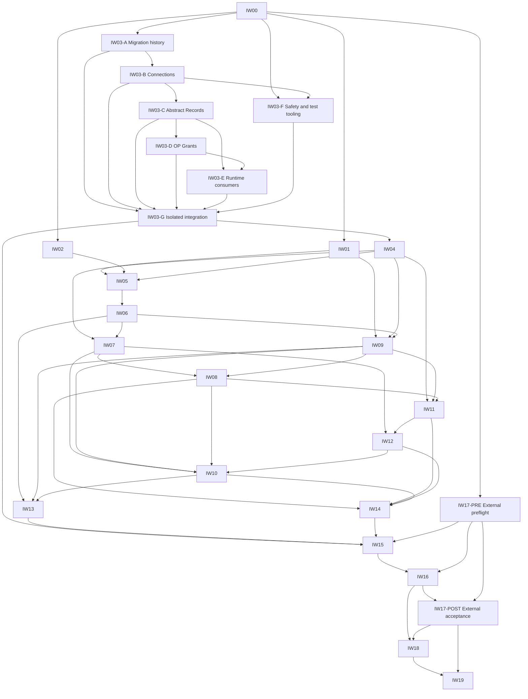

# OP/RP Separation Plan — Worldwide and Regional Client Identity Revision

> Archived snapshot, generation 0001 (originally `nine.md`). Non-normative and not evidence; see
> [README](./README.md).

Status: CONDITIONAL GO for planning; implementation and deployment are not authorized.

This revision records the user's corrected Client ID contract. D-01 through D-05 remain unchanged.
It replaces the earlier A-3 assumption that the twelve logical RPs retain twelve unregionalized
client registrations. It also replaces the earlier statement that the regional matrix is outside
this migration.

Source inspection: branch `feature`, HEAD `8e302ed42b45e45dcc73225b52fe08357432c9db`. The tracked
worktree was clean when inspected. The pre-existing untracked file
`evidence/2026-10-16-tech-tunnel-reachability-T7C2.md` is unrelated and remains untouched. `nine.md`
was empty at the start of this revision, so this document records a standalone corrected contract
and its implementation-plan consequences rather than claiming to preserve an unavailable on-disk
plan.

Only this planning document is changed. No application code, ADR, migration, database, test,
credential, external registration, or deployment is changed. Findings below are static observations;
no Rails tests, database queries, or deployed-client verification were run.

## A. Architecture Contract

### A-1. Unchanged requirements

- Base remains the sole OP for each realm. Auth and Xper remain Non-Participants.
- Zenith remains Global Identity authority. RP code does not directly access OP, Zenith, or another
  RP's private database.
- Authentication requires a valid Access JWT AND a valid RP-local session with exact identity,
  client, realm, and OP sid bindings.
- Refresh issuance, rotation, replay detection, and the five-second delivery receipt remain
  OP-owned.
- D-01 preserves immediate Tech capability revocation through narrowly scoped same-realm HTTPS
  authorization checks, failing closed.
- D-02 preserves immediate refusal of Base high-risk operations and post-stop token issuance; normal
  RP residual access is bounded only after the issuance/stop serialization and clock assumptions are
  verified.
- D-03 preserves Restricted prohibitions independently of Standby and Step-Up. A claim alone does
  not provide immediate restriction.
- D-04 preserves immediate revocation for important business operations. No permission is silently
  moved to a stale projection.
- D-05 preserves development data, sessions, audit history, DatabaseSafety, and existing unrelated
  work.
- Palm is a Browser RP. No native bearer, native refresh, or native-specific PKCE flow is
  introduced.
- OP revocation is the logout point of no return. OP revocation and its outbox commit together; RP
  revocation and browser cookie purge remain separate results.
- The new completion contract is GET/POST `/sign/bye`. Retirement of existing sign-out routes
  remains Pending.

### A-2. Distinct identity dimensions

Keep these values separate in the catalog, deployment settings, migration manifest, session records,
jobs, logs, and tests:

1. Logical RP: family plus realm, such as Core/app.
2. Concrete OAuth client: the registered value, such as `core-app-jp`.
3. Deployment scope: worldwide or one approved deployment region.
4. Logical database connection: such as `rp_core_app`.
5. Physical database identity: the actual writer/replica target for that deployment.
6. User-facing representation region: for example the `ri` parameter; it is not deployment
   authority.

The same repository or application artifact does not merge OAuth clients. `core-app-jp` and
`core-app-us` are separate clients even when their code and OP issuer are identical.

### A-3. Corrected fixed mapping for twelve logical RPs

| Realm | OP DB         | Logical RP DB | Client ID           |
| ----- | ------------- | ------------- | ------------------- |
| app   | `op_base_app` | `rp_base_app` | `base-app-ww`       |
| app   | `op_base_app` | `rp_core_app` | `core-app-{region}` |
| app   | `op_base_app` | `rp_warp_app` | `warp-app-{region}` |
| app   | `op_base_app` | `rp_palm_app` | `palm-app-{region}` |
| com   | `op_base_com` | `rp_base_com` | `base-com-ww`       |
| com   | `op_base_com` | `rp_core_com` | `core-com-{region}` |
| com   | `op_base_com` | `rp_warp_com` | `warp-com-{region}` |
| org   | `op_base_org` | `rp_base_org` | `base-org-ww`       |
| org   | `op_base_org` | `rp_core_org` | `core-org-{region}` |
| org   | `op_base_org` | `rp_warp_org` | `warp-org-{region}` |
| org   | `op_base_org` | `rp_edit_org` | `edit-org-ww`       |
| org   | `op_base_org` | `rp_tech_org` | `tech-org-ww`       |

`{region}` is explanatory notation and is never a stored or registered Client ID. Concrete entries
use an approved two-character region, currently represented by `jp` and `us` in the inspected
regional catalog. Examples are `core-app-jp`, `core-app-us`, `palm-app-jp`, and `palm-app-us`.

Every concrete ID in this naming scheme contains exactly 11 ASCII characters. Validate the
11-character constraint and membership in the fixed catalog. Do not truncate an ID, accept a longer
region, substitute a default region, or apply the general opaque-resource ID generator to an OAuth
Client ID.

There are five worldwide logical RPs and seven regional logical RPs. With the same N approved
regions enabled for all seven regional families, the target catalog contains `5 + 7N` concrete
clients. For JP and US this is 19, not 12. With partial deployment, count only explicitly enabled
cells: five worldwide entries plus the enabled regional cells. Distinguish catalog approval,
registration readiness, and deployment activation.

### A-4. Deployment selection and Registry ownership

Use `AuthBoundaryAuthorityMap` as the fixed approved-client metadata source. Each entry records
family, realm, actor, scope, and deployment region. Worldwide entries have scope `worldwide` and
suffix `ww`; do not treat `ww` as an ordinary regional code.

Update `RegionalRpClientMatrix` to describe only Core, Warp, and Palm regional cells. Remove its
current worldwide Edit exception. Worldwide bindings are read from the same approved metadata
through the existing static Registry boundary, not through a second independently maintained list.

The OP Registry may contain all approved and ready clients. Each RP deployment selects one exact
client for each logical RP it serves using trusted deployment configuration plus catalog lookup. Use
a required deployment-region setting for regional deployments, with no default to JP. A new
`DEPLOYMENT_REGION` setting may be introduced for this purpose; read it with one-argument
`ENV.fetch` and validate it against the fixed approved set. Boot configuration, not request
handling, resolves the concrete client.

Do not select or build client identity from `ri`, query/body parameters, cookies, a user-selected
tenant, Host, forwarded headers, token-supplied URLs, or unverified token claims. Host checks
confirm the preselected deployment binding; they do not grant authority to select another client.
Invalid or incomplete deployment bindings fail startup/readiness explicitly.

Regional and Edge-Core deployments use the same selection contract. Two processes serving the same
approved cell may share one registration only when they are replicas of the same RP security
boundary, including its session database and canonical route ownership. Distinct security owners,
environments, or deployments cannot silently share a cell's private key and database. A deployment
topology requiring another independent client needs a separately approved catalog entry, not an
invented extra suffix.

Registry configuration is an immutable boot snapshot. Change deployment identity through a
controlled restart/cutover; do not use the current incomplete cache-signature inputs as authority
for region changes at runtime.

### A-5. Keys, namespaces, and token bindings

| Client or pattern       | Target client-assertion namespace    |
| ----------------------- | ------------------------------------ |
| `base-app-ww`           | `BASE_RP_APP_WW`                     |
| `base-com-ww`           | `BASE_RP_COM_WW`                     |
| `base-org-ww`           | `BASE_RP_ORG_WW`                     |
| `edit-org-ww`           | `EDIT_ORG_WW`                        |
| `tech-org-ww`           | `TECH_ORG_WW`                        |
| `core-{realm}-{region}` | explicit entry such as `CORE_APP_JP` |
| `warp-{realm}-{region}` | explicit entry such as `WARP_ORG_US` |
| `palm-app-{region}`     | explicit entry such as `PALM_APP_JP` |

Patterns describe the catalog; callers obtain the registered namespace from a fixed entry, never by
transforming request strings. Each concrete client has independent client-assertion key material.
Existing Base namespaces can remain because their Client IDs do not change. Create new key material
for new Edit, Tech, and regional Palm identities; do not copy a single old private key into multiple
regional namespaces.

OP retains public verification material for Client Assertions. An RP receives only its own client
private key and OP public JWKS. The existing `oidc_client:<namespace>` identity remains distinct
from the OP signing issuer/key namespace.

For target registrations, explicitly register Access JWT audience equal to the concrete Client ID.
This is a recorded target contract, not permission for a caller to invent a missing audience. ID
Token audience and Access JWT `client_id` also name that exact client. The OP issuer remains the
canonical Base issuer of the realm; regionalization does not create a new issuer per region. Client
Assertion `iss` and `sub` equal the exact client, and its `aud` is the exact OP endpoint being
called.

RP-local binding keys include exact issuer, subject, client, and realm. OP Grant, refresh family,
delivery receipt, RP-local session, callback state, security fence, DBSC binding, logout
participant, outbox recipient, and replay scope remain client-specific. A shared subject does not
authorize session or refresh sharing between JP and US.

### A-6. URI and logout recipient contracts

For every concrete client, register exact canonical origin, `/oidc/callback`, permitted post-logout
completion URIs, and `/oidc/backchannel-logout`. The new completion target is `/sign/bye`; retain
existing completion registrations only for the bounded migration while old flows exist. Existing
sign-out route removal remains Pending.

Core uses the existing canonical regional root URL source. Warp uses explicit per-region host
entries; the current JP boot-host special case must become an explicit catalog mapping, not a JP
default. Add explicit regional Palm origin entries; the current single Palm host is insufficient
evidence for either a JP or US registration. Worldwide Edit/Tech use their worldwide canonical
origin entries. Preserve any explicitly approved public/private host binding rather than silently
expanding it to arbitrary hosts.

URI configuration is an activation prerequisite. Do not invent Palm/US or Warp/US hostnames. If the
URI or route owner is missing, leave that cell approved but inactive and fail its activation gate.

`ri` may continue to select an approved representation on a worldwide completion page, but cannot
change its `-ww` identity. On regional endpoints, a different representation parameter cannot change
the selected OAuth client. Enforce the registered URI allowlist exactly.

Logout and Restricted fanout enumerate actual OP Grant records, not twelve logical names or a single
client per family. A root with both `core-app-jp` and `core-app-us` gets separate participants,
exact audiences, endpoints, and acknowledgments. Mandatory logout targets are the same-realm Base
Self-RP and the exact initiating concrete client. Other clients remain Best Effort under the
unchanged contract.

## B. Current-State Assessment and Database Ownership

### B-1. Observed mismatches

| Inspected source                                       | Current observation                                                                                                                                                                                                   | Required plan change                                                                                                                                                     |
| ------------------------------------------------------ | --------------------------------------------------------------------------------------------------------------------------------------------------------------------------------------------------------------------- | ------------------------------------------------------------------------------------------------------------------------------------------------------------------------ |
| `app/values/auth_boundary_authority_map.rb`            | First-party runtime set has 12 entries, including unsuffixed Core/Warp/Palm/Edit/Tech. Regional set has 12 JP/US Core/Warp entries. Approved set omits worldwide Base entries and includes old Edit/Palm/Tech values. | Separate logical RP inventory from the complete approved concrete-client catalog; include Base worldwide, Edit/Tech worldwide, and regional Palm.                        |
| `app/values/regional_rp_client_matrix.rb`              | Pre-deployment contract; 12 Core/Warp regional clients plus `edit-org`, 13 total. Palm and Tech are absent.                                                                                                           | Regional-only matrix with seven families per enabled region; worldwide clients remain in the shared catalog.                                                             |
| `app/values/oidc_client_stores_static_client_store.rb` | Runtime builder registers unsuffixed Core/Warp/Palm/Edit/Tech and worldwide Base.                                                                                                                                     | Expand registrations, then activate only ready exact cells; retire old identities after drain.                                                                           |
| `RegionalRpClientMatrix.binding_for`                   | Requires an actual Registry audience, private-key JWT method, exact URIs/namespace, and audience uniqueness.                                                                                                          | Preserve fail-closed validation and extend it to the complete target catalog. Matrix membership alone is not active registration.                                        |
| Matrix namespace/host lookup                           | Core/Warp regional namespaces exist; Edit is a special global case; no regional Palm host branch.                                                                                                                     | Add Palm regional sources, remove global Edit from regional lookup, and validate all worldwide bindings.                                                                 |
| `app/values/oidc_client_assertion_jwt.rb`              | Registry namespace selects signing/verifying keys; assertion `iss/sub` use Client ID. Replay uses `SecurityConsumedJti` on app Ticket.                                                                                | Provision exact-client keys; preserve assertion replay and include its same-realm OP placement in the original separation work.                                          |
| `OidcClientRegistry.client_config_signature`           | Current signature does not cover the full regional/Palm/Tech target configuration.                                                                                                                                    | Use a validated immutable boot snapshot; do not depend on partial live cache invalidation for cutover.                                                                   |
| RP controllers and Tech callback cleanup               | Concrete unregionalized IDs are hardcoded, including Tech child-grant cleanup.                                                                                                                                        | Use the fixed deployment binding throughout entry, callback, refresh, authorization, cleanup, and logout.                                                                |
| `test/values/regional_rp_client_matrix_test.rb`        | Pins 13 entries and excludes `palm-app`.                                                                                                                                                                              | Replace the old expectation with regional Palm coverage and worldwide separation; retain exact-cell negative tests.                                                      |
| Ticket SQL                                             | OP Grant client columns are `varchar(64)`; inspected Identity Binding audiences are wider strings.                                                                                                                    | The 11-character requirement is the new first-party catalog contract, not a proven existing database-wide constraint. Do not shrink historical columns or truncate data. |
| Accepted Base/Auth ADR regional amendment              | Describes an older thirteen-client target, global `edit-org`, and pre-deployment activation gates.                                                                                                                    | Supersede the target names/counts within scope; preserve exact-cell isolation and real-registration acceptance gates.                                                    |

These are repository observations, not assertions about which clients or keys are deployed
externally. The current pre-deployment matrix does not prove JP/US registrations already exist at
the OP.

### B-2. Ownership retained

Zenith models, including `*RpRecord` descendants, retain their existing Global authority. OP-managed
`ClientRpSession`, `VisitorRpSession`, and `OperatorRpSession` remain OP Grant/Refresh records and
move with their realm Ticket data into `op_base_app`, `op_base_com`, and `op_base_org`. Do not
rewrite them into RP-local sessions.

The twelve RP connection names in A-3 are logical names. Worldwide Base/Edit/Tech deployments use
their own worldwide physical RP databases. Every regional Core/Warp/Palm cell uses its own physical
RP database. JP and US may share infrastructure capacity, but never the same RP session database,
credentials, migration ledger, or writer authority.

For example, both JP and US deployments may call their connection `rp_core_app`, while trusted
deployment settings resolve it to different physical targets. Record the actual server/cluster
identity, database name, writer, replica, role, realm, family, and deployment region in the
deployment inventory. Physical database names are operational settings, not OAuth identifiers.

With all JP/US cells active there are 19 RP-owned physical database instances for the twelve logical
RP types, plus three Global OP databases and the retained existing Global authority databases. This
does not rename the specified logical connections or imply a new worldwide OP per region.

Do not configure one RP connection pool to switch region per request. A combined Global development
process may expose multiple explicit regional instances only through fixed connections and
host/route bindings. A regional production process resolves only its own permitted physical RP
databases. Never point two regional keys at the same database as a convenience fallback.

Replica binding must identify the replica of the same cell's writer. Session validity, fences,
replay, refresh coordination decisions, and immediate authorization use the relevant writer.
Deployment construction is verified by running the environment and retaining evidence, not by adding
configuration-subject Minitest/Vitest cases.

## C. Revised Implementation Phases

### Phase 0 — Capture the corrected catalog

- Purpose: establish the 12 logical / variable concrete-client distinction before implementation.
- Planned changes: accepted specification, catalog contract, migration manifest, and ADR amendment
  drafts; do not change them during this planning task.
- Fix deployment scope, region allowlist, namespace, audience, host, route owner, physical DB,
  registration state, and migration owner for each concrete entry.
- Migration: none. Inventory old references and data without updating rows.
- Tests: catalog contract cases listed in I; no result is claimed now.
- Dependency: plan approval and a separate implementation instruction.
- Done: every proposed active cell has exact canonical registration inputs; missing cells are
  explicitly inactive.
- Recovery: document-only reversal. Risk: mistaking an approved matrix for an active registry.

### Phase 1 — Preserve Context before identity cutover

- Retain the prior P0 fix for `authn_ctx` at Code exchange, refresh, and reissue; Org Standby
  retains ordinary authorization and cannot Step-Up or become Normal.
- Add concrete-client bindings to these continuation tests. Client migration cannot repair an
  already misissued Normal claim by renaming its client.
- Migration/ADR: retain the bounded Org-only Context migration; no unrelated Emergency rename.
- Done: Context tests pass before any client cutover. Failure stops token/client activation.

### Phase 2 — Expand registrations, keys, and physical placement

- Planned code: authority map, regional matrix, static store, deployment binding value, JWT
  namespace configuration, RP callers, environment configuration, and readiness reporting.
- Provision new Client Assertion keys and OP public-key registrations before activation. Keep Base
  identities unchanged.
- Register explicit target audience and exact redirect/logout/BCL origins for each ready client.
  Neither matrix lookup nor a new key automatically activates a client.
- Add RP physical DB instances and writer/replica mappings without dropping existing databases.
  Extend DatabaseSafety, preparation manifests, and parallel-worker manifests to the actual
  deployment/test fleet.
- Migration: additive local-session/binding/fence structures and migration metadata. Do not
  bulk-update historical client or audience columns.
- ADR: approve the corrected naming, worldwide/regional ownership, and bounded transition.
- Done: each target's registration, key fingerprint, canonical URI, and physical DB binding is
  verified. Missing keys/hosts/DB identities stop that cell only.
- Recovery: leave the new cell inactive. Retain old registration/data. Do not redirect the new
  client to old credentials.

### Phase 3 — Exact-client local sessions and HTTP continuity

- Reuse the common RP authentication implementation. Pass an immutable deployment binding rather
  than hardcoded IDs.
- Binding/session/fence/attempt/receipt uniqueness includes exact Client ID even where the physical
  DB already isolates the cell.
- Code exchange rechecks the initiating client and exact redirect URI before consuming the code.
  Callback state records the selected client at start and cannot be moved by a later region
  configuration change.
- Refresh requests, five-second receipts, replay detection, DBSC state, and cookie installation
  revalidate that same client. No audience list spanning JP and US is accepted for ordinary RP
  access.
- Keep transport failures distinct from OAuth refusals and preserve cookies on dependency failures.
  Preserve the separate OP receiving pool and the Core GET/HEAD refresh prohibition.
- Migration: additive RP state only. Existing data is not recategorized by region.
- Done: cross-region negative/concurrency tests pass. Failure blocks the pilot.
- Recovery: stop new enrollment for the affected cell; preserve invalidation facts and old data.

### Phase 4 — Capability, Restricted, and lifecycle propagation

- Update Tech's expected client to `tech-org-ww`; do not rename the `tech.access` capability. While
  draining old Tech, authenticate its exact old profile separately with the same latest capability
  checks.
- Keep same-realm OP/Zenith identity checks and issuance serialization. Client changes do not create
  a new realm or Identity authority.
- Restricted fences and logout notifications target every actual Grant, including JP/US and bounded
  legacy participants. Do not deduplicate by family or logical DB key.
- Preserve separate RP-commit, webhook-ACK, and browser-cookie-response facts. Unknown sid
  notifications create exact-client tombstones.
- Migration: realm-local outboxes, participants, and versioned security state from the original
  separation plan; no client rekey of old events.
- Done: D-01 through D-04 tests pass across old/new and JP/US partitions. Failure blocks
  security-state cutover.
- Recovery: replay pending events to their original exact recipients. Never undo OP revocation.

### Phase 5 — Migrate active client identities without relabeling data

Use this explicit old-to-target map:

| Existing identity                         | Target identity                             | Treatment                                                                                          |
| ----------------------------------------- | ------------------------------------------- | -------------------------------------------------------------------------------------------------- |
| `base-{realm}-ww`                         | unchanged                                   | Preserve client and data; only OP/RP DB separation applies.                                        |
| `edit-org`                                | `edit-org-ww`                               | New registration/key; old sessions remain old-bound during drain.                                  |
| `tech-org`                                | `tech-org-ww`                               | Same, with immediate capability checks on both exact profiles.                                     |
| `palm-app`                                | explicit `palm-app-jp`, `palm-app-us`, etc. | One-to-many enrollment; no automatic region assignment or family copying.                          |
| `core-{realm}`                            | explicit approved regional cells            | Activate each new client independently; do not split old sessions using `ri` or inferred location. |
| `warp-{realm}`                            | explicit approved regional cells            | Same. Preserve current public MCP behavior without inventing business tools.                       |
| Already-existing regional records, if any | same exact client                           | Inventory and preserve them; do not duplicate an existing client/session during import.            |

Cutover sequence per old registration:

1. Inventory its codes, callback transactions, grants, refresh families, identity bindings, key
   namespace, logout flows/outboxes, exact origins, and deployed consumers. Record immutable old
   identity and evidence; do not log token material.
2. Back up relevant data and verify restore in a separate authorized environment. Record
   source/target DB identity and schema version.
3. Expand new registrations and their independent keys, URI bindings, local DBs, and receive
   endpoints. Keep them inactive until ready.
4. Record the old-client issuance cutoff and the set of already admitted transactions. After cutoff,
   allow only the recorded bounded in-flight completions and existing-grant continuation on their
   original profile. Reject new old-client enrollment.
5. Switch new sign-in initiation to the deployment-selected target. Complete a new standard Code
   Flow. Issue a new target-bound Grant, refresh family, sid, and local session; never convert the
   old family into the new family.
6. Keep previously valid old sessions usable only on their original registered boundary for a
   bounded drain, with unchanged D-01 through D-04 protections. Store a fixed drain deadline no
   later than their recorded original absolute session expiry; refresh cannot extend it.
7. On a shared old/new host, select only an exact, verified migration profile using server-owned
   session/flow binding. Never implement 'new verifier failed, try any legacy audience'. With a
   missing access cookie, refresh profile selection comes from the trusted stored session/attempt
   binding, not request `client_id` or unverified token claims. If this cannot be implemented
   without weakening CSRF, cookie isolation, or client validation, keep cutover blocked and retain
   the original serving deployment.
8. Do not clone old Palm/Core/Warp sessions, cookies, refresh tokens, DBSC bindings, or Identity
   Bindings into every region. A new regional binding is created only from a verified enrollment for
   that exact client. Keep Global identity records canonical and unchanged.
9. Preserve legacy registration keys and exact endpoints as required for bounded continuation,
   replay refusal, and pending logout work. New deployment credentials never gain legacy-key
   fallback. Keep old events associated with old recipients even when a host also serves a new
   client.
10. At drain completion, refuse all old authentication/refresh and revoke remaining old grants
    through the existing authority transaction/outbox. Preserve data and audit history. Wait for
    codes, assertions, access-token/leeway windows, pending logout work, and published-key consumers
    to retire before removing old runtime registrations and key access.

Each transition has an owner, cutoff, drain deadline, consumer inventory, separate migration tests,
and removal gate. This is bounded migration support, not a permanent alias. It needs no native
compatibility protocol.

Migration records preserve both old and target identity plus enrollment outcome. They are not an
authorization alias table and cannot let a new client consume old credentials. Do not update signed
JWT contents, existing `oidc_client_id`, audience, historical callback state, binding uniqueness
keys, delivery receipts, or outbox destinations in place.

Rollback before activation leaves new entries inactive. After new sessions exist, stop new
enrollment and repair forward or retain both exact profiles within the recorded drain; do not
restore a stale snapshot, delete new sessions, or make target-bound credentials valid as the old
client. Any subsequent switch back to old enrollment requires a reviewed recovery change and cannot
silently reopen the cutoff.

Done: old consumers and active sessions are drained, all notifications retain correct ownership, and
old runtime/key dependencies have explicit retirement evidence. Unknown deployed consumers or an
unbounded legacy expiry block retirement.

### Phase 6 — Roll out by logical RP and concrete cell

Use the original risk-based order: regional Palm pilot, Base app, regional Core app, regional Warp
app, com families, org Base/Core/Warp, worldwide Edit, worldwide Tech. Within each regional family,
validate a fully configured pilot region, then another approved region before broad expansion. A
missing Palm regional origin blocks that pilot; it is not permission to assume JP or US.

Each cell has before/during/after states, independent activation, dedicated physical DB, recovery
manifest, and acceptance evidence. Success for `core-app-jp` does not approve `core-app-us`. One
region's failure does not change another region's deployment identity.

### Phase 7 — Complete logout, retirement, and resilience

Preserve Global Sign-out semantics, `/sign/bye`, required Base/initiator acknowledgments, Best
Effort siblings, durable outboxes, tombstones, and single-use completion. Include all concrete
regional clients and legacy recipients until drained.

Exercise OP/Zenith/RP/DB/Queue/Valkey outages, HTTP response loss, replay, JWKS rotation,
Restricted/capability races, callback-versus-logout, and restore. Retire old dependencies only after
the exact-client migration gates below pass. No existing sign-out route is deleted under this
revision.

## D. Work Unit Changes for Codex Luna Max

These units refine the original plan. They authorize no implementation now. Keep credential
provisioning, external writes, data cutover, and destructive operations separately gated.

| Unit   | Planned files / deliverables                                                                                                    | Contract and prohibitions                                                                                           | Tests / Done                                                                                                      |
| ------ | ------------------------------------------------------------------------------------------------------------------------------- | ------------------------------------------------------------------------------------------------------------------- | ----------------------------------------------------------------------------------------------------------------- |
| CID-00 | Accepted spec and catalog manifest; planned `AuthBoundaryAuthorityMap` changes                                                  | Twelve logical RPs; explicit WW/region cells; no request-derived IDs                                                | Complete 11-character target catalog and current/target inventory; G0                                             |
| CID-01 | `app/values/auth_boundary_authority_map.rb`, `regional_rp_client_matrix.rb`, `oidc_client_stores_static_client_store.rb`        | One approved metadata source; regional matrix excludes WW Edit; include Palm; no automatic activation               | JP/US complete sets, count formula, audience/namespace/URI refusal cases                                          |
| CID-02 | New `app/values/rp_deployment_binding_value.rb`, actual boot configuration owner, `OidcClientRegistry` consumers                | Required trusted deployment region; immutable lookup; no parameter/Host/`ri` selection, no JP fallback              | Public RP entry/callback/refresh stays bound despite attacker region inputs; real boot validation in evidence     |
| CID-03 | `oidc_client_assertion_jwt.rb`, JWT registry/local keyset consumers, credential provisioning manifest                           | Independent target-client keys, exact namespaces, exact assertion `iss/sub/aud`; no old-key alias                   | Wrong client/region key refusal, assertion replay, rotation and staged public-key readiness                       |
| CID-04 | Core/Warp/Palm/Edit/Tech application, callback, sign-entry, refresh, sign-out controllers/concerns; Tech cleanup                | Same binding object for all paths; `tech.access` unchanged; no hardcoded old IDs in target callers                  | Same-client round trip and cleanup scope; another region's session survives                                       |
| CID-05 | RP schema/Record additions, OP Grant consumers, `OidcRpIdentityProvisioning`, credential contract, Local Session operations     | Exact issuer/subject/client/realm keys; no cross-region family/session/binding copying                              | Callback/logout and refresh/logout races plus JP/US negative partitions; G2                                       |
| CID-06 | `config/database.yml`, fixed connection owners, `DatabaseSafety`, `lib/tasks/test_db_prepare.rake`, CI/parallel clone manifests | Logical DB reused as a name only; physical DB/roles separate per region; no destructive rebuild                     | Run actual fleet/configuration checks and restore rehearsal; record evidence, not setup-subject unit tests        |
| CID-07 | Planned client migration operation, durable migration manifest, cutover/rollback runbook                                        | Expand, enroll, bounded drain, retire; preserve all old rows/epochs; no signed-token rewriting or permanent aliases | Independent old/new credential refusal, no drain extension, late-event handling, recovery and family preservation |
| CID-08 | OP logout/restriction outboxes, participant models, senders/receivers, `/sign/bye`                                              | Concrete recipient tuple, not logical family; mandatory exact initiator; legacy events not retargeted               | Root with JP and US yields two independent recipients; receipt/ACK atomicity and replay                           |
| CID-09 | Existing and new contract/concurrency tests; ADR amendment drafts; evidence manifest                                            | Tests pin target semantics, except explicitly scoped transition cases; no weakening guards to pass                  | G1 through G6 evidence per cell; all obsolete runtime references and key consumers accounted for                  |

Dependencies: CID-00 precedes CID-01; CID-01 precedes CID-02/03/06; CID-02/03 precede CID-04;
CID-04/06 precede CID-05; CID-05 precedes activation portions of CID-07/08. Build and test the
receivers before any new Grant becomes active. CID-09 verification accompanies each unit; final
retirement depends on all units and the original security/continuity gates.

The original Context repair, safe HTTP refresh, issuance/stop serialization, Restricted fence, DBSC,
and important-policy work remain required. Integrate the concrete binding into those units; do not
create a second regional authentication implementation.

## E. Security Review Changes

- Verify Access JWT signature/type, same-realm issuer, exact registered audience, exact `client_id`,
  and exact local session/binding. A valid OP signature is not permission to accept a sibling
  regional audience.
- Keep client-specific refresh resolution and receipt checks before state changes. JP input must
  never rotate a US family; reject before consuming a code or modifying the wrong Grant.
- Preserve actor/tenant/resource and session bindings for important operations. Neither matching
  subject nor matching logical RP authorizes cross-region access.
- Preserve Standby Context and Restricted state across target-client enrollment and continuation.
  Starting a new client flow does not grant Step-Up or clear a restriction.
- Extend OP revocation and restriction fanout to both regions, worldwide clients, and draining
  legacy clients. Keep replay receipt plus local invalidation atomic.
- Bound legacy reads to an exact profile. Do not add an audience union, fallback key namespace,
  subject-only identity lookup, or reusable old-to-new credential converter.
- Host-only cookies may have the same cookie name on different regional origins; they remain
  separate. Redirecting the browser does not move cookies or sessions. Same-host transitions must
  still preserve exact profile and CSRF binding.
- Keep OP signer secrets out of RP code/configuration. Regional Client Assertion keys are client
  secrets, not OP token signing keys.

## F. Business Continuity Changes

Existing outage behavior remains fail-closed for immediate authorization and expired credentials. A
valid existing regional Access JWT plus local session can continue within its allowed lifetime
without per-request OP introspection, subject to its own RP/DB/admission dependencies.

- JP RP/DB failure affects JP availability, not US session authority. Do not fail over to the US
  OAuth client or database under the JP cookie.
- Same-cell database failover retains that cell's durable identity, fencing, receipts, and
  revocations. Restoring stale authentication state is not an acceptable regional disaster-recovery
  shortcut.
- OP or Zenith failure still blocks new issuance/refresh and latest-state important operations as
  required by D-01/D-02/D-04.
- Queue interruption leaves concrete-recipient outboxes durable; retry after recovery cannot
  collapse two regional participants into one.
- Missing regional host/key/DB configuration keeps the new cell inactive while the original valid
  boundary drains within its fixed contract.
- A successful new-client login is additive. Failure to enroll does not rewrite, revoke, or erase
  the old session merely because a target registration exists. Explicit global logout, stop,
  compromise response, or the recorded drain deadline still applies.
- At mandatory-initiator outage, OP revocation stays committed and logout completion remains
  pending. Another region's ACK cannot satisfy the initiating client's mandatory ACK.

## G. Maintainability and Connection Budget

Retain twelve logical RP implementations with one shared authentication lifecycle. Concrete client
entries are catalog data, not copied authentication controllers. Add a region by adding explicit
catalog/URI/key/deployment/physical-DB entries and matrix cases, not another fork of authentication
logic.

Keep worldwide and regional metadata in one authority map, with scope-specific views. Update the
existing matrix rather than preserving its historical global Edit exception as a hidden alias.
Derive the expected concrete set from approved metadata; independently assert the actual explicit
values in acceptance tests to avoid tests that merely mirror the builder.

Each physical database owns its migration history. Reuse immutable schema definitions where
appropriate, but apply/verify migrations explicitly for each cell and preserve backup/restore
identity. Do not retarget one live AR connection between regions.

Compute pool capacity by process role and actual physical database use: OP receivers, each regional
RP deployment, worldwide RPs, workers, sweepers, and verification/administration reserve. Nineteen
possible target RP databases for JP/US do not require every process to open nineteen pools, but lazy
connection creation alone is not a capacity proof. Verify writer/replica matching and observed peak
connections.

Use realm, logical RP, concrete Client ID, deployment region, migration phase, and non-secret
event/flow IDs for diagnostics. Never log credentials, token bodies, cookies, or assertion material.
Future Global/Regional/Publishing repository extraction retains these contracts without sharing
private databases.

## H. ADR Supersession Changes

This table plans future amendments; no ADR is edited now. Preserve unrelated Accepted and Pending
decisions.

| ADR / contract                                                           | Retained                                                                                              | Scoped replacement                                                                                                                      |
| ------------------------------------------------------------------------ | ----------------------------------------------------------------------------------------------------- | --------------------------------------------------------------------------------------------------------------------------------------- |
| `adr/base-auth-ceremony-and-seven-rp-boundary.md`                        | Base-only authority, exact regional isolation, canonical URI/audience prerequisites, deployment gates | Old seven/thirteen-client target and global `edit-org` naming become five WW plus seven regional families; regional target is in scope. |
| `adr/tech-and-palm-browser-rp-participation.md`                          | Tech capability and Browser Palm, no native role, host-only credentials                               | `tech-org` to `tech-org-ww`; `palm-app` to approved regional identities; exact key/session/URI transition.                              |
| `adr/base-authority-and-self-rp-separation.md`                           | OP versus Self-RP roles and unchanged Base WW IDs                                                     | Client-specific bindings and regional deployment selection; retain the main plan's removal of shared parent DB reads.                   |
| `adr/oidc-oauth-participation-allowlist-and-non-participant-surfaces.md` | Auth/Xper and existing nonparticipant boundaries                                                      | Approved concrete catalog includes regional Palm and WW Edit/Tech without widening participants.                                        |
| `adr/global-regional-database-ownership.md`                              | Global Zenith/Avatar/Publishing authority and no cross-repository shared database                     | Distinguish twelve logical RP connections from region-owned physical databases.                                                         |
| `adr/surface-database-connection-naming.md`                              | Existing naming decisions outside scope                                                               | Document the specified logical OP/RP names and deployment-specific physical targets.                                                    |
| `adr/operator-capability-authorization.md`                               | `tech.access`, immediate revocation, continuity protection                                            | Consumer binding becomes exact `tech-org-ww`; legacy profile only during bounded drain.                                                 |
| `adr/first-party-sign-out-shared-database-without-backchannel-logout.md` | Authority-first and point of no return                                                                | Main-plan BCL replacement plus concrete-client participant fanout and immutable legacy recipients.                                      |
| `adr/logout-ceremony-boundary.md`                                        | Browser binding and one-time completion                                                               | Exact per-client `/sign/bye` registration; old-route removal remains Pending.                                                           |
| `adr/tanstack-start-zero-cookie-ui-origin-boundary.md`                   | Entire UI cookie exclusion and Core GET/HEAD non-rotation                                             | Deployment region chooses Edge-Core client; no cookie or key disclosure to the UI origin.                                               |
| Security Mode / authentication Context ADRs                              | D-01 through D-05, Standby/Restricted/Step-Up separation, unresolved `acr/amr` and recovery decisions | No semantic relaxation from client naming.                                                                                              |
| Identifier contract and historical evidence                              | Existing issued values and history                                                                    | New first-party Client ID catalog constraint does not reformat opaque IDs or narrow all historical protocol columns.                    |

No full ADR retirement is required solely for this correction. Do not restore old Side/client
aliases or revive superseded architecture as an implementation shortcut.

## I. Acceptance Gates and Tests

All names below describe planned tests/verification, not tests executed in this session. Extend
existing tests where their public boundary already matches.

| Gate | Required acceptance                                                                                                                                                                                    | Stop condition                                                                                                         |
| ---- | ------------------------------------------------------------------------------------------------------------------------------------------------------------------------------------------------------ | ---------------------------------------------------------------------------------------------------------------------- |
| G0   | Twelve logical rows exactly match A-3; explicit JP/US target catalog has 19 unique 11-character IDs; WW and regional ownership are distinct; registry/key/URI/DB manifest has no unexplained gaps.     | Catalog contradiction or invented/missing activation input blocks affected implementation/cutover.                     |
| G1   | Target assertions and tokens reject wrong client/region keys, audiences, `client_id`, realm, issuer, type, and redirect before code consumption. Context and five-second receipt tests remain passing. | Any identity confusion, Normal promotion, or receipt/replay regression blocks activation.                              |
| G2   | Exact-client local-session/binding uniqueness; same subject can enroll independently in JP and US; foreign-region sid, refresh, callback, fence, or receipt cannot authorize the local client.         | Cross-cell credential or state acceptance blocks all affected shared code.                                             |
| G3   | Tech old/new profile checks latest `tech.access`; stop/epoch, important policy, Restricted, and logout notify every actual relevant Grant across regions and migration profiles.                       | Any lost recipient or immediate-authorization regression blocks lifecycle cutover.                                     |
| G4   | Each activated cell runs against its own verified writer/replica/role; deny OP/Zenith/other RP private DB access; canonical HTTPS and exact URI routing verified on the actual deployment.             | Shared physical RP state, wrong region/host, missing key/route owner, or another cell's private key blocks that cell.  |
| G5   | Expand/enroll/drain recovery; no old-row relabeling; backup restore; old/new and JP/US negative partitions; HTTP loss, Queue/Valkey/DB outages, callback/logout races.                                 | Session loss from migration shortcuts, stale restore, replay relaxation, or unbounded drain blocks rollout/retirement. |
| G6   | Old issuance closed; in-flight flows/session windows and pending deliveries accounted for; legacy runtime/key consumers retired; catalog, ADRs, deployment manifest, and evidence agree.               | Unknown deployed consumer, unknown expiry, outstanding mandatory delivery, or implicit alias blocks retirement.        |

Add or update these public-boundary tests:

- `test/values/regional_rp_client_matrix_test.rb`: 14 regional entries for JP/US; no worldwide
  Edit/Tech/Base in the regional view; include both Palm cells; exact canonical
  host/audience/namespace checks and unknown-region refusal.
- Existing authority-map/registry tests: all five worldwide entries, complete 19-entry target
  catalog when JP/US are enabled, approved versus active distinction, unique
  IDs/audiences/namespaces, and no legacy entries in the final target set.
- `test/values/oidc_client_identifier_contract_test.rb`: supported 11-character IDs; reject missing,
  empty, 10-character, 12-character, non-ASCII, literal braces, unknown two-character regions, and
  wrong WW/regional combinations. Legacy values are allowed only in explicitly scoped migration
  tests.
- `test/integration/rp_deployment_client_binding_test.rb`: JP and US deployment contexts choose
  different fixed clients; attacker `ri`, Host/forwarded headers, request `client_id`, and body
  region cannot change that binding. Environment construction itself remains a runtime verification
  subject.
- `test/services/oidc_client_assertion_jwt_test.rb`: same-realm OP endpoint, exact
  issuer/subject/audience, wrong-region key, wrong namespace, assertion replay, key rotation, and no
  old-key fallback.
- `test/services/oidc/realm_binding_test.rb` and token exchange tests: regional audience/client
  mismatch refuses before consuming the legitimate code; the legitimate cell remains usable
  afterward.
- Local-session and refresh contract tests: JP token with US local session, US refresh on JP,
  receipt from a sibling client, same subject with independent bindings, stale callback after
  logout, and no family cloning.
- `test/integration/oidc_client_identity_migration_test.rb`: old/new records remain immutable; one
  old Palm binding does not become two regional logins; new enrollment creates a new family/sid;
  deadline is not extended by refresh; failed enrollment preserves the old valid session; retirement
  refuses old credentials without deleting history.
- Logout/restriction concurrency tests: a root with two regional grants yields two participants;
  wrong-client notification is rejected; an old outbox event is not sent as the replacement client;
  another region's ACK cannot satisfy mandatory origin completion.
- Existing Palm browser boundary tests: all regional Palm registrations remain confidential Browser
  RPs; old native clients and bearer user-authentication routes remain retired.

Run a deployment matrix for every enabled concrete cell, not just twelve logical rows. Run deeper
common security/race tests on representative regional and worldwide instances, then JP/US separation
cases and wiring checks across the full catalog to avoid redundant copies.

For database/boot/key provisioning, actually run non-destructive configuration and reachability
checks in an authorized environment and record exact revision, physical DB identity, registration
metadata, public-key fingerprints, observed results, and unverified scope. Do not record secret
values. No such runtime checks were performed for this document revision.

## J. Final Adversarial Review of This Correction

| Severity | Scenario / impact                                                                     | Countermeasure and falsifying verification                                                                          | Residual risk                                                                |
| -------- | ------------------------------------------------------------------------------------- | ------------------------------------------------------------------------------------------------------------------- | ---------------------------------------------------------------------------- |
| Critical | Request `ri=us` switches a JP process to US credentials or database.                  | Trusted boot lookup and fixed connection; mutate all request region/host inputs and observe unchanged client/DB.    | Incorrect deployment settings remain an activation risk.                     |
| Critical | Old Palm family or Identity Binding is cloned into both regions.                      | No data relabel/clone; verified new enrollment only; assert independent sid/family and preserved old rows.          | Unclassified historical ownership blocks import.                             |
| Critical | Audience union accepts a US JWT on JP.                                                | Exact single-client profile validation and local binding; reject sibling tokens even under the same OP signing key. | Shared verifier bugs require common and full-matrix tests.                   |
| High     | One private key is copied across regional namespaces.                                 | Independent key inventory/fingerprints and wrong-client assertion tests.                                            | Provisioning is not verified in this session.                                |
| High     | Legacy compatibility becomes a permanent authentication fallback.                     | Recorded cutoff/deadline, exact profiles, no try-any-audience path, G6 consumer/key retirement.                     | Unknown deployed clients block retirement.                                   |
| High     | Logout/restriction deduplicates by logical family and omits US.                       | Actual Grant enumeration; exact recipient tuple; two-region fanout/concurrency tests.                               | Unavailable recipient remains pending under original security contract.      |
| High     | Logical DB name points both regions to one physical store.                            | Inventory actual server/database/role identity; runtime denial tests; fail activation.                              | Environment isolation evidence is outstanding.                               |
| High     | Cutback restores old refresh/revocation state.                                        | No stale snapshot rollback; bounded exact profiles and forward repair; restore rehearsal.                           | Actual recovery duration/data volume are unknown.                            |
| Medium   | A matrix entry is mistaken for an active registration with an invented host/audience. | Approved/ready/active distinction; exact canonical source required.                                                 | Palm regional origins and external registrations need provisioning evidence. |
| Medium   | Registry cache retains old region/namespace inputs.                                   | Immutable validated boot snapshot and controlled restart; no live identity switch.                                  | Incomplete restart/traffic drain remains a rollout risk.                     |
| Medium   | New naming is implemented by shrinking historical columns.                            | Validate new catalog without truncation or bulk update; preserve history and wider protocol storage where required. | Unknown non-first-party consumers require inventory.                         |

No finding authorizes weakening D-01 through D-05. Missing canonical origins, unverified key
provisioning, absent physical DB separation, or unsafe old-client drain make the affected
activation/retirement unit NO-GO until resolved.

## K. Additional Decisions and Overall Verdict

The user has already decided the corrected naming and scope. No repeat choice is needed for WW
suffixes, regional Palm, separate JP/US clients, or deployment-selected Client IDs. Key namespaces,
fixed catalog lookup, additive enrollment, and bounded drain are technical implementation contracts
in this plan.

Missing deployment hosts, physical DB identities, external registration state, key ownership, and
old-session deadlines are required operational facts, not permission to guess a new architecture.
Inventory/provision them before activating a cell. If a shared-host old/new transition cannot
preserve existing sessions safely, keep that cutover blocked and present the concrete
availability/security tradeoff; do not silently force logout or add a permissive fallback.

An additional user decision is needed only if preserving the specified guarantees proves impossible
without changing an external contract, accepting session loss, relaxing immediate
authorization/restriction, extending the five-second recovery contract, or introducing an
independent client outside the fixed naming catalog. No such relaxation is adopted here.

Overall verdict: CONDITIONAL GO for the revised plan. Concrete client activation and old-client
retirement remain NO-GO until their exact registration, URI, key, data-preservation, physical-DB,
and security gates pass. Implementation still requires a separate instruction.

---

# Final Design Integration — D-01 through D-11

This appended integration is the current implementation-plan authority within `nine.md`. The
preceding revision is retained as planning history. Where they conflict, this appendix replaces it.
In particular, legacy-client drain, dual authentication profiles, all-RP-ACK-before-Restricted,
mandatory-RP-ACK-before-sign-out, Global ownership of regional physical databases, and retaining
Ticket aliases are **superseded proposals, not executable tasks**. Do not implement them from the
earlier text.

This is a plan, not implementation, deployment, credential-provisioning, or database-execution
permission. Only `nine.md` is being appended. All classes, endpoints, schemas, migrations, tests,
and commands described as targets remain proposed unless explicitly identified as inspected existing
code.

## A. Executive Summary

The target is three physically renamed Global OP databases, independently owned worldwide RP
databases, and explicit HTTPS contracts with existing Regional deployments. The twelve logical RP
types and `5 + 7N` concrete Client ID model remain. Global does not create or connect to the
regional fleet merely because its OP registers those clients.

The final cutover is offline. Stop all relevant writers, preserve and prove backups, rename or
restore the three OP databases, apply additive schema/state changes, invalidate pre-cutover
authentication continuations without deleting their history, switch the complete Rails
naming/connection graph, and reopen only after security and recovery acceptance. There is no dual
write, long session drain, old-client verifier, or old-key fallback. New authentication uses the new
standard Code Flow.

Restricted commits at the OP independently of notification ACKs. A durable event transports
restriction to RPs. Existing operations requiring immediate restriction use a narrowly scoped
current-state authorization check; notification and JWT claims alone are insufficient. Global
Sign-out succeeds at the OP revocation/outbox commit. RP ACK and cookie cleanup are follow-up facts
and cannot undo or delay that success.

ActionPolicy and existing important controls are preserved. The final design removes direct Global
authority AR/SQL use from RP request paths without prematurely specifying unfinished
Membership/Ownership business lifecycles. Jump and Edge receive no writes. An external consumer that
cannot meet the new contract is a blocked activation, not evidence of completed migration.

Inspection basis: local branch `feature`, HEAD `8e302ed42b45e45dcc73225b52fe08357432c9db`. Unlike
the previous revision's clean snapshot, the current worktree contains unrelated changes to Base
sign-in/authorization controllers, `BaseSignInLimitations`, `CommonRedirect`, the Jump handoff ADR,
tests, lint baselines, and untracked handoff/evidence files. These were inspected only as needed and
are preserved. The original 49,629 bytes of this document had SHA-256
`482d1e420d26e3364634aad71f5aef8b32e1041d84566650d2717865908c0a9d` before this append. No live
database, provider permission, external registration, or deployment readiness was inspected.

## B. Decision Register

| Decision | Final treatment                                               | Consequence                                                                                                                        |
| -------- | ------------------------------------------------------------- | ---------------------------------------------------------------------------------------------------------------------------------- |
| D-01     | Decided: immediate `tech.access` revocation                   | Fixed same-realm Base authorization check, latest Zenith writer, fail closed; capability name remains unchanged.                   |
| D-02     | Decided: Base immediate / ordinary RP bounded residual access | Serialize stop and all issuance paths; separate Zenith and OP commits; durable propagation, no fabricated distributed transaction. |
| D-03     | Decided: preserve Restricted separately from Standby/Step-Up  | Preserve actual prohibited and exception operations; no claim-only immediacy.                                                      |
| D-04     | Decided: existing important authorization remains immediate   | Preserve implemented IAM, Support, Enforcement, Tech and existing resource checks.                                                 |
| D-05     | Decided: protect existing persistent data                     | Development and test data are protected too; backups, restore proof, identity manifest, no implicit recreation.                    |
| D-06     | Closed: no additional timing choice                           | OP commits restriction first; no all-RP ACK barrier. Targeted current-state checks preserve immediate prohibitions.                |
| D-07     | Closed: breaking Client ID change allowed                     | Remove old-client acceptance at cutover; no drain/dual profile/family conversion; preserve rows and audits.                        |
| D-08     | Closed: sign-out succeeds at OP commit                        | Base `/sign/bye` is final completion; RP ACK/purge is independent, prioritized follow-up.                                          |
| D-09     | Closed: Regional physical architecture excluded               | Global registers clients/contracts only; existing regional DB ownership remains external.                                          |
| D-10     | Deferred: comprehensive future business revocation            | Keep seams and existing controls, do not invent unfinished roles or lifecycles; scoped incompatibilities block only their units.   |
| D-11     | Closed: offline cutover and coherent rename                   | Physical OP DB names, connection keys, records, active consumers and current docs converge; old aliases do not survive.            |

Still outside scope: Jump/Edge implementation or deployment, Regional DB construction/migration,
unrelated Security Mode/recovery work, native Palm, a new authorization framework, and
deletion/consolidation of old sign-out routes. Separate explicit approval is required for actual
database operations and external writes. None of D-01 through D-11 is reopened as a user
questionnaire.

## C. Architecture Contract

### C-1. Ownership and placement

| Boundary                                           | Owns                                                                                                                                       | Does not do                                                    |
| -------------------------------------------------- | ------------------------------------------------------------------------------------------------------------------------------------------ | -------------------------------------------------------------- |
| Global Zenith                                      | Identity, credentials, global actor state, existing global business authority                                                              | Become an RP-local principal or regional database.             |
| Base OP, per realm                                 | Root sessions, OP grants, code issuance, refresh/replay/receipt, Restricted authority, step-up authority, revocation, logout flow/outboxes | Directly update RP-local session stores.                       |
| Worldwide RP: Base app/com/org, Edit org, Tech org | Its own local principal/binding/session/fence/callback/replay state                                                                        | Read OP/Zenith/other RP tables directly.                       |
| Regional Core/Warp/Palm                            | Existing region-owned deployment and local state                                                                                           | Be provisioned as new physical DBs by Rails Global.            |
| Auth                                               | Existing ceremony/evidence/admission responsibilities                                                                                      | Issue general OP/RP sessions or become an OAuth participant.   |
| Xper                                               | Existing nonparticipant boundary                                                                                                           | Receive a registration through this change.                    |
| Publishing / Avatar / other Global domains         | Existing canonical business records and operations                                                                                         | Be duplicated into a new RP database or redesigned under D-10. |

Shared Rails code is an algorithm, not shared authority. Use fixed record classes and immutable
deployment bindings. Local RP principal objects are explicit RP-owned objects; they are never
subclasses pretending to be Global `Client`, `Visitor`, or `Operator`. Existing global policies run
with real Global actors at the authority-owned boundary. Local policies run with explicit local
actor/record context.

Global currently contains authenticated Core/Warp/Palm controllers that directly use shared
authority state. Their current placement is evidence of technical debt, not authorization to create
Global-managed JP/US databases. Replace Global's active regional authentication responsibility with
the public OP contract and the already-existing external Regional owner. Retain only public/machine
functions actually owned by Global. Authenticated regional route handoff/removal cannot be activated
while ingress or the external owner still depends on the old Global handler. Such a cell is an
external-integration NO-GO until read-only acceptance proves readiness; do not edit Edge/Jump to
force a pass. Existing sign-out routes are not deleted by this cleanup.

### C-2. Authentication, context, and token authority

Authentication requires both a cryptographically valid, unexpired, exact-client Access JWT and a
writer-verified live RP-local session/binding. A local session, ID Token, refresh credential, root
cookie, or stale projection alone is insufficient. OP sid and local session ID are distinct. Every
session reference is scoped by issuer/client/realm. Token types, audiences, client IDs, and realms
remain separately checked.

Fix the inspected OIDC Code/Refresh callers that omit `authentication_context`. Every access
issuance/reissue derives Context from locked OP authority. Rename only Org alternative
authentication from Emergency to Standby. Preserve normal business authorization, prohibit Step-Up
and Normal promotion, and preserve the accepted absolute lifetime. Unrelated app Secret Emergency,
identifier rotation, and incident mechanisms remain.

Client IDs are exactly 11 ASCII characters and come from the fixed registry plus trusted deployment
configuration. WW is not a region. OP issuer remains same-realm Base; target Access audience and
`client_id` name the exact client. ID Token audience and Client Assertion `iss/sub` also name that
client. OP signing keys and each RP's Client Assertion keys remain different secrets. Existing
`acr/amr` meaning is not changed.

### C-3. Identity stop, epoch, and lock order

Use the existing Global actor row as the common serialization boundary for stopping and issuing,
rather than adding a generic lock service. `LocalAuthenticationSessionCommitter` already establishes
actor-before-Ticket ordering. Add an `authentication_epoch` to the Global actor and stamp the epoch
on OP root/session issuance. Increment it when authentication continuity must end. Old roots cannot
refresh after an epoch change, including after recovery.

Resolve IDs without authorizing, then acquire locks in this single direction: Zenith actor, the
required OP transaction/flow owner, stable device/root session, current root token, OP grant,
associated receipt. Multi-owner operations lock same-type rows in stable ID order. No OP-lock-held
path may call back into a Zenith-locking authorization operation. Standalone restriction/logout may
lock OP rows only and must not subsequently lock Zenith. No RP row lock or open transaction spans
HTTP. No network or Valkey lease wait occurs while a Zenith/OP database lock is held. Acquire any
coordination lease before entering the database decision unit; DB generation/row locks remain
authority, not the lease.

Hold the actor lock through OP issuance commit, using the two actual connection owners explicitly.
This orders issuance relative to stop; it is not two-phase commit. If OP commits and the process
dies before the outer actor transaction finishes, treat the OP issuance as real. A later stop still
commits its epoch and revocation intent. If the stop commits first, issuance reloads the stopped
actor and refuses. Bound lock/statement waits and roll back pre-commit failures explicitly; never
report success on an indeterminate commit.

`Tidentity` is the Zenith state/epoch/outbox commit; `Top` is the OP invalidation/outbox commit;
each `Trp` is an independent local invalidation commit. Normal-RP residual access can be bounded
from `Tidentity` only after all issuing, refresh, reissue, and receipt-redelivery paths obey current
actor/epoch checks and fixed exp. Preserve 300-second TTL and 30-second configured leeway, and
include verified clock error in any wall-clock bound. Do not assert stop-plus-330-seconds merely
from token TTL. Receipt redelivery never moves exp forward.

Zenith outbox: state change -> durable pending OP invalidation. OP receiver: deduplicated event ->
invalidate roots/grants older than the event cutoff epoch + OP logout outbox in one OP commit. RP
receiver: deduplicated receipt + tombstone + local invalidation in one RP commit. A delayed old stop
event cannot kill a newly enrolled post-recovery epoch. Recovery never revives previous families.
Distinguish app/com withdrawal requested versus access-blocking suspension, org suspension without
deletion countdown versus withdrawal/termination, and compromise-specific session/family scopes;
reuse existing semantics, not one invented universal status.

### C-4. Restricted without an ACK barrier

Observed authority: `TokenStatusManagement` defines ACTIVE 1, EXPIRED 102, RESTRICTED 103, REVOKED
104, with `mark_restricted!` and `promote_to_active!`. The inspected app/lib callers do not
demonstrate an active production caller of those two methods. That does not justify deleting the
state or its existing-data guarantees. The `RESTRICTED_TTL` constant is 15 minutes; its presence
alone does not prove every writer currently caps expiry correctly.

Observed prohibition: `RestrictedSessionGuard` runs on Base, Core, Warp, Edit, Palm, Tech
application surfaces and Auth ceremony controllers. It rejects a restricted identified request
outside four controller-path exceptions: `base/app/sign/in/limitations`, and
`base/{app,com,org}/identity/mfa/resets`. It also checks restricted expiry. Audit inherited
callbacks/actions, including authenticated requests to otherwise public pages, before finalizing the
fixed operation table. Do not assume only writes are prohibited or add the com/org limitations pages
as new Restricted exceptions without evidence.

Session limits are different: current `SessionLimitResolutionTransactionable`, `SessionLimitGate`,
and changed `BaseSignInLimitations` keep sign-in pending and select/revoke an existing session
before final root issuance. Do not create a placeholder RESTRICTED login for a pending flow.
Preserve the final flow recheck, cooldown anchor, ownership/browser binding, and expiry. A
limit-resolution revocation uses the same final OP revoke/outbox primitive.

New restriction transition: lock the OP parent/current root, verify the legal source state, change
Restricted state and monotonically increasing security version, cap any restricted deadline without
extending absolute expiry, invalidate Step-Up evidence as required, prevent normal refresh/issuance,
and append per-grant restriction outbox events in that same OP transaction. Commit immediately
without contacting any RP. Queue/receiver outages do not prevent that commit. Status and per-RP
delivery results are separate axes.

For each existing prohibited operation that needs immediate enforcement, declare a fixed
restriction-authorization operation at its controller/business boundary. A normal-looking JWT is not
proof that restriction has not changed. Query same-realm Base through a dedicated
`POST /oauth/session-restrictions/check` contract immediately before authorization/effect. Validate
Client Assertion, exact-client access credential, sid, realm and a server-selected fixed operation.
The OP locks/reloads the stable session/current root on the writer, checks current
restriction/expiry/revocation and returns only an operation-bound permit/refusal plus
version/correlation. Responses are non-cacheable, non-transferable to another operation, and not
reusable across requests. Dependency failure denies the operation and preserves cookies.

This is operation authorization, not a generic introspection step in the shared authentication
resolver. Anonymous, bare health/revision/MCP, token cryptographic validation, and independently
owned operations without an existing immediate restriction requirement do not acquire this query
automatically. Base-owned operations check the same state locally at their final authority boundary.
Existing exception ceremonies retain their purpose/browser/expiry gates. Sign-out follows its
explicit revocation authority, not a new unrestricted business permission.

The current guard has broad coverage. Preserving it may therefore put many actual guarded
business/page operations behind this narrow check. Make that dependency visible in the operation
inventory and outage matrix; do not relabel those existing operations as delay-tolerant to make the
HTTP count look smaller. Do not implement a universal `before_action` that introspects all RP
authentication. If exact immediate coverage cannot be implemented without violating the
no-universal-introspection contract or an external RP cannot enforce it, mark that operation/cell
activation NO-GO. D-06 itself is closed; do not ask the user to choose timing again.

Concurrent guarantee: an authorization evaluation begun after the OP restriction commit refuses a
prohibited operation. An evaluation that obtained permission before the commit may finish; critical
Base mutations recheck at their final locked mutation boundary. This does not retract previously
returned data. Notifications make local refusal earlier and reduce needless checks but do not
establish immediacy alone.

Restriction propagation is durable and versioned. Unknown sid creates a local fence. A delayed older
unrestricted event cannot clear a restriction. Release requires a fresh OP decision/version and
newly issued JWT, never a local toggle or an old Normal JWT. Revocation tombstones remain absorbing.
Normal refresh is refused while restricted; only an explicitly existing purpose-limited recovery
contract may proceed, without gaining ordinary scopes or Step-Up.

### C-5. HTTP refresh and replay

Replace the direct coordinator call from RP refresh with HTTPS. Keep Code exchange single-use
without automatic retry. Separate transport/TLS/DNS/5xx/429/protocol corruption from definitive
credential refusal. Preserve cookies on dependencies and configuration errors; do not map all
failures to invalid_grant. Recheck the local session/fence after receiving tokens before writing
cookies.

OP rotation, generation change, complete encrypted delivery snapshot and absolute deadlines commit
together. The five-second receipt remains fixed. A dedicated receipt query is read/redelivery-only:
authenticate the exact client and original attempt/credential binding; check current actor epoch, OP
grant, expiry and revocation before returning the original response. It never rotates, extends exp,
or grants a new recovery window. Late replay on the token endpoint keeps its existing
detection/revocation behavior. Do not automatically resend an indeterminate old refresh after its
recovery window; report the dependency state and require a new Code Flow when recovery is no longer
possible.

Use a durable minimal RP refresh-attempt record only to distinguish dispatch/uncertain/installed
outcomes and coordinate concurrent local requests. Store attempt ID, session reference, input HMAC
and times; no refresh-token vault, duplicate token authority or permanent ciphertext response cache.
Obtain fresh Client Assertions per HTTP request; assertion replay is independent of receipt
redelivery. Valkey outage prevents starting a rotation as required by the existing coordination
contract; committed DB receipts remain recoverable through their exact read path. Lease expiry never
authorizes a second generation without DB checks.

Current Open 2s / Read 5s versus Receipt 5s is not a safe end-to-end budget. Design initial bounded
communication at 2s total for token delivery, 1s total for receipt lookup, 4s overall recovery
budget, then prove it under actual OP admission/DB lock latency. These are target budgets, not
observed guarantees. Preserve explicit per-stage and total deadlines and OP DB-clock receipt
validation. If five-second safety cannot be demonstrated, stop the refresh activation unit; do not
silently extend TTL or permit replay.

Use independently reserved OP receiving workers/listeners for public OP endpoints while serving RP
requests from another pool of the same Rails application. Do not solve self-call starvation merely
by extending timeouts. Base Self-RP also uses HTTPS. No recursive OP->RP->OP call chain in
request-time authority; asynchronous senders have their own bounded resources. Core GET/HEAD does
not refresh; use protected POST. Preserve unsafe CSRF, Origin, Fetch Metadata and rate-limit order.

### C-6. Logout success and completion

Validate the exact initiating client, browser/authority binding and intended parent, not just a
logout hint. In the same realm OP transaction: revoke the stable parent, root continuation and
associated grants/refresh authority, invalidate applicable pending authorizations/receipts, record
`LogoutFlow`, concrete `LogoutFlowParticipant` targets, and outbox. A confirmed commit is successful
sign-out and the point of no return.

`LogoutFlow` facts separate `op_revoked_at` from delivery progress and one-time notice. Never make
`signed_out?` depend on participant ACK count. Indeterminate DB commit is not failure or success
until writer reread resolves it. A duplicated bound request finds the existing committed result; it
cannot revoke a later unrelated login.

Prioritize Base Self-RP and the exact initiating RP for local invalidation and browser cleanup, but
do not make either ACK/response a success prerequisite. Other relevant grants also receive durable
notifications. Model per-participant attempt/ACK/failure and cookie-purge-response facts
independently. A 200 from a valid RP receiver means its receipt+tombstone+local invalidation
committed; ACK loss triggers idempotent resend. Unknown sid is tombstoned. Reject wrong
audience/issuer/type/client and nonce-bearing Logout Tokens. BCL is not cookie deletion.

Base owns `GET /sign/bye` (read-only view of bound OP outcome) and `POST /sign/bye` (CSRF-protected,
single-use `LogoutReceipt` consumption and final presentation). A one-time success notice is
consumed by POST, not a state-changing GET. Base can truthfully show OP sign-out established while
RP cleanup remains pending. Missing/consumed receipts show a generic state and do not replay the
success notice. Browser return from an RP is optional follow-up; an unavailable RP must not trap
Base completion behind a redirect/ACK loop.

Each RP has a separate, exact-registered CSRF-protected local cookie-purge/return action, proposed
as `POST /sign/cookie-purge` with a read-only confirmation page if needed. Bind it to the
flow/client/browser and current matching local sid; an old purge request must not destroy a newer
login. Report deletion-response-sent, not 'browser storage proven empty'. Do not register the RP
purge path as Base's final completion screen. Existing sign-out route removal remains Pending;
updated surviving entry controllers delegate to the new authority primitive, not to an old competing
coordinator.

## D. Naming and Ownership Matrix

### D-1. Client catalog and placement

| Realm | Logical RP connection | Concrete client     | Physical RP owner             |
| ----- | --------------------- | ------------------- | ----------------------------- |
| app   | `rp_base_app`         | `base-app-ww`       | Global Worldwide              |
| app   | `rp_core_app`         | `core-app-{region}` | Existing Regional deployment  |
| app   | `rp_warp_app`         | `warp-app-{region}` | Existing Regional deployment  |
| app   | `rp_palm_app`         | `palm-app-{region}` | Existing Regional deployment  |
| com   | `rp_base_com`         | `base-com-ww`       | Global Worldwide              |
| com   | `rp_core_com`         | `core-com-{region}` | Existing Regional deployment  |
| com   | `rp_warp_com`         | `warp-com-{region}` | Existing Regional deployment  |
| org   | `rp_base_org`         | `base-org-ww`       | Global Worldwide              |
| org   | `rp_core_org`         | `core-org-{region}` | Existing Regional deployment  |
| org   | `rp_warp_org`         | `warp-org-{region}` | Existing Regional deployment  |
| org   | `rp_edit_org`         | `edit-org-ww`       | Global / Publishing Worldwide |
| org   | `rp_tech_org`         | `tech-org-ww`       | Global Worldwide              |

The placeholder is never an actual ID. The current JP/US catalog yields 19 concrete registrations:
five WW plus fourteen regional. It does **not** imply nineteen new Global RP databases. Global
locally owns five WW RP databases under this plan, and the three OP databases. No new Global AR
connection/credential/CI database-preparation entry is added for regional RP databases. Regional
configuration/DB internals are neither inspected live nor migrated here.

Keep Base namespaces `BASE_RP_APP_WW`, `BASE_RP_COM_WW`, `BASE_RP_ORG_WW`. Use target `EDIT_ORG_WW`,
`TECH_ORG_WW`, and exact per-cell `CORE_*_*`, `WARP_*_*`, `PALM_APP_JP/US` Client Assertion
namespaces. Independent private keys, public-key registration, exact canonical redirect/logout/BCL
endpoints and host ownership are activation inputs. OP signing issuer/key identity remains distinct.
Remove unsuffixed Core/Warp/Palm/Edit/Tech acceptance, not their history. No default region or
Host/ri-derived identity. Missing external readiness blocks the cell; do not write Jump/Edge or
assume generated hostnames exist.

### D-2. OP logical and physical rename

| Realm | Old writer / reader keys           | Final keys                           | Old record -> final record             | Migration path                                       | Schema dump                                               |
| ----- | ---------------------------------- | ------------------------------------ | -------------------------------------- | ---------------------------------------------------- | --------------------------------------------------------- |
| app   | `app_ticket`, `app_ticket_replica` | `op_base_app`, `op_base_app_replica` | `AppTicketRecord` -> `OpBaseAppRecord` | `db/app_tickets_migrate` -> `db/op_base_app_migrate` | `app_ticket_structure.sql` -> `op_base_app_structure.sql` |
| com   | `com_ticket`, `com_ticket_replica` | `op_base_com`, `op_base_com_replica` | `ComTicketRecord` -> `OpBaseComRecord` | `db/com_tickets_migrate` -> `db/op_base_com_migrate` | `com_ticket_structure.sql` -> `op_base_com_structure.sql` |
| org   | `org_ticket`, `org_ticket_replica` | `op_base_org`, `op_base_org_replica` | `OrgTicketRecord` -> `OpBaseOrgRecord` | `db/org_tickets_migrate` -> `db/op_base_org_migrate` | `org_ticket_structure.sql` -> `op_base_org_structure.sql` |

| Environment               | Inspected physical names                                                                            | Final physical names                                                                                                                                                |
| ------------------------- | --------------------------------------------------------------------------------------------------- | ------------------------------------------------------------------------------------------------------------------------------------------------------------------- |
| development writer/reader | `development_{app,com,org}_ticket_db`; reader keys use the same name on separately configured hosts | `development_op_base_{app,com,org}_db`, writer and corresponding actual reader target                                                                               |
| test normal writer        | `test_{app,com,org}_ticket_db`                                                                      | `test_op_base_{app,com,org}_db`                                                                                                                                     |
| test normal reader        | `test_{app,com,org}_ticket_replica_db`                                                              | `test_op_base_{app,com,org}_replica_db`                                                                                                                             |
| production writer/reader  | `production_{app,com,org}_ticket_db`; writer/reader endpoint variables differ                       | `production_op_base_{app,com,org}_db`, after provider topology verification                                                                                         |
| isolated test fleet       | `codex_integrity_<run>_<old-key-without-_replica>`; framework workers append their worker suffix    | `codex_integrity_<run>_op_base_<realm>` and the existing explicit worker suffix; preserve the manifest-backed reader mapping rather than inventing another database |

Names in braces describe explicit per-environment mappings, not glob execution targets. For locally
owned WW RPs use `development_rp_<family>_<realm>_db`, `test_rp_<family>_<realm>_db`, and
`production_rp_<family>_<realm>_db`, with matching explicitly configured replicas. Existing
environmental isolation/manifest rules still apply. Do not accidentally apply the `-ww` OAuth suffix
to a physical database name.

Development writer/reader hosts and production `NEON_PGHOST`/`NEON_REPLICA_PGHOST` are configuration
facts, not proof of physical standby topology. Normal test reader names are separate objects;
isolated configurations intentionally map roles differently. Inventory each actual endpoint before
choosing rename commands. Rename a physical streaming-replication source once and verify catalog
replay; do not independently rename its standby. Independently writable test copies require their
own approved rename entries. If managed reader endpoints refer to different branches/stores,
provider identity and support must be established first.

### D-3. Model, table, and migration ownership

All tables currently owned by each Ticket database move with that realm's physical DB rename. All
`*TicketRecord` descendants acquire the final OP record superclass with no aliases. Retain
`ClientToken`/`VisitorToken`/`OperatorToken`, stable device session and ceremony names where they
accurately describe domain/protocol semantics. Preserve Global `*ZenithRecord`, semantic
`*PrincipalRecord` and `*RpRecord` descendants on Zenith; no RP-name inference moves them.

Rename OP-managed `ClientRpSession`/`VisitorRpSession`/`OperatorRpSession` to
`OpAppGrant`/`OpComGrant`/`OpOrgGrant`. Rename their tables to
`op_app_grants`/`op_com_grants`/`op_org_grants` with new forward migrations that preserve rows,
PK/FK identity, sequences, generation, sid, receipt ciphertext and revocation history. Update
associations, protocol serializers, expiry inventories, jobs and every caller. Do not repurpose
these tables as RP-local sessions. Persisted old receipt fields may remain historical, but no old
continuation becomes valid through a field rename.

Create only the five local WW connection owners `RpBaseAppRecord`, `RpBaseComRecord`,
`RpBaseOrgRecord`, `RpEditOrgRecord`, `RpTechOrgRecord` in Global. Each owns concrete local
Principal/IdentityBinding/Session/Fence/Callback/Receipt/Attempt models through shared method
concerns, without dynamic class lookup. Regional local models and migration ledgers remain owned by
their existing deployments and are addressed through the contract acceptance inventory only.

Common minimal local tables: `rp_principals`, `rp_identity_bindings`, `rp_sessions`,
`rp_sid_fences`, `rp_oidc_transactions`, `rp_logout_receipts`, and `rp_refresh_attempts`. A fence is
the shared lock target for callback/refresh/notification races. A local audit outbox is added only
where that RP actually needs durable audit delivery; do not create empty generic projection,
permission-cache, native-refresh, or status tables on every RP.

The `LogoutFlow`, `LogoutFlowParticipant`, `LogoutReceipt` domain concepts have realm-specific
concrete OP models, for example `OpAppLogoutFlow` on `OpBaseAppRecord`, with common state concerns.
New realm-local tables are `logout_flows`, `logout_flow_participants`, `logout_receipts`,
`logout_outbox_entries`; restriction events can use one bounded session-event outbox with explicit
event kinds rather than a second generic framework. Preserve old app-owned logout history as
historical rows; import only deterministically classified required records. Unknown realm history is
preserved and not used for authority.

Move existing migration directories as files, retaining version prefixes, class names and migration
bodies. Inspection counted 131 app, 113 com and 98 org Ticket migration files; these are static
source counts, not live applied versions. Initial migrations build historical user/customer/staff
tables and subsequent migrations transform them. Renaming their classes or replaying only the newest
schema would break history. Preserve `schema_migrations` exactly during physical rename/restore,
then append forward migrations for the new schema. Existing historical strings in old
filenames/classes/bodies are documented exceptions, not Runtime aliases. Regenerate renamed schema
dumps after authorized migration validation, not by claiming an unchanged dump proves execution.

All Zenith, Setting, Signal, Avatar, Publishing, Chronicle, Occurrence, primary and queue data
retain their current ownership. Search/storage and unrelated orphan artifacts are not deleted in
this cycle. Existing Global OIDC identity bindings and Core bridges remain historical/domain records
until their actual consumers are accounted for; RP authentication no longer reads them directly.
Preserve all models/tables without an explicit replacement in this matrix under their current actual
connection owner.

## E. Legacy Removal Matrix

| Existing item                                                                    | Final disposition / replacement                                                                                                               | Evidence and remaining consumer condition                                                                                                                                                             |
| -------------------------------------------------------------------------------- | --------------------------------------------------------------------------------------------------------------------------------------------- | ----------------------------------------------------------------------------------------------------------------------------------------------------------------------------------------------------- |
| Unsuffixed Core/Warp six IDs, `edit-org`, `tech-org`, `palm-app`                 | Remove from active registry/callers at offline cutover; new exact IDs only                                                                    | Current map/static store/controllers use them. Inventory references in tokens, bindings, codes, flows, outboxes and keys; preserve rows but disable authentication.                                   |
| Dual Registry, legacy drain, old/new profile selector, family-conversion adapter | Do not implement; earlier proposals superseded by D-07/D-11                                                                                   | These are plan proposals, not evidence that classes exist. Delete their tasks and test requirements from the active task graph.                                                                       |
| Old `*_ticket` connection keys and environment selectors                         | Replace with `op_base_*` names throughout live config, tasks, pools, CI and runbooks                                                          | Inspect effective configuration, URL overrides and actual catalog; no live old-key alias.                                                                                                             |
| Three `*TicketRecord` classes/files                                              | Rename to `OpBase*Record` and migrate every subclass/caller/test                                                                              | Static scan found app/test consumers: app 104/29, com 58/12, org 62/15 files at inspection. Re-enumerate at implementation; counts are not completeness proof.                                        |
| Three `*RpSession` OP models                                                     | Replace by `Op*Grant`, same authority/data via forward table rename                                                                           | Existing root/grant associations, refresh issuer, callback cleanup and revoker must all migrate.                                                                                                      |
| `AcmeLogoutTransactionCoordinator`                                               | Replace with `OpLogoutCoordinator`; remove obsolete request-owned progress/ACK-as-success orchestration                                       | Static references in 8 app and 21 test files. New per-realm commit is authority, not a wrapper around the old coordinator.                                                                            |
| `AcmeLogoutTransaction` / old `LogoutTransaction` runtime workflow               | New realm-specific Flow/Participant/Receipt; retain historical tables as non-authorizing history                                              | Static references include app/test and two historical migration files; old migration classes remain historical. Old route URLs survive through updated controllers while route retirement is Pending. |
| `OidcRpTokenClient` under services                                               | Replace by `OidcOpTokenClient` under adapters, supporting explicit Code/Refresh contracts                                                     | Current service has 2 app / 6 test consumers; migrate all, delete old file/class, no delegating alias.                                                                                                |
| `OidcRpUserInfoClient` under services                                            | Move/reclassify as `OidcOpUserInfoClient` adapter                                                                                             | Current 2 app / 4 test consumers; protocol UserInfo Bearer use remains legitimate, not Palm native auth.                                                                                              |
| `AuthenticationTokenService` facade and mixed encode/decode callers              | Replace RP decode with public-JWKS verifier; OP issuance with explicit issuer/codec; remove facade after all authentication consumers migrate | Static 8 app / 194 test references. Preserve unrelated shared JWT primitives needed by Preference/Jump; do not delete shared helpers based on this facade's retirement.                               |
| `BrowserSessionSecurityContext` carrying Root/Device AR objects                  | Replace RP use with immutable `RpSessionContextValue`; OP uses its own explicit context                                                       | No RP values retain OP/Zenith records or perform hidden DB reads.                                                                                                                                     |
| Direct coordinator refresh, authoritative-resource callback provisioning         | Replace with HTTPS and local binding commit                                                                                                   | Remove old direct calls and their obsolete behavior-mocking tests; keep cryptographic and public-boundary tests.                                                                                      |
| Old migration paths/dump names                                                   | Move directories, rename dump outputs, preserve executed migration identity                                                                   | All references in config, initializers/tasks/tooling/tests move; historical citations remain.                                                                                                         |
| Previous all-ACK Restricted preparation / mandatory-ACK logout completion        | Remove design and any subsequently introduced implementation from final Runtime                                                               | No such new classes were established by this inspection; test final commit-first contracts.                                                                                                           |
| Global regional private DB managers / connections proposed earlier               | Do not introduce                                                                                                                              | D-09 excludes their creation and migration; verify no regional DSN/private key enters Global RP credentials.                                                                                          |
| Old BCL sender/receiver                                                          | Do not revive                                                                                                                                 | Current app/config/lib scan found no Runtime BCL implementation beyond comments; implement the new contract afresh.                                                                                   |
| Palm native endpoints/clients                                                    | Keep retired                                                                                                                                  | Current Palm Browser code and negative tests exist. Do not remove shared OIDC machinery used elsewhere.                                                                                               |

Removal is complete only when the old definition, imports, call sites, jobs, serializers, fixture
model resolution, test helpers, autoload references and active documentation have migrated. Final
`rg` results for old names must be zero in active configuration/runtime or individually classified
historical data/migration/evidence references. Merely adding a new adapter while leaving old
authority paths runnable does not satisfy the unit.

## F. Integrated Implementation Phases

| Phase | Purpose / units                                                              | Schema and ADR work                                                                     | Completion / recovery                                                                               |
| ----- | ---------------------------------------------------------------------------- | --------------------------------------------------------------------------------------- | --------------------------------------------------------------------------------------------------- |
| P0    | Freeze current evidence, contracts and rename/ownership inventory: IW00      | Draft Accepted-spec/ADR changes only after implementation permission                    | Complete consumer/operation/topology manifests; no code or DB change before separate instruction.   |
| P1    | Repair Context and build final registry/bindings: IW01-IW02                  | Org-only Context forward migration; final client contract                               | New contract refuses old identity; no dual profile. Code checks precede activation.                 |
| P2    | Coherent OP naming/history and environment preparation: IW03-IW04            | Path/record/key renames and additive epoch/outbox/grant schema                          | Fresh reconstruction and preserved-history rehearsal; keep service offline rather than old aliases. |
| P3    | Public JWKS/token transport, local Session and lifecycle: IW05-IW10          | Five WW local schemas, exact session bindings, restrictions/outboxes                    | G1-G3 in authorized isolated environments; repair forward after any authority write.                |
| P4    | OP-commit logout, notification and completion; existing policies: IW11-IW14  | Realm Flow/Receipt schemas, surviving route behavior, scoped ADR amendments             | No RP ACK blocks sign-out; no direct Global model access in local RP request paths.                 |
| P5    | Offline rehearsal and physical cutover: IW15-IW16                            | Actual rename/restore and forward migrations only with explicit data-execution approval | Preserve snapshots; source/target/security checks, then controlled reopen.                          |
| P6    | Existing Regional/Jump/Edge contract acceptance and final cleanup: IW17-IW19 | Contract/docs/evidence only for excluded owners; no external writes                     | Global complete separately from cell activation. External mismatch blocks that cell.                |

These are dependency phases, not a requirement to leave broken intermediate code deployed. Units may
be reviewed independently behind a closed activation gate. Do not deploy the final logical names
against the old physical names as a lasting transition. D-11 makes a coordinated outage preferable
to an extra live compatibility path.

## G. Integrated Codex Luna Max Work Units

### G-1. Common packet contract

The following IW identifiers are the only executable unit identifiers for this integrated plan.
Every unit's packet includes its listed purpose/evidence/files/classes, explicit
connection/migration/data ownership, wire contract or 'none', invariants, existing and proposed
public tests, runtime acceptance, dependencies, done/consumer criteria, repair and stop conditions.
Names of new classes/files are target choices, not claims of implementation. Named existing tests
must be revalidated on the execution checkout. Every behavior/state unit updates the affected
durable checklist, canonical Mermaid diagram and transition-inventory section with code. Every
rename includes all consumers and removal of the old Runtime definition. No private-method test
access or model-to-operation dependency is introduced.

No environment-construction Minitest/Vitest is added. Run actual
boot/configuration/connection/restore/pool probes in the authorized environment and record evidence.
Application protocol/security behavior still needs tests. No unit writes an external repository or
executes real persistence migration without its separate approval. Stop conditions are scoped:
unfinished business models under D-10 do not stop unrelated units.

### IW00 — Current contract, consumer, and acceptance inventory

- Purpose/evidence/files: replace overlapping plans with one accepted change specification under
  `specs/op-rp-separation/`; inspect current `README.md`, ADR supersession,
  `AuthBoundaryAuthorityMap`, `RegionalRpClientMatrix`, `database.yml`, changed Base/Jump callers
  and migration history. No new Runtime class; no removal yet.
- DB/migration/ownership/wire: read-only source inventory; create no database. Produce exhaustive
  Model->table->actual owner->final owner rows, active Controller/action restriction and
  important-policy rows, old-name consumer manifest, exact-client/URI/key manifest, and
  actual-topology collection template. External owner unknowns are marked unverified, not defaulted.
- Tests/acceptance: map existing root/session/Context/logout tests and each proposed acceptance
  below to G0-G6. Static counts are discovery evidence, not proof. Confirm D-06/D-07/D-08/D-09
  supersession explicitly.
- Dependencies/done: first unit; G0 documents reviewed, every rename consumer and critical operation
  accounted for. Repair: document correction only. Risk/stop: moving worktree or ADR conflict;
  rebase the packet to actual source without discarding others' work. No implementation permission
  is inferred from this plan.

### IW01 — Context repair and Org Standby coherence

- Purpose/evidence/files/classes: fix `oidc_token_exchange_coordinator.rb` Code/Refresh encode
  callers, `authorization_token_claims.rb`, `authentication_jwt_tokens.rb`,
  `authentication_context_value.rb`, `token_status_management.rb`, Org emergency
  ceremony/policy/controller/locale/docs consumers. Rename Org-only
  `SignOrgEmergencyPasskeyCeremony`/`OrgEmergencyAccessPolicy` to
  `SignOrgStandbyPasskeyCeremony`/`OrgStandbyAccessPolicy` and update every real caller; keep other
  Emergency concepts.
- DB/migration/ownership/wire: current OP-owned root context becomes the final OP context; forward
  constraint/value changes only. Existing trusted `emergency` root values map to `standby`; unknown
  values refuse, never Normal. JWT `authn_ctx` required for the new contract; `acr/amr` unchanged.
- Invariants/tests: preserve normal operations and deny Step-Up regardless of old freshness.
  Existing `org_emergency_session_continuity_test.rb`, Context policy/value/invariant tests move to
  target names; add Code/Refresh/reissue Context and two-hour boundary tests. No implicit
  reauthentication from a renamed string.
- Dependencies/done/repair/stop: IW00; all Context issuers explicit and old Org consumers removed.
  Cutover invalidates legacy continuations, so no old-token compatibility is added. Before data
  writes revert code coherently; after conversion repair forward. Unknown context/lifetime
  provenance blocks affected conversion, not unrelated Emergency mechanisms.

### IW02 — Final client registry, deployment binding, and namespaces

- Purpose/evidence/files/classes: update `auth_boundary_authority_map.rb`,
  `regional_rp_client_matrix.rb`, `oidc_client_stores_static_client_store.rb`,
  `oidc_client_registry.rb`, assertion/credential registry consumers; add immutable
  `RpDeploymentBindingValue`. Remove duplicate legacy lists/cache inputs, not legitimate protocol
  registries.
- DB/migration/ownership/wire: no historical client/audience row rewrite; new enrolled grants use
  exact target values. Register WW5 and approved regional cells, independent Client Assertion
  namespaces and public-key metadata. OP issuer unchanged. Global stores registrations, not regional
  DB connections/private credentials.
- Invariants/tests: all concrete IDs ASCII length11; WW not regional; `5+7N` catalog;
  unknown/missing region/URI/key fails closed; no `ri`/Host/user-input selection. Update existing
  matrix/registry/assertion/realm tests and add exact-client/no-old-profile cases.
- Dependencies/done/repair/stop: IW00, activation after IW01 and cutover; no old IDs accepted by
  final Runtime, every caller/cleanup/redirect/assertion updated. Revert pre-activation registry
  code as a unit; after new issuance no old-client reopening without reviewed recovery. External
  host/key/Jump identity mismatch blocks affected registration activation only.

### IW03 — OP record, path, model and tooling rename

- Purpose/evidence/files/classes: `app/models/{app,com,org}_ticket_record.rb` ->
  `op_base_{app,com,org}_record.rb`, all subclass/caller/test uses, three migration directories and
  dump names, jobs/queries/controllers, `config/database.yml`, environment example/selectors,
  `.github/workflows/ci.yml`, `test/support/parallel_test_database_cloner.rb`,
  `lib/tasks/test_db_prepare.rake`, DatabaseSafety and preparation/boot consumers. Replace
  `*RpSession` models with `Op*Grant`; all historical strings are classified.
- DB/migration/ownership/wire: final logical names and physical-name manifest D-2; preserve original
  migration files byte-for-byte when moving; append forward grant-table/association changes. All
  existing Ticket-owned data remains same-realm OP. No DB operations in the source rename unit; no
  aliases or live old-physical-name fallback.
- Invariants/tests/acceptance: update existing record/grant/rotation/issuance tests, Zeitwerk
  loading and public consumer behavior; run real effective configuration and fresh reconstruction
  against new authorized disposable targets, plus upgrade-from-snapshot rehearsal. Compare old/new
  migration versions and moved-file hashes.
- Dependencies/done/repair/stop: IW00-IW02; all active old names removed and history coherent.
  Coordinate with offline deployment, not partial rollout. Pre-write source revert must include all
  consumers; after forward schema mutation repair forward. Missing migration versions/duplicate
  class/path or old live connection reference blocks completion.

### IW04 — Epochs, outboxes, minimal local schema and safety manifests

- Purpose/evidence/files/classes: additive migrations under final OP paths and existing Zenith
  paths; five WW RP migration paths/records; realm-specific `Op*LogoutFlow/Participant/Receipt` and
  event outbox models; local Principal/Binding/Session/Fence/Callback/Attempt/Receipt models sharing
  bounded concerns. Extend safety/CI/worker manifests for Global-owned DBs only.
- DB/migration/ownership/wire: local bigint PK/FK plus proper public IDs, exact-client compound
  uniqueness and constraints; actor/root epoch, monotonic security version; DB-owned state
  references. Rename preserves old grants; new tables do not absorb Global business records. Do not
  add generic unused tables or regional physical fleets.
- Invariants/tests/acceptance: existing DatabaseSafety invariants remain; run real manifest/catalog
  checks. Public tests cover uniqueness, absorbing revocation, expiry and valid transitions; no
  setup-subject suite. Validate upgrade and clean construction preserve ledger, FKs and sequence
  targets.
- Dependencies/done/repair/stop: IW03; usable minimal schema, migration-owned transitions and test
  manifests cover all real Global targets. New DBs with unknown ownership or unsafe test names
  block. No drop-based `down` on populated history; stop before write or use forward migration.

### IW05 — Separate OP token issuance and public-JWKS verification

- Purpose/evidence/files/classes: retire `AuthenticationTokenService` facade after all callers
  migrate; OP `OpAccessTokenIssuer` plus DB-free `OidcAccessTokenCodec`/`OidcIdTokenCodec` in
  `app/lib`; RP `OidcOpAccessTokenVerifier`, `OidcOpIdTokenVerifier`, `OidcOpJwksClient` adapters.
  Move existing authentication codec responsibilities coherently; keep shared JWT helpers for
  non-authentication consumers where evidenced.
- DB/migration/ownership/wire: signing and authoritative claim assembly only in OP; RP verification
  requires public HTTPS JWKS, exact issuer/client/realm/type and fixed endpoints. No new DB schema
  beyond IW04.
- Tests/acceptance: existing token exchange, ID verifier, JWKS and credential-contract tests; new
  cross-type/cross-client/unknown-kid/rotation/required-context tests. Boot actual RP without OP
  signing credentials; same-process secret isolation is not claimed. No token-supplied fetch URL.
- Dependencies/done/repair/stop: IW01-IW04; all encode/decode consumers migrated, old facade
  removed, no RP OP-keyring calls. Repair verifier/config forward or stop affected RP. Unclassified
  shared cryptographic consumer prevents deleting that helper, not completion of RP dependency
  removal.

### IW06 — OP HTTPS token/UserInfo adapters and receiving capacity

- Purpose/evidence/files/classes: replace service-root `OidcRpTokenClient`/`OidcRpUserInfoClient`
  with `OidcOpTokenClient`/`OidcOpUserInfoClient` adapters; update callback consumers and common
  Result types; planned `config/puma.rb`, process/ingress configuration and final endpoint routing.
- DB/migration/ownership/wire: Code and Refresh go through same-realm public HTTPS,
  `private_key_jwt`, exact URI/PKCE; UserInfo Bearer is OP protocol use, not native Palm. No schema
  mutation. Explicit transport/protocol/OAuth outcomes, no insecure TLS/redirect bypass.
- Tests/acceptance: existing client/userinfo/callback tests plus malformed success, invalid_client,
  timeout/TLS/DNS/429/5xx cookie-retention tests. Run actual multi-pool saturation and same-FQDN
  Self-RP round trip; keep OP DB/Zenith lock bounds and no held-RP-transaction HTTP.
- Dependencies/done/repair/stop: IW02/IW05; delete old clients and every direct OP coordinator call
  in RP paths. No timeout-only starvation fix. If ingress requires excluded Edge/Jump changes, stop
  the affected runtime gate and report the exact path/owner; do not edit it.

### IW07 — RP-local callback, principal and access resolver

- Purpose/evidence/files/classes: replace authoritative-resource logic in
  `oidc_rp_identity_provisioning.rb`, callback orchestration and `browser_rp_authentication.rb`; add
  `RpCallbackCommitter`, `RpSessionContextValue`, local actor policy context. Remove RP
  `BrowserSessionSecurityContext` Root/Device dependencies; OP callers use an explicit OP context.
- DB/migration/ownership/wire: five WW local stores only in Global; fixed model selection per
  surface. State/Nonce/PKCE/browser-bound callback, Access/ID/UserInfo subject/client/sid
  consistency, binding/session/fence atomic local commit. New standard flow only; no legacy
  binding/session import.
- Tests/acceptance: existing RP flow/callback/session-isolation tests; add JWT-only/session-only
  refusal, email auto-link refusal, callback-versus-tombstone race, exact-client uniqueness, expiry.
  Refuse OP/Zenith/private-sibling DB access in the live RP acceptance process.
- Dependencies/done/repair/stop: IW04-IW06; valid JWT AND local session, all Global model reads
  removed from RP resolver, old provisioning path deleted. Missing post-commit local row or fence
  returns failure; no root fallback. Stop affected RP and repair data/flow forward, never erase
  tombstones to restore acceptance.

### IW08 — Refresh rotation, receipt lookup and local concurrency

- Purpose/evidence/files/classes: `oidc_refresh_token_issuer.rb` as OP issuer, OP read-only
  `OidcRefreshDeliveryQuery`, dedicated protocol controller, common RP refresh concerns,
  `RpRefreshCommitter`, minimal attempt model. Remove direct coordinator refresh and opaque
  response-error collapsing.
- DB/migration/ownership/wire: OP grant/receipt/generation is authority; RP attempt owns dispatch
  state only. Exactly five-second redelivery with current epoch/parent/grant checks; absolute cookie
  deadlines from original issuance. New assertion per network call; no family conversion or general
  grace retry.
- Tests/acceptance: existing receipt/coalescing/replay/absolute-expiry tests plus actual HTTP
  commit-response-loss, two-tab refresh, receipt/Valkey outage, logout-versus-install and
  timeout-boundary tests. Unsafe checks run before refresh; Core GET/HEAD never rotates.
- Dependencies/done/repair/stop: IW04-IW07 and IW09 issuance fence before activation; 2s/1s/4s
  budgets measured under real contention within fixed receipt window. Stop if legitimate bounded
  recovery or replay guarantees cannot coexist; no silent TTL extension. After commit recover
  receipt or use new Code Flow, never rollback generation.

### IW09 — Identity lifecycle and issuance serialization

- Purpose/evidence/files/classes: Root issuance in
  `authentication_base.rb`/`local_authentication_session_committer.rb`, Code/Refresh/reissue paths,
  `withdrawal_lifecycle.rb`, `administrative_access_lock.rb`, `org_operator_lifecycle_execute.rb`,
  Enforcement convergence, realm outbox publisher/receiver operations. Retain meaningful existing
  lifecycle names; extract write-side responsibilities rather than make models call services.
- DB/migration/ownership/wire: Zenith actor+epoch+outbox commit; OP receiver dedup+cutoff
  invalidation+outbox commit. Actor-first bounded lock order C-3, including receipt redelivery and
  restoration. Backups/history retained.
- Tests/acceptance: existing root/cooldown/limit/withdrawn-refresh/Enforcement tests;
  independent-connection stop-versus-Code/Refresh/issue/reissue, old-event-after-restore and
  crash-between-DB-commits tests. Measure lock/pool behavior; a mocked transaction is insufficient.
- Dependencies/done/repair/stop: IW01/IW03-IW06; complete issuing/state-writer inventory, no inverse
  order, no new token after committed stop. Missing participant blocks the guarantee and affected
  activation. Recover pending outbox/version forward; never undo identity stop to repair OP
  availability.

### IW10 — OP Restricted transition and narrow operation checks

- Purpose/evidence/files/classes: `TokenStatusManagement` transition boundary, stable-parent
  version, `RestrictedSessionGuard`, Base restricted/refresh and limitations controllers/concerns,
  `OpRestrictionCommitter`, `OpRestrictionQuery`, `OpRestrictionClient`, fixed operation
  declarations, notification handler. Remove all-ACK-preparation design, not actual Session Limit
  behavior.
- DB/migration/ownership/wire: OP restriction+version+outbox same commit;
  `POST /oauth/session-restrictions/check` operation-bound current-state result; versioned
  notifications update local fences. No universal auth introspection and no positive authorization
  cache.
- Tests/acceptance: existing restricted-guard/status/session-limit/root-limit tests; add OP commit
  with RP/Queue down, normal JWT used after restriction, restricted refresh/receipt refusal,
  allowed-ceremony expiry, release with old token, and broad guard coverage matrix. Measure actual
  synchronous call count and outage effect.
- Dependencies/done/repair/stop: IW07-IW09 and IW12 receiver; exact prohibited-operation parity, no
  ACK wait, no pending-login placeholder. If any old immediate prohibition cannot be preserved
  within allowed scoped checks, that operation/cell is NO-GO, not D-06 reopened. Preserve committed
  restriction and resend, never clear it to recover traffic.

### IW11 — Realm-local OP logout commit and flow replacement

- Purpose/evidence/files/classes: replace `AcmeLogoutTransactionCoordinator` by
  `OpLogoutCoordinator`, new realm Flow/Participant/Receipt, `OpLogoutCommitter`; migrate
  `oidc_rp_logout_authority.rb`, logout operations/jobs/controllers and all old workflow consumers.
  Keep historical rows/classes only inside immutable old migration files, not loaded legacy Runtime
  models.
- DB/migration/ownership/wire: exact parent/client/browser authority, parent/root/grant/receipt
  revocation plus outboxes in one OP commit; Base initiator already revoked result is idempotent. No
  app DB central authority for com/org flows. Old history remains preserved, not reinterpreted as
  current authority.
- Tests/acceptance: existing authority-first/binding/truthful-state/current/all-session tests; add
  OP commit succeeds with all RPs down, duplicate POST versus new login, commit-outcome reread,
  wrong hint/browser refusal. Only confirmed OP commit means success.
- Dependencies/done/repair/stop: IW04/IW09; all surviving sign-out routes call new commit, old
  coordinator removed, no ACK in success predicate. Unresolved commit is indeterminate; inspect
  writer and reconcile, do not issue success or resurrect parent. Scope mismatch stops the flow
  before mutation.

### IW12 — Durable session-event outbox and RP receivers

- Purpose/evidence/files/classes: bounded OP outbox sender/dispatcher and sweep,
  `OidcBackchannelLogoutClient`, RP logout/restriction protocol controllers/verifiers,
  `RpSessionRevoker`, `RpRestrictionRecorder`, replay receipt/fence consumers. No old BCL revival.
- DB/migration/ownership/wire: exact-client targets from actual grants; local
  receipt+tombstone+invalidation commit before 200, unknown sid retained, signed event/type
  separation, no nonce in Logout Token. Queue carries event IDs, no token secrets. Network outside
  DB locks.
- Tests/acceptance: wrong issuer/audience/type/region/replay; receiver DB failure; ACK loss; queue
  outage/restart sweep; callback/refresh races; newer restriction not overwritten. Run real
  sender/receiver HTTP and transactional tests; external regional receivers need owner evidence.
- Dependencies/done/repair/stop: IW04-IW07/IW11; durable retry independent of Queue enqueue success,
  required-priority is dispatch scheduling only. Recover with replay/sweep; no success forgery on
  receiver failure. Missing external receiver readiness blocks only that cell's activation and is
  not waived by Global unit tests.

### IW13 — Existing important policies and extensible business boundary

- Purpose/evidence/files/classes: `TechAccessPolicy`, `OperatorCapabilityGrantPolicy`,
  Support/Enforcement policies/controllers, `PublishingEntryPolicy`, `OrganizationPolicy`,
  `OrganizationMembershipPolicy`, existing business action concerns and local Actor context; fixed
  `BaseAuthorizationClient`/authority queries/commands, not a general permission engine.
- DB/migration/ownership/wire: Global business data stays in its actual Zenith/Publishing/Avatar
  owner. RP reads and mutations use narrow existing-operation HTTPS contracts; Base final command
  resolves real actor/resource and rechecks latest authorization. No speculative new
  role/ownership/grant tables.
- Tests/acceptance: existing capability policies/continuity, membership and publishing-entry policy
  tests; add capability revoke-before-evaluation, protected mutation latest-state, wrong
  client/tenant/resource, dependency fail-closed, local principal cannot impersonate Global actor.
  Preserve current org membership changes denial and existing publishing active-operator check.
- Dependencies/done/repair/stop: IW02/IW06-IW10; direct RP Global AR/SQL removed for moved paths,
  ActionPolicy still enforced, future fetch/decision seam explicit. D-10 incomplete future logic is
  deferred, not a blanket blocker. An existing operation that cannot retain its current safety
  remains individually NO-GO; fail closed or retain its authority-owned route until migrated,
  without granting private DB access to an RP.

### IW14 — DBSC and Base final completion / RP purge

- Purpose/evidence/files/classes: existing DBSC services/verifiers/record adapter, local binding,
  `OpLogoutCoordinator`, Base `sign/byes_controller`, RP cookie-purge controllers and Presenter.
  Keep shared DBSC cryptographic rules; remove OP-record dependencies from RP checks.
- DB/migration/ownership/wire: OP Root DBSC remains OP; per-host RP proof state remains local. Base
  GET/POST `/sign/bye` owns single-use completion; RP POST purge binds old flow/sid without clearing
  new login. No RP ACK predicate for OP success.
- Tests/acceptance: existing DBSC, completion-host/registered-flow tests; add
  bound/no-proof/unsupported-browser partitions, no bound-to-fallback downgrade, success page with
  origin RP down, one-shot POST, GET no mutation, stale purge versus new login. Real browser
  evidence required, including cookie attributes and optional return.
- Dependencies/done/repair/stop: IW07-IW12; OP-established sign-out renderable independently of
  cleanup, origin/current-cookie identity protected. Preserve state and retry cleanup forward. If
  proof ownership or cookie boundary cannot be demonstrated, affected browser client activation is
  NO-GO; no fallback protocol.

### IW15 — Offline migration tooling and rehearsal

- Purpose/evidence/files/classes: precise runbook, source/target identity manifest, owned
  `OpDatabaseMigrationInventory` read query and explicit offline administrative entrypoint;
  snapshot/restore proof, rename/copy selection, namespace/reference reports. No default-target
  script or autonomous database action.
- DB/migration/ownership/wire: H's exact Global DB fleet only. Preserve schema_migrations,
  constraints, data, sequence and family/replay state; validate all migrations/path hashes. No
  regional DSNs, no online sync, no external communication beyond approved maintenance/provisioning.
- Tests/acceptance: run actual rehearsals on explicitly authorized new verification targets without
  replacing existing development/test DBs. Evidence states exact commit/worktree, DB identity,
  pre/post counts/ledger/hashes, restore outcome, old-token refusal and runtime checks. Do not add
  environment-construction tests.
- Dependencies/done/repair/stop: IW00-IW14 code accepted in isolated environment; obtain separate
  approval even for a rehearsal involving copied sensitive data/real persistence. Unproved restore,
  unknown target/provider capability or mixed source state blocks execution. No `db:drop`,
  `db:reset`, blind `db:test:prepare`, or destructive restore flags.

### IW16 — Approved offline physical rename and authentication cutover

- Purpose/evidence/files/classes: execute reviewed H manifest using final source release,
  configuration, migrations and administrative tool; no surprise new classes or scope. Stop all
  writers, disconnect, rename/restore, migrate and validate, then reopen.
- DB/migration/ownership/wire: development/test/production each has an independently approved exact
  list. Revoke pre-cutover root/grant continuation without deleting rows; reject old
  IDs/codes/assertions/receipts. OP table rename and fresh WW local sessions use the target
  ownership; no legacy session adapters.
- Tests/acceptance: full H reconciliation, actual fresh Sign-in/Code/Refresh/logout, old credential
  negative tests, writer/reader verification, DatabaseSafety and token/epoch state. Runtime region
  contracts outside scope must be independently ready or remain inactive.
- Dependencies/done/repair/stop: IW15 plus explicit environment/data-execution approval; gates
  before traffic open. Any unexplained data delta, old live connection or missing key stops
  reopening. Forward repair after any security write; old snapshot is never an automatic rollback
  target. Preserve all original artifacts and history.

### IW17 — Existing Regional / Jump / Edge contract acceptance

- Purpose/evidence/files/classes: Global OP registration docs/contract tests and read-only
  integration evidence only; do not edit excluded repositories, regional physical configurations,
  Edge or Jump. Global regional private-auth handlers can be retired only with verified owner/route
  disposition, preserving separately Pending sign-out URLs.
- DB/migration/ownership/wire: no Regional database migration or Global connection to it. Prove
  exact client/region audience, canonical callbacks, HTTPS token/JWKS, restriction authorization,
  BCL, browser return and zero-cookie/DBSC contracts using existing owner deployments or authorized
  integration fixtures clearly labeled as such.
- Tests/acceptance: all approved client metadata matrix plus real external handshake/evidence.
  Shared-repository JP/US remain independent clients; no Host/ri switching. Current changed
  same-origin handoff in `CommonRedirect` and its ADR must be reconciled without treating historical
  Jump graph support as readiness for new identities.
- Dependencies/done/repair/stop: IW02/IW06/IW10-IW14/IW16; Global contract completion and each
  external activation have separate results. Required external code/config change or missing
  receiver/route support makes that cell NO-GO; report exact consumer/owner. Do not silently adapt
  Jump IDs or mark a fixture pass as external deployment acceptance.

### IW18 — Final cleanup, ADR supersession and current documentation

- Purpose/evidence/files/classes: remove obsolete clients/records/facades/coordinators/adapters and
  dead test helpers only after consumer migration; update accepted ADR scope, current
  architecture/operation docs, checklists and new evidence. Keep historical migrations/evidence
  intact. No unrelated lint cleanup.
- DB/migration/ownership/wire: no data deletion, no old DB-name alias, no old-client registration,
  no old-key fallback. Historical ciphertext/backup decryption material may be retained under
  offline recovery ownership, never an authentication fallback. Shared helpers needed by excluded
  systems remain with their proper role.
- Tests/acceptance: old-name Runtime scans, loaded constant/route ownership checks, meaningful
  existing root/security suite and final model/DB inventory. Account for string-bearing job
  payloads/serialized polymorphic references before class deletion; no indefinite legacy
  deserializer. If required for retained history, expose an offline read-only history reader rather
  than a live authentication class.
- Dependencies/done/repair/stop: IW01-IW17 scoped acceptance; all active consumers moved, no
  duplicate implementation. Historical-only hits explicitly allowlisted by purpose, not to bypass
  guards. Unknown live consumer or queued job class stops deletion; migrate/dispose authorized
  obsolete jobs explicitly without deleting business queue history wholesale.

### IW19 — Final adversarial, continuity and recovery acceptance

- Purpose/evidence/files/classes: common protocol/concurrency tests, five Global WW integration
  matrix, concrete regional contract matrix, runtime outage/load/recovery runbooks and evidence; no
  new authentication framework.
- DB/migration/ownership/wire: actual Global stores and exact external recipient contracts; no new
  regional physical verification fleet. Review C and H guarantees against observed results.
- Tests/acceptance: L/M scenarios, meaningful narrow-first suite followed by affected security
  breadth; restore/rotation/stop/logout races, queue/Valkey failures, pool pressure, time bounds and
  secrets-in-log checks. Distinguish PASS, FAIL, BLOCKED_EXTERNAL and NOT_RUN.
- Dependencies/done/repair/stop: all preceding applicable units; G6 signoff with no unresolved
  critical acceptance. Repair affected unit and rerun impacted boundaries; do not rerun unrelated
  suites to hide a missing external result. Global internal completion may coexist with explicitly
  inactive external cells, never with a false claim of complete end-to-end rollout.

### G-2. Old-to-new unit traceability

| Previous unit | Integrated replacement                                            |
| ------------- | ----------------------------------------------------------------- |
| U00           | IW00, IW18                                                        |
| U01           | IW01                                                              |
| U02           | IW01                                                              |
| U03           | IW05                                                              |
| U04           | IW06                                                              |
| U05           | IW08                                                              |
| U06           | IW06, IW08                                                        |
| U07           | IW03, IW04, IW15                                                  |
| U08           | IW04, IW07                                                        |
| U09           | IW07                                                              |
| U10           | IW12                                                              |
| U11           | IW07                                                              |
| U12           | IW08                                                              |
| U13           | IW09                                                              |
| U14           | IW09                                                              |
| U15           | IW11                                                              |
| U16           | IW12                                                              |
| U17           | IW13                                                              |
| U18           | IW10; discard all-ACK Restricted preparation                      |
| U19           | IW14                                                              |
| U20           | IW13; future D-10 business redesign deferred                      |
| U21           | IW15, IW16                                                        |
| U22           | IW07, IW16, IW17; no Global regional DB rollout                   |
| U23           | IW07, IW16, IW17; no Global regional DB rollout                   |
| U24           | IW07, IW13, IW16, IW17                                            |
| U25           | IW11, IW12, IW14; discard ACK-required sign-out success           |
| U26           | IW18, IW19                                                        |
| CID-00        | IW00                                                              |
| CID-01        | IW02                                                              |
| CID-02        | IW02, IW06                                                        |
| CID-03        | IW02, IW05                                                        |
| CID-04        | IW02, IW07, IW11, IW13                                            |
| CID-05        | IW04, IW07, IW08                                                  |
| CID-06        | IW03, IW04, IW15; remove Regional DB construction scope           |
| CID-07        | IW15, IW16; remove dual profile / drain / old-family continuation |
| CID-08        | IW10, IW11, IW12, IW14                                            |
| CID-09        | IW18, IW19                                                        |

The mapping is traceability only. Do not execute the previous unit list alongside the IW list. Older
phases in the retained document likewise do not add a second set of work.

## H. Offline Database Migration Plan

### H-1. Rename versus copy/restore decision

| Method                          | Benefits for this actual source shape                                                                                                                                                                                    | Risks / prerequisites                                                                                                                                                                                     | Selection                                                                                                 |
| ------------------------------- | ------------------------------------------------------------------------------------------------------------------------------------------------------------------------------------------------------------------------ | --------------------------------------------------------------------------------------------------------------------------------------------------------------------------------------------------------- | --------------------------------------------------------------------------------------------------------- |
| PostgreSQL database rename      | Existing three realm databases already co-locate their OP tables and complete migration ledger. No row transfer is needed to change their role/name; identity, constraints, sequence state and ciphertext stay together. | Exact host/provider/privileges, target-name absence, no target connections, maintenance connection to another DB, pooler and reader handling. Three renames are not a cross-database atomic deployment.   | Preferred for verified self-managed/supported same-store deployments.                                     |
| Full dump and restore to new DB | Allows a provider that cannot safely rename, a changed physical destination, or a proven restore-based cutover. Source retained offline.                                                                                 | More moving parts: roles/ACLs/extensions/settings, large objects, sequence values, migration ledger, resource time, replica setup, new OIDs and credentials. Must prove full restore, not a table subset. | Approved alternative only when inventory establishes need; not an automatic retry after a partial rename. |

The repository config is enough to prefer rename for a supported same-store target, but not to
certify an actual Neon/managed production topology or rights. The final command manifest is selected
per environment after actual read-only catalog/provider discovery. If rename is unsupported, revise
that environment's approved manifest to full restore. Do not request another architecture choice
already settled by D-11.

PostgreSQL requires a suitable owner/superuser privilege and a connection to another database for
rename; the target cannot be the current database. Follow the actual installed PostgreSQL version's
[ALTER DATABASE documentation](https://www.postgresql.org/docs/current/sql-alterdatabase.html).
Validate sessions/pooler behavior in rehearsal, not by guessing from Rails process shutdown.

For restore, use the installed-compatible
[pg_dump](https://www.postgresql.org/docs/current/app-pgdump.html) and
[pg_restore](https://www.postgresql.org/docs/current/app-pgrestore.html) contract. A dump is per
database; cluster roles and database-level settings/privileges need their own capture. Restore into
an explicitly new verified target and fail on errors. Do not use `--clean`, drop an existing DB, or
trust archive listing alone as restore proof.

### H-2. Exact execution manifest and approval

Before any actual rename, connection termination, revocation batch, restore or forward migration,
submit an environment-specific review packet: source release/HEAD/worktree, every writer and
independent reader identity, old/new names, provider/cluster/branch, DB OID and owner, schema
version/hash, role/ACL/extension/settings, backup identifiers/checksums, restore evidence,
stopping/quiescence plan, exact parameterized/quoted commands, expected deltas,
point-of-no-safe-rollback, repair path, responsible operator and measured outage/recovery estimates.
Explicit user approval is required for this packet. Plan approval alone is insufficient.

Do not expand braces/globs into a destructive fleet command. Development, normal test, isolated
test/worker fleets and production each get a separate list. Existing test databases/data are
protected. Never select a target from current Rails.env alone, an unvalidated DSN default, or a
generic admin DB name that equals a source.

### H-3. Step-by-step procedure

1. **Identify:** compare effective Rails configuration to catalog/server/provider identities and the
   approved D-2 mapping. Record both role endpoints. Refuse target collisions, missing source,
   unknown environment, unsupported version/extension, or unverified external consumer. Inventory
   URL overrides and pooler alias/config without printing secrets.
2. **Prepare recovery:** obtain baseline snapshots/backups for all affected OP, Zenith and local RP
   stores, plus required configuration/key references and relevant queue/replay state. Retain
   existing backups. Actually restore representative/full approved backups into separate authorized
   targets; compare schema, data, ledger, sequences and refusal state. A provider 'snapshot created'
   message is not restore evidence.
3. **Stop admission:** put relevant user/API authentication and mutations into maintenance. Stop all
   Web/OP receivers, jobs, schedulers, sweeps, consoles, migrations, token issuers,
   refresh/revocation writers and retries that can write the affected stores. Fence external
   producers/receivers or make them return retryable maintenance failures. Stop Sidekiq-like
   assumptions: use the actual Solid Queue/process inventory. No special new queue system is
   introduced.
4. **Quiesce and capture final state:** wait for or explicitly resolve in-flight transactions and
   indeterminate commits, verify no new writes, then take the final coordinated offline
   backups/manifests. With all writers stopped, separately captured Zenith/OP snapshots describe the
   same quiescent interval; still do not call it a distributed DB transaction. Include pending
   outboxes and flows, family/generation/previous-digest state, receipt deadlines, step-up/DBSC,
   replay entries and security epochs. Never put raw auth data in markdown evidence.
5. **Disconnect:** close application pools, block reconnecting services/poolers under approved
   maintenance, inspect actual remaining sessions, then terminate only approved target sessions if
   needed. Connect administrative commands to an explicitly different database. Failure to prove
   quiescence stops execution.
6. **Rename or restore:** execute the chosen manifest one entry at a time and journal completed
   steps. A same-store rename preserves the catalog database OID; verify this. For true streaming
   replicas verify replay of the catalog change instead of executing rename there. For independent
   writable test replicas rename their own listed object. For restore, verify its new identity and
   transfer all required schema/data/ledger/sequence/ACL/settings; a new OID requires new verified
   manifest provenance. Keep the source offline; never run two writers.
7. **Reconcile before application migrations:** compare normalized
   schema/constraint/index/trigger/extension inventories, complete migration-version sets, table
   counts/checksums at an appropriate chunking scale, FK validation flags, actor/session/grant
   references and ownership. Compare exact sequence last_value/is_called/cache settings and ensure
   future allocation cannot collide with retained rows. Keep bigint IDs unchanged. Preserve
   previously NOT VALID constraints rather than silently dropping/revalidating the entire fleet.
8. **Forward schema and continuation invalidation:** using only the final paths/connection keys, run
   approved pending migrations once. Rename OP grant tables, create epoch/outbox/flow/local
   structures, and perform the explicit cutover invalidation through the named authority transition
   boundary, batched with a resumable manifest if needed. Record the exact cutoff/run identity and
   target set. Preserve rows and audit records; no SQL delete, digest erasure or generation reset
   masquerades as cleanup.
9. **Prevent pre-cutover resurrection:** expire/revoke pre-cutover OP root continuations and
   associated grants/refresh families, pending codes/authorization transactions, old delivery
   receipts and unfinished result-delivery authority. This maintenance invalidation intentionally
   requires new sign-in, including Base clients whose ID is unchanged, so old bad Context or code
   paths cannot bypass the new contract. Preserve historical payloads and consumed/revoked facts.
   Invalidate relevant opaque Valkey auth artifacts in their exact old namespaces with an approved
   targeted operation, never FLUSHALL/FLUSHDB. PostgreSQL final checks must independently refuse an
   old artifact even if cache invalidation failed; otherwise do not reopen. Add a durable cutover
   generation/marker so retry and restore can prove this invalidation was applied, without a second
   token-authority compatibility layer.
10. **Handle pending jobs/history:** drain or explicitly translate required job payload class
    references offline with a verified manifest. Preserve business jobs and audit history. Mark
    obsolete auth result jobs terminal/non-authorizing through their real owner rather than deleting
    all queue contents. Keep old-client notification intent as history; all pre-cutover old sessions
    are invalid, so no old-client sender/key fallback is needed. Required events for unchanged
    clients remain deliverable and idempotent.
11. **Apply final configuration:** switch physical DSNs, record classes, keys, migration paths,
    schema dumps, CI/test lists and poolers together. No old connection alias remains. Keep service
    admission closed. DatabaseSafety first validates new effective normal/isolated/worker targets
    against catalog names, OIDs/owners/comments and administrative separation before any
    test-preparation mutation. Rename preserves OIDs; restore requires legitimate new receipts, not
    falsified old OID entries. Do not run destructive `db:prepare`/fixture reset against retained
    test data to prove setup.
12. **Validate while fenced:** boot final processes with limited/no public admission, prove new
    writer and matching reader identity/read-only role behavior, execute controlled fresh
    browser/Code/Refresh/receipt/Context/DBSC/sign-out flows using dedicated verification
    principals, test every old credential fails, test stop/Restricted commits, and inspect durable
    outbox/replay effects. Controlled tests themselves are new security writes: record that point in
    the repair journal. A successful boot is only one check.
13. **Open in order:** start bounded senders/sweep and verify recovery; open Base authority and
    verified WW clients, then activate only external Regional contracts with actual evidence. Resume
    business writers only after identity/epoch/policy and data reconciliation pass. Inspect
    connection count, lock waits, queue lag, token refusal classes and sensitive-log filters. If
    all-client availability cannot yet be enabled, report exactly which cells remain inactive rather
    than old-client fallback.
14. **Close the migration:** retain pre/post snapshots, executable manifest, source/destination
    identities, cutover epoch/run marker, exact version lists, expected-versus-observed deltas and
    gate outcomes. Update only current docs and add new evidence; retain historical citations. No
    source/backup database is dropped merely because checks pass.

### H-4. Repair and rollback limits

Before any new security/schema write, a verified partial rename can be reversed by the journaled
inverse rename with services still stopped, provided target-name absence, topology and unchanged
source content are proved. This is not a claim that the whole fleet renamed atomically.

After forward migrations, maintenance revocation, controlled smoke authentication, rotation or any
new invalidation has written authority, prefer forward repair using the same stores. A pre-cutover
snapshot cannot be restored and opened as if current. Any exceptional restore must replay/merge all
later epochs, consumed codes/JTIs, family generations, revocations/tombstones, receipt outcomes and
outbox progress, or perform a separately approved fresh invalidation that proves every affected old
continuation is unusable. Verify before traffic. If those facts cannot be recovered, keep
authentication closed; do not trade replay protection for availability.

Database rename preserves data; it does not remove the requirement to back it up or prove service
quiescence. Data-retention approval and authentication-invalidity approval are separate: D-07
permits session discontinuity, not deletion of rows, histories, or backups.

## I. Security and Business Continuity Review

| Guarantee / event                           | Final behavior                                                                                                                                                        | Evidence still needed                                                                 |
| ------------------------------------------- | --------------------------------------------------------------------------------------------------------------------------------------------------------------------- | ------------------------------------------------------------------------------------- |
| OP logout commits while origin RP is down   | Sign-out established; refresh cannot issue; Base completion available; cleanup pending                                                                                | Real OP commit/response-loss and down-RP tests.                                       |
| Ordinary valid JWT + local session, OP down | Authentication can remain local until exp; an operation requiring immediate restriction/capability/latest-state authorization still denies                            | Exact operation inventory and runtime outage probes; no blanket availability promise. |
| OP DB down                                  | No issuance, current-state operation permit or sign-out commit; do not fake logout success                                                                            | Database fault and indeterminate outcome tests.                                       |
| Zenith down                                 | No new issuance/refresh/latest Identity/capability permit; valid local ordinary access within its contract; OP-only known-session revocation can proceed              | Lock-order and dependency-specific tests.                                             |
| Queue down                                  | OP stop/restriction/logout commit and outbox persist; sender/sweep retries later                                                                                      | Queue recovery without lost events or ACK-dependent success.                          |
| Valkey down                                 | Preserve existing admission/rate-limit fail-closed behavior; no new rotation when coordination unavailable; committed DB receipt redelivery only under exact contract | Separate before/after-commit fault tests.                                             |
| RP DB down                                  | That local RP refuses; OP sign-out/restriction success is independent                                                                                                 | Receiver retry and local DB fault tests.                                              |
| HTTP failure                                | No false invalid_grant/cookie purge; affected operation refuses; five-second bounded recovery or fresh Code Flow                                                      | Actual transport cuts and pool saturation.                                            |
| JWKS fetch failure                          | Only valid-cache known keys remain usable; unknown/unverifiable keys refuse; no credential purge for dependency failure                                               | Rotation/cache-expiry tests and runtime fetch failure.                                |
| Restricted after JWT issuance               | Immediate prohibited-operation query denies after OP commit; local event eventually fences; no refresh bypass                                                         | Post-commit old-Normal-JWT, release/reorder and outage tests.                         |
| Capability revoked                          | `tech.access` latest writer check and important final Mutation authorization deny; no positive cache                                                                  | Revocation-vs-evaluation and grant-continuity tests.                                  |
| New client sees old credential              | Refuse; old history stays, no conversion/drain                                                                                                                        | All token/code/assertion/receipt/cookie negative partitions.                          |
| JP/US same codebase                         | Different fixed clients/keys/URIs; Global has no private regional DB dependency                                                                                       | External owner readiness; no excluded-repo changes inferred.                          |

Keep ActionPolicy checks at the owner of each existing operation, including org membership-change
denial and latest active-operator publishing checks. Do not infer a new permission system from
unfinished Membership/Ownership models. TLD authentication sharing remains prohibited; the existing
stateless com-to-org application exception remains its own contract. TanStack never receives
Cookie/Set-Cookie or secrets; Standby is an Entra alternative, not a backup OP authority.

## J. Maintainability and Technical Debt Review

Remove old live connection vocabulary, OP/RP session naming confusion, token signing/verifying
facade coupling, direct RP coordinator calls, authoritative-AR callback provisioning, app-central
logout workflow authority and duplicated migration plans. Do not retain an old class behind a new
Adapter. Preserve meaningful Code/Nonce/PKCE/Token/Grant protocol terms and helpers with real
out-of-scope consumers.

Share algorithmic concerns, immutable request/session values, fixed deployment registration and
typed transport outcomes across the five local WW RP implementations. Keep concrete
models/connections/policies/keys distinct. No new Rails Engine, dynamic authorization DSL,
request-selected connection, permission cache or generic event platform. Local schema additions
require a real owner/use; an optional audit outbox is not copied to every RP without a durability
need.

The future D-10 seam is explicit: an RP's fixed operation calls an authority fetch/command boundary,
and ActionPolicy owns the decision with real authoritative records. Later business work can replace
information acquisition and policy rules there without changing session authentication. Record
deferred Membership/Persona/Avatar/Publishing decisions in their owner artifacts, without assigning
invented consistency windows now.

Connection budget is calculated from actual Global processes/pools and five WW stores plus OP/other
actual domains, not from 19 clients. Use separate OP receiving capacity, release RP connections
before HTTP and bound actor-lock duration. Measure lock wait/pool checkout/outbox lag with existing
safe event conventions; never log auth material. Regional capacity/DB maintenance remains with its
existing owner.

Historical migration bodies and Evidence are intentional retained history, not technical debt to
rewrite away. Current docs use new names; new evidence explains preserved old identifiers and exact
rename provenance. Unknown consumer discovery stops removal of that component until classified. It
does not justify permanent aliases or deleting shared infrastructure used by Jump/Preference.

## K. ADR Supersession Matrix

No ADR is changed by this append. The implementation documentation unit applies only the reviewed
scopes below; retain all historical decisions and Pending items.

| Existing decision                                                    | Maintain                                                                                      | Amend / supersede                                                                                                                                            |
| -------------------------------------------------------------------- | --------------------------------------------------------------------------------------------- | ------------------------------------------------------------------------------------------------------------------------------------------------------------ |
| `first-party-sign-out-shared-database-without-backchannel-logout.md` | Confirmed OP commit is irreversible; exact authority/target checks                            | Shared-RP-DB atomicity and BCL exclusion replaced by realm OP transaction/outbox + independent RP invalidation. No ACK-dependent success.                    |
| `base-authority-and-self-rp-separation.md`                           | Separate Base roles, no root-cookie RP fallback                                               | Shared parent/actor reads replaced by local JWT+session and narrow operation contracts.                                                                      |
| `base-auth-ceremony-and-seven-rp-boundary.md`                        | Base-only OP, Auth ceremony, exact regional bindings                                          | Five WW + seven regional families; no legacy drain; new runtime/DB ownership.                                                                                |
| `tech-and-palm-browser-rp-participation.md`                          | Browser Palm, Tech capability, no native compatibility                                        | Final Client IDs, independent local state, no old session continuity, correct Worldwide/Regional placement.                                                  |
| `surface-database-connection-naming.md` / Ticket placement ADRs      | Unrelated database owners                                                                     | Physical and logical `op_base_*`, final records/paths/dumps; old records removed, history preserved.                                                         |
| `global-regional-database-ownership.md`                              | Existing regional physical independence and Global Zenith/Publishing/Avatar ownership         | Clarify no Global regional DB fleet from client catalog; Global locally owns WW RP stores only. Do not reuse historical fresh-DB permission.                 |
| `root-login-establishment-boundary.md`                               | Root `log_in`, cooldown, limit, final flow checks                                             | Local RP callback creates local session only, not another root token; no third establishment bypass.                                                         |
| Session limit / flow state ADRs                                      | Pending-flow authority and legal transitions                                                  | Rename storage owners without substituting Restricted placeholder sessions.                                                                                  |
| `authentication-security-cycle-consolidation-2026-10-15.md`          | Existing accepted Context/Standby intent, expiry target, all unrelated Pending/Deferred items | Org-only naming and guaranteed continuation Context. No `acr/amr` or recovery redesign.                                                                      |
| Restricted authority contract/new decision                           | Restricted independent of Standby/Step-Up                                                     | OP-first state/version/outbox; operation-specific latest-state checks; no all-ACK barrier.                                                                   |
| `operator-capability-authorization.md`                               | Latest eligibility/grant, continuity safeguards, important existing denials                   | Exact `tech-org-ww` consumer and scoped HTTPS checks; no speculative business authority.                                                                     |
| `logout-ceremony-boundary.md`                                        | Exact browser binding and one-time notice                                                     | Base `/sign/bye` final completion, RP purge distinct, success at OP commit; old route retirement stays Pending.                                              |
| `tanstack-start-zero-cookie-ui-origin-boundary.md`                   | Entire cookie/SSR separation and Core GET nonrotation                                         | Deployment evidence only; no Edge code change or implied readiness.                                                                                          |
| `device-session-dbsc-device-id-boundary.md`                          | Device ID is not proof, bound session cannot downgrade                                        | RP proof ownership through explicit protocol, no direct Root lookup.                                                                                         |
| `jump-directed-rails-handoff-contract.md`                            | Existing approved graph and current same-origin boundary                                      | Identify Rails-side affected client/URI contracts only; do not assert new Jump graph support or edit Jump/Edge systems. Preserve unrelated worktree changes. |
| General cross-DB / identifier / history ADRs                         | Existing global authority, immutable issued identity, no remote integer FK                    | Explain approved physical rename, forward grant-table rename, old rows retained but non-authorizing.                                                         |

No blanket Supersession is needed for unrelated sections. D-10 future business timing, old sign-out
route consolidation and excluded-owner rollout remain explicitly outside the accepted implementation
scope.

## L. Acceptance Gates

These are required future tests/probes, not results from this planning session. Use public
boundaries and committed independent-connection concurrency tests. Cover missing/empty/unknown
values and below/at/above limits; do not test private methods through reflection or change
visibility for tests.

| Gate | Required evidence                                                                                                                                                                              | Stop condition                                                                                                                              |
| ---- | ---------------------------------------------------------------------------------------------------------------------------------------------------------------------------------------------- | ------------------------------------------------------------------------------------------------------------------------------------------- |
| G0   | Reviewed D-register, complete ownership/consumer/operation manifest, exact environment topology collection, final naming and external-owner inventory                                          | Any unclassified critical writer, data owner, live consumer or unresolved ADR conflict blocks its code packet. First handoff is IW00.       |
| G1   | Context continuity, strict type/issuer/audience/client/realm/JWKS, HTTP outcome classes, real self-call capacity and five-second delivery tests                                                | Normal promotion, old-client acceptance, replay/timeout relaxation or same-pool deadlock blocks token activation.                           |
| G2   | JWT AND local session; exact sid/client uniqueness; callback/refresh versus logout/restriction races; expired JWT denied; no Global private DB in RP resolver                                  | Any resurrection or root fallback blocks affected RP switch.                                                                                |
| G3   | Stop-versus-all-issuance epoch ordering, Zenith/OP crash recovery, capability continuity, immediate Restricted old-JWT operation refusal without ACK wait, OP logout success with all RPs down | Any post-stop new token, restriction bypass, weakened important Policy or ACK-dependent sign-out blocks corresponding lifecycle activation. |
| G4   | Exact verified Global WW DB role/reader/writer, final physical names, actual full backup restore, complete ledger/constraint/sequence/security-state comparison and old-target exclusion       | Wrong/unknown DB identity, missing data/history or obsolete live alias blocks database reopening.                                           |
| G5   | Actual HTTPS/browser/DBSC/purge/zero-cookie and excluded-owner regional contracts; outages, Queue recovery, lock/pool/load and restore-after-write proof                                       | Fixture-only external acceptance, missing receiver/Jump/Edge support, stale-state restore or unsafe purge blocks affected deployment.       |
| G6   | All active consumer renames complete, target-only registry/keys, no direct RP OP/Zenith SQL, history exceptions justified, current docs and revision-specific evidence agree                   | Unresolved critical result or unclassified Runtime reference prevents final completion; no database/history deletion follows automatically. |

Required proposed public test names and placement:

- `test/integration/oidc_authentication_context_continuity_test.rb`: Code/Refresh/reissue preserve
  Standby, unknown/missing context refuses, ordinary policy operation works, Step-Up fails, absolute
  deadline boundary.
- `test/values/oidc_client_identifier_contract_test.rb`: exact 11-ASCII catalog, WW/region
  partition, old IDs refused, placeholder/10/12/non-ASCII/unknown region refused.
- `test/concurrency/identity_issuance_revocation_test.rb`: actor-first issuance/stop ordering, no
  new tokens after stop commit, late stop event after recovery, receipt refusal after revocation,
  bounded deadlock refusal.
- `test/integration/browser_rp_local_session_contract_test.rb`: two-factor acceptance, exact
  client/subject/sid/realm, local-only refusal and cookie dependency behavior.
- `test/concurrency/browser_rp_callback_revocation_test.rb` and
  `browser_rp_refresh_revocation_test.rb`: unknown-sid tombstone first, callback/refresh loser
  cannot revive, delayed cookie response remains unusable.
- `test/integration/oidc_http_refresh_delivery_test.rb`: commit-response loss, five-second boundary,
  current state on redelivery, generation preserved, no cookie purge on dependencies, no automatic
  late replay, no wrong-client receipt.
- `test/integration/op_restricted_authority_contract_test.rb`: state commits with all RPs/Queue
  down, old Normal JWT denied on each fixed prohibited operation, allowed ceremony expiry, no normal
  refresh, release requires fresh version/JWT, no all-ACK wait.
- `test/integration/op_logout_commit_contract_test.rb`: correct authority binding, OP commit/outbox
  atomic, down-RP success, ACK independent, duplicate POST versus new sign-in, indeterminate commit
  resolved by writer.
- `test/integration/oidc_backchannel_logout_contract_test.rb`: invalid token not 200, DB failure not
  200, receipt+invalidation atomic, duplicate ACK, unknown sid tombstone, wrong client/type/nonce
  refusal.
- `test/integration/base_logout_bye_contract_test.rb`: Base completion works without RP return, GET
  read-only, POST one-time receipt, stale purge cannot clear newer login, notice truthfully
  separates cleanup.

Retain and adapt existing `oidc_token_exchange_boundary_test`, `oidc_refresh_delivery_receipt_test`,
`oidc_refresh_token_coalescing_test`, `withdrawn_resource_refresh_invariant_test`,
`operator_capability_continuity_test`, `root_login_establishment_flow_test`,
session-issuance/cooldown surface tests, Restricted guard/status tests, old authority-first logout
tests, registered-client matrix and applicable DBSC/Policy tests. Rename tests with renamed concepts
and replace shared-DB assumptions only under the reviewed new contract; do not broaden security
allowlists to pass.

The deployment matrix covers five Global WW implementations plus every approved external
concrete-client contract. It does not instantiate 19 private Global RP databases. Deep common
attacks/races are shared; per-client wiring and JP/US negative cases remain exhaustive.
Database/environment construction is verified by actual approved execution and markdown evidence,
not new setup-subject Minitest/Vitest.

Operational evidence records full HEAD/worktree scope, environment and non-secret catalog
identities, exact command/probe, expected/observed state, failures/blocked/not-run scope. Backups,
token dumps, raw credentials, large logs and binaries do not enter `evidence/`. Current planning
performed no runtime acceptance; historical evidence is not a new PASS.

## M. Final Adversarial Review

| Severity | Concrete attack / failure                                                                                        | Mitigation incorporated into plan                                                                              | Falsifying test / residual risk                                                                                                                                                                  |
| -------- | ---------------------------------------------------------------------------------------------------------------- | -------------------------------------------------------------------------------------------------------------- | ------------------------------------------------------------------------------------------------------------------------------------------------------------------------------------------------ |
| Critical | OP Restricted commits but a normal-looking old JWT permits an existing prohibited operation before notification. | Fixed operation latest-state check, fail closed; notification is not immediacy proof.                          | Start check after commit with notification/Queue blocked. Any permit makes that operation/cell NO-GO. Broad existing guard coverage costs availability; external enforcement remains unverified. |
| Critical | Refresh/redelivery issues after OP logout or Zenith stop; epoch/parent check is skipped on recovery path.        | Same actor-first decision ordering and latest epoch/grant check on every issuance/redelivery.                  | Race stop/logout with Code, Rotation and receipt query; post-commit issuance blocks G3. Cross-DB atomicity is never claimed.                                                                     |
| Critical | Global Sign-out waits for required RP ACK and appears failed although OP is revoked.                             | Sign-out success depends only on confirmed OP commit; progress separate.                                       | Stop all RPs, commit logout and render Base `/sign/bye`. Missing ACK cannot block success.                                                                                                       |
| Critical | Restored snapshot revives old refresh family or consumed code.                                                   | Offline invalidation journal, current security epochs/replay state, forward repair after any authority write.  | Restore rehearsal including a later rotation/revocation. Unknown delta keeps service closed.                                                                                                     |
| Critical | New/JP client accepts old/US credential under audience union or compatibility fallback.                          | Target-only exact-client registry/verifiers, no drain or family conversion.                                    | Old token/code/receipt/assertion and cross-region negative matrix. No exception for same repo/subject.                                                                                           |
| High     | Callback arrives after receiver committed logout and recreates local session.                                    | Exact sid unique fence lock, tombstone even without a session, atomic receiver commit.                         | Independent-connection callback/refresh races. Cookie response can arrive late but cannot make invalid state accepted.                                                                           |
| High     | Actor/OP lock inversion deadlocks ordinary refresh with stop.                                                    | One ordered manifest, no OP-to-Zenith locking, bounded waits, no network/lease wait under locks.               | Actual concurrent distinct connections and pool pressure. Caller inventory completeness is a gate, not a proven observation.                                                                     |
| High     | Self-HTTP occupies every Puma thread and OP cannot answer.                                                       | Independent bounded OP receive resources and no recursive request chain.                                       | Actual saturated server run. Timeout changes alone do not pass. Shared DB/host resource pressure remains.                                                                                        |
| High     | Receipt expires after normal response loss and transparent retry triggers replay revocation.                     | 5s exact receipt, bounded lookup, explicit uncertainty; no late automatic replay.                              | Real loss around commit/time boundary. Long outages may require new sign-in; no replay relaxation.                                                                                               |
| High     | DB rename uses another environment/reader or leaves an old pool writing.                                         | Exact host/provider/OID manifest, quiescence and disconnect, journaled per-object operations, no glob targets. | Catalog identity/pooler/reconnect probe. Actual topology/privileges remain unverified.                                                                                                           |
| High     | Migration path/class rewrite reruns old schema or loses rows/sequences.                                          | Preserve moved migration bytes/versions; new forward migrations; full before/after and restore comparison.     | Compare ledger/hash/constraint/sequence and actual allocation. Fresh boot alone is insufficient.                                                                                                 |
| High     | RP local actor is accepted as Global Operator or existing important Policy is simplified.                        | Real actors/policies at authority-owned boundary, explicit local context, D-10 no invented roles.              | Policy/tenant/capability negative tests. Unmigratable existing operation is scoped NO-GO, not global redesign.                                                                                   |
| High     | New Client IDs assume Jump/Edge readiness that is absent.                                                        | Read-only owner contract gate; no external writes or silent aliases.                                           | Actual exact-client/URI handoff. External cells stay inactive until proved.                                                                                                                      |
| High     | RP proof failure downgrades DBSC or Standby becomes Normal.                                                      | Bound state cannot downgrade; Context required through all paths.                                              | Real browser/Context partitions. Current end-to-end DBSC acceptance is not established by source reading.                                                                                        |
| Medium   | Old serialized job references removed class and silently drops an audit/notification.                            | Queue payload consumer inventory and explicit offline migration/terminal disposition before deletion.          | Recovered pending-job execution with new graph; no bulk queue wipe.                                                                                                                              |
| Medium   | Receiver returns 200 before durable invalidation or loses event on enqueue failure.                              | Receipt/fence/session commit before 200, DB outbox and independent sweep.                                      | Commit-fault, ACK-loss and Queue-down tests. Retry latency remains operational.                                                                                                                  |
| Medium   | Regional client count is interpreted as Global database provisioning.                                            | Client catalog versus existing deployment ownership explicit; Global manifest only actual local stores.        | Inspect effective Global connections/credentials/CI lists. No Regional private DSNs allowed.                                                                                                     |
| Medium   | Old unrestricted event clears newer fence or stale purge removes new login.                                      | Monotonic version, absorbing revocation, fresh JWT on release, flow/client/sid-bound purge.                    | Reorder/replay tests. Browser deletion itself remains an unprovable follow-up fact.                                                                                                              |
| Low      | Append-only historical text is implemented instead of final decisions.                                           | Explicit appendix precedence, one IW graph and old-unit traceability; spec migration in IW00.                  | Review packet must cite this final register, not earlier drain/ACK tasks.                                                                                                                        |

The mitigations above are design requirements. This session executed source/document inspections
only: no new tests, actual DB rename/restore, provider permission probe, external handshake, browser
test or load test passed here. No unresolved critical acceptance can be hidden by saying that the
plan contains a mitigation.

## N. Final Verdict and First Handoff

**CONDITIONAL GO for the integrated implementation plan.** The design now respects D-06 through D-11
without reinstating prior compatibility/ACK/regional-fleet proposals. Database safety, final names,
migration history, target-only clients, OP-commit logout and scoped current-state restrictions are
explicit contracts.

Hand Luna Max **IW00 first**, after the user reviews this plan and separately authorizes
implementation. It establishes the exact moving-worktree consumer/operation/ownership inventory and
draft Accepted-contract changes on which the security and aggressive rename units depend. IW01
Context repair is the first behavior change after that packet; do not start by renaming live
databases or adding adapters over the obsolete implementation.

Specific activation/execution units remain NO-GO until their evidence exists: IW08 real five-second
HTTP/replay acceptance; IW10 any immediate prohibited operation not safely wired; IW15/IW16 actual
restore/topology approval and data-execution permission; IW17 external Regional/Jump/Edge paths
lacking readiness; and final G6 with any unresolved critical security result. These are scoped
conditions, not requests to re-decide D-01 through D-11 or to design unfinished business revocation
now.

No implementation, ADR update, real DB operation, environment change, deployment or
excluded-repository write has been carried out. Only this append is authorized and delivered.

# Second Revision — Restricted Availability, Domain Authorities, and Executable Work Units

Date: 2026-10-16. Source: local `feature`, HEAD `8e302ed42b45e45dcc73225b52fe08357432c9db`, with
pre-existing staged, unstaged, and untracked work. The current worktree, including its changed Base
sign-in/limitations/handoff code, is the source of truth. This revision uses local source and ADR
inspection; it makes no new claim about deployed topology, measured capacity, or external-owner
readiness.

## Revision Scope and Precedence

This section is appended at the user's explicit request. All preceding bytes are historical and
remain intact. Within **Final Design Integration — D-01 through D-11**, the replacement contracts
below supersede the specified parts of C, F, G, H references, I, J, L, M, and N. The original
A/B/D/E and unaffected C/H/K provisions remain effective, subject to the explicit authority and
unit-reference corrections below. This is one revised executable plan, not another parallel
implementation track. Neither the old monolithic IW03 nor an earlier U/CID unit is separately
executable.

D-01 through D-11 remain closed on their existing terms. In particular: OP Restricted commit waits
for no RP ACK; old Client IDs receive no compatibility profile; logout succeeds at OP revocation
commit; Regional physical DB redesign and Jump/Edge writes remain excluded; unfinished business
authorization stays deferred; offline full naming changes remain required. Actual data execution
needs separate explicit approval. This append authorizes no implementation or runtime migration.

| Previous integrated section                                 | Effective revision                                                                                                                                |
| ----------------------------------------------------------- | ------------------------------------------------------------------------------------------------------------------------------------------------- |
| C-1, C-4                                                    | C-R1 through C-R5 below replace the business-authority ambiguity and complete the Restricted contract.                                            |
| F, G-1 unit dependencies, IW00, IW03, IW10, IW13, IW17, G-2 | F-R/G-R are authoritative. Other unit purposes remain, with the dependency table below overriding all earlier ranges.                             |
| H                                                           | H-R changes references and cutover preconditions only; original backup, physical-name, history, token-state and forward-repair safeguards remain. |
| I, J                                                        | I-R/J-R replace statements that imply normal pages are independent of OP or that Base owns every business command.                                |
| K                                                           | K-R clarifies the planned ADR scope; it does not edit an ADR or promote a Pending decision.                                                       |
| L, M, N                                                     | L-R/M-R/N-R supply the revised acceptance, adversarial findings, and scoped verdict.                                                              |

## C-R. Architecture Contract Corrections

### C-R1. Three authorities, independent of process placement

**Base OP is the Authentication Authority. It is not a universal Business Authority.** A process or
host named Base may contain distinct modules; sharing that placement does not transfer data
ownership to its OAuth issuer.

| Role                                    | Responsibility and canonical state                                                                                                                                                                                                        | Boundary after separation                                                                                                                                                                                                                                                     |
| --------------------------------------- | ----------------------------------------------------------------------------------------------------------------------------------------------------------------------------------------------------------------------------------------- | ----------------------------------------------------------------------------------------------------------------------------------------------------------------------------------------------------------------------------------------------------------------------------- |
| Authentication Authority: realm Base OP | Root/session/grant, Code/Access/Refresh, rotation/replay/receipt, Restricted, Step-Up, authentication invalidation and logout/outboxes in `op_base_app/com/org`                                                                           | Public same-realm OAuth/OIDC and narrowly declared authentication-state contracts. It issues no universal business permission.                                                                                                                                                |
| Business Authorization Authority        | Current rules and facts for the requested resource and operation. Existing org Zenith capability owner, membership owner, Publishing policy boundary, and Avatar authorization owner retain their respective responsibilities.            | Resolve the authenticated subject to the real canonical actor; apply the existing ActionPolicy and current facts. An RP principal or asserted Operator integer is insufficient.                                                                                               |
| Business Data Authority / Writer        | Domain mutations, transactions, constraints and audit attribution: Publishing Operations and `publishing`; Avatar writers and `avatar`; existing identity/membership and enforcement owners in their actual Zenith/other canonical stores | Concrete domain command/query contracts where RP separation requires them. Preserve current writers; do not copy canonical business tables into RP Session DBs.                                                                                                               |
| RP                                      | Valid Access JWT AND live local session, local identity binding, browser ceremony state, local fences, request orchestration and presentation                                                                                             | No direct OP/Zenith/Publishing/Avatar/other RP AR or SQL from RP execution. Domain requests are authenticated, operation-specific HTTPS calls. Local ActionPolicy remains where it has an RP-owned responsibility; canonical policy is not replaced by a local allow boolean. |

Global continues to own its existing canonical modules; Regional continues its existing region-local
deployment. Publishing remains its content authority. Auth owns ceremonies and Xper remains a
nonparticipant. This revision creates no Rails Engine, microservice requirement, generic
authorization framework, or new Regional DB fleet.

A domain Authority implemented inside Rails Global may use its own canonical models and explicit
owner-provided queries. That is an authority implementation, not a permission for RP
controllers/concerns to reach those models. Tests must exercise these roles separately even when
they load in one Rails process. Base Self-RP must cross the same public authentication/domain
boundaries as another RP. An internal method call from its RP path to the OP committer is not a
substitute for HTTPS.

### C-R2. Current Restricted behavior and limits of the evidence

Current source findings, not runtime test results:

- `app/controllers/concerns/restricted_session_guard.rb` explicitly requires controller callback
  registration; inclusion alone adds no callback. Its block is HTTP 423 for a Restricted session
  outside the exception controller paths. It makes no general distinction between GET and mutation.
  Inherited callbacks, authentication mode, skips and order therefore matter.
- Base RP and Authority controllers, Core/Warp app/com/org, Edit org, Palm app, Tech org and Auth
  app/com/org register the guard. A complete reachable action/verb inventory is still required; the
  list of application controllers alone is not that inventory.
- The literal exception paths are `base/app/sign/in/limitations` and
  `base/{app,com,org}/identity/mfa/resets`. An expired Restricted session is not exempt. The guard's
  expiry path invokes `AuthenticationLogoutCurrentSession`. No additional exception follows from
  similar naming in com/org.
- `TokenStatusManagement` defines ACTIVE 1, EXPIRED 102, RESTRICTED 103, REVOKED 104 and
  `RESTRICTED_TTL = 15.minutes`. The app/lib search found definitions of `mark_restricted!` and
  `promote_to_active!`, not an active direct caller. This is a writer-discovery gap, not proof that
  Restricted is unused or safe to remove. IW00 must inspect indirect status writes, migrations,
  triggers, jobs and existing persisted states before declaring coverage complete.
- Session-limit handling is a separate pending-sign-in lifecycle. The changed
  `Base::App::Sign::In::LimitationsController` derives from `AuthorityController`, uses a
  browser-bound resolution, and completes issuance only after the final root checks. It does not
  justify creating a Restricted placeholder session. Its show/update/destroy purposes remain
  separate from a generic business permission.
- `Base::{App,Com,Org}::Identity::Mfa::ResetsController#show` is a private page with its own
  authorization. An exception to this guard does not waive authentication, current identity, expiry,
  CSRF, or other policies, and does not prove that every future MFA-reset mutation is allowed.
- `test/controllers/concerns/restricted_session_guard_test.rb` currently asserts the block-message
  constant; it does not establish route parity or race safety.
  `test/models/concerns/token_status_management_test.rb` and the MFA/session-limit tests provide
  additional starting points, not a demonstrated complete matrix.
- `test/controllers/auth/org/restricted_mode_chrome_test.rb` describes the Org Emergency
  authentication-context indicator. Its name does not make it evidence for token-status Restricted
  enforcement. IW01's Org Standby rename must preserve the independent axes.

The default for an existing guarded identified action is preservation of immediate restriction,
including normal page reads. Do not classify it as low-risk or delay-tolerant merely because it is
GET. Only a demonstrated absent/nonapplicable guard or an existing exception changes the check
requirement. An UNKNOWN entry blocks activation of that reachable operation; it is not a permissive
fallback. None of these findings authorizes new business rules.

### C-R3. Restricted decision algorithm and concurrency

The target restricted-operation declarations belong to the existing controller/action boundary,
backed by IW00's fixed inventory. Use the same shared guard implementation and explicit
declarations, rather than twelve copies or an automatic inclusion hook. The common
cryptographic/session resolver performs no unconditional OP introspection.

1. Apply the existing ingress, unsafe-request, CSRF/Origin/Fetch Metadata and authentication
   ordering. Resolve a valid exact-client Access JWT and live local session. Requests without those
   prerequisites receive the existing authentication behavior, not a new authority query.
2. Resolve a server-owned operation declaration from the matched route/controller/action. A
   user-supplied operation, `ri`, Host or token claim cannot select a less restrictive declaration.
   Missing declarations for identified guarded operations fail closed and emit a configuration
   diagnostic.
3. For an operation with an existing restriction prohibition, a local absorbing revocation tombstone
   or applicable Restricted fence can deny immediately. A signed Restricted claim can also support
   denial. **The absence of a fence, a Normal JWT, and a cached Normal result cannot support
   permission.**
4. When that prohibited operation is not already locally denied, obtain one current same-realm OP
   decision, through proposed `OpRestrictionClient` / `POST /oauth/session-restrictions/check`. This
   is a planned contract, not an existing endpoint. Client Assertion, Access token type, issuer,
   audience, `client_id`, realm, subject and OP `sid` must match the registered client and
   operation. OP reads the writer and serializes its decision with the stable OP parent/current
   token transition, returning the current version and an operation-bound result. Unknown sid,
   revoked, expired or restricted state refuses. The response is no-store and cannot be reused
   across requests or operations.
5. A local RP transaction is closed before the HTTP call. After the response, recheck local
   session/fence version before accepting the request or installing refresh output. A notification
   committed during the call wins over the older permit. On dependency failure, deny this operation
   with a dependency-specific response; retain otherwise valid cookies and local state. Do not
   present a transport failure as invalid credentials or clear restriction to restore service.
6. Existing exception ceremonies keep their explicit purpose, browser binding, lifetime and policy
   checks. There is no unconditional restriction query for public anonymous operations, health
   probes, local cryptographic validation, or genuinely nonapplicable actions. If another existing
   control requires current state, that control still applies. Logout uses its revocation contract
   and is never denied solely because the session is Restricted.

At OP, a Restricted transition atomically commits state/version, required Step-Up invalidation and
durable per-grant event intents in its own OP DB, without RP calls or ACK waits. Issuance, refresh
and receipt redelivery obey that current state. At RP, a received restriction event atomically
records its replay receipt and monotonic fence. OP commit and each recipient's application are
distinct facts. No notification is a global synchronization barrier.

**Linearization guarantee:** the OP current-state evaluation under its stable-session serialization
is the restriction authorization decision. An evaluation starting after restriction commit must
refuse. In the requested T1-commit / T2-delay / T3-old-Normal-JWT / T4-decision / T5-notification
race, T4 must call the current authority unless already denied locally, and therefore refuse. A
decision completed before T1 may already be in flight and complete later. No design here retracts
prior responses or promises atomic cross-DB cancellation of an in-flight business write. Existing
stronger final-mutation rechecks/locks remain mandatory. IW00 records any such stronger guarantee
and IW13 must preserve it; if it cannot, that operation is NO-GO.

No open RP or business transaction waits for HTTPS. No positive authorization result is cached
across requests. Within one request, an exact-operation result can be carried explicitly to avoid
duplicate guard calls; do not use a global/thread-local cache or treat one operation's permit as
another's. A domain Authority must still perform its own current business policy check. Coalescing a
current authentication-state check into an existing **specific** Tech authorization response is
allowed only if the same canonical query executes and the subject/client/sid/operation and decision
instant are unambiguous; it must not introduce a general authorization hub. Otherwise keep the two
calls and measure both.

Restricted release is a new, increasing OP version, legal transition, fresh token context and
explicit local reconciliation. An older Normal event or token cannot clear a newer deny fence. A
revocation tombstone remains absorbing. When a stale Restricted fence denies a released session,
recovery obtains current authority plus newly issued credentials and applies the verified newer
version; local absence or user input cannot release it. The plan does not add a normal refresh path
that bypasses Restricted.

### C-R4. Availability and cost are operation-dependent

Preserving this broad guard can make most authenticated page requests on an affected RP depend on
synchronous OP availability. Calling the check narrow describes the data returned, not necessarily a
small traffic volume. The plan does **not** claim that ordinary authenticated browsing always
survives OP failure. A short JWT plus local session only preserves requests whose existing controls
do not require current authority.

For each inventory entry record `r` (restriction query), `c` (specific capability query), and `b`
(domain request), each the actual additional HTTPS count for that execution path. The starting
design for one otherwise-permitted guarded RP request is `r = 1`; already locally denied requests
have `r = 0`. Existing exempt/nonapplicable actions have `r = 0` from this guard. A Tech private
request may have `c = 1` as well; a Publishing mutation has its domain request `b = 1`, plus `r` if
the RP boundary itself needs that check. A domain's own current-state check is separately counted.
These are design path counts, not measured fleet traffic. Document any coalescing proof before
reducing them.

Let `lambda_i` be the observed arrival rate for entry i and `p_i` its observed fraction not locally
denied or otherwise rejected. Restriction demand is estimated from `sum(lambda_i * p_i * r_i)`. Size
threads/connections from observed service times, blocking behavior, tail latency and bounded
concurrency; do not infer a sustainable throughput from this formula alone. Account for Client
Assertion verification/replay writes and OP writer reads, not just network RTT. Include JP/US
distance, bursts, existing token/logout load, queue recovery and client retry behavior. No
latency/throughput or population percentage is asserted as measured in this document.

Bound requests with a real end-to-end deadline, admission/concurrency limits and no automatic
per-page retry storm. Use the independent OP receiving pool/listener required by IW06. Shared
application code and a higher timeout do not reserve capacity. Client circuit breaking can reject
earlier during outage; it cannot permit an operation from cached Normal state. A separate listener
alone does not protect a shared saturated OP database or Zenith writer; measure those resources as
well.

If an existing guarded cell requires near-universal synchronous querying and cannot satisfy both
preserved safety and the architecture's ban on unconditional generic authentication introspection,
its Activation is NO-GO pending a concrete compliant operation-level design. Do not conceal it as a
small check, weaken the guard, reopen D-06, or compensate with an ACK barrier. This is a technical
acceptance condition, not a new user timing decision.

### C-R5. Publishing and other domain contracts

Inspected current evidence:

- `PublishingEntryPolicy` permits its index/show/create/update/destroy rules through a real active
  `Operator`. It does not establish an unimplemented Publishing role system. An already-loaded
  actor's `.active?` is not proof of a later writer reload or a revocation/write lock.
- `PublishingManagementCell` fixes its audience/surface/entry class, obtains the canonical actor and
  applies `PublishingEntryPolicy`. The Entries, Publications and Archives action concerns authorize
  before invoking domain Operations. The entry/publication lookup is scoped; preserve it at the new
  authoritative entry point.
- `Publishing::CreateEntryOperation`, `ReviseEntryOperation`, `PublishEntryOperation`,
  `EndPublicationOperation`, `ArchiveEntryOperation` and `UnarchiveEntryOperation` retain business
  ownership. Inspected Revise and Publish use `entry.with_lock`; Publish preserves
  immutable-version/publication-window consistency and the exclusion constraint. That entry lock
  does not serialize an org Zenith capability/identity change.
- `PublishingRecord` connects to `publishing`; `AvatarRecord` connects to `avatar`.
  `OperatorCapabilityGrant` derives through `OrgPrincipalRecord` from `OrgZenithRecord`. Realm
  enforcement cases derive from their actual Principal records. A name suggesting RP does not change
  ownership.

Target Publishing path: Edit RP receives the browser request and validates its local authentication
and applicable Restricted gate; a proposed **Publishing-specific** HTTPS adapter delivers the
requested domain action to a Publishing-owned Rails Global entry point; that entry point verifies
credentials, resolves a canonical current Operator, applies `PublishingEntryPolicy` to a freshly
scoped domain record, and calls the existing Publishing Operation. It returns an allowlisted domain
result for RP presentation. Do not move the operation into OP token/logout controllers or call the
old Global writer directly from the RP controller.

Use a concrete proposed `PublishingAuthorityClient` and Publishing-owned protocol controllers only
for existing required entry/revision/publication/archive actions. Bind each route to a fixed action
and allowed content cell; external route/host definitions must be frozen in IW00 and checked in
IW17-PRE if externally consumed. These are new names/contracts to implement, not claims of an
existing API. Do not create an umbrella `BaseAuthorizationClient`, arbitrary operation dispatcher,
policy-expression language, or generic business command bus.

Every domain request validates the registered caller, strict same-realm credential
type/issuer/audience/client, subject, session scope, requested resource/cell and operation. The
fixed service contract states which exact client audience is accepted; do not accept any audience
merely because OP signed it or silently reuse an OP endpoint assertion at a domain endpoint. Keep OP
and domain Client Assertion audience/replay scopes distinct. Resolve the signed subject by the
canonical identity contract at the owner; never trust an RP-provided internal Operator ID,
`active: true`, capability list, or local principal class. Forward only required credentials over
TLS, not browser cookies, and keep them out of logs/jobs.

For mutation retries, the domain owns any required idempotency receipt and its business commit. If
response loss leaves a non-idempotent outcome unknown, query the bounded recorded outcome or report
indeterminate; do not blindly repeat Create/Publish. RP replay receipts do not become the domain's
mutation authority. Add a domain receipt only where the concrete operation needs one, in that
domain's DB, not all RP schemas.

Business authorization and mutation concurrency is specified per existing operation. Reload current
facts at the authoritative decision; do not treat a previous RP check as sufficient. Preserve the
existing operation's local row locks, optimistic versions, constraints and audit attribution.
Distinguish a decision after a committed revocation from a mutation already authorized before it. Do
not claim that Publishing's transaction and Zenith's transaction atomically commit together. IW00
must identify any existing stronger serialization, and IW13 must prove its retained ordering with
independent connections. If a required stronger guarantee cannot be transferred safely, keep that
operation inactive. D-10 does not justify removing an existing guarantee, nor require inventing one
for unfinished functions.

IAM, Support and Enforcement may remain on Base-hosted **domain** entry points where currently
owned, with their actual policies/writers. Authentication-related session revocation ultimately
invokes the OP revocation owner; that does not move account discipline, approvals or audit ownership
into OAuth. Tech's `tech.access` confirmation remains the fixed same-realm Base domain contract
backed by current org Zenith capability state; OP token authenticity is a prerequisite, not the
capability decision. Avatar and Organization preserve their present owners and policies; implement
only the boundaries necessary for reachable existing features. Future
Membership/Ownership/Publishing role redesign remains D-10 deferred.

## F-R. Integrated Phases and Authoritative Dependency DAG

### F-R1. Revised P0 through P6

| Phase | Work and purpose                                                                                                          | Exit condition / ordering                                                                                                                                                                        |
| ----- | ------------------------------------------------------------------------------------------------------------------------- | ------------------------------------------------------------------------------------------------------------------------------------------------------------------------------------------------ |
| P0    | IW00: read-only current-state, Restricted operation and domain-responsibility inventories; exact contract/source baseline | G0 contracts reviewed before any rename implementation or new authorization API. No implementation starts merely because this plan is delivered.                                                 |
| P1    | IW01 Context repair; IW02 target registry; IW17-PRE read-only external-owner comparison                                   | Known target bindings and external gaps. IW17-PRE may run alongside source preparation after IW00, but must finish before IW15 acceptance and IW16.                                              |
| P2    | IW03-A through IW03-G, then IW04 foundations                                                                              | Coherent named code/history/safety baseline in approved isolated verification; no production/current development/test DB rename. IW03 is a parent label only.                                    |
| P3    | IW05, IW06; then IW07 and IW09; then IW08                                                                                 | Strict token/HTTPS/local-session/current-issuance contracts. IW09 is not made dependent on a refresh implementation that already needs it.                                                       |
| P4    | IW11, IW12, IW10; then IW13 and IW14                                                                                      | Logout/receiver precede full Restricted integration; existing domain policies and browser/DBSC completion verified. No notifications are assumed implemented by merely defining the schema.      |
| P5    | IW15 approved isolated rehearsal; IW16 separately approved stopped-service physical cutover                               | Preflight external report, G1-G3 and applicable pre-cutover G5 checks are complete; G4 is verified during actual cutover before reopening. No broad activation with an unresolved required cell. |
| P6    | IW17-POST, IW18, IW19                                                                                                     | New-contract end-to-end results for each active cell, source cleanup and final G5/G6. Preflight cannot substitute for post-cutover results, and a late failure cannot revive old credentials.    |

These are review/build phases. Intermediate rename packets may not boot independently and are not
production deployables. The coherent release is activated during the D-11 outage. An authorized
isolated rehearsal uses separate verified targets and its own permission; it is not authorization to
alter the existing development/test data. Excluded owners receive no writes in either IW17 stage.

### F-R2. Dependency graph

The table following the diagram is the authoritative list of **all 27 executable units** and their
direct prerequisites. Other existing prose referring to `IW04-IW10` or similar ranges does not
introduce edges. IW03 is not a node, and IW17 is a stage-group label, not a third executable unit.

<!-- BEGIN SECOND-REVISION DEPENDENCIES -->

| Unit      | Direct prerequisites                           |
| --------- | ---------------------------------------------- |
| IW00      | none                                           |
| IW01      | IW00                                           |
| IW02      | IW00                                           |
| IW03-A    | IW00                                           |
| IW03-B    | IW03-A                                         |
| IW03-C    | IW03-B                                         |
| IW03-D    | IW03-C                                         |
| IW03-E    | IW03-C, IW03-D                                 |
| IW03-F    | IW00, IW03-B                                   |
| IW03-G    | IW03-A, IW03-B, IW03-C, IW03-D, IW03-E, IW03-F |
| IW04      | IW03-G                                         |
| IW05      | IW01, IW02, IW04                               |
| IW06      | IW05                                           |
| IW07      | IW04, IW06                                     |
| IW09      | IW01, IW04, IW06                               |
| IW08      | IW07, IW09                                     |
| IW11      | IW04, IW09, IW08                               |
| IW12      | IW07, IW11                                     |
| IW10      | IW07, IW09, IW08, IW12                         |
| IW13      | IW06, IW09, IW10                               |
| IW14      | IW08, IW11, IW12, IW10                         |
| IW17-PRE  | IW00                                           |
| IW15      | IW03-G, IW13, IW14, IW17-PRE                   |
| IW16      | IW15, IW17-PRE                                 |
| IW17-POST | IW16, IW17-PRE                                 |
| IW18      | IW16, IW17-POST                                |
| IW19      | IW18, IW17-POST                                |

<!-- END SECOND-REVISION DEPENDENCIES -->

The small departure from the suggested IW03 sketch is intentional: moving paths (A) precedes
changing path references (B); Grant model preparation (D) follows the new abstract Record (C);
consumers (E) follow both. F can start its inventory after IW00 but its final implementation
consumes B. All six complete before G. These are code/review dependencies, not six data executions.

IW04 defines shared schema, security epochs and outbox rows, not working event senders. IW09
completes all issuance/stop/redelivery authorization preconditions without requiring the RP refresh
orchestration. IW08 then implements refresh/delivery using those preconditions. IW11 consumes both
to test logout against an actual rotation and receipt. IW12 uses IW07's local commit/fence
primitives. IW10 uses that receiver and IW08 for Restricted/receipt integration. This resolves the
old refresh/lifecycle and notification/restriction cycles without assuming unfinished code exists.
Later lifecycle units may add tests to earlier contracts; that is test integration, not a reverse
build dependency.

One valid topological order is: IW00; IW01/IW02/IW03-A/IW17-PRE; IW03-B; IW03-C/IW03-F; IW03-D;
IW03-E; IW03-G; IW04; IW05; IW06; IW07/IW09; IW08; IW11; IW12; IW10; IW13/IW14; IW15; IW16;
IW17-POST; IW18; IW19.

## G-R. Revised Work Unit Packets

### G-R1. Shared packet requirements and unchanged units

For every unit retain the earlier common packet contract: current source references; purpose;
files/classes; actual connection owner; migration and before/after ownership; wire contract;
invariants; existing/additional public-boundary tests; actual-environment acceptance; direct
dependencies; all-consumer Done Definition; repair; residual risks; stop conditions. New
symbols/endpoints are proposals until implemented and verified. Each behavior/state change must
later update its owning diagrams/inventory/checklist in the same implementation packet. This
planning append changes none of those artifacts.

IW01, IW02, IW05, IW06, IW07, IW08, IW09, IW11, IW12, IW14, IW15, IW16, IW18 and IW19 retain their
preceding purposes and detailed contracts with the F-R dependency overrides and these corrections:

| Unit        | Binding clarification                                                                                                                                                                                                                                                |
| ----------- | -------------------------------------------------------------------------------------------------------------------------------------------------------------------------------------------------------------------------------------------------------------------- |
| IW01        | Org Standby context is independent of token-status Restricted and UI wording. Code, Refresh and every reissue preserve it.                                                                                                                                           |
| IW02        | Registry/key/URI target-only changes remain breaking; no old profile, Dual Registry or old-family bridge.                                                                                                                                                            |
| IW04        | Add only required epoch/outbox/local state schemas. Use IW03-F's safety tooling once and extend its target manifest for the five Global WW RP DBs; do not create a second test-preparation framework. Keep Regional catalog entries separate from Global DB targets. |
| IW05 / IW06 | Reserve OP receiving capacity and prove self-call isolation for token, current-restriction and domain calls. RP verifier/clients depend on public keys and fixed contracts, never OP signing secrets or internal model APIs.                                         |
| IW07        | Local session/fence primitives are generic only to RP authentication. They do not make an RP principal an Operator or copy business records.                                                                                                                         |
| IW08 / IW09 | Issuance/stop/receipt current-state logic belongs to IW09; RP HTTP attempt/redelivery/install belongs to IW08. IW08 needs IW09 before completion, not merely before activation. Preserve the five-second receipt and current-state redelivery checks.                |
| IW11        | Depends on IW08 as well as IW09. Integration proves a committed logout invalidates even a still-live delivery receipt; a response received after logout cannot install a usable session. No dependency on future IW12 ACKs or IW14 browser completion.               |
| IW12        | Generic durable transport handles only the typed authentication events defined in IW04. It can record a versioned Restricted fence before IW10 implements the full transition/operation matrix. Receipt+fence+invalidation are one RP commit before 200.             |
| IW14        | Receives completed Refresh, Logout and notification contracts. Base `/sign/bye` remains final OP completion and never waits for RP ACK/purge. DBSC and matching-session cookie purge are verified separately.                                                        |
| IW15 / IW16 | No physical cutover before IW17-PRE and the selected activation manifest. G4 final data acceptance belongs to IW16, never IW03-G. Real data execution permission remains separate.                                                                                   |
| IW18 / IW19 | Cleanup uses every IW03 packet's consumer manifest; historical migration names are intentional. Final acceptance reports inactive cells honestly rather than passing excluded-owner gaps.                                                                            |

### IW00 — Independent Read-Only Inventory and Contract Packet

**Purpose:** make the current implementation and proposed boundaries explicit before any large
rename or authority API. This is the first safe unit to hand to Luna Max after a separate
instruction. It is not permission to start IW03 or to create an endpoint.

**Allowed work and outputs:** inspect current branch/HEAD/status, code, current Accepted ADR chains,
migrations, tests and revision-specific evidence without executing writers, boot preparation or
database tasks. Prepare the reviewed inventory/spec packet in the documentation locations separately
authorized for IW00. No Runtime classes, migrations, application/env/CI edits, database probes that
might prepare a schema, or external writes. In this revision only `nine.md` is writable.

**Restricted Operation Inventory:** produce one row per reachable surface/controller/action/HTTP
verb and relevant authenticated branch, including inherited callbacks, skips, open/private/deny-all
mode and exception predicates. Static controller matches are starting points. Required columns are:

`Surface | Controller | Action | HTTP Method | Authentication Required | Effective Guard Applies | Current Restricted Result | Exception and Preconditions | State Reader/Writer | Immediate Latest State Required | Proposed Check | OP-Down Result | Additional HTTPS Calls | Existing Tests | Additional Tests | Evidence/UNKNOWN Reason`.

Seed observations below are not the completed inventory. UNKNOWN requires investigation before that
operation can activate.

| Surface / Controller / action                                               | Verb / authentication                                                                   | Current guard and exception evidence                                                                                      | Source / latest-state need                                                                          | Proposed check / OP-down / extra call                                                                                                                                         | Existing and required tests                                                                           |
| --------------------------------------------------------------------------- | --------------------------------------------------------------------------------------- | ------------------------------------------------------------------------------------------------------------------------- | --------------------------------------------------------------------------------------------------- | ----------------------------------------------------------------------------------------------------------------------------------------------------------------------------- | ----------------------------------------------------------------------------------------------------- |
| Base app/com/org Self-RP application descendants, exact actions pending     | UNKNOWN per route / mode                                                                | Registered inherited guard; identified Restricted requests outside literal exceptions block 423; exact skip/order UNKNOWN | Browser security context currently reaches OP-root state; preserve immediate check where applicable | Fixed operation lookup, local deny else one HTTPS current query; dependency denial; `r=1` for otherwise accepted guarded path                                                 | Existing browser/session tests; new exhaustive reachable action matrix                                |
| Core/Warp app/com/org, Palm app, Edit org, Tech org application descendants | UNKNOWN per route / mode                                                                | Same broad guard registration; GET is not categorically exempt                                                            | Root-backed current context today; external implementation parity UNKNOWN                           | Current query for each actually guarded identified action; OP-down denies that action; `r=1` unless denied earlier                                                            | Existing surface tests; external cell guarded-page/verb parity and outage probes                      |
| `base/app/sign/in/limitations` show/update/destroy                          | Actions observed; route verbs must be verified / open, browser-bound pending resolution | Literal exception, subject to Restricted expiry and its own flow checks                                                   | OP-owned pending flow/session limit, not a new RP permission                                        | Owner-local checks at Authority entry, no additional RP restriction permission query; OP unavailable means flow cannot resolve; no new client call from guard                 | Session-limit/root-issuance tests; cancellation, ownership, final recheck and expired-exception cases |
| `base/{app,com,org}/identity/mfa/resets#show`                               | GET candidate, route confirmation required / private declaration observed               | Literal exception, no waiver of current policy or Restricted expiry                                                       | Existing private page policy; underlying authority access must be classified                        | No blanket prohibition check; use its purpose-specific owner contract for any required state. OP-down behavior beyond JWT/local validation is UNKNOWN until call chain traced | Existing three MFA resets controller tests; exception expiry and no privilege elevation               |
| Auth app/com/org descendants                                                | UNKNOWN per action / ceremony                                                           | Guard callback registered; not an RP participant                                                                          | Existing ceremony/root authority context; exact cross-owner readers UNKNOWN                         | Preserve ceremony owner checks; no new RP registration/introspection merely due to controller match; OP-down per actual ceremony dependency                                   | Existing ceremony/root tests; proof that exception/guard changes do not issue general sessions        |
| Anonymous/public/health and actions with explicit callback skips            | UNKNOWN until route/callback verification                                               | Guard may be registered but lack an identified session; an authenticated visitor to an otherwise public page can differ   | UNKNOWN branch-specific behavior                                                                    | No new query for a verified nonapplicable branch; UNKNOWN is closed, not presumed public                                                                                      | Anonymous plus authenticated/Restricted variants, existing skip evidence                              |

**Writer/transition inventory:** enumerate all root/token status assignments and status FKs,
`mark_restricted!`/`promote_to_active!`, generic updates/callbacks, SQL/trigger/job/import paths,
restricted expiry and session-limit revocations, MFA reset steps, Step-Up invalidation, receipt
redelivery and restored states. Determine actual deadlines and legal transitions from code and
data-execution-approved inspection later. Preserve exact expiry behavior while removing RP access to
Root models. A constant or missing direct caller is insufficient evidence of writer completeness.

**Authority Responsibility Matrix:** complete one row per important reachable action with these
mandatory fields:

`Entry Surface | Operation | Authentication Authority | Authorization Authority | Business Writer | Current Policy | Data Owner/DB | Current Guarantee | Proposed Boundary | Deferred Work | Evidence/UNKNOWN`.

| Domain / entry                                              | Current policy and canonical owner                                                                                                               | Writer/data evidence                                                                                                                         | Proposed responsibility and deferred scope                                                                                                                                                                                             |
| ----------------------------------------------------------- | ------------------------------------------------------------------------------------------------------------------------------------------------ | -------------------------------------------------------------------------------------------------------------------------------------------- | -------------------------------------------------------------------------------------------------------------------------------------------------------------------------------------------------------------------------------------- |
| IAM / Base org                                              | `OperatorCapabilityGrantPolicy`; real Operator and `OperatorCapabilityGrant` in org Zenith                                                       | Existing grants/revocations; exact committer/locks must be traced in IW00                                                                    | Keep separate IAM authority, grant bootstrap/self-delegation rules and audits. An OP authentication check does not grant IAM permission. No new membership administration model.                                                       |
| Support / Base org, app/com targets                         | `SupportClientPolicy` and `SupportVisitorPolicy`; operator capabilities distinguish target realms                                                | Session-revoke operation must reach corresponding OP owner; account/support canonical records remain with their current owners               | Authenticate org Operator at org authority; preserve existing fixed app/com administration rules. Do not create cross-TLD browser session sharing or generic RP impersonation. Exact allowed existing support contract must be frozen. |
| Enforcement / Base org support                              | `EnforcementCasePolicy`; class-fixed app/com capability checks and approval separation; org cases deny                                           | Realm cases use actual Principal/Zenith ownership; case/effect/session convergence paths require complete writer map                         | Preserve read+mutation capabilities, self-action checks and DB constraints. OP owns resulting authentication revocation only; case state/approval remains Enforcement. Future discipline rules deferred.                               |
| Tech / Tech org                                             | Application-controller private-action gate, `OperatorCapabilityGrant` current `tech.access`                                                      | Org Zenith grants; Tech RP owns only local authentication/presentation                                                                       | Specific same-realm Base capability authority, current writer check and fail closed; retain actual policy. No ubiquitous business introspection.                                                                                       |
| Publishing / Edit org                                       | `PublishingEntryPolicy`, `PublishingManagementCell`, Entries/Publications/Archives action concerns                                               | `Publishing::{CreateEntry,ReviseEntry,PublishEntry,EndPublication,ArchiveEntry,UnarchiveEntry}Operation`; `PublishingRecord` -> `publishing` | Publishing-owned command/query entry point and current canonical Operator policy; preserve content locks/constraints. Future role/membership detail deferred, not an OP writer.                                                        |
| Avatar / existing Base app/org entries                      | `AvatarPolicy`, ownership-period source and `AvatarPermissionResolver`; app Client versus org Operator and selected collective matter            | `AvatarRecord` -> `avatar`; actual operation/ownership/lifecycle collaborators and other-store writes require tracing                        | Avatar owner authenticates/resolves current subject and scoped collective, runs existing policies/writers. No claim-based owner substitution; future model changes deferred.                                                           |
| Organization Membership / existing Base app/com/org entries | `OrganizationMembershipPolicy`; canonical identity joins, current memberships; org mutation rules explicitly deny AgentMembership/Bureau changes | Existing Principal/account/membership classes; exact per-model connection and operation inventory required                                   | Owner-scoped existing operations only; retain org mutation denial. Future who-may-change-org rules remain D-10, not an implementation gap to fill.                                                                                     |

The Support target-realm administration already present in the code is not a new OAuth cross-realm
login exception. IW00 must surface any conflict between its machine-command needs and the existing
TLD boundary before defining an endpoint; that operation remains inactive until a compliant contract
is demonstrated. Do not infer blanket authority across app/com/org from an org credential.

**Other required inventories:** every model/table before/after owner; record and connection
consumers; pending serialized jobs/callback names; fixed Client Registry/key/assertion/URI/BCL
mapping; environment-specific physical-name/replica manifest; direct and indirect issuance and stop
writers; policy lookup freshness and current request-vs-commit guarantees; external Owner route and
deployment references. Preserve UNKNOWNs with named resolution and blocked cell.

**Tests/acceptance:** inspect existing guard/status/session-limit/MFA, operator-capability,
publishing controller/operation, avatar and membership tests; map to proposed L-R tests. Execute no
app tests that can prepare DBs in this read-only packet. Done means G0 reviewable inventories,
traceable source references and a fixed planned endpoint/operation list, with no unexplained
critical caller or optimistic UNKNOWN classification. Recovery is document correction. Stop before
implementation if an owner/guard/writer remains ambiguous for the proposed packet. Unrelated clear
packets may proceed only after their separate implementation instruction and their own G0 scope is
complete.

### IW03 — Parent Group Only: OP Naming and History

IW03 has no standalone change list, test run or completion claim. Its executable children are IW03-A
through IW03-G below. Review packets are bounded and may be temporarily nonbootable; none is
separately deployable to the live old schema. Migration/Record/table preparations are code work.
Existing DB modifications happen only in IW16 with separate execution approval.

### IW03-A — Migration History and Directory Moves

- **Purpose/evidence/files:** current `db/app_tickets_migrate`, `db/com_tickets_migrate`,
  `db/org_tickets_migrate`, corresponding `*_ticket_structure.sql`, migration-path references from
  `database.yml` and tooling. Record source version/class/path/hash manifests before moving.
- **Changes/classes:** move to `db/op_base_app_migrate`, `db/op_base_com_migrate`,
  `db/op_base_org_migrate` and `op_base_*_structure.sql`. No new Runtime class. Move historical
  migrations without modifying their basename/version/class/body; classify references in config for
  B/F. Preserve dump contents on the move; later migration-generated dump changes are separate,
  reviewable diffs.
- **DB/migration/ownership/wire:** existing realm Ticket contents remain the same OP-owned data; no
  SQL, ledger update, DB copy or protocol change. Executed `schema_migrations` versions must map
  one-to-one, not rerun under new versions.
- **Verification:** compare sorted version/class manifests and per-file SHA256 before/after,
  including duplicate-version and missing-file detection. Review dump move hashes separately.
  Existing upgrade tests are mapped, not executed against existing data here. New behavior tests are
  unnecessary for a byte-preserving source move.
- **Dependencies/done:** IW00; all path consumers assigned to B/F/E with no orphan. Done is
  hash/version equivalence and a reviewable move, not a boot pass. Intermediate references may await
  B/F; keep activation closed.
- **Repair/risk/stop:** before data execution, revert the whole source move if needed. Historical
  body/version change, collision, missing migration or undocumented dump change stops this unit. It
  neither renames nor connects to an actual DB.

### IW03-B — Connections and Physical-Name Mapping

- **Purpose/evidence/files:** `config/database.yml`, current environment configuration/readers,
  final execution manifest and runbook references. Read actual writer/replica environment rules and
  DatabaseSafety expectations; no guessed shared production DB.
- **Changes/classes:** final logical writer keys `op_base_app`, `op_base_com`, `op_base_org` and
  corresponding replica keys, final migration paths from A and dump targets. No Runtime
  compatibility key, default old DB fallback or old-key alias. No new domain class.
- **DB/migration/ownership/wire:** same OP data. Carry forward D-2's exact environment mapping:
  development `development_op_base_<realm>_db`, ordinary test `test_op_base_<realm>_db`, test
  independent replica `test_op_base_<realm>_replica_db`, production `production_op_base_<realm>_db`,
  and verified isolated/parallel suffix manifests. These are target configured names, not claims
  that deployed names/OIDs were inspected. Real source identity/reader topology must be collected in
  the approved runbook before IW16. Streaming readers and independent test replicas are not the same
  rename operation.
- **Verification:** inspect rendered/effective configuration in an authorized isolated environment;
  verify writer/reader role, environment and name agreement with the manifest. Existing DB tasks
  remain blocked from old/data-bearing targets. No new Minitest/Vitest whose subject is
  configuration construction. Record actual later checks in evidence.
- **Dependencies/done:** IW03-A; all active connection selectors and path consumers have one target
  mapping, and missing required config fails explicitly. A source packet may not boot with old
  Records until C/E; do not deploy it alone.
- **Repair/risk/stop:** coherent source correction before writes. Unknown physical identity, reader
  mismatch, unsafe environment substitution or RP/Regional DB accidentally added to Global blocks
  cutover. This unit never executes physical Rename; IW16 owns it.

### IW03-C — Abstract Record Renames

- **Purpose/evidence/files:** `app/models/app_ticket_record.rb`, `com_ticket_record.rb`,
  `org_ticket_record.rb`, inheritance references, inflection/Autoload and Zeitwerk consumers.
- **Changes/classes:** `AppTicketRecord` -> `OpBaseAppRecord`, `ComTicketRecord` ->
  `OpBaseComRecord`, `OrgTicketRecord` -> `OpBaseOrgRecord`; filenames `op_base_app_record.rb`,
  `op_base_com_record.rb`, `op_base_org_record.rb`. Update every direct/indirect subclass to the
  correct realm Record. Keep genuine Zenith `*RpRecord` ownership unchanged. No old Runtime alias.
- **DB/migration/ownership/wire:** new Records use B's explicit writer/reader connections; this is
  not table migration and introduces no wire change. OP models remain OP models, never local RP
  models.
- **Verification:** actual isolated Zeitwerk load after the coherent consumers are present, and
  existing public model/issuance tests with target Records. Track subclass census before/after; test
  connection behavior through public model use, not a new environment-construction suite.
- **Dependencies/done:** IW03-B; app/com/org can be reviewed as three packets. Done requires every
  subclass mapped and new constant/file agreement. E handles non-inheritance runtime consumers; C
  alone can remain temporarily nonbootable until E.
- **Repair/risk/stop:** source revert/correction before data write, no constant alias to rescue a
  missed consumer. Misbound realm, unknown descendant, persisted class string or autoload collision
  blocks final acceptance and is assigned to E/G.

### IW03-D — OP Grant Model and Table Preparation

- **Purpose/evidence/files:** `client_rp_session.rb`, `visitor_rp_session.rb`,
  `operator_rp_session.rb`, related associations, constraints, receipt/refresh references and the
  new forward migrations in A's final directories.
- **Changes/classes:** `ClientRpSession` -> `OpAppGrant`, `VisitorRpSession` -> `OpComGrant`,
  `OperatorRpSession` -> `OpOrgGrant`. Prepare reviewed forward table renames from
  `client_rp_sessions` / `visitor_rp_sessions` / `operator_rp_sessions` to `op_app_grants` /
  `op_com_grants` / `op_org_grants`. Map every dependent FK, association, index and
  Sequence/default/ownership reference; rename database object names only as the exact manifest
  requires. Do not assume `rename_table` handles every custom constraint/Sequence name.
- **DB/migration/ownership/wire:** all before/after rows are OP grant/refresh authority, not RP
  Local Session. Preserve PKs, public IDs, subject/client history, Family/Generation, receipt
  deadlines, revoked/replay flags, audit references and migration ledger. No import into RP tables
  and no relabeling old credentials as target Client IDs. Code prepares migrations; IW16 applies
  them to existing data.
- **Verification:** existing grant/refresh/replay/association public tests plus independent
  snapshot-upgrade and clean-target reconstruction in the authorized G sandbox. Compare row counts,
  key sets, FK validity, Sequence next values and security-state fingerprints; data secrecy is
  preserved. Fresh target migrations include the historical table creation followed by forward
  rename exactly once.
- **Dependencies/done:** IW03-C (and transitively A/B); declarations and migration code are
  complete, consumers handed to E, data reconciliation specified. Packet may await E for full boot.
  No simultaneous old/new models and no compatibility view as permanent Runtime.
- **Repair/risk/stop:** before applying migrations correct/revert source coherently; after a data
  write use verified forward repair under H. Missing grant/refresh relation, dangling FK, lost state
  or unsafe Sequence default stops this unit's acceptance. Zero deletion is the default, not
  permission for a bulk transformation.

### IW03-E — Runtime Consumer Migration

- **Purpose/evidence/files:** all Services, Operations, Controllers, Concerns, Jobs, Serializers,
  Queries, callbacks, test helpers/factories and string-bearing dispatch/serialized references found
  by IW00. Use `rg` plus ownership/constant/association review; a textual count alone is
  insufficient.
- **Changes/classes:** migrate old connection/Record/Grant names to the actual target owners; remove
  superseded adapters only when their consumers are migrated by the owning later unit. Keep a
  consumer manifest that assigns each old reference to migrated Runtime, later bounded cleanup, or
  historical-only record. No replacement service merely wrapping an unchanged old adapter.
- **DB/migration/ownership/wire:** OP consumers select `OpBase*Record` and `Op*Grant`; RP consumers
  must later use local Records and HTTPS clients, not simply a renamed OP dependency. No data update
  or serialized-payload mutation in this unit. Any required stored/pending job transformation is
  prepared and executed only under the approved stopped-writer runbook; dead old job class names
  cannot be silently dropped.
- **Verification:** affected public service/job/controller behavior tests, including each realm's
  issuance/refresh/expiry/revocation; isolated boot after all related packets; exercise actual
  serialized-job deserialization on a safe fixture/snapshot. Do not widen method visibility for
  tests.
- **Dependencies/done:** IW03-C and IW03-D. Split by app/com/org and then Code/Refresh/logout/other
  paths if needed, with named manifest entries and reviewer scope per packet. All active consumers
  are accounted for; final G allows no abandoned old name. Future IW05/IW06 replacements remain
  explicit dependencies of final cleanup, not aliases hidden here.
- **Repair/risk/stop:** pre-write source repair as a coherent set. Unknown live consumer, persisted
  discriminator or unprocessable pending job blocks removal until its safe migration is planned.
  Protect historical payload/audit readability; never mass-delete queues to satisfy a search.

### IW03-F — DatabaseSafety, CI and Test Environment

- **Purpose/evidence/files:** actual DatabaseSafety implementation,
  `lib/tasks/test_db_prepare.rake`, `test/support/parallel_test_database_cloner.rb`, existing cloner
  tests, test target manifests, actual CI workflows and development connection safeguards. The
  concrete filenames are frozen by IW00; no invented duplicate manifest owner.
- **Changes/classes:** adapt existing safety checks and tooling to B's keys/names, A's paths, safe
  worker/replica derivation and target manifests. Retain exact environment allowlists, DB
  identity/owner/comment checks and protections against connecting tests to development/production.
  No new infrastructure framework, bypass or old-name fallback.
- **DB/migration/ownership/wire:** config/tooling preparation only; preserve existing development
  AND test data. No `db:drop`, reset, blanket truncate, forced recreation or unapproved clone
  overwrite. Future authorized isolated targets are positively identified; Regional private
  databases are never Global targets.
- **Verification:** adapt already-existing meaningful safety behavior tests where applicable, but
  add no Minitest/Vitest for environment construction. Run actual config/boot/prepare/cloner
  commands only on separately authorized verified isolated targets and record observations later in
  flat `evidence/`. An unsafe target must be refused before any writer runs. This planning cycle
  runs none of those commands.
- **Dependencies/done:** IW00 for initial inventory, IW03-B for final implementation. G waits for F.
  One existing tooling implementation owns manifests; IW04 later adds only its new WW RP entries via
  that owner.
- **Repair/risk/stop:** source correction, keep all data targets closed while uncertain. Ambiguous
  DB/worker suffix, environment collision, reader-to-writer mismatch, automatic destructive
  preparation or required new skip blocks G and IW16.

### IW03-G — Isolated Integration and Old-Name Exclusion

- **Purpose/files/classes:** integrate A-F's manifests, source references, migration ledger/dumps
  and actual consumer behavior. No new Runtime class or physical rename of the real source DB.
- **DB/migration/ownership/wire:** in an explicitly approved isolated environment, verify both a
  clean construction and upgrade of a restored pre-cutover snapshot using the prepared forward
  migrations. It may use target physical names in that isolated environment. This is distinct from
  current service/development/test source cutover. Scope is A-F's renamed baseline and Grant
  migrations; IW04's later schema is tested when added and in IW15, not assumed present here.
- **Verification/expected result:** identical moved migration hashes/versions, no
  skipped/double-applied version, preserved restored rows/security state, target Record connections
  and associations, valid constraints/Sequence defaults, coherent dumps and actual Zeitwerk/selected
  public tests. Search Jobs/Serializers/callbacks and loaded consumers as well as source. Historical
  migration/ADR/audit hits have a documented historical purpose, never an active alias exemption.
- **Dependencies/done:** every IW03-A through F. Done requires zero unclassified old Runtime
  connection/Record/Grant references and no old alias, reproducible clean/upgrade results, and
  preserved DatabaseSafety. G0 inventories are updated with the observed isolated result.
- **Repair/risk/stop:** repair source or forward migration and repeat only affected checks on the
  isolated verified target. Missing authorization means NOT_RUN, not PASS. Do not require real
  physical DB Rename to pass G; do not claim G is G4. The actual source DB cutover and final data
  checks belong exclusively to IW16/G4.

### IW10 — Restricted Immediacy, Propagation and Availability

- **Purpose/evidence/files/classes:** implement C-R2 through C-R4 using IW00's complete effective
  operation matrix, `RestrictedSessionGuard`, `TokenStatusManagement` transition consumers,
  session-limit/MFA exception paths, proposed `OpRestrictionCommitter`, `OpRestrictionQuery`,
  `OpRestrictionClient`, fixed operation declarations, and IW12's typed restriction recorder. Remove
  the all-ACK design and the ambiguous claim that only high-risk writes are guarded.
- **DB/migration/ownership/wire:** OP owns state/version/outbox; RP owns local versioned deny
  fences/receipts. Use IW04's schema and add only a discovered required constraint through a forward
  migration. Query same-realm OP writer over the declared fixed HTTPS contract. Exception ceremonies
  remain owner-scoped; no new general recovery bypass.
- **Invariants:** no ACK gate on OP commit; local absence never permits; no cross-request positive
  cache; no old Normal JWT escape; no ordinary refresh/receipt escape; no delayed-event release; no
  universal query inside shared authentication. A current decision plus a live JWT/local session is
  still subject to ActionPolicy. Capture request decision instant and in-flight limits explicitly.
- **Existing tests:** guard/status, three MFA resets controllers,
  `session_limit_promotion_flow_test`, `com_session_limit_promotion_flow_test`,
  resolution-transaction and root-issuance/cooldown suites. Org context chrome tests are classified
  separately.
- **Additional tests/probes:** L-R Restricted races, complete guarded GET/mutation/exception matrix,
  identified visitor to public page, Queue-down OP commit, OP-down normal request failure,
  no-cookie-deletion on dependency, release ordering, fresh version/receipt/expiry and actual
  call-count/load/latency admission probes. Use public contract boundaries, independent connections
  and barriers rather than sleeps.
- **Dependencies/done:** IW07, IW09, IW08 and IW12. All applicable operation rows resolved,
  prohibition parity proved and measured receiver/DB/pool capacity accepted for each activation
  cell. Do not activate with UNKNOWN guards or fabricated performance results.
- **Repair/risk/stop:** preserve OP restriction/fences and resend/reconcile forward. No fail open to
  improve availability. Existing prohibition that cannot be preserved without forbidden
  unconditional introspection, or an unavailable external enforcement implementation, makes that
  operation/cell NO-GO. A target budget violation blocks activation and requires capacity/path
  repair, not weaker policy or reopened D-06.

### IW13 — Specific Business Authorities and Existing Policies

- **Purpose/evidence/files/classes:** implement IW00's important-operation matrix without recreating
  unfinished business models. Inspect `PublishingEntryPolicy`, `PublishingManagementCell`,
  `PublishingManagementEntriesActions`, `PublishingManagementPublicationsActions`, archive actions
  and all six listed Operations; existing IAM/Support/Enforcement policies/operations; Tech gate;
  Avatar and Organization Membership policies/writers.
- **Changes:** remove the proposed universal `BaseAuthorizationClient` and generic "Base final
  command" from the target design. They are past proposals, not assumed existing files to delete.
  Use specific Tech capability and, where separation requires, Publishing/Avatar/other existing
  domain contracts. Only add adapters/controllers/queries for concrete reachable operations frozen
  in IW00. Preserve existing Operations rather than introduce parallel writers. Relocate direct AR
  work to its existing domain owner and migrate every RP caller; local Principal is not substituted
  for `Operator` in the old policy.
- **Connections/migration/ownership:** RP request paths access only their RP authentication DB plus
  explicit network contracts; each domain entry accesses its actual canonical stores under that
  role. Publishing writes remain `publishing`, Avatar writes remain `avatar`, current org grants
  remain org Zenith. Authentication effects call the OP owner. Add only a concrete required domain
  idempotency/replay record in the owner DB; do not put domain data or unused domain receipts in all
  RP schemas. No executed data transformation here.
- **Wire/security:** C-R5's authenticated subject/client/realm/resource/action checks, scoped record
  lookup, endpoint-specific assertion audience/replay and strict result/error types. Owner applies
  latest policy; RP-supplied identity integer, authorization boolean or arbitrary content-class name
  is never trusted. Preserve current cross-realm Support target boundaries, no cross-TLD session
  sharing. No permission can be inferred from host/process colocation.
- **Existing tests:** `test/policies/operator_capability_policies_test.rb`,
  `test/concurrency/operator_capability_continuity_test.rb`, Support/Enforcement controllers,
  `test/policies/publishing_entry_policy_test.rb`, Edit publishing controller tests, Publishing
  operation tests, Avatar policy/ownership and Organization Membership tests. Modified unrelated
  avatar work remains protected and must be included in the execution source baseline rather than
  overwritten.
- **Additional tests:** canonical writer performs policy even when RP claims allow; wrong
  actor/client/realm/resource/cell/action; inactive Operator; app/com capability mix; org membership
  change still denied; publication locking/version/window invariants; canonical audit attribution;
  domain command response loss/idempotency; revocation-vs-decision/write behavior actually promised
  in the inventory. Capture current Actor/collective selection explicitly through validated context,
  not unverified RP values or global/thread-local storage.
- **Dependencies/done:** IW06, IW09 and IW10; latest authentication-state/identity contracts are
  available. Done means each migrated reachable operation retains policy/writer safety, all callers
  use its specific boundary, and no RP reads Global canonical DBs. Existing unsupported operations
  still deny; future D-10 rules are listed as deferred, not implemented.
- **Repair/risk/stop:** source repair before activation; forward domain/authentication state repair
  after a write, retaining audit and replay history. A current important guarantee that cannot be
  preserved, ambiguous target-realm machine authority, untrusted subject mapping or external
  endpoint gap blocks that operation/cell. It does not require redesigning all future business
  permissions or moving every writer into OP.

### IW17-PRE — Read-Only External Owner Preflight

- **Purpose/evidence/files:** after IW00, inspect already available Jump/Edge/Regional
  implementations, route/configuration references and revision-specific evidence read-only. Compare
  actual Owner revisions and reachable routes with the frozen target manifest. Local Global code is
  primary; old GitHub code or an unavailable repository is not proof of readiness.
- **Contract matrix:** per approved concrete client record issuer, exact 11-character ID, audience,
  assertion public key/namespace and endpoint audience, code callback/PKCE/state/nonce, UserInfo,
  refresh, local-session binding, BCL/restriction receiver and acknowledgement semantics, browser
  return/purge route and HTTPS/ingress owner. Include Base same-origin paths and cross-origin Jump
  paths separately. Regional physical DB access is excluded.
- **DB/classes/migration:** none. No external write, deployment, probe that mutates an external
  session, or new Regional DB connection. New Runtime class: none. This code/configuration preflight
  is not a claim of live end-to-end testing.
- **Tests/acceptance:** compare actual owner artifacts with every target binding; mark PASS_STATIC,
  MISMATCH, UNKNOWN with revision and named owner. Do not use a static PASS as runtime PASS. Produce
  an explicit eligible/ineligible cell list and unresolved integration actions before IW15 closes
  and before IW16 is approved.
- **Dependencies/done/repair/stop:** IW00. A known external change requirement or missing required
  artifact blocks that cell's Activation before physical cutover. An essential starting/Base cell
  gap blocks the relevant cutover scope. Correct Global contracts within later authorized units or
  report the excluded-owner requirement; never edit Jump/Edge/Regional or add legacy fallback.
  Preserve the report and revalidate if owner revisions change.

### IW17-POST — New-Contract Acceptance After Cutover

- **Purpose/files/classes/DB:** verify the actual newly activated contract against the eligible
  manifest after IW16; no external implementation changes, new Runtime class or DB migration.
  External owners conduct or authorize their own non-read-only activity; this unit does not infer
  write permission to their systems.
- **Tests/acceptance:** approved runtime Code/refresh/logout/notification/browser flows for the new
  identities and bindings; wrong-region/client refusal; Restricted guarded-page and outage behavior;
  true BCL commit-before-ACK; own-cookie purge distinct from Base completion. Testing that needs an
  external writer must be coordinated under explicit owner permission and otherwise remains
  BLOCKED_EXTERNAL. Do not claim active end-to-end completeness from mocks or source inspection.
- **Dependencies/done:** IW16 and IW17-PRE, with the implemented
  protocol/refresh/restriction/browser contracts transitively complete. Done records
  PASS/FAIL/NOT_RUN/BLOCKED_EXTERNAL per concrete cell; only passed cells activate or remain active
  as the gate permits.
- **Repair/risk/stop:** deactivate the failing cell and repair Global forward or report the external
  owner requirement. OP revocation, epochs, refresh generations and old-client cutoff remain intact;
  no database rollback or old-client fallback to restore availability. Inactive cells remain
  explicit in final status and cannot silently satisfy G5/G6.

### G-R2. Historical Unit Traceability

The following table replaces earlier mappings. Each row is traceability only; no U/CID identifier
authorizes a second implementation. Splitting IW03 does not duplicate a migration or test
infrastructure task.

<!-- BEGIN SECOND-REVISION TRACEABILITY -->

| Historical unit | Final executable owners / disposition                              |
| --------------- | ------------------------------------------------------------------ |
| U00             | IW00, IW18                                                         |
| U01             | IW01                                                               |
| U02             | IW01                                                               |
| U03             | IW05                                                               |
| U04             | IW06                                                               |
| U05             | IW08                                                               |
| U06             | IW06, IW08                                                         |
| U07             | IW03-A, IW03-B, IW03-C, IW03-D, IW03-E, IW03-F, IW03-G, IW04, IW15 |
| U08             | IW04, IW07                                                         |
| U09             | IW07                                                               |
| U10             | IW12                                                               |
| U11             | IW07                                                               |
| U12             | IW08                                                               |
| U13             | IW09                                                               |
| U14             | IW09                                                               |
| U15             | IW11                                                               |
| U16             | IW12                                                               |
| U17             | IW13                                                               |
| U18             | IW10; all-ACK Restricted preparation discarded                     |
| U19             | IW14                                                               |
| U20             | IW13; unfinished business rules deferred under D-10                |
| U21             | IW15, IW16; G4 actual data acceptance belongs here                 |
| U22             | IW07, IW16, IW17-PRE, IW17-POST; no Global Regional DB rollout     |
| U23             | IW07, IW16, IW17-PRE, IW17-POST; no Global Regional DB rollout     |
| U24             | IW07, IW13, IW16, IW17-PRE, IW17-POST                              |
| U25             | IW11, IW12, IW14; no ACK-dependent logout success                  |
| U26             | IW18, IW19                                                         |
| CID-00          | IW00                                                               |
| CID-01          | IW02                                                               |
| CID-02          | IW02, IW06                                                         |
| CID-03          | IW02, IW05                                                         |
| CID-04          | IW02, IW07, IW11, IW13                                             |
| CID-05          | IW04, IW07, IW08                                                   |
| CID-06          | IW03-B, IW03-F, IW03-G, IW04, IW15; no Regional DB construction    |
| CID-07          | IW15, IW16; no dual profile, drain or old-family continuation      |
| CID-08          | IW10, IW11, IW12, IW14                                             |
| CID-09          | IW18, IW19, with each owning unit's local tests/gates              |

<!-- END SECOND-REVISION TRACEABILITY -->

Any generic IW03 reference in original D/E/H/J/K/L means the relevant A-G child: history/path -> A;
connection/physical-name manifest -> B; abstract inheritance -> C; OP Grant model/table preparation
-> D; Runtime consumer -> E; DatabaseSafety/CI/test tooling -> F; isolated integration -> G. Actual
source data change always means IW16, not a child. Existing cleanup remains IW18. Original IW17
references mean PRE for readiness determination and POST for actual new-contract acceptance.

## H-R. Offline Migration Reference and Precondition Corrections

Keep original H-1 through H-4 in full: exact source identity and reader topology; verified
restorable backup; service/writer/Job/token/refresh/revocation shutdown; connection drain; approved
physical rename or justified copy/restore; schema/ledger/constraint/Sequence/security-state
reconciliation; legacy credential invalidation; closed reopening gates; snapshots retained; no blind
stale rollback after any new security write. Same-store Rename remains the preferred simple method
only when actual verified topology/provider supports it. No actual topology or restore ability has
been proven this planning cycle.

Apply these references to its execution checklist:

1. **Preparation:** IW03-A preserves and fingerprints migration history; B freezes environment
   mappings; C/E migrate code consumers; D prepares the forward Grant migrations; F prepares safety
   tooling. G proves only those preparations in an approved isolated environment. Neither G nor a
   clean Boot is the actual Rename acceptance.
2. **Pre-cutover scope:** IW17-PRE must already identify every required external
   route/client/key/receiver gap. IW15 freezes the eligible activation-cell set,
   source/target/security manifest, outage and repair procedures after relevant G1-G3 and
   pre-cutover G5 results. A Base/required ingress gap stops the corresponding cutover; optional
   unready cells remain explicitly inactive. No assumption that an excluded owner will fix itself
   during the outage.
3. **Execution:** IW16, under separate explicit data-execution approval, performs the
   stopped-service physical-name switch and applies D/IW04/other reviewed forward migrations. It
   invalidates old authentication continuation while preserving business/audit/history and
   revocation/replay/family state. Any serialized job/discriminator migration from E must be
   enumerated, approved and reconciled here; do not simply erase old payloads.
4. **Final data gate:** G4 checks the actual changed databases and roles/replicas, ledger,
   rows/FKs/Sequences and security-state invariants before reopening writers. An actual reader
   pointed at the wrong environment or a missing old-runtime consumer blocks reopening. Isolated
   G3/G4-style rehearsal results are not live G4 evidence.
5. **After cutover:** IW17-POST validates eligible new-contract runtime behavior. Failing cells stay
   closed or are deactivated. The first new authentication/security write, including an acceptance
   probe, activates the original H-4 prohibition on unconditional old-snapshot recovery. Forward
   repair retains all committed restrictions, revocations, epochs, generations and replay/receipt
   state.

The additional preflight and checks do not authorize DB Rename, a new environment, app boot with
writer side effects, migration execution, or external writes in this cycle.

## I-R. Security and Business Continuity Review

### I-R1. Guarantee comparison

| Concern                     | Current evidence / existing guarantee to preserve                                                 | Revised design and evidence required                                                                                                                                                                     |
| --------------------------- | ------------------------------------------------------------------------------------------------- | -------------------------------------------------------------------------------------------------------------------------------------------------------------------------------------------------------- |
| Restricted coverage         | Broad callback blocks identified Restricted requests, including pages, outside literal exceptions | Full action/verb/branch parity; local deny plus current authority permit where required. A narrowed high-risk-only table is a failure.                                                                   |
| Restricted notification gap | Current shared authority access can observe state without a webhook                               | Old Normal token during delayed notification cannot permit an immediate operation. Serialize current OP decision; notifications are durable acceleration, not permission proof.                          |
| Authentication availability | Current request may depend on shared DB even without explicit HTTP                                | New same-realm network dependency for preserved guarded operations is explicit; no claim of offline normal browsing for all RPs. Capacity/outage evidence is mandatory.                                  |
| Authentication context      | Code/Refresh Context continuity is a priority defect contract                                     | IW01 required claim/authority continuity; Standby cannot become Normal or gain Step-Up. Token-status Restricted stays separate.                                                                          |
| Business policy             | Current canonical actors, ActionPolicy and existing Operations/constraints                        | RP forwards authenticated request, not an authorization verdict. Domain owner reloads/authorizes/writes; local principal cannot impersonate Global actor.                                                |
| Capability revocation       | `tech.access` from current org Zenith; other existing capability rules                            | Exact Tech operation check, fail closed, no positive cache. Preserve current IAM/Support/Enforcement invariants and target-realm restrictions.                                                           |
| Refresh and stop            | Rotation/replay and five-second delivery receipt; current actor status matters                    | IW09 current state/epoch before issuance/redelivery; IW08 bounded response-loss recovery; IW11 invalidates continuation/receipt authority. Transport failure preserves cookies but grants no new access. |
| Logout                      | OP authority-first revocation, no resurrection after commit                                       | OP revoke+outbox atomic; success independent of RP ACK/purge; RP receipt/fence/session commit before 200. Local session cannot extend expired JWT.                                                       |
| Identity/domain concurrency | Existing policies/row locks differ by domain; no demonstrated universal atomic decision+write     | Inventory actual guarantee. Preserve current decision freshness and any existing stronger serialization; explicitly bound in-flight decisions. No invented Zenith/Publishing distributed transaction.    |
| Database/history safety     | Existing DatabaseSafety and migration ledger/data must survive                                    | A-G code integration, explicit IW16 data approval and G4 actual checks; no alias debt, no historical migration rewriting or stale-state restore.                                                         |

### I-R2. Failure matrix

`Conditional` below means the exact operation inventory and other existing controls govern; it never
means fail open. Every accepted RP request still needs a live local session and unexpired valid JWT.
No duration beyond exp/leeway/verified clock bounds is granted by local state.

| Failure                                    | Existing JWT/local-session requests                                                                                                                                          | New sign-in / refresh                                                                                                                | High-risk and immediate-authority operations                                                                  | Sign-out and recovery                                                                                                                                                                       |
| ------------------------------------------ | ---------------------------------------------------------------------------------------------------------------------------------------------------------------------------- | ------------------------------------------------------------------------------------------------------------------------------------ | ------------------------------------------------------------------------------------------------------------- | ------------------------------------------------------------------------------------------------------------------------------------------------------------------------------------------- |
| Base OP endpoint/pool unavailable          | Nonapplicable/exempt operations may continue if all their own dependencies permit. Guarded normal pages needing a current decision are denied; local denial remains possible | Cannot obtain new Code exchange/rotation; cookies retained on transport failure, access ends at JWT expiry                           | Restricted-protected operations and Tech current capability contract fail closed; no Normal cache fallback    | Cannot assert a new OP logout commit until OP is reachable. Already committed logout remains established; local cleanup may proceed independently.                                          |
| OP DB/writer unavailable                   | Same current-query failures even if OP HTTP is up; pure verified local paths conditional                                                                                     | Issuance/rotation/receipt query fail                                                                                                 | OP current authentication-state authorization unavailable; domain state cannot override it                    | New logout indeterminate/fails before proven commit; no false success. Reconcile indeterminate commit by writer reread.                                                                     |
| Zenith writer unavailable                  | OP-only restriction queries do not automatically require Zenith, but any existing identity/policy check does. Pure local paths conditional and time-limited                  | Current actor/epoch issuance and receipt checks fail closed                                                                          | Tech, canonical identity-dependent and current business policy operations unavailable as applicable           | OP-only current-session revoke may commit if all its own prerequisites are OP-local; do not add a reverse Zenith lock. Identity-stop propagation resumes from durable state when available. |
| One RP process/DB unavailable              | That RP refuses; sibling RPs remain independently governed. No local-session fallback without its writer                                                                     | That RP callback/refresh install unavailable; OP remains independent                                                                 | That RP cannot act; do not reroute to another RP's store                                                      | OP can commit logout; recipient delivery pending/retryable. Unknown sid tombstone created when receiver recovers.                                                                           |
| Queue stopped / notification delayed       | Old Normal JWT is still insufficient for an immediate guarded permit. Non-immediate verified paths remain time-limited                                                       | Synchronous issuance uses current state, not queue progress                                                                          | Current restricted/capability checks continue if OP/Zenith available; no dependence on ACK or sender progress | OP commits outbox durably; bounded sweep resumes delivery after queue recovery. Completion does not wait.                                                                                   |
| Valkey unavailable                         | Follow existing limiter/lease/DBSC fail-closed requirements. Do not assume all page requests survive                                                                         | Do not start rotation without required coordination; exact already-committed receipt query follows existing DB authority constraints | No bypass of rate-limit/client-assertion/authority prerequisites                                              | OP commit may proceed only if its required ingress controls permit; committed logout stays established regardless of later cache loss.                                                      |
| HTTPS timeout / inter-region latency spike | Affected current-state operation is denied on its deadline; local credentials retained                                                                                       | Indeterminate rotate uses exact read-only receipt recovery within five seconds, not automatic old-token replay                       | No cached-positive permit or timeout retry fan-out                                                            | Lost ACK is retried idempotently; lost OP response requires committed-outcome reconciliation.                                                                                               |
| JWKS fetch fails                           | Only a valid cached known public key within the approved freshness/rotation policy can verify; unknown kid/expired trust refuses                                             | No unverified token installation                                                                                                     | Domain/OP protocol checks likewise require trusted registered keys                                            | Never fetch token-supplied URLs or fallback to OP private keys.                                                                                                                             |
| Publishing/Avatar/domain owner unavailable | Unrelated presentation/local operations may continue; domain data/query dependencies refuse                                                                                  | Authentication can still work if independent                                                                                         | Only affected domain actions fail; Base OP cannot take over that writer                                       | OP logout remains independent; domain response-loss outcome reconciled by that domain's contract.                                                                                           |
| Browser Cookie Purge fails                 | Server fences/invalid JWT continue to deny; do not assert storage deletion                                                                                                   | New login is a separate bound flow                                                                                                   | No permission arises from a stale browser cookie                                                              | OP logout remains established; report purge separately and never purge a newer unrelated login using an old flow.                                                                           |

Base OP and RP may share a Rails process or database host operationally; that is still a common
failure domain. No claim of process-level isolation is made before actual pool/host tests. Standby
is alternative Entra sign-in, not an OP outage authority. Regional distance and external readiness
remain measured per cell, not inferred from shared repository code.

## J-R. Maintainability and Technical Debt Review

Use one shared RP authentication algorithm, one current-restriction protocol client, typed
domain-specific adapters only for needed operations, fixed registry/deployment bindings, and
explicit controller declarations. No twelve independent guards, a second registry, or a generic Base
business abstraction. Keep protocol verification, state transitions, domain policy and domain
mutation separate without adding an Engine.

IW03's seven packets divide ownership, not duplicate implementations: A history, B config, C
inheritance, D grant/schema, E consumers, F existing safety tooling, G integration. One manifest
traces a reference to its owner and final disposition. Realm/path sub-packets have finite consumers
and a nondeployable status until coherent acceptance. The final release has no legacy
Record/connection alias, dual-client bridge or unused adapter retained to hide a missed migration.

Operation declarations add maintenance cost because guard parity must track route/action changes.
Keep a single inventory and owning acceptance checklist tied to explicit declarations; a changed/new
guarded action must supply a classification or fail closed. Test effective runtime callbacks/verbs
and behavior, not merely string presence. Context chrome terminology, token status and permission
names must remain distinct to avoid misleading future maintainers.

Publishing keeps existing entry/publication/archive Operations and locking; Authority entry points
add transport authentication/current policy, not parallel business implementations. The same pattern
is applied only where an existing domain actually needs a boundary. D-10's extension points are
policy fact acquisition and specific domain entry contracts; no future roles, membership timing or
generic framework are prebuilt.

Pools must be budgeted per real process and unique connection owner, not by model count or `5+7N`
client count. Global manages OP3, existing Zenith/domain DBs and its actual WW RP5 targets; it never
opens JP/US RP databases. Measure the maximum aggregate configured connection demand, admission
caps, OP restriction load and saturation recovery across instances. A renamed connection must not
accidentally create two live pools for one authority. No numeric safety claim is made before those
observations.

Reuse shared deep protocol/race tests and per-cell wiring/guard classification tests. A-G's
environment construction uses actual authorized commands/evidence, not new setup-subject unit
suites. Meaningful policy and state behavior tests remain. Record correlation IDs, exact
client/realm/operation, authority role, state version and outcome stage without tokens, cookies or
sensitive resource bodies; a trace must distinguish OP decision, domain decision, domain commit,
notification ACK and browser purge. Use existing observability contracts rather than an additional
telemetry subsystem.

## K-R. ADR Supersession Scope Clarification

The original K matrix remains a future change plan, with these corrections. No ADR has been changed
here and Pending remains Pending.

| ADR / contract                                                                             | Planned treatment under this revision                                                                                                                                                                                                                  |
| ------------------------------------------------------------------------------------------ | ------------------------------------------------------------------------------------------------------------------------------------------------------------------------------------------------------------------------------------------------------ |
| `adr/publishing-db-content-authority.md` and its current twelve-family/taxonomy successors | Maintain canonical Publishing ownership, current models/constraints and their existing Supersession chain. RP transport boundary does not supersede content authority or move writes to OP.                                                            |
| `adr/operator-capability-authorization.md`                                                 | Maintain actual grant catalog, current realm-specific policies, delegation/approval/self-action rules and not-provided org membership mutation. Amend only how independent RP requests reach the existing authority; no weaker cache guarantee.        |
| `adr/first-party-sign-out-shared-database-without-backchannel-logout.md`                   | Supersede only the shared-DB/no-BCL premises that independent RP stores invalidate. Maintain committed OP revocation irreversibility and D-08 success semantics.                                                                                       |
| Restricted/session/root/ceremony contracts identified in original K and IW00               | Preserve existing prohibition and exception scope, pending-session-limit handling, lifetime and independent context axes. Document operation-specific current-state protocol and availability cost; do not silently amend the guard to high-risk-only. |
| Identity/Avatar boundary ADRs                                                              | Maintain canonical ownership and existing policies. Amend transport/role boundaries only for required independent RP consumers; defer future business models under D-10.                                                                               |
| New OP/RP design amendment                                                                 | Explicitly record the three authorities, synchronous Restricted decision linearization, absence of positive cache, operation inventory, scoped NO-GO, A-G source preparation versus IW16 data execution, and IW17-PRE/POST.                            |
| Existing sign-out route removal/integration                                                | Remains Pending. Neither append nor cleanup implicitly approves route deletion.                                                                                                                                                                        |

History is retained; future ADR changes cite the final revision and the completed source/acceptance
inventories. A proposed endpoint/class in a plan is never retroactively represented as current
implementation evidence.

## L-R. Revised Acceptance Gates

All tests and probes below are future requirements, not results of this document edit. Reuse
existing tests where they cover the contract and add focused public-boundary tests for missing
guarantees. Record actual PASS/FAIL/NOT_RUN/BLOCKED_EXTERNAL against the execution HEAD and dirty
scope. Never treat a plan, mock endpoint or historical log as runtime acceptance.

| Gate    | Concrete verification / expected result                                                                                                                                                                                                                                                                                                   | Stop condition and responsible unit                                                                                                                                                                                                   |
| ------- | ----------------------------------------------------------------------------------------------------------------------------------------------------------------------------------------------------------------------------------------------------------------------------------------------------------------------------------------- | ------------------------------------------------------------------------------------------------------------------------------------------------------------------------------------------------------------------------------------- |
| G0      | IW00 action/verb/authenticated-branch inventory, writer/transition inventory, three-authority responsibility matrix, before/after model-table ownership, rename/serialized consumer manifest, exact-client/endpoint/key list and environment topology collection plan. All critical scoped rows are evidence-backed or explicitly blocked | UNKNOWN applicable guard/policy/writer, hidden canonical RP DB access or unresolved critical ADR conflict blocks the corresponding implementation packet. No IW03 or new authorization API before its inventory/contract is complete. |
| G1      | IW01 Context continuity; strict token/JWKS/client/type/realm tests; IW06 actual independent-pool HTTPS self-call and outcome classification; IW08 five-second commit-response-loss/redelivery/replay boundary probes                                                                                                                      | Standby promotion, cross-client credential, private-key RP dependency, unsafe receipt/retry budget or same-pool starvation blocks token activation. Transport failure must retain cookies.                                            |
| G2      | IW07 local-session contract and callback/refresh-vs-tombstone tests; valid JWT AND local session; exact issuer/client/realm/sid and expiry                                                                                                                                                                                                | Callback resurrection, unknown-sid recreation, local-only acceptance, stale install or OP/Zenith/domain SQL from RP blocks that RP.                                                                                                   |
| G3      | IW09 stop vs Code/Refresh/reissue/redelivery, independent-DB crash recovery; IW10 guard parity and delayed-notice race; IW11 logout with all RPs down; IW13 canonical policy/decision/write tests                                                                                                                                         | Post-stop issuance/redelivery, old-Normal Restricted bypass, lost existing important policy, fictional atomicity, positive cache, no-ACK commit violation or forged local Operator blocks operation/cell.                             |
| G4-PREP | IW03-G actual approved isolated clean/upgrade/boot/safety checks, byte/version migration equality, preserved data/security state, all-consumer target names, no alias. IW15 repeat full final-schema rehearsal and restore proof                                                                                                          | Missing ledger/version/Sequence/FK, data loss, unsafe target or untested isolated preparation blocks IW16. Physical Rename of the live source is not a prerequisite to G4-PREP.                                                       |
| G4      | IW16 actual approved stopped-service Rename/migrate/reader/writer/source exclusion and exact schema/ledger/data/security-state validation before reopening                                                                                                                                                                                | Wrong/unknown DB identity, missing history/state, active old writer/consumer/alias or stale-restore plan blocks reopening. A successful isolated G4-PREP cannot substitute.                                                           |
| G5-PRE  | IW17-PRE fixed target vs actual owner report before IW15/IW16; IW10/IW06 authorized load/outage/call-count probes and IW13 domain contracts; actual restore/recovery rehearsal                                                                                                                                                            | Unknown/mismatched required route/client/BCL/restriction contract blocks that cell beforehand. Capacity/latency safety unproven blocks activation; no external writes or old-client compatibility fix.                                |
| G5-POST | IW17-POST actual eligible cell Code/Refresh/logout/restriction/BCL/browser/DBSC/zero-cookie tests after cutover, independent ACK/purge outcomes                                                                                                                                                                                           | Source-only or mock-only external success is not PASS. A failing/unverified cell is inactive; OP commit remains final.                                                                                                                |
| G6      | IW18/IW19 Runtime consumer/source/loaded-role checks, no old IDs/aliases/OP-secret RP dependency/direct private SQL, history exceptions justified, ADR/docs/checklists/evidence match tested active set                                                                                                                                   | Unresolved Critical result or unclassified live consumer prevents final approval; explicitly blocked cells cannot be included as a complete 12-logical-RP deployment.                                                                 |

G4-PREP and G5-PRE/POST are staged evidence under the original G4/G5 gates, not alternative final
approvals. G5-PRE is a prerequisite to data execution; the actual database cutover does not wait for
a circular post-cutover test. Only the already-eligible set is considered for reopening, and actual
runtime acceptance still applies.

### L-R1. Required Restricted and authority tests

Proposed file names are targets; implementation first checks for an existing appropriate owner/test
file to extend.

- `test/integration/rp_restricted_operation_matrix_test.rb`: every inventoried guarded action/verb
  and identified branch rejects Restricted with the same effective coverage, including GET and
  authenticated visits to public pages; existing exception purposes/expiry stay constrained. Verify
  effective callbacks/skips, not a copied list that passes while new routes escape.
- `test/concurrency/rp_restricted_decision_ordering_test.rb`: commit Restricted, deliberately hold
  notification, present old Normal JWT, begin the current authority decision, assert refusal;
  independently schedule pre-commit permit, late local fence and response/install ordering. Validate
  the declared in-flight contract instead of expecting retroactive cancellation.
- `test/integration/rp_restricted_dependency_failure_test.rb`: OP timeout/down denies guarded
  operations and retains cookies; verified nonapplicable paths make zero restriction calls; local
  deny fence avoids a call; Normal absence requires current state. No positive cached permit across
  two requests with a restriction between them.
- Extend `op_restricted_authority_contract_test.rb`: OP commits with all RPs/Queue down; typed
  versioned outbox is durable; expired exception fails; stale Normal/release event and old receipt
  cannot bypass restriction; no all-ACK state.
- `test/integration/domain_authority_contract_test.rb`, or existing domain-specific integration
  owners: valid RP cannot forge Operator/realm/resource/action; canonical policy is executed even
  after RP allow; wrong endpoint assertion audience/replay fails. Keep individual
  Publishing/Avatar/Tech cases in their own owners rather than a generic framework test suite.
- Extend Edit Publishing controllers/Operations tests: new boundary preserves
  create/revise/publish/end/archive/unarchive, current Operator requirement, scoped record lookup,
  optimistic version, exclusion constraints and audit identity. Include concurrent
  identity/capability decision cases according to the actual policy guarantees, plus response-loss
  behavior where mutation retry is supported.
- Extend IAM/Support/Enforcement, Avatar and Organization tests for unchanged current
  capability/target scope, approval separation, collective ownership, current writer and explicit
  org mutation denial. No test invents D-10 future permissions.
- Extend IW08/IW11 integration: rotate committed but response lost; logout commits; subsequent
  receipt lookup and late RP install refuse authority. Replay detection remains active outside the
  five-second window and dependency failure is not misclassified as replay.

### L-R2. Actual measurement protocol before activation

Run only after separate authorization in the verified representative environment. Record exact
build/dirty scope, client cell, source and destination regions, TLS/connection reuse,
process/listener/thread counts, admission limits, OP/Zenith/RP pools, DB role/lag, load shape and
request mix. Do not use a single localhost request to claim JP/US performance.

1. Select operations from every inventory partition: guarded GET, guarded mutation, literal
   exception, anonymous/nonapplicable, locally fenced, Tech current capability and Publishing
   command. Capture actual outbound HTTPS calls and each owner hop. Expected zero/one/additional
   calls must match the declared path, not an assumed fleet average.
2. Measure end-to-end and per-hop p50/p95/p99, timeout/queue/admission failure rates, OP CPU/thread
   occupancy, active/waiting DB connections and lock waits. Increase realistic traffic through the
   declared capacity envelope with concurrent token/refresh/logout traffic; stop before uncontrolled
   resource exhaustion. There is no measured value supplied by this plan.
3. Repeat with notification delivery held, Queue stopped, OP slow/unavailable, Valkey failure
   according to existing controls, and realistic JP/US RTT/jitter. Healthy normal tokens must never
   convert dependency rejection to permission. Verify bounded retries, no cascading RP worker
   starvation and prompt recovery after restoration.
4. Under injected response loss and worst admitted contention, separately prove IW08's fixed
   five-second receipt recovery and replay distinction. The earlier 2s/1s/4s values remain
   unverified design targets. If they cannot fit actual service/clock/commit behavior, activation
   stops; neither TTL nor replay semantics change silently.
5. Before running, the implementation packet must state numeric offered-load/concurrency,
   latency/error and pool-headroom pass thresholds using actual deployment capacity and existing
   operational SLOs. If these facts are missing, record NOT_RUN/blocked capacity approval rather
   than inventing a PASS threshold after measurement. Technical sizing is an engineering
   deliverable, not a reopened D-01/D-06 choice.

No environment-construction Minitest/Vitest is added for these probes. Retain a short factual result
in the existing evidence format when performed. This planning edit ran no load, network, database or
application acceptance test.

## M-R. Final Adversarial Review of the Revision

The following are design findings and planned mitigations. Source inspection supports the named
current structures; it does not establish that the proposed defenses work. Severity refers to the
unmitigated design failure. Residual exposure remains blocked until the listed acceptance evidence
exists.

| Severity / scenario                                          | Attack or failure and impact                                                                                                                   | Plan correction / resolution condition                                                                                                                               | Remaining status                                                                                                              |
| ------------------------------------------------------------ | ---------------------------------------------------------------------------------------------------------------------------------------------- | -------------------------------------------------------------------------------------------------------------------------------------------------------------------- | ----------------------------------------------------------------------------------------------------------------------------- |
| **Critical — old Normal token during notification gap**      | OP restricts, Queue delays delivery, no local fence exists; RP would otherwise admit a forbidden page/mutation                                 | Current writer decision on every applicable existing operation, no positive cache; T1/T4 race test and complete guard parity                                         | Mitigation specified, unimplemented/unverified. Any uncovered immediate operation is scoped NO-GO.                            |
| **Critical — lost existing guard coverage**                  | Classifying GET as low-risk or checking only sensitive writes silently widens Restricted access                                                | IW00 effective action/verb/branch matrix, preserve literal exceptions only, UNKNOWN closed; runtime parity tests                                                     | Full inventory is not completed by this append; IW00 precedes implementation.                                                 |
| **High — OP outage stops normal RP browsing**                | Broad guard causes substantial synchronous dependence and potentially near-all authenticated traffic; OP/DB saturation cascades across regions | Explicit per-operation outage matrix, independent receiving/admission pools, exact call counts and realistic capacity/RTT probes; fail closed                        | Availability cost remains inherent where current immediacy requires it. No performance claim; failing cell cannot activate.   |
| **High — generic introspection hidden behind a name**        | A shared authentication hook adds one network check to every request, including unrelated/exempt paths                                         | Checks only fixed demonstrated prohibited operations; zero-call tests elsewhere; no positive cache to disguise volume                                                | If effective safety and no-unconditional-introspection cannot coexist for a cell, that cell remains NO-GO.                    |
| **Critical — OP becomes trusted universal business writer**  | RP allow/Operator ID drives publishing or enforcement without canonical policy; compromised RP escalates                                       | Three authorities, specific authenticated domain entry, canonical subject resolution/current policy and scoped resource checks; remove generic Base command proposal | Contracts/consumers must be proven in IW00/IW13; no claim that policy migration is already safe.                              |
| **High — Publishing revocation/write race overstated**       | A policy read and entry DB transaction are described as one atomic Zenith/Publishing decision, masking stale authorization                     | Preserve actual policy/locks; state evaluation vs in-flight guarantee; independent-connection tests for any stronger existing lock ordering                          | Exact stronger guarantees UNKNOWN until inventory. No universal cross-DB transaction promised; affected gap blocks operation. |
| **High — shared-pool self-call starvation**                  | RP threads all wait for OP/restriction/domain work routed to the same exhausted receiver or DB pool                                            | IW06 reserved receiver capacity, admission/concurrency/total deadlines, no DB transaction across HTTP; measure total shared DB pressure                              | Source design alone is insufficient; actual process/ingress/DB evidence required. Timeout increase is not resolution.         |
| **High — refresh/receipt resurrects logout or Restricted**   | Commit-response loss followed by receipt redelivery/late installation restores superseded authority                                            | IW09 state contract -> IW08 -> IW11 -> IW12 -> IW10 integration; current epoch/restriction/revocation at redelivery and local recheck                                | No TTL/replay relaxation; dedicated receipt/logout/restriction race must pass.                                                |
| **High — partial rename corrupts history or jobs**           | Moved migration version/body changes, stale Record in serialized job, wrong physical target or Sequence breaks live recovery                   | A byte/version manifest, B exact mapping, C/E all consumers, D forward schema, F safety, G isolated construction/upgrade; actual G4 only at IW16                     | No data operation performed. Unknown job/discriminator/target blocks source removal or reopening.                             |
| **High — late discovery of excluded-owner mismatch**         | New ID/callback/BCL/Restricted not implemented externally, discovered only after physical cutover                                              | IW17-PRE before IW15/IW16, explicit eligibility manifest; IW17-POST runtime proof; no fallback/no external writes                                                    | External implementations not newly verified here. Mismatch blocks affected activation before execution.                       |
| **High — stale restore revives authority**                   | An acceptance write rotates/revokes, then old snapshot is restored as a simple rollback                                                        | H unchanged; every new security write ends unconditional snapshot rollback; forward repair preserves epochs/families/replay/fences                                   | Requires an actual approved recovery rehearsal; doc-only mitigation is not evidence.                                          |
| **Medium — reversed cross-owner locks**                      | Domain operation holds entry/OP lock and waits for a Zenith-locking helper or HTTP response                                                    | IW00 lock-path map, actor-first issuer contract, no network while DB locks, no domain/OP reverse callback cycle                                                      | Per-path lock review and contention probes required; shared Rails process is not deadlock proof.                              |
| **Medium — confusing context chrome with Restricted status** | Existing “restricted mode” UI test is mistaken for token restriction or Standby is overblocked                                                 | Explicit independent axes; IW01 scoped rename, IW00 true guard tests and current-state matrix                                                                        | Existing naming is source debt; only the relevant scoped rename is permitted.                                                 |
| **Medium — duplicate abstraction/schema after unit split**   | A-G become parallel versions of monolithic IW03, or every RP gets domain receipts/data                                                         | IW03 parent only, one tooling owner, minimal local schema, specific domain idempotency only where required, all-consumer Done                                        | Verify final source/schema census in IW18/IW19.                                                                               |
| **Low — append leaves old text discoverable**                | Reader executes historical IW03 or obsolete Base command/ACK proposal                                                                          | Explicit precedence, authoritative 27-unit table, complete U/CID traceability, first handoff limited to IW00                                                         | History intentionally remains at user's request; handoffs must cite this revision.                                            |

There is no claim of a newly proven exploitable current-runtime Critical defect from this planning
review alone. The Critical rows identify unsafe separation outcomes that must be prevented. Current
broad guard behavior, domain policy/operation structure and gaps in test/inventory coverage are
source-supported findings. Deployment capacity, external Owner readiness, actual physical
identities, restore ability and new concurrency behavior remain unverified.

## N-R. Final Verdict and First Luna Max Handoff

**CONDITIONAL GO for the revised planning/handoff sequence. No implementation, data execution, ADR
change, environment alteration, deployment or excluded-repository write is authorized by this
verdict.** D-01 through D-11 are not reopened.

The first unit for a separately instructed Luna Max is **IW00 only**. It is independently safe
because it is read-only investigation plus the specifically authorized documentation packet,
introduces no Runtime API or model rename, and exposes the exact prohibited operations, domain
owners, critical policy/lock guarantees, consumer map and external gaps before code changes. Its
first actions are branch/HEAD/status capture and preservation of all existing dirty/untracked work.
No IW03 implementation or new authorization endpoint begins until the relevant IW00
contract/inventory passes G0.

Scoped NO-GO conditions are: an UNKNOWN or unpreservable existing immediate Restricted operation; a
cell whose compliant current-state design/capacity is unproven; lost current canonical policy or
stronger existing write ordering; unresolved mandatory external client/route/receiver contract;
unsafe physical identity/history/security-state recovery. These block the affected operation/cell,
or the required cutover scope if foundational, without inventing D-10 business rules or revisiting
the accepted decisions.

What this revision resolves at the design level: Restricted permission now explicitly requires
current state despite missing notifications and its broad availability cost is visible; OP
authentication is separated from canonical domain authorization/writes; IW03 is seven reviewable
packets rather than a broad executable unit; the dependency graph is acyclic by construction;
external readiness is checked before, and runtime behavior after, actual cutover. None of those
proposed guarantees is represented as a completed application or database test.

Only this planning-document append is delivered in this cycle. The pre-existing document and all
unrelated work are preserved.

# Independent Critical Review of the Second Revision (sub-investigator, 2026-10-16)

Reviewer: Claude (sub-investigator), read-only. Basis: branch `feature`, HEAD
`8e302ed42b45e45dcc73225b52fe08357432c9db`, dirty worktree as found. Only `nine.md` is appended.
Every finding below cites source that was read in this session; no test, boot, database or network
check was run. The review targets the Second Revision but reads it together with the layers it
inherits.

## Verdict

**Not ready to hand IW00 to an implementer.** Two premises of the Second Revision contradict
accepted repository decisions, and both change the plan's shape, not just its details. Resolve R-1
and R-2 (they need user answers) before any further revision. The parts that are sound are listed at
the end.

## Findings

### R-1 [Blocker] The Restricted design preserves a state that an Accepted ADR retired

C-R2 through C-R4, IW10, `POST /oauth/session-restrictions/check`, the `r = 1` per-page cost model,
the "New restriction transition" and "Restricted release" all assume token status `RESTRICTED` (103)
is a live authentication state whose immediacy must be preserved. It is not:

- `adr/root-login-establishment-boundary.md` (Accepted 2026-10-02): "`RESTRICTED` tokens are no
  longer issued. The resolver authenticates only `ACTIVE`, unexpired, unrotated tokens, so an
  existing `RESTRICTED` row and its cookies authenticate nothing." Consequences: "Rollback must not
  restore restricted issuance."
- `docs/security/session-limit.md`: "`RESTRICTED` is no longer written; existing rows authenticate
  nothing."
- `app/controllers/concerns/authentication_current_resource_resolver.rb:132`: "RESTRICTED (the
  retired session-limit placeholder), EXPIRED, REVOKED, and unknown statuses are not a weaker login;
  they are no login." The lookup uses `active_status` only.

C-R2 calls the missing `mark_restricted!` caller a "writer-discovery gap" and sends it to IW00. The
gap is already closed by the ADR above; the plan did not read it, although it lists that ADR in K
for an unrelated point. Consequences:

1. The `RestrictedSessionGuard` branch the plan builds around is, per the ADR, reachable only
   through a session that the resolver already refuses (the browser-RP path through
   `BrowserSessionSecurityContext#restricted?` needs the same confirmation in code, but the ADR
   states the contract).
2. The plan's "New restriction transition" would reintroduce an OP-side Restricted writer, which the
   ADR explicitly forbids restoring.
3. The largest availability cost in the Second Revision (C-R4: near-universal synchronous OP
   dependency for guarded pages, M-R "OP outage stops normal RP browsing") would be paid to protect
   a state with no writer.

Required before revision: ask the user what D-03 "Restricted" refers to.

- If it means token status 103: replace C-R2–C-R4 and the restriction-query half of IW10 with
  "confirm 103 never authenticates on every path, including the browser-RP root lookup; decide
  whether the guard's dead branch is kept as defence or removed". The per-request OP query, its
  capacity protocol (L-R2) and most Restricted rows of M-R disappear.
- If it means another concept (for example an Enforcement or account-level suspension), it is a
  Business or Identity authority state under C-R1's own definitions, not an OP token status. It then
  needs a definition, an owner and an existing writer before any propagation design.

### R-2 [Blocker] "Existing Regional deployment / external owner" does not exist

The plan treats Core/Warp/Palm as owned by an existing external Regional deployment (D-1 "Existing
Regional deployment", C-1, D-09, IW17-PRE "inspect already available Jump/Edge/Regional
implementations", I-R2 "Regional continues its existing region-local deployment").

- `adr/global-regional-database-ownership.md`: "A **future** `umaxica-apps-regional` repository will
  be created by cloning this one."
- `README.md`: Prod `N/A`, CD `N/A`.
- `app/controllers/core/`, `app/controllers/warp/`, `app/controllers/palm/` are in this repository.

Consequence: IW16 removes the unsuffixed `core-*`, `warp-*` and `palm-app` IDs from the active
registry, while IW17 forbids changing any "external owner" and marks cells NO-GO until that owner
proves readiness. With no such owner, the in-repository Core/Warp/Palm surfaces stop authenticating
at cutover and 7 of 12 logical RPs (14 of 19 clients) can never become eligible. The plan has no
step that migrates the in-repository code that actually serves these surfaces today.

Required: ask the user whether, until the repository split happens, in-repository Core/Warp/Palm are
(a) in scope and migrated to the regional client IDs as Global-hosted code, or (b) excluded from the
cutover, which then must not remove their current IDs. Either answer removes the unexecutable
IW17-PRE dependency on a non-existent owner.

### R-3 [High] Production calibration is unstated

README states there is no production or CD. H-3's fourteen-step stopped-service procedure, Neon
reader/writer topology, provider rename privileges, outage estimates and "every user must sign in
again" are written for a live production fleet. If that fleet does not exist, the physical rename is
a development/test operation governed by D-05 and DatabaseSafety, and most of H, IW15 and IW16
collapses into a much smaller, reviewable procedure. Ask the user to confirm whether any production
or shared environment holds data today; size H to the answer instead of to a hypothetical fleet.

### R-4 [High] A confirmed security defect is queued behind the whole programme

`app/services/oidc_token_exchange_coordinator.rb:964` (refresh) and `:1021` (code exchange) call
`AuthenticationTokenService.encode` without `authentication_context`, while the local path in
`app/controllers/concerns/authentication_jwt_tokens.rb:26,49` passes it. The plan itself rates this
a priority defect (IW01), yet the DAG puts IW01 behind IW00's full inventory, and its Org Standby
rename is bundled into the same unit. The impact (whether a missing claim degrades to Normal) was
not verified in this review. Recommendation: fix the missing argument as an independent change with
its own tests now; leave only the Emergency-to-Standby rename inside the programme.

### R-5 [High] Big-bang coupling and a near-serial critical path

The final release couples four independent changes into one offline cutover: physical/logical DB
renaming (D-11), Client ID replacement (D-07), OP/RP protocol separation over HTTPS, and Context
repair. The one valid topological order in F-R2 has about 21 sequential steps, nothing is deployable
before IW16, and the intermediate packets are declared non-bootable. That is the highest-risk
delivery shape and conflicts with AGENTS.md "implement the smallest coherent solution". D-11
requires the naming change and an offline cutover; it does not require the rename to share an outage
with the protocol change. Recommended release split, each bootable and independently reversible
before its own security write:

1. Context fix (R-4).
2. Mechanical rename only: migration paths, connection keys, records, physical names. No behaviour
   change, own outage.
3. Client ID catalog and registry change (D-07), after R-2 is answered.
4. OP/RP separation (local sessions, HTTPS token/refresh, logout outbox).

### R-6 [High] The plan forecloses escalation even when its constraints can be jointly unsatisfiable

C-R4 admits that preserving the guard may need "near-universal synchronous querying", which is the
"unconditional generic authentication introspection" the plan forbids. Its answer is a cell-level
NO-GO "pending a concrete compliant operation-level design", and it repeats "not a new user timing
decision" and "D-06 is not reopened". If that NO-GO applies to every guarded cell, the programme
cannot complete, and the plan has pre-committed not to tell the user. AGENTS.md requires an explicit
user decision when constraints cannot all be preserved. R-1 probably makes this instance moot, but
the pattern recurs ("not reopened" appears throughout); replace it with an explicit escalation rule:
when two accepted decisions cannot both hold for a cell, stop and present the trade-off to the user.

### R-7 [Medium] IW00's manual inventory will rot and cannot itself be trusted

IW00 asks for one hand-written row per surface/controller/action/verb/branch with 16 columns, across
18 guard-registering controllers and all descendants. A hand-built table becomes stale on the next
route change and gives a reviewer nothing to check except the author's diligence. Generate the
action/callback inventory from `Rails.application.routes` and the controllers' effective callback
chains, and pin it with a static invariant guard
(`.agents/harnesses/rules/project/static-invariant-guards.mdc`) so a new unguarded action fails CI.
Keep manual work for what code cannot reveal: owners, guarantees, deferred scope.

### R-8 [Medium] Document structure is hostile to its implementer

- Three layers (first revision, Final Design Integration, Second Revision) with partial supersession
  ("the original A/B/D/E and unaffected C/H/K provisions remain effective, subject to…"). An
  implementer must merge three documents by hand to know the current contract; that merge is where
  mistakes such as R-1 hide.
- Line 3 still reads "Status: CONDITIONAL GO for planning", which is the first revision's status.
- Most sentences carry negations and disclaimers ("not a claim", "proposed", "UNKNOWN", "no … is
  authorized"). They are individually defensible, but they bury the positive contract. A reader
  cannot extract "what to build" quickly.
- Recommendation: the next revision should be a consolidated, single-layer spec under `specs/` (IW00
  already proposes `specs/op-rp-separation/`), with this file kept as history. State each contract
  once, positively, and keep disclaimers in one scope section.

### R-9 [Medium] No stated motivation or success criterion

The plan lists heavy costs (per-request HTTPS on guarded paths, forced re-sign-in, an offline
outage, 27 units) but never states the problem that OP/RP separation solves or how success will be
measured (for example: "RP processes hold no OP/Zenith credentials", "an RP database compromise
cannot mint or revive a session"). Without that, no reviewer can judge whether a cost is worth
paying or whether a scoped NO-GO is acceptable. Add one short section of goals and measurable
acceptance before IW00.

### R-10 [Low] Base Self-RP calling its own process over HTTPS

C-R1 requires Base Self-RP to cross the public boundary over HTTPS even when co-located, which
forces the reserved receiving pool (IW06) and doubles hops for the most common surface. That is
consistent with the separation goal, but it should be justified against R-9's goals and measured,
not asserted.

## Parts that are sound and should survive consolidation

- Exact single-client verification; no audience union, no old-key or old-profile fallback.
- Sign-out succeeds at the OP revocation/outbox commit; RP ACK and cookie purge are separate facts.
- Forward repair after any security write; no stale-snapshot rollback (H-4).
- Byte-preserving migration moves with version/hash manifests (IW03-A).
- Domain writers stay with their owners; no generic Base business command bus (C-R5, IW13).
- Explicit PASS / FAIL / NOT_RUN / BLOCKED_EXTERNAL reporting.

## Questions that must go to the user before the next revision

1. D-03 "Restricted": token status 103 (retired by `adr/root-login-establishment-boundary.md`) or a
   different concept? If different, which state and owner?
2. In-repository Core/Warp/Palm: migrate them inside this programme as Global-hosted code until the
   Regional split, or exclude them from cutover and keep their current IDs?
3. Does any production or shared environment hold real data today? This sizes H, IW15 and IW16.
4. May the Context fix (R-4) ship now as an independent change, and may the rename ship as its own
   release (R-5)?

## User Answers to the Review Questions (recorded 2026-10-16)

These answers come from the user. Carry them into the consolidated plan (`one.md`, to be written by
Codex) as decisions, not open questions.

1. **D-03 "Restricted":** the user does not know what it was meant to cover. Source facts: token
   status `RESTRICTED` (103) was the session-limit placeholder, retired by
   `adr/root-login-establishment-boundary.md`; nothing writes it. One gap exists: the browser-RP
   chain (`browser_rp_authentication.rb:595-606`) checks `currently_usable?`, which tests
   expiry/rotation/discard but not status, so on that path only `RestrictedSessionGuard` stops a 103
   root. Reviewer recommendation for `one.md`: no token-status Restricted feature exists; delete the
   restriction-propagation design (C-R2–C-R4, the IW10 query and outbox, the Restricted parts of
   L-R2/M-R); make the browser-RP chain require `ACTIVE` like the API resolver does; then remove the
   guard's dead branch as a cleanup with tests. Any future "restricted account" concept is a new
   feature with its own owner and spec. **Superseded later the same day:** the user did not remember
   retiring Restricted, and history showed the retirement and its "Accepted" ADR arrived in agent
   checkpoint commits without a recorded user decision. This also corrects the premise of review
   finding R-1. The user then decided the session-limit design in P-8 (waiting slot N+1, purge and
   cancel only, refusal from N+2, MFA-reset path closed). P-8 governs; the propagation-design
   deletion above still applies.
2. **Regional / Publishing:** this programme builds Regional and Publishing inside Global; there is
   no repository split now. In-repository Core/Warp/Palm are in scope and migrate to the regional
   Client IDs as Global-hosted code. Rewrite D-09, D-1 "Existing Regional deployment", IW17-PRE/POST
   and every "external Regional owner" gate accordingly. Edge has some deployed code of its own;
   nothing from this repository is deployed.
3. **Production:** none exists and none is deployed; a past production period has ended. The Neon
   configuration is not a deployment environment. The change is breaking. Size H, IW15 and IW16 to
   development/test data protected by D-05 and DatabaseSafety, not to a production fleet.
4. **Release split:** approved. The Context fix ships first as an independent change; the mechanical
   rename ships as its own release, separate from the Client ID change and the OP/RP separation.

## Reviewer Proposals for the Consolidated Plan (`one.md`)

Status: proposals from the sub-investigator. Nothing here authorizes implementation; the user asked
that no implementation happen now.

**Correction (2026-10-16, later the same day): P-1 is suspended, not accepted.** The user does not
remember retiring Restricted. Their intended design for `app` is: at 2 active sessions, a third
sign-in ("2+1") must revoke one session to proceed; further concurrent attempts ("2+2", "2+3", …)
get no such choice and are refused. Source history shows both parts of that design were removed in
agent-assisted checkpoint commits:

- `b74017b51` (2026-10-04, message `[CheckPoint] ..`, 142 files): stopped issuing `RESTRICTED`
  placeholders, rewrote `authentication_base.rb` and `docs/security/session-limit.md`, and added
  `adr/root-login-establishment-boundary.md` already marked "Accepted (2026-10-02)".
- `c737e51ae` (2026-10-08, `[WIP] Remove session_limit_hard_reject`): removed the immediate 403 at
  the total-row ceiling; refused logins now go to resolution, and a second refusal answers 503
  `session_limit_conflict`.

Current behaviour (`docs/security/session-limit.md`): `app` allows 2 active sessions with a
total-row ceiling of 3; every sign-in at the limit becomes a pending resolution with the revoke-one
choice, and "a pending flow does not block other sign-ins", so there is no "2+2 refuse" any more.
`com`/`org` allow 1 and refuse a full limit with 403. The ADR's "Accepted" status therefore may not
reflect a user decision. The user then decided to restore the 2+1 / 2+2 design without reviving the
placeholder session; see P-8, which resolves D-03.

### P-1. Restricted: retire the token-status concept from the plan (applies together with P-8)

- State in `one.md`: no token-status Restricted feature exists. `RESTRICTED` (103) was the
  session-limit placeholder, retired by `adr/root-login-establishment-boundary.md`. The session
  limit is a pending sign-in flow (`sign/in/limitations`) that issues no session until resolved.
- Delete from the plan: C-R2–C-R4, the OP restriction transition/release,
  `POST /oauth/session-restrictions/check`, `OpRestrictionCommitter/Query/Client`, restriction
  outbox events and fences, the Restricted rows of I-R/L-R/M-R, and the restriction part of the L-R2
  capacity protocol. D-03 and D-06 become obsolete rather than "closed".
- Keep, as a small separate unit: (a) the browser-RP chain (`browser_rp_authentication.rb:595-606`)
  requires `ACTIVE`, matching the API resolver; (b) then remove the dead `RestrictedSessionGuard`
  branch and its exception list, with public-boundary tests showing a 103 root authenticates on no
  path. The status reference row and historical data stay.
- Any future "restricted account" capability is a new feature with its own owner, spec and writer;
  it is not inferred from this history.

### P-2. Release sequence

Each release is bootable on its own and can be stopped before its first security write.

1. **R1 Context fix:** pass `authentication_context` at `oidc_token_exchange_coordinator.rb:964` and
   `:1021`; tests for Code and Refresh preserving the root's context. No rename.
2. **R2 Session-limit restoration and Restricted cleanup:** P-8 (2+1 / 2+2 rule) plus P-1's small
   cleanup unit.
3. **R3 Mechanical rename (D-11):** migration paths, connection keys, records, `Op*Grant`, physical
   names in development/test only (no production exists). No behaviour change. Its own
   stop-and-rename procedure, sized to development/test data under D-05 and DatabaseSafety.
4. **R4 Client ID catalog (D-07):** the 19 concrete clients, including in-repository Core/Warp/Palm
   regional cells, breaking change, forced re-sign-in.
5. **R5 OP/RP separation:** local RP sessions, HTTPS token/refresh, logout outbox, domain contracts
   for Publishing and others.

### P-3. Scope after the user's answers

- Regional and Publishing are built inside Global; no repository split. Core/Warp/Palm are
  in-repository cells to migrate, not external owners. Remove every "external Regional owner" gate
  (D-09 wording, D-1 "Existing Regional deployment", IW17-PRE/POST as written). Jump/Edge remain
  external; only their contract with this repository is checked read-only.
- No production exists. Remove production-fleet steps (Neon topology, provider rename rights,
  production outage estimates) from H, IW15 and IW16.

### P-4. Escalation rule (user decision, 2026-10-16)

**Decided by the user.** `one.md` states this rule and removes every "D-xx is not reopened / not a
user decision" phrasing:

- When two accepted decisions cannot both hold for a cell, an operation or the whole programme, stop
  work on the affected scope and present the conflict to the user with the options and the cost of
  each.
- A scoped NO-GO is always reported to the user with its cause; it is never recorded silently as a
  final state.
- Closed decisions stay closed for ordinary design choices; this rule applies only to a demonstrated
  conflict between them, or between a decision and an Accepted contract.

### P-5. Inventory by generation, not by hand

Generate the controller/action/verb/callback inventory from `Rails.application.routes` and each
controller's effective callback chain. Pin the result with a static invariant guard so a new
unclassified action fails CI. Keep hand-written rows only for facts code cannot show: owners,
guarantees, deferred scope.

### P-6. Shape of `one.md`

- One layer. State each contract once, positively. Put disclaimers and the authorization scope in
  one section near the top.
- Start with a short goal section: the problem the OP/RP separation solves and measurable success
  criteria (for example, "RP processes hold no OP signing key or OP/Zenith database credential").
- Define terms once: logical RP, concrete client, cell (see below), WW, region.
- Keep the sound parts listed under the review's "Parts that are sound".
- `nine.md` remains history; `one.md` does not reference superseded sections as live text.

### P-7. Glossary entry for "cell"

A **cell** is one concrete OAuth client deployment unit: a logical RP (family + realm) combined with
one deployment scope. Regional examples: `core-app-jp`, `core-app-us`. Worldwide examples:
`base-app-ww`, `tech-org-ww`. Each cell has its own Client ID, Client Assertion key, registered
URIs, local session database and activation state. With JP and US enabled there are 19 cells (5 WW +
7 families × 2 regions). Activation, failure and acceptance are per cell: `core-app-jp` passing does
not activate `core-app-us`.

### P-8. Session-limit design: limit N, one waiting slot N+1, refusal from N+2 (user decision, 2026-10-16)

**Decision (user):** restore the intended design below on the current pending sign-in flow, without
reviving `RESTRICTED` placeholder sessions. This replaces the earlier draft of P-8. No
implementation is done now.

#### Definitions

- **Browser login unit:** one signed-in browser (one root session) of an actor on a realm.
- **Full-access unit:** a login unit with ordinary access; it can obtain RP tokens and use every
  surface its policies allow.
- **Waiting unit:** the one extra login unit allowed above the limit. Its owner has completed
  sign-in authentication, but it is **not** full access: its only permitted actions are purging one
  full-access unit or cancelling itself.
- **N:** the per-realm limit of full-access units.

| Realm | N (full-access units) | Allowed full-access counts | Waiting slot    | Refused from                       |
| ----- | --------------------- | -------------------------- | --------------- | ---------------------------------- |
| `app` | 2                     | 0, 1, 2                    | the 3rd sign-in | the 4th sign-in onward (4, 5, 6 …) |
| `com` | 1                     | 0, 1                       | the 2nd sign-in | the 3rd sign-in onward             |
| `org` | 1                     | 0, 1                       | the 2nd sign-in | the 3rd sign-in onward             |

#### Rule (decided under the actor lock, on the writer, using the database clock)

| State when a sign-in completes authentication | Result                                                                         |
| --------------------------------------------- | ------------------------------------------------------------------------------ |
| Fewer than N full-access units                | Becomes a full-access unit immediately                                         |
| N full-access units, waiting slot free        | Becomes the waiting unit (sign-in accepted, not full access)                   |
| N full-access units, waiting slot occupied    | Sign-in refused outright; nothing issued, no new waiting unit, no purge choice |

- **Existing units are unaffected** while a waiting unit exists. The N full-access units keep
  working exactly as before until one of them is purged.
- **Promotion:** the waiting unit becomes full access only when the full-access count drops below N,
  either because its owner purges one full-access unit (app: unit 1 or 2; com/org: unit 1) or
  because a full-access unit ends by itself (sign-out, expiry, revocation). Promotion re-checks the
  count under the actor lock; if the count is still N, the unit stays waiting.
- **Release of the slot:** the waiting unit ends when it is promoted, cancelled by its owner, or
  expires (current `SessionLimitResolutionTransactionable::TTL` = 15 minutes, capped by the parent
  flow). After that, the next sign-in at N becomes the waiting unit again.
- **Concurrency:** two sign-ins arriving together at N with a free slot are serialized by the actor
  lock; exactly one becomes the waiting unit and the other is refused.
- **Model ceiling agreement:** the existing total-row ceilings (`app` 3, `com`/`org` 2;
  `MAX_TOTAL_SESSIONS_*`) equal N + 1 and stay as the last line of defence.

#### Mapping to the current implementation

| Intended behaviour                         | Current code (`docs/security/session-limit.md`, worktree at review time)                                                                                                                                                                       | Required change                                                                                                                    |
| ------------------------------------------ | ---------------------------------------------------------------------------------------------------------------------------------------------------------------------------------------------------------------------------------------------- | ---------------------------------------------------------------------------------------------------------------------------------- |
| `app` waiting unit with purge choice       | Exists as a pending resolution (`/sign/in/limitation`, `ClientSessionLimitResolutionTransaction`), issuing no session                                                                                                                          | Keep; the waiting unit is the pending resolution, not a token                                                                      |
| `app` refusal from the 4th sign-in         | Missing: "a pending flow does not block other sign-ins", so every sign-in at N gets its own resolution                                                                                                                                         | Add: an open resolution (`PENDING` or `SESSION_SELECTED`, unexpired) for the actor occupies the slot; further sign-ins are refused |
| `com`/`org` waiting unit with purge choice | Exists: `Base::{Com,Org}::Sign::In::LimitationsController` (show/update/destroy routes in `config/routes/base.rb`) with `Visitor`/`Operator` resolution transactions; Base com/org OAuth authorization redirects `session_limit_pending` to it | None. `docs/security/session-limit.md` and the ADR still say com/org refuse with 403; that text is stale                           |
| `com`/`org` refusal from the 3rd sign-in   | Missing, as for app: an open resolution is looked up per sign-in flow (`SessionLimitResolutionTransactionable`, `open.where(sign_in_flow_id: …)`), not per actor, so every flow at N gets its own resolution                                   | Add the per-actor occupied-slot refusal for all three realms                                                                       |
| Waiting unit is not full access            | Holds: no token, cookie, `current_resource` or RP grant exists for a pending attempt                                                                                                                                                           | Keep; this is why no RP needs to learn about it                                                                                    |

The intended design does not need a token-status `RESTRICTED` session: the waiting unit's only
capabilities (purge one full-access unit, cancel) are the pending resolution's existing actions. The
user confirmed (2026-10-16) that purge and cancel are the only capabilities of the waiting unit.

**Mandatory (user, 2026-10-16): the MFA-reset path must be closed completely.** The user states that
MFA reset was never part of the session-limit design. The `RestrictedSessionGuard` allowlist entry
for MFA resets has no recorded user decision: it existed as `auth/app/settings/mfa/resets`, became
`base/app/identity/mfa/resets` in `cc1cb38134` (2026-07-03, `[update] ..............`), and was
widened to `base/{com,org}/identity/mfa/resets` in checkpoint `47312b9208` (2026-09-25).
Requirements:

- Remove every MFA-reset entry from the Restricted/limit allowlist. No waiting unit, pending
  resolution, `RESTRICTED` (103) root, or any non-full-access state may reach
  `base/{app,com,org}/identity/mfa/resets` or any other MFA-reset entry point, by any verb.
- Do not add an MFA-reset action, link or redirect to the limitation/purge ceremony.
- MFA-reset pages remain reachable only by a full-access unit under their own policies (today they
  only render a "reset unavailable" notice).
- Tests per realm: a waiting unit, a pending resolution browser, and a 103 root each receive refusal
  on every MFA-reset route and verb; a full-access unit still reaches the page under its policy.
- This removal ships with the P-1/P-8 work in release R2 and is not deferred to the OP/RP
  separation.

#### Consequences for this plan

- D-03 is resolved as a Base OP sign-in rule. A waiting unit holds no OP grant and no RP session, so
  nothing is propagated to RPs and no per-request OP restriction query exists. C-R2–C-R4 and the
  restriction part of IW10 are removed as in P-1.
- `RestrictedSessionGuard`'s restricted branch and token status 103 remain dead; P-1's cleanup still
  applies.
- Release R2 in P-2 carries this rule for app, com and org. Correction (2026-10-16): an earlier
  draft of this table said com/org lacked a limitation ceremony; source shows it exists, so the only
  missing behaviour in all three realms is the per-actor refusal from N+2.

#### Artifacts the implementation must update in the same change

Amend `adr/root-login-establishment-boundary.md` (reverse "A pending flow does not block other
sign-ins of the account"; correct the stale "com and org … refuse a full limit with 403"; note that
its Accepted status arrived in checkpoint `b74017b51` without a recorded user decision),
`docs/security/session-limit.md`, the matching `docs/mermaid/idp-*.mmd` diagrams and
transition-inventory sections for all three realms, and `docs/checklists/` where session limits are
covered.

#### Tests (public boundaries, per realm with its own N)

- Full-access count N−1, N with a free slot, N with an occupied slot (below, at and above the
  limit).
- Waiting unit cannot reach any full-access page or obtain an RP token; it can purge and cancel
  only.
- Existing full-access units are unchanged while a waiting unit exists and after a refused sign-in.
- Promotion after purge; promotion after a full-access unit signs out or expires; no promotion while
  the count is still N.
- Slot freed by cancel, by expiry just after `expires_at`, and not freed just before it; resolved
  and cancelled resolutions do not occupy the slot; another actor's waiting unit does not count.
- Race on independent connections: two sign-ins at N with a free slot yield one waiting unit and one
  refusal.

#### Documentation applied ahead of code (2026-10-16)

At the user's request the P-8 contract is already written into the docs, marked "decided,
implementation pending" wherever code differs:
`docs/mermaid/idp-{client,visitor,operator}-{session-limit-resolution,sign-in,token}.mmd`,
`docs/mermaid/README.md`, `docs/mermaid/idp-state-machine-transition-inventory.md` (rows
`idp-{client,visitor,operator}-session-limit-resolution:T005`, `idp-client-sign-in:T029`,
`idp-{visitor,operator}-sign-in:T027`, all `UNCONFIRMED`), `docs/security/session-limit.md`, the
waiting-slot amendment in `adr/root-login-establishment-boundary.md`,
`docs/security/mfa-reset-account-recovery.md`, `sign-in-compensation.md`, `org-emergency-access.md`,
`idp-flow-lifecycle.md`, `webauthn-security-invariants.md` and
`docs/architecture/controller-boundaries.md`. The implementation packet turns the `UNCONFIRMED` rows
into `CONFIRMED` and removes the "pending" markers in the same change. No code, test or Mermaid
render check was run.
