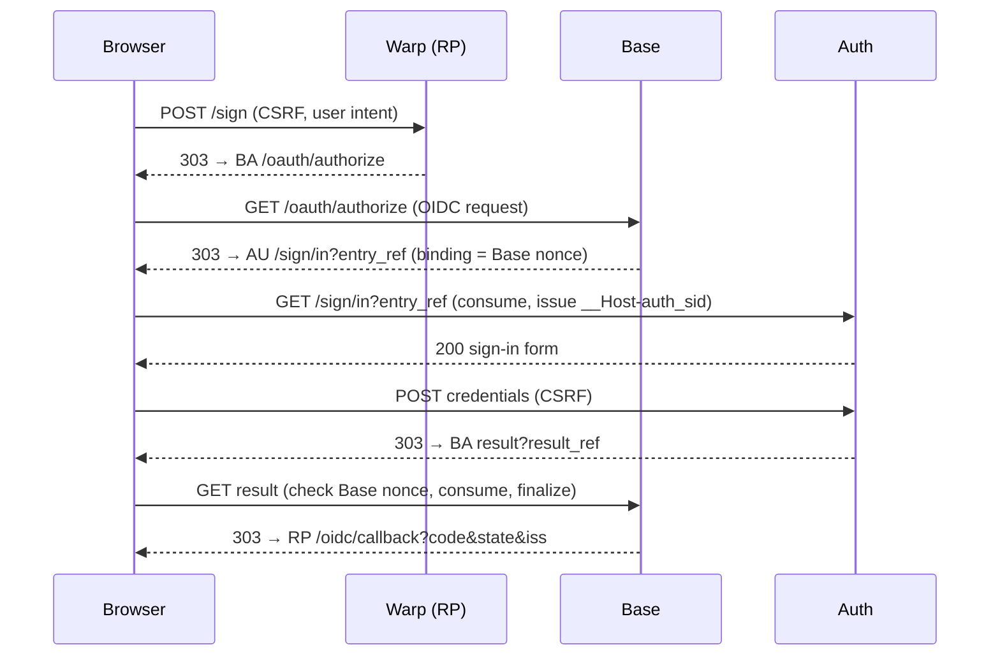

# five.md — Sign-in path Admission protocol: re-evaluation and adversarial review

> Archived 2026-10-27 from the working file `five.md` (cycle archive 0002; frozen, not maintained).

> Status 2026-10-22: Design D is **not approved**. §9 Q2–Q5 were answered (one.md D-49 … D-52); Q1 is one.md X-1, still open. Later decisions D-73 … D-83 refine refusal and deadline rules. See `one.md` "Resume here".

Working document (gitignored). Investigation and design review only: no application code, schema
or migration was changed. Requested by the owner on 2026-10-21 (prompt "匿名認証Admissionプロトコルの
再評価・敵対的セキュリティレビュー", hypotheses C-1 … C-3 from a ChatGPT review). Scope: **Sign-in path
only** (anonymous Guest sign-in / sign-up, `Warp → Base → Auth → Base → Warp`); Re-verification path (Step-Up,
reauthentication, credential registration/change, bootstrap tickets) is out of scope (`one.md` D-44).

- Worktree: `feature`, HEAD `febec3225cc9a0cfa53b9cbe817d20d366aba5a2`, dirty (not ours).
- Primary sources read this session: RFC 9110 §9.2.1–9.2.2; RFC 9700 §2.1.1, §4.2.4, §4.3.1, §4.5.1,
  §4.7.1; RFC 9126 §4, §7.1, §7.5; RFC 6749 §4.1.2/§10.5 (single-use code); OAuth 2.0 Form Post
  Response Mode 1.0 (Final, 2015-04-27); draft-ietf-oauth-v2-1-16 (2026-09-03, WG draft).
- **Not verified against primary text**: SAML 2.0 Bindings §3.6 (the OASIS PDF could not be extracted
  in this environment). SAML statements below are from prior knowledge and are labelled.
- Code/ADR facts are source readings, not executed tests.

## 1. Executive summary

**Do not adopt the previous proposal as written.** Its conclusion (redirect-driven relays with no
Continue page) remains achievable, but three of its justifications are wrong or unproven, exactly as
C-1 … C-3 suspected:

1. "Artifact binding justifies consuming on GET" — false. Neither SAML nor OAuth turns GET into a
   safe place for state change; RFC 9110 §9.2.1 puts the burden on the resource owner (§3, C-1).
2. "The reference has no authority" — false. Today's `entry_ref` is a **bearer occupancy
   capability**: a thief inside its TTL cannot take the session over, but **can lock the victim out**
   by attaching an Auth ceremony first (§4, F-2).
3. "A PKCE-equivalent server-side secret" — adds no protection when Base and Auth share one process and
   database. The property PKCE actually supplies is **transaction-specific binding to the user agent
   that started the transaction** (RFC 9700 §2.1.1); UMAXICA already has that property through the
   Base browser digest and the Auth ceremony cookie (§4, F-3).

Recommendation (§9): **Design D — a redirect-driven continuation protocol** that keeps today's
stores, digests, CAS consumption and **both** browser bindings (including the Auth→Base→Auth binding
confirmation, made automatic instead of removed), restricts GET to *continuing* a flow that a
user's CSRF-protected POST started, makes replays from the bound browser return the same
continuation (RFC 9126 §4 tolerance), and records the RFC 9110 §9.2.1 deviation explicitly with its
compensating conditions. It is a UMAXICA protocol that borrows named properties from OAuth/PAR; it
does not claim conformance to any of them.

## 2. Established facts

### 2.1 Standards

| Source | Fact relevant here |
|---|---|
| RFC 9110 §9.2.1 | GET is safe: "the client does not request, and does not expect, any state change". A server *may* have side effects, but "the client … cannot be held accountable". When URI parameters select an action and the action is unsafe, "the resource owner MUST disable or disallow that action when it is accessed using a safe request method", because automated processes (link maintenance, prefetch, indexing) GET every URI. |
| RFC 9110 §9.2.2 | GET is idempotent; clients may automatically retry it after a connection failure. |
| RFC 6749 §4.1.2, §10.5 | The authorization code travels to the redirection endpoint in the URL (GET); it MUST be short-lived and single-use; a second use MUST be denied. |
| RFC 9700 §2.1.1 | Code injection must be prevented; PKCE (or nonce) "MUST be transaction-specific and securely bound to the client and the user agent in which the transaction was started." |
| RFC 9700 §4.5.1 | Code injection: the attacker replays a stolen code inside **their own** session; the defense binds the code to the session that started the transaction. |
| RFC 9700 §4.7.1 | CSRF on the redirection endpoint is prevented by `state` bound to the user-agent session; PKCE/nonce give the same protection. |
| RFC 9700 §4.2.4, §4.3.1 | Leakage via Referer and history: `Referrer-Policy: no-referrer`; single-use codes; binding to PKCE; history mitigation includes form post. |
| RFC 9126 §4 | `request_uri` SHOULD be one-time use but **MAY allow duplicate requests due to the user reloading/refreshing**; expired values MUST be rejected. |
| RFC 9126 §7.1, §7.5 | `request_uri` must not be guessable; swapping is mitigated by PKCE, `state` or `nonce`. |
| Form Post Response Mode 1.0 (Final) | Response parameters are auto-submitted as an HTML form POST to the redirect URI; "any technique supported by the User Agent MAY be used" — JavaScript `onload` only in the non-normative example; no JS-off behavior defined; the response MUST NOT be stored or reused. |
| OAuth 2.1 draft -16 | Still an Internet-Draft; PKCE mandatory (S256), exact redirect URI matching, 307 forbidden; redirect-based (GET) code delivery remains the default. |
| SAML 2.0 Bindings §3.6 (**unverified**) | Artifact delivered by HTTP Redirect or HTML form POST; artifact contains a random message handle; issuer enforces one-time use and a short lifetime; **resolution is a back-channel request whose requester is authenticated** — the artifact's safety rests on that requester authentication, not on the HTTP method of delivery. |

### 2.2 Current implementation (source reading)

| Property | Observed | Location |
|---|---|---|
| Opaque code entropy | 32 random bytes | `Valkey::AuthState::OpaqueAdmissionStore::CODE_BYTES` |
| Storage of raw value | only SHA-256 digests are keys; raw codes never persist | same class comment |
| TTL | 60 s (acceptance) | `CODE_TTL`; binding `expires_at` capped by it in `create_or_reuse_binding!` |
| Single use / atomicity | Lua script: `issued → consumed` CAS; returns `missing` / `replay` / `binding_mismatch` | `CONSUME_SCRIPT` |
| Burn resistance | expected binding fields are compared **before** consumption; a mismatch consumes nothing | `CONSUME_SCRIPT` |
| Purpose / surface binding | `PURPOSES` (Sign-in path: `local_sign_in`, `local_sign_up`, `authentication_handoff`, `authentication_result`, `local_sign_in_result`, `cancellation_handoff`, …); `surface`, `subject_ref`, `ceremony_session_ref` fields | same |
| Reference in the browser | `entry_ref` (UUID v4, ~122 bits) in the URL; the code itself is never in the URL (ADR 2026-09-21) | `BaseAuthAdmissionCoordinator.create_or_reuse_binding!`, `consume_entry_reference!` |
| Base-side browser binding | `base_browser_digest = digest(surface, entry_ref, nonce)`; the nonce lives in the Base Rails session (host-only cookie, `SameSite=Lax`) | `BaseAdmissionBrowserBinding` |
| Auth-side browser binding | `__Host-auth_sid` ceremony cookie (`SameSite=Lax`), rotated on admission | `AuthCeremonySidCookie`, `AuthCeremonySession.rotate_and_admit!` |
| Binding confirmation | Auth attaches its ceremony session → Base checks its own nonce (`confirm_base!`) → Auth redeems only if its cookie matches the attached session | `Auth::App::CeremonyBindingsController`, `BaseCeremonyBindingConfirmation`, `AuthCeremonyAdmission#redeem_admission_reference_and_redirect!` |
| Attach is first-come | `attach_auth_session!` refuses a different session once attached | `AuthAdmissionBinding#attach_auth_session!` |
| Result receipt | Base validates the Base browser binding, Valkey result generation, PostgreSQL row lock, idempotent `base_finalized_at` | `OidcAuthorizationResultPost`, ADR 2026-09-20 amendment |
| Transport | every hop is a GET page + CSRF POST + 303 (the Continue pages) | views `auth/shared/admission_continuation`, `base/shared/ceremony_binding_confirmation`, `auth/shared/oidc_authorization_handoff`, `base/shared/result_continuation` |
| Systems A and B share one mechanism | split only by `purpose` / parent (`TICKET_CEREMONY_PURPOSES`) | `BaseAuthAdmissionCoordinator`, `AuthCeremonyAdmission#admit_confirmed_binding!` |

ADR vs code: ADR 2026-09-21 ("GET non-consuming; POST consumes") and 2026-09-20 ("result POST-only")
match the code. The dev log shows Cancel/Switch failing with 422 null Origin on the POST from a page
served with `Referrer-Policy: no-referrer` after a cross-site Jump redirect (`one.md` F1).

## 3. Threat model

- **Assets**: the right to start a ceremony for a given parent; the Auth ceremony session; the
  authentication result; the Base Root Session; the user's control of their own browser flow.
- **Principals**: the legitimate browser; Base (`www.<realm>`); Auth (`auth.<realm>`); RPs on sibling
  subdomains of the same registrable domain; external RPs on other sites.
- **Trust boundaries**: browser ↔ each host (TLS, host-only cookies); Base ↔ Auth are **not**
  cryptographically separated — one Puma, one credentials set, shared PostgreSQL/Valkey (D-15,
  D-19, D-20). Their separation is code discipline; a code-execution compromise of either is a
  compromise of both.
- **Attacker capabilities considered**: A1 web attacker (own site, links, iframes, images, forms,
  top-level navigations); A1′ control of a sibling subdomain of the same site (cookie tossing,
  same-site navigations); A3-like reader of leaked URLs (history, access logs, Referer, shoulder
  surfing, link-preview services); a second browser controlled by the attacker; racing requests;
  automated agents (prefetchers, scanners). Out of scope: server compromise, TLS break, malware on
  the victim's device.

## 4. Adversarial findings (by severity)

| ID | Severity | Finding | Attack condition | Impact | Defense / residual |
|---|---|---|---|---|---|
| F-1 | High | **C-1 holds.** No standard makes GET a safe place to consume a one-time value or create a session. RFC 9110 §9.2.1 requires the owner to disallow unsafe actions on GET when URI parameters select them. OAuth's redirection endpoint is a de-facto exception justified by `state`/PKCE binding, not by the method. | Any automated or attacker-induced GET of a continuation URL | Unintended consumption, ceremony start, cancellation or session issuance | GET may only *continue*: the unsafe effect must be impossible unless per-browser host-only cookie state minted by an earlier user POST is present and matches; otherwise a no-op refusal. Record as an explicit, scoped deviation. Residual: the deviation itself |
| F-2 | High | **C-2 holds.** `entry_ref` is a bearer occupancy capability. A thief within the 60 s acceptance window can open Auth and attach **their** ceremony session first; `attach_auth_session!` then refuses the victim. Takeover fails at Base confirmation (the thief lacks the victim's Base nonce). | URL leak + action within 60 s | Denial of service of the victim's sign-in attempt | Short TTL; references not rendered; `no-referrer`; residual DoS remains. Mitigation candidates: refuse attach unless Fetch Metadata shows a top-level navigation; allow the **Base-confirmed** browser to supersede an unconfirmed foreign attach (needs a design decision) |
| F-3 | Medium | **C-3 holds.** A Base-held "verifier" adds nothing in a shared process/DB: whoever can read the result row can read the verifier. RFC 9700 §2.1.1 asks for binding to the user agent that started the transaction; UMAXICA implements that with the Base browser digest (Base session nonce) checked at confirmation and at result receipt, plus the Auth ceremony cookie. | — | Over-engineering; misleading security claims | Drop the "PKCE-equivalent secret"; name the property "per-transaction user-agent binding on both hosts" |
| F-4 | Medium | Removing the binding-confirmation round trip (previous proposal) would discard a real property: before credentials are entered, both hosts know the same browser holds the flow. Without it, an attacker can push a victim into an attacker-started Auth ceremony; the final Base check still refuses the result, but the victim has already authenticated inside the attacker's ceremony | Victim follows an attacker's Auth URL | Confusion, credential entry into a foreign flow, DoS; no account takeover | **Keep** the confirmation, but drive it by redirects |
| F-5 | Medium | Back button, reload and automatic GET retries (RFC 9110 §9.2.2) hit an already consumed reference and today end in a reason-less 400 (`one.md` F2) | Normal use | Dead ends | For the bound browser, a `replay` outcome returns the **same** continuation (RFC 9126 §4 allows reload duplicates); for any other browser, refusal. `OpaqueAdmissionStore` already returns the payload on `replay` |
| F-6 | Medium | `SameSite=Lax` does not separate sibling subdomains (same site). A sibling-subdomain attacker can trigger top-level navigations to Base/Auth that carry the victim's host-only cookies | A1′ | Forced continuation of the victim's **own** flow is possible only with the victim's reference; forcing the attacker's reference fails binding | Host-only cookies (no `Domain=`); bindings compare the reference with the cookie; Fetch Metadata `Sec-Fetch-Mode: navigate` + `Sec-Fetch-Dest: document`. Note: a Jump hop through `jump.umaxica.net` makes `Sec-Fetch-Site` cross-site, so `Sec-Fetch-Site` cannot be pinned to same-site on hops that follow Jump |
| F-7 | Medium | Result trust (§2 of the prompt, 3.3): Base cannot cryptographically know that "Auth" wrote a result — the same process wrote it. Trust rests on state-machine discipline | A code defect that writes a result outside the ceremony state machine | Session issuance without evidence | Base accepts a result only if: issued from a ceremony admitted to **this** binding and parent; ceremony has recorded evidence (method + event time); result generation current; not expired; single consumption under the parent row lock; Base browser binding matches; selected Identity == authenticated Identity (ADR-PK); idempotent finalization. Most exist today (ADR 2026-09-20 amendment, ADR R3); they must stay on the redesigned path |
| F-8 | Low | Reference leakage through access logs (CloudFront), history and Referer | A3 reader | Bounded by single use, TTL and binding; DoS per F-2 | `no-referrer`, `no-store`; clean URL after consumption (Auth already redirects to a clean `/sign/in`) |
| F-9 | Low | Form Post across origins (design C) cannot use the receiver's Rails CSRF token and produces a cross-origin `Origin`; behavior with JavaScript disabled is undefined by the spec | Design C only | Needs an origin-check exception and still a visible button for no-JS | See §7 |
| F-10 | Info | Systems A and B share one coordinator/binding table (`TICKET_CEREMONY_PURPOSES`) | — | Changes for A can regress B | D-44 separation; A's redesign must not alter B's paths |

## 5. Protocol comparison

| Candidate | Usable for Sign-in path? | What it contributes | Limits here |
|---|---|---|---|
| SAML 2.0 HTTP-Artifact Binding (unverified) | Pattern only | Front-channel artifact, back-channel resolution, one-time use, requester authentication | XML/SOAP unsuitable; requester authentication degenerates in one process; does not justify GET |
| OAuth 2.0 Authorization Code (RFC 6749) | Pattern only | Short-lived single-use code via redirect; precedent for consuming on the redirection endpoint | It is authorization; Sign-in path has no subject or grant (D-44) |
| PKCE (RFC 7636) | Property only | Binding of the code to the transaction's originator | In a shared process the useful part is user-agent binding, which exists already |
| PAR (RFC 9126) | Pattern only | Request body server-side, browser carries a reference; reload duplicates tolerated | Needs a client→AS back channel; here Base writes the shared store directly |
| Form Post Response Mode (Final) | Possible transport | POST body instead of URL; standard-sanctioned scripting | Cross-origin POST (CSRF/Origin exception), no-JS undefined |
| RFC 9700 | Requirements | Single use, binding, Referer/history mitigations, CSRF | — |
| Current UMAXICA | Base for the redesign | 256-bit codes, digest storage, CAS, burn resistance, dual-host binding, result generation/locks | Click per hop; F1, F2, F5 |

## 6. Alternative designs

### Design A — artifact via redirect GET (previous proposal, corrected)

Front channel carries `entry_ref` / `result_ref`; every hop is a GET that consumes after binding
checks; the binding-confirmation round trip is **removed**.



Rejected as written: F-4 (drops the pre-credential dual binding) and F-1 (unscoped GET consumption).

### Design B — Authorization Code + PKCE structure

Adds a Base-held verifier and an Auth-held challenge to Design A. In a shared process this is
equivalent to Design A plus a redundant secret (F-3). Not recommended as a separate design.

### Design C — POST front channel (Form Post style)

Each hop renders an auto-submitting form whose `action` is the next host; JavaScript `onload`
submits it; a `<noscript>` button remains.

```mermaid
sequenceDiagram
  participant B as Browser
  participant BA as Base
  participant AU as Auth
  BA-->>B: 200 form action=AU (auto-submit)
  B->>AU: POST entry_ref (cross-origin; Origin = Base)
  AU-->>B: 200 form action=BA (auto-submit)
  B->>BA: POST confirmation (cross-origin; Origin = Auth)
```

Security equals the current design if the receiver checks an exact allowed origin and the bindings;
costs: Rails CSRF cannot be used across origins (exception needed), JavaScript is load-bearing, no-JS
users still see buttons (the owner rejected that), more pages to render and test. Avoids the RFC
9110 deviation.

### Design D (recommended) — redirect-driven continuation protocol

Every **user action** remains a CSRF-protected POST (RP "続行", Auth credential submission,
Cancel, Switch). Every **system hop** after such a POST is a 303 + GET *continuation endpoint* that:
(1) requires `Sec-Fetch-Mode: navigate` and `Sec-Fetch-Dest: document` and refuses HEAD;
(2) verifies the host-only cookie binding of that host **before** touching the one-time record;
(3) consumes atomically (existing CAS); (4) on `replay` from the **same bound browser** returns the
same next redirect, otherwise refuses without consuming; (5) sends `Cache-Control: no-store` and
`Referrer-Policy: no-referrer`; (6) ends on a clean URL. The binding confirmation round trip stays.

```mermaid
sequenceDiagram
  participant B as Browser
  participant RP as Warp (RP)
  participant BA as Base
  participant AU as Auth
  B->>RP: POST /sign (CSRF) — user intent
  RP-->>B: 303 → BA /oauth/authorize?client_id…&state&code_challenge
  B->>BA: GET /oauth/authorize (standard OIDC; create transaction + binding, Base nonce)
  BA-->>B: 303 (via Jump) → AU continuation?entry_ref
  B->>AU: GET continuation (navigate/document; attach __Host-auth_sid)
  AU-->>B: 303 → BA confirmation?binding_ref
  B->>BA: GET confirmation (Base nonce must match; confirm)
  BA-->>B: 303 → AU continuation?entry_ref
  B->>AU: GET continuation (auth_sid must match attached; CAS consume; rotate sid)
  AU-->>B: 303 → AU /sign/in (clean URL)
  B->>AU: POST credentials (CSRF) — user action
  AU-->>B: 303 → BA result?result_ref
  B->>BA: GET result (Base nonce + generation + evidence + lock; finalize once)
  BA-->>B: 303 → RP /oidc/callback?code&state&iss
  B->>RP: GET /oidc/callback (standard: state, iss, PKCE at token endpoint)
```

State transitions (binding): `issued → attached (Auth sid) → confirmed (Base nonce) → redeemed`;
terminal `retired` / `expired`; result: `issued → consumed` with generation check; replays by the
bound browser re-emit the stored next step.

Cancel and Switch follow the same pattern: user POST at Auth → 303 → Base GET `/oidc/cancellation`
or `/oidc/switch` continuation (D-38) → 303 to the RP (`access_denied`) or back to Auth.

## 7. Security comparison by attack

| Attack | A | B | C | D |
|---|---|---|---|---|
| Login CSRF / session swap (attacker's flow in victim browser) | Refused at result (Base nonce) | Same | Refused (origin + bindings) | Refused at confirmation **and** result |
| Victim pushed into attacker's Auth ceremony before credentials | **Possible** (F-4) | Possible | Refused at confirmation | Refused at confirmation |
| Stolen `entry_ref` takeover | Refused at result | Refused | Refused | Refused at confirmation |
| Stolen `entry_ref` DoS | Possible | Possible | Possible | Possible (residual F-2) |
| iframe / image / script triggered request | Lax cookies absent cross-site; same-site needs Fetch Metadata | Same | Forms need top-level; origin check | Refused by Fetch Metadata before consumption |
| Prefetch / scanner / link preview | Must carry victim cookies; refused | Same | Not applicable (POST) | Refused (Fetch Metadata, binding first) |
| Back / reload / auto-retry | 400 dead end unless replay design | Same | Resubmit prompt / POST replay | Same continuation for bound browser |
| Referer / history / log leakage | Bounded by single use + binding | Same | Smaller exposure (body) | Bounded; clean URL |
| Concurrent double consumption | CAS | CAS | CAS | CAS + idempotent finalize |
| Wrong admission ↔ result | Generation + parent checks | Same | Same | Same |
| JS disabled | Works | Works | Buttons | Works |
| Basis of safety | Implementation | Implementation | Spec (transport) + implementation | Implementation, with OAuth/PAR precedents; RFC 9110 deviation recorded |

## 8. Recommendation

Adopt **Design D** as the Sign-in path protocol, described in an ADR as "a UMAXICA continuation protocol
that borrows: single-use short-lived references (RFC 6749 §10.5, RFC 9126 §4), per-transaction
user-agent binding (RFC 9700 §2.1.1), reload tolerance for the bound browser (RFC 9126 §4),
Referer/history controls (RFC 9700 §4.2.4/§4.3.1), and the redirection-endpoint precedent for
consuming on GET, with an explicit deviation from RFC 9110 §9.2.1 bounded by the six continuation
conditions". Reasons: it keeps every existing protection (including the pre-credential dual binding
that Design A drops), removes the clicks and JavaScript dependence the owner rejected, removes the F1
null-Origin failure class (no cross-origin form POST), and its safety argument is short enough to
test exhaustively.

## 9. Open questions (before deciding)

1. Does the owner accept the RFC 9110 §9.2.1 deviation for continuation endpoints, including the
   final Base result GET that creates the Root Session?
2. ~~F-2~~ — **decided as `one.md` D-51**: residual DoS accepted; "no takeover" is checklist item
   AUTH-19, re-verified whenever the relay components change.
3. ~~Fetch Metadata after Jump~~ — **decided as `one.md` D-52**: cross-surface navigation always uses
   Jump (Base ↔ Auth included); relay GETs do not check `Sec-Fetch-Site`.
4. ~~Replay semantics~~ — **decided provisionally as `one.md` D-49** (same bound browser, ≤ 10 s,
   relay hops only; the Root Session hop always errors; revisit after implementation).
5. ~~Clients without Fetch Metadata~~ — **decided as `one.md` D-50** (`allow_browser :modern` +
   refuse relay GETs lacking `Sec-Fetch-Mode: navigate` / `Sec-Fetch-Dest: document`).
6. Exact list of Sign-in path purposes once Re-verification path is separated (D-44).

## 10. Migration implications (if Design D is adopted)

- Keep: `OpaqueAdmissionStore`, digests, CAS, binding state machine, result generation and locks,
  `__Host-auth_sid`, Base nonce.
- Replace: Continue pages `auth/shared/admission_continuation`, `base/shared/ceremony_binding_confirmation`,
  `auth/shared/oidc_authorization_handoff`, `base/shared/result_continuation`,
  `base/shared/authorization_ceremony_start`, `base/shared/authorization_exit_continuation` and their
  POST actions with GET continuation endpoints; `create` actions become `show` on the continuation
  resources (routing policy: nouns, no route-level `path:`).
- ADR amendments: 2026-09-21 (GET non-consuming), 2026-09-20 (result POST-only), AUTH-1/AUTH-2,
  `generic/authentication-boundaries.mdc` (GET must not create ceremony state); new ADR for the
  continuation protocol and the RFC 9110 deviation.
- Separate Sign-in path purposes from Re-verification path in `BaseAuthAdmissionCoordinator` /
  `AuthCeremonyAdmission` without changing B's behavior (D-44).
- Tests (Red first): foreign browser cannot consume or burn; iframe/image/prefetch/HEAD refused
  without consumption; reload by the bound browser yields the same continuation; concurrent hops
  consume once; result requires evidence, matching binding, generation, deadline; Cancel/Switch via
  continuation; no Continue page rendered on the happy path (request-count assertions in integration
  tests; browser E2E excluded per D-16).
